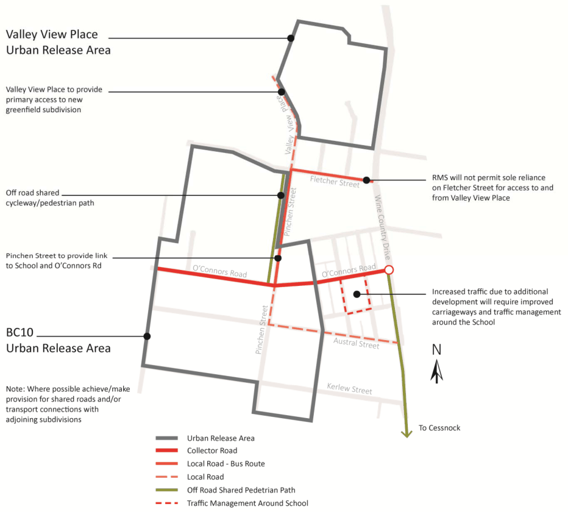

#### 13.1.7 Transport

Figure 4 shows the Transport Concept Plan for the Urban Release Areas including the surrounding suburb.

Objectives

(a) Residents have access to safe convenient public transport, vehicular, pedestrian and bicycle networks;

(b) Vehicular, cyclist and pedestrian connectivity within and between the Urban Release Areas, other parts of Nulkaba and to other parts of Cessnock is maximised;

(c) Low vehicle speeds are encouraged throughout Nulkaba;

(d) The impact of development in the Urban Release Areas on the efficient functioning of Wine Country Drive from development is minimised, and

(e) Conditions of development consent, arrangements with Roads and Maritime Services, and a Section 94 Plan support the resourcing of new transport infrastructure required as a result of development.

Requirements

Note: This section includes items that are funded through Section 94 contributions and provides a holistic perspective of transport requirements.

(i) Consent will not be granted for the subdivision of land unless a Transport Management Plan has been lodged to the satisfaction of the consent authority. The Transport Management Plan should address such matters as:

a.  Traffic volumes;

b. Triggers for the provision of infrastructure and upgrades;

c. An assessment of the impact of the development on the road system internal and external to the site and urban release area;

d. Pedestrian and cyclist networks;

e. Identification of road upgrades, and

f. Intersection upgrades and the cumulative impact of development on the road network. (Note: the nature and scope of the Transport Management Plan will vary depending on the scale of the proposed subdivision).

(ii) The road, cycle and pedestrian movement network is to be generally consistent with the concept plan shown in Figure 4.

(iii) Traffic calming and other safety measures are to be implemented in the streets surrounding Nulkaba School because of the increased traffic resulting from new residential development.

(iv) Subdivision road networks should have no dead ends unless unavoidable. The use of low speed “share ways” to connect cul de sac heads and the like is acceptable.

(v) Road, intersection, cycleway and pedestrian networks upgrades throughout the area will be necessary due to increased transport development demand resulting from new development. These will be provided by a combination of

conditions of development consent and Section 94 contributions as relevant to a specific development.

(vi) The first development within the BC10 precinct, west of Pinchen Street and south of O’Connors Road is required to construct the unformed section of Austral Road between Pinchen Street and Occident Street.

(vii) Upgrades to Austral Street between Pinchen Street and Occident Street are to be undertaken in association with development occurring adjacent to this section of Austral Street.  Upgrades are to be proportionate to the proposed development.

#### Figure 4: Transport Concept Plan

> [Picture on page 11: a picture, saved as a picture (images/part-e15-nulkaba-urban-release-areas-bc10-page-11-11.gif, 150 dpi).]
