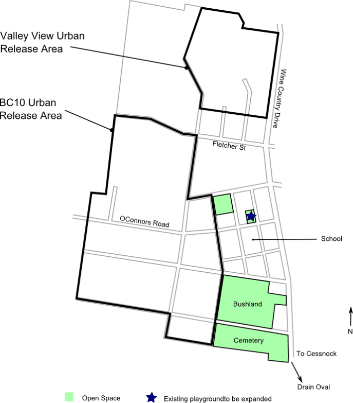

#### 13.1.8 Landscaping, Vegetation, Streetscape and Open Space Areas

Objectives

(a) Open space caters for a variety of recreational, aesthetic and environmental use;

(b) Open space is easily maintained;

(c) Open space provides informal and formal settings;

(d) Landscaping responds to the natural topography and rural setting of the land;

(e) Existing native vegetation is to be retained and enhanced where possible, and

(f) The use of existing open space and recreational facilities is maximised.

Requirements

(i) It is proposed to rely on the existing public open space areas rather than create additional open space areas, as shown in Figure 5. The Section 94 Contributions Plan makes provision for the augmentation of the existing playground in Nulkaba and for the augmentation of facilities at Drain Oval to meet the increased demand arising from new development at Nulkaba.

(ii) Consent for the subdivision of land requires a Landscape Plan to be lodged to the satisfaction of the consent authority. The Landscape Plan can be in the form of a concept plan at the Development Application stage and a detailed plan at the Construction Certificate stage (this should be confirmed with the consent authority prior to lodgement of a Development Application for subdivision).

(iii) Such Landscape Plans should include:

a. Details of the proposed landscaping of the public domain, such as tree planting;

b. A schedule of the species and the planting locations;

c. Technical details of the planting and initial maintenance regime;

d. An assessment of ongoing maintenance requirements;

e. Landscape treatments, including any paving and street furniture;

f. The location of existing trees, highlighting those with hollows and those that it is proposed to remove, and

g. Details of the restoration of any riparian areas.

(iv) Landscaping should be consistent with the rural nature of the area, with a focus on retaining and enhancing natural trees/woodland wherever possible.

(v) Street trees are to be planted to:

a. Soften the streetscape

b. Act as traffic calming measures through perceived narrowing the road

c. Provide shade to footpaths and roads

d. Enhance views.

(vi) Natural watercourses are to be protected and revegetated where appropriate to enhance the visual amenity, prevent soil erosion, and to protect the quality of receiving waters with a treatment commensurate with their role in the water management system. Riparian vegetation along watercourses is to be re-

established using locally occurring native species from locally sourced seed stock and in accordance with in accordance with Office of Water guidelines.

(vii) A vegetated riparian zone corridor along the watercourse designated in Figure 7 is to be provided to enhance visual amenity, prevent soil erosion, and to protect the quality of receiving waters commensurate with its role in the water management system. This should be done to an extent not less than that required by the Department of Primary Industries Office of Water in the publication “Guidelines for Riparian Corridors on Waterfront Land”, unless otherwise justified to the satisfaction of the consent authority and agreed by the NSW Office of Water.

(viii) Riparian vegetation along watercourses is to be re-established using locally occurring native species from locally sourced seed stock.

(ix) Clearing of native vegetation shall only occur within an approved development footprint to accommodate the proposed development and any required Asset Protection Zones (bushfire).

#### Figure 5: Open Space concept

> [Picture on page 13: a picture, saved as a picture (images/part-e15-nulkaba-urban-release-areas-bc10-page-13-17.gif, 150 dpi).]
