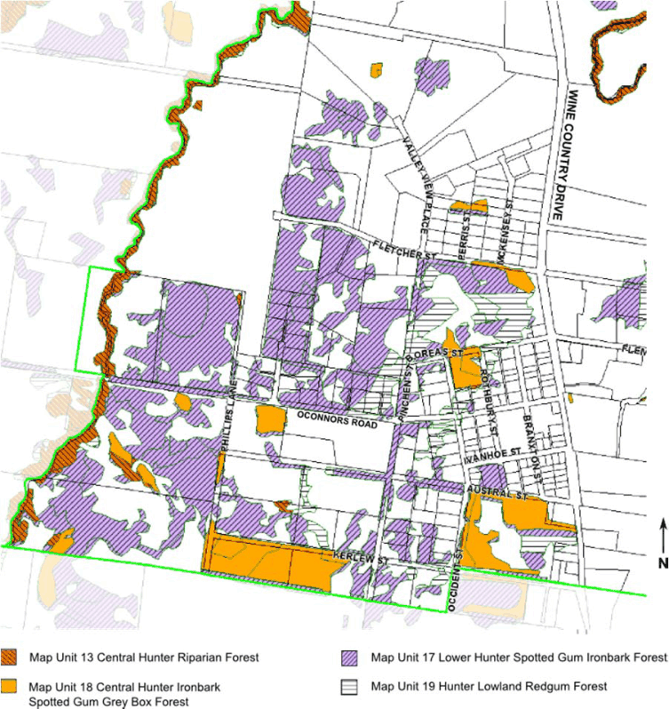

#### 13.1.9 Biodiversity

Notes: The presence of Endangered Ecological Communities (EEC) has been identified in studies of Nulkaba, as shown in Figure 6. EECs are protected by legislation, such as the Threatened Species Conservation Act 1995 and the Threatened Species Conservation Regulation 2010 and other policies. In addition, the Native Vegetation Act 2003 has requirements in relation to the clearing and removal of native vegetation. This Act applies to land zoned R5 large lot residential but not land zoned RU5 Village. Objective Areas of biodiversity significance, including riparian areas are managed to conserve their biodiversity values.

Requirements

(i) Where required by legislation, threatened species assessments are to be undertaken at the subdivision or building DA stage, whichever occurs first, to assess the impact of the development and any proposal to clear native vegetation including old growth trees and any trees with hollows. Flora/fauna assessment(s) and Species Impact Statements shall be prepared in accordance with requirements specified in Chapter C.2 Flora and Fauna Survey Guidelines in the Cessnock Development Control Plan 2010. It is recommended that a Council statutory planner be consulted if further information is required.

(ii) Consent will not be granted for the subdivision of land containing an EEC unless a Vegetation Management Plan has been lodged to the satisfaction of the consent authority.

(iii) The Vegetation Management Plan is to include:

a. Details of the location of significant vegetation, including trees with hollows.

b. The location of building footprints relative to significant vegetation.

c. Details of the clearing of native vegetation relative to the proposed development footprint to accommodate the proposed development and any required Asset Protection Zones (bushfire).

d. Details of the proposed rehabilitation of significant vegetation.

e. Details of the proposed ongoing vegetation management regime in the context of the proposed subdivision, which may include such measures as Section 88B instruments to designate building footprints.

(iv) Where possible within the scope of design and safety issues, hollow-bearing trees should be retained. Where hollow bearing trees are required to be removed, this should be undertaken in the presence of a suitably qualified ecologist equipped with the appropriate tools and experience in fauna recovery. Hollow loss may be able to be partially offset with installation of suitable nest boxes in retained areas.

(v) Landscaping of the site should enhance retained vegetation where possible. Any future landscaping should aim to utilise locally occurring flowering/fruiting native shrubs that would provide potential foraging resources for threatened species and other native species.

(vi) Where clearing of the filling of farm dams is proposed, development consent must be obtained prior to works and supported by a flora/fauna assessment(s).

#### Figure 6: Location of Ecologically Endangered Species (2003)

> [Picture on page 15: a picture, saved as a picture (images/part-e15-nulkaba-urban-release-areas-bc10-page-15-2.gif, 150 dpi).]
