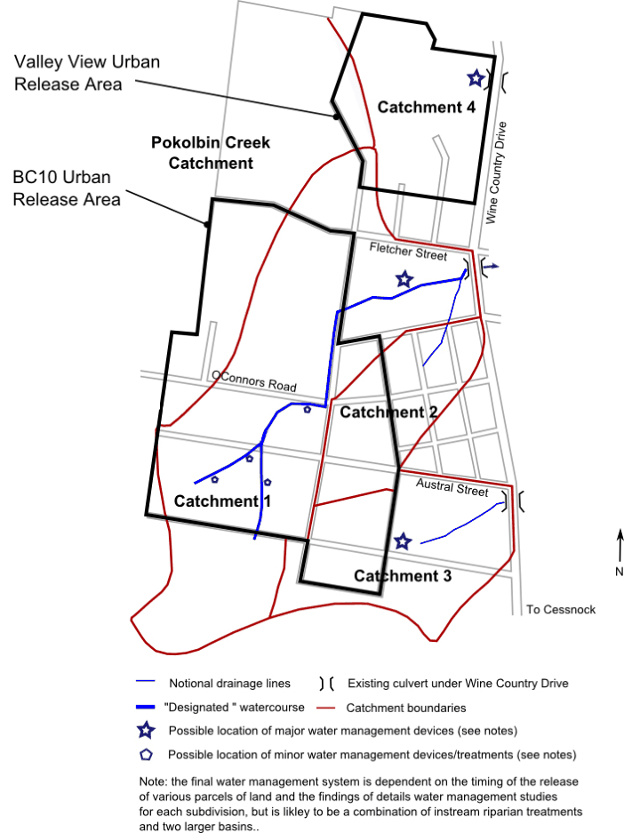

#### 13.1.10 Water Management

Nulkaba contains several catchments, a number of which experience flooding.

Objectives

a) The water balance of the BC10 and Valley View Place Urban Release Areasis to be as close as practical to natural conditions;

b) Water management should seek to provide an effective treatment train in the context of minimising Council’s long term maintenance requirements. The treatment train should consider source controls, water quality, water volume, salinity management, on and off site detention, instream treatment measures and the implications for receiving areas;

c) Runoff flow rates from low intensity, common rainfall is equivalent to the runoff flow rates from a natural catchment;

d) Runoff generated by more intense rainfall causes no downstream property damage or risk to public safety;

e) To mimic the existing flow regime as near as possible, and

f) Easements are to be negotiated between adjoining landowners if required.

Requirements

(i) A Water Management (stormwater) Strategy is to be lodged to the satisfaction of the consent authority prior to consent being granted, Figure 7 illustrates selected hydrological features of the Nulkaba area.

(ii) Water management strategies should aim to achieve a:

a. Reduction of erosion;

b. Reduction of flow velocity;

c. Reduction of runoff volume through at source controls and water quality treatment, and

d. Maximum practical infiltration (note: the nature of the soils at Nulkaba may limit infiltration).

(iii) The Water Management Strategy shall include, but is not limited to, the management of upstream and downstream impacts on water quality and quantity (having regard to all contributing catchments and downstream water bodies, the 1% AEP Black Creek Flood Level and the 1% AEP storm event). These measures may be provided at a subdivision level, allotment level, or a combination. The Water Management Strategy should clearly outline the requirements for any allotment controls that will be required in any development application, including individual buildings.

(iv) Development of land inconsistent with the Water Management Strategy can occur if the proposed measures are justified by a supporting study, to the satisfaction of the consent authority.  The supporting study must be lodged prior to or with the relevant development application.

(v) The supporting study is to include (but is not limited to):

a. Hydrological and flood analysis of the proposed strategy;

b. Impact on the overall Water Management Strategy;

c. Impact on other future urban development within Nulkaba;

d. Cost impact on Council (recurrent) and other future urban development (capital);

e. Impact on upstream and downstream land and buildings, and

f. Environmental impact.

(vi) The Water Management Strategy for the watercourses is to be designed to appear as a natural stable stream in a riparian corridor. Existing major natural drainage lines and watercourses are to be retained wherever possible, and preferably rehabilitated through comprehensive re-planting with indigenous plant species, rather than being piped and filled.

(vii) Subject to the role of the watercourse within the water management system and Council’s approval, subdivision proposals which affect the “designated” watercourses shown in

(viii) Figure 7 shall either:

a. Include a ‘restriction as to user’ over the watercourse and buffer zones under section 88 Conveyancing Act 1919. The restriction shall prohibit the construction of any building or structure, which would affect the flow of the watercourse, including any standard fencing, or

b. Be transferred to Council at the subdivision certificate stage as a drainage easement, with a maintenance period.

(ix) The design of stormwater management systems is to be undertaken in accordance with Cessnock City Council’s engineering requirements for development, unless otherwise varied by the content of this DCP.

(x) The quality of runoff should be in accordance with ARQ guidelines and Council Engineering Standards.

(xi) Development should not result in more run off than what existed prior to development for the 10 year ARI to 100 year ARI, and the quantity of runoff flow rates of each stage of development is to be equivalent to the pre development state.  Council will assist in determining what is defined as a stage for the purposes of this clause.

(xii) Design storms and flow rates shall be determined using the procedure in the current version of Australian Rainfall and Runoff.

(xiii) An underground piped drainage system is to be constructed within the road alignments to provide sufficient depth for lots to drain and shall be designed to convey the flow rate from the design 10 year Average Recurrence Interval (ARI) event.

(xiv) The combination of the pipe drainage network and water within the road reserve is to convey the 100 year ARI event.  The depth velocity product of surface water for the 100 year ARI event within the road reserve is to be less than 0.4m2/s unless special safety features are provided.

(xv) Cross drainage (culverts and bridges) is to be designed to convey the design critical 100 year ARI storm event.  The design of subdivision earthworks levels shall consider the potential increase in flood water as a result of the cross drainage structures, including an appropriate allowance for blockage. Concessions may be granted for larger culvert diameters, open span bridges or where additional features (i.e. trash racks) are installed to reduce the likelihood and magnitude of blockage.

(xvi) Additional piped drainage features (e.g. inter-allotment drainage lines) are permissible for areas other than roads within the development, where required and appropriate.

(xvii) Alternative methods and criteria for design of stormwater systems (for example, continuous simulation using rainfall data) may be proposed and considered on merit.

(xviii) Easements may need to be created in circumstances where water management infrastructure, such as detention basins, is located on land not included in that development. Easements are to be negotiated between adjoining landowners as required prior to the approval of the construction certificate of the development.

(xix) Any drainage easements and reserves within the site shall be constructed and dedicated to Council (at no cost) at the subdivision stage or prior to occupation.

(xx) Minimum floor level of any habitable space in a residential dwelling must be to comply with Council’s Flood Standard for the locality

#### Figure 7: Conceptual Water Management Strategy

> [Picture on page 18: a picture, saved as a picture (images/part-e15-nulkaba-urban-release-areas-bc10-page-18-2.gif, 150 dpi).]
