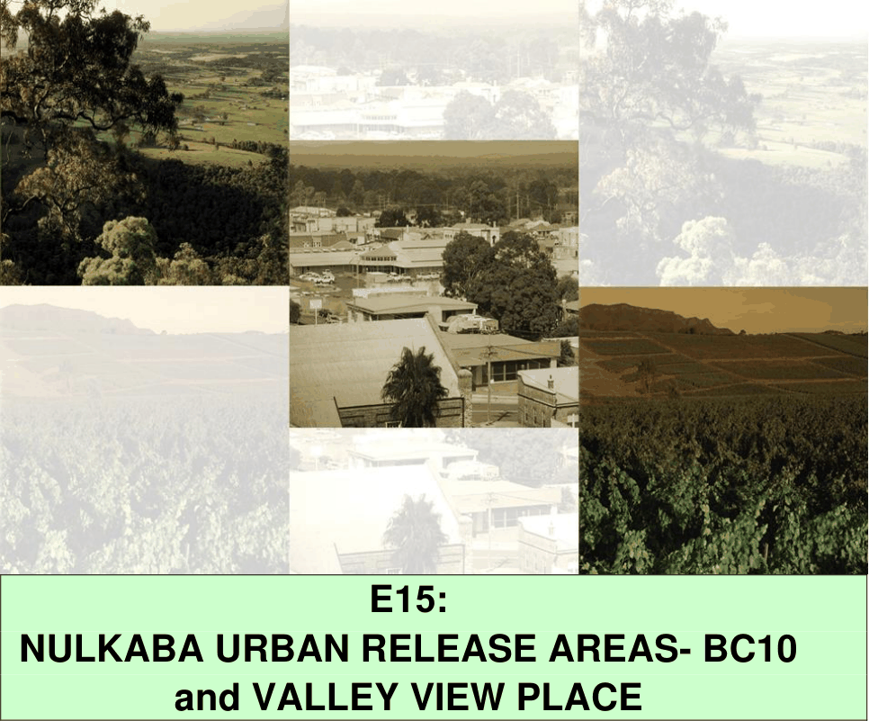

# Cessnock Development Control Plan 2010 - Part E15 Nulkaba Urban Release Areas- Bc10

> This chapter is split into 12 section file(s), one per numbered heading, in the order they appear in the PDF.

Source PDF: [E15 - Nulkaba.pdf](E15%20-%20Nulkaba.pdf)

### CESSNOCK

### DEVELOPMENT CONTROL PLAN 2010

### PART E

### SPECIFIC AREAS

> [Picture on page 1: a picture, saved as a picture (images/part-e15-nulkaba-urban-release-areas-bc10-page-1-5.gif, 150 dpi).]

### E15:

### NULKABA URBAN RELEASE AREAS- BC10

### and VALLEY VIEW PLACE

#### TABLE OF CONTENTS

#### E.12: NULKABA URBAN RELEASE AREAS – BC10 and VALLEY VIEW PLACE

| OVERVIEW ................................................................................................................................ 3 |  |
|---|---|
| 13.1.1 | Objectives: ........................................................................................................ 4 |
| 13.1.2 | Application ........................................................................................................ 4 |
| 13.1.3 | Purpose of the Plan .......................................................................................... 4 |
| 13.1.4 | Relationship to other Plans and Chapters of the Development Control Plan ... 4 |
| 13.1.5 | Structure Plan ................................................................................................... 5 |
| 13.1.6 | Staging and Servicing Strategy ......................................................................... 9 |
| 13.1.7 | Transport......................................................................................................... 10 |
| 13.1.8 | Landscaping, Vegetation, Streetscape and Open Space Areas ..................... 12 |
| 13.1.9 | Biodiversity ...................................................................................................... 14 |
| 13.1.10 | Water Management ........................................................................................ 15 |
| 13.1.11 | Built Form ........................................................................................................ 18 |
| 13.1.12 | Road Noise and Vibration ............................................................................... 19 |

### Figures

Figure 1: Boundary of BC10 and Valley View Urban Release Areas ............................. 5 Figure 2: Nulkaba Structure Plan .................................................................................... 8 Figure 3: BC10 Potential subdivision concept ................................................................ 8 Figure 4: Transport Concept Plan ................................................................................. 11 Figure 5: Open Space concept ..................................................................................... 13 Figure 6: Location of Ecologically Endangered Species (2003) ................................... 15 Figure 7: Conceptual Water Management Strategy ..................................................... 18

### Overview

This Chapter provides guidelines for the development of certain land in the suburb of Nulkaba. The land comprises two Urban Release Areas under the Cessnock Local Environmental Plan 2011 - namely the BC10 and Valley View Place Urban Release Areas as shown in Figure 1.

Nulkaba is located on the western side of Wine Country Drive 1 km north of the urban fringe of the Cessnock urban area and 2.5 km from the Cessnock City Centre. It is separated from Cessnock by flood prone land (a tributary of Black Creek), rural land, the Calvary Retirement Community, and Cessnock Corrective Centre. To the east lies rural land and Black Creek. To the west and north is rural land largely occupied by vineyards. Further to the north is the Cessnock airport.

Nulkaba is generally zoned RU5 Rural Village and R5 Large Lot Residential, with a number of smaller areas of land zoned RU2 Rural Landscape and E2 Environmental Conservation, under the Cessnock Local Environment Plan 2011.

The Urban Release Area lands have been identified as extensions to the village of Nulkaba to provide additional serviced land for village and large lot residential development.

Nulkaba contains a mixture of lots ranging from less than 700 sq. metres to around 8

ha. Ausgrid have a large holding of around 12 ha which contains a substation but is otherwise underdeveloped woodland. There is a local primary school and two parks.

The main drainage line through Nulkaba runs in a northerly direction parallel to Pinchen Street, and flows under Wine Country Drive south of Valley View Place (but does not drain Valley View). Valley View Place is within a small catchment that drains towards Wine Country Drive and hence into Black Creek. The western areas of Nulkaba drain westwards into Pokolbin Creek.

The landownership within the Urban Release Areas is generally fragmented in a number of ownerships. A co-ordinated approach to the development of the land is important to the sound and efficient development of the land. The provision of new and upgraded public amenities, services and infrastructure is important to ensure that they meet contemporary standards and the increased demand arising from the new development.

<!-- sections -->
## Sections

1. [13.1.1 Objectives:](01-13-1-1-objectives.md)
2. [13.1.2 Application](02-13-1-2-application.md)
3. [13.1.3 Purpose of the Plan](03-13-1-3-purpose-of-the-plan.md)
4. [13.1.4 Relationship to other Plans and Chapters of the Development Control](04-13-1-4-relationship-to-other-plans-and-chapters.md)
5. [13.1.5 Structure Plan](05-13-1-5-structure-plan.md)
6. [13.1.6 Staging and Servicing Strategy](06-13-1-6-staging-and-servicing-strategy.md)
7. [13.1.7 Transport](07-13-1-7-transport.md)
8. [13.1.8 Landscaping, Vegetation, Streetscape and Open Space Areas](08-13-1-8-landscaping-vegetation-streetscape-and.md)
9. [13.1.9 Biodiversity](09-13-1-9-biodiversity.md)
10. [13.1.10 Water Management](10-13-1-10-water-management.md)
11. [13.1.11 Built Form](11-13-1-11-built-form.md)
12. [13.1.12 Road Noise and Vibration](12-13-1-12-road-noise-and-vibration.md)
