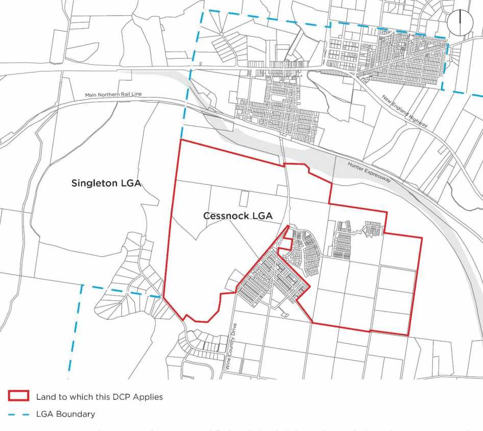

## 1 Introduction

### 1.1 Application

This chapter of the DCP applies to land in the Cessnock Local Government Area at the Huntlee New Town Site (‘Huntlee’) as shown at Figure 1.

> [Picture on page 11: a picture, saved as a picture (images/part-e17-huntlee-page-11-5.gif, 150 dpi).]

#### Figure 1:  Land application map

### 1.2 Purpose of this DCP chapter

The purpose of this DCP chapter is to:

• communicate the planning, design and environmental objectives and controls against which Council will assess development applications;

• consolidate and simplify the planning controls for Huntlee;

• ensure the orderly, efficient and environmentally sensitive development of Huntlee; and

• promote high quality urban design outcomes within the context of environmental, social and economic sustainability.

### 1.3 Relationship to other chapters of this DCP

This DCP chapter should be read in conjunction with the Cessnock Local Environmental Plan 2011 and other relevant State environmental planning policies. This section forms part of Part E – Specific Areas of the Cessnock Development Control Plan 2010 (Cessnock DCP 2010). It sets out specific controls to guide the future development of Huntlee. Development within the precinct will need to have regards to this section of the DCP, in addition, to the provisions from the following sections of Cessnock DCP 2010:

• Community Participation Plan

• Part C.9 Development on Flood Prone Land

• Part D.8 Temporary Events

In the event of any inconsistency between this section and other sections of the Cessnock DCP 2010, this section will prevail to the extent of the inconsistency.

### 1.4 Structure of this DCP chapter

This DCP is structured as follows:

Section 1 Introduction

Sets out the administrative provisions of the DCP.
