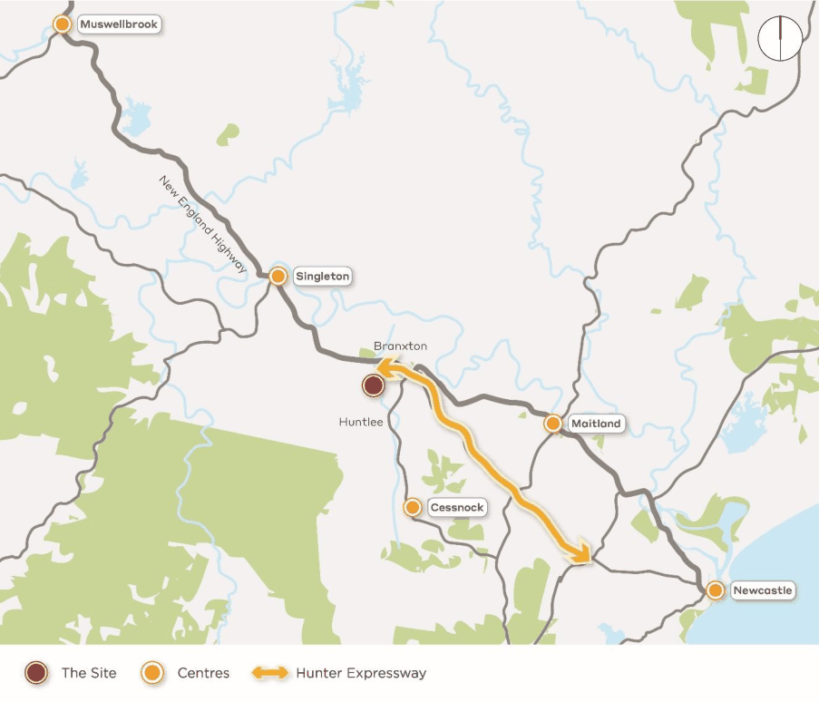
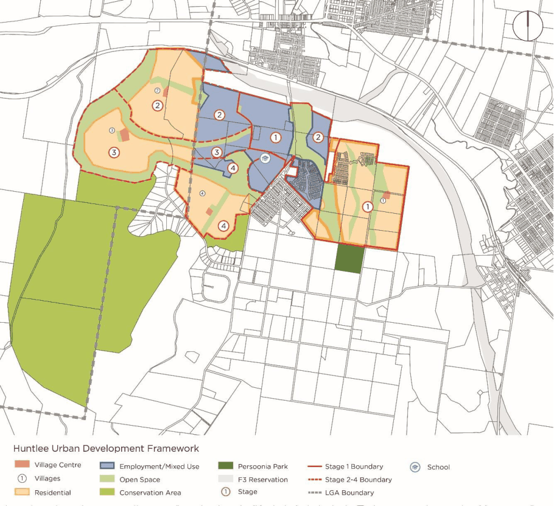

## 2 Vision and Character

### 2.1 Regional context

The Hunter Regional Plan 2036 recognises the regional significance of the Huntlee site, identified as a centre of local significance and an area for future housing and urban renewal opportunities.  Huntlee will contribute 7,300 dwellings and 200 hectares of employment land to the region, which is capable of generating over 3,000 jobs.

Huntlee is located 20km north of Cessnock and 25km southeast of Singleton.  It straddles Wine Country Drive, which links Cessnock with the New England Highway at Branxton.  The site is generally bounded by the Main North Railway and Hunter Expressway to the north and east, the existing North Rothbury village to the south and the Black Creek floodplain to the west. The Huntlee location plan is shown in Figure 2.

> [Picture on page 14: a picture, saved as a picture (images/part-e17-huntlee-page-14-1.gif, 150 dpi).]

#### Figure 2:  Huntlee location plan

### 2.2 Vision and development objectives

The vision for Huntlee is to create a new Hunter Valley town that retains the character of the place. The new town will comprise a town centre, residential precincts, open spaces, recreation areas and supporting employment lands. It should reflect its natural attributes and rich Aboriginal and European past. It should establish an active and memorable urban core, surrounded by well-connected neighbourhoods, each with an identifiable centre that is within easy and safe walking and cycling distance from the houses in that neighbourhood. Huntlee will have a high quality public domain of connected streets, parks, and recreational open space links.

The natural attributes of the site include an undulating topography affording panoramic views, extensive areas of vegetation including dedicated conservation areas. The man-made heritage of the site includes pre-European remnants as well as the memory of the site’s significant industrial past – an important part of the Hunter’s development as an industrial mining centre in New South Wales. While parts of the site’s topography have been significantly altered by mining activity, these areas offer the opportunity to create interesting places.

The Huntlee Town Centre is to create an exciting township in the Hunter Valley combining community, commercial, local shopping and educational facilities that is well connected to open space, Branxton and public transport, including the rail station.  Supporting this will be a series of residential neighbourhoods each connected to the Town Centre via the road network. Each neighbourhood will be distinctive in character, being located within a different landscape within the larger site. Some neighbourhoods will be on ridge tops, others along watercourses and areas of vegetation.

The Huntlee Town Centre comprises a mixed use area of approximately 200 hectares catering for a range of uses including retail, service industries, bulky goods, commercial, entertainment, residential, educational and community including open space. The Town Centre will ultimately serve the residents of Huntlee and surrounding areas.

The Town Centre will be laid out with defined centres and edges. Within the Town Centre, streets will be laid out as a permeable network that promotes movement between key destinations. Community oriented buildings and uses shall be distributed throughout the Town Centre.

Village centres will provide for low level retail and community facilities and complement the Town Centre. The village centres will be approximately 5 hectares in area and contain uses including neighbourhood retail premises, community facilities, a primary school and a village centre park.  There will be four village centres in the overall Huntlee development.

The key development objectives for Huntlee are:

• To facilitate urban development that meets environmental sustainability objectives.

• To promote housing diversity by providing a range of lot and housing types.

• To create walkable neighbourhoods, with good access to public transport.

• To maximise opportunities for local employment and business.

• To create vibrant, successful town and neighbourhood centres.

• To provide social infrastructure that is flexible and adaptable.

• To maximise opportunities for future residents to access and to enjoy the outdoors.

• To protect and enhance riparian corridors, significant trees and vegetation.

### 2.3 Design principles

The Indicative Layout Plan proposes four residential villages connected to each other and the town centre by a network of open space, pedestrian and cycleways, local roads and bus routes.

The Indicative Layout Plan is underpinned by a number of key design principles that relate principally to the creation of the public domain.  These include:

• Adopting a Main street approach to the Town Centre to create an active centre.

• Creating a well-connected street pattern that responds to the site’s topography.

• Streets that generally terminate on an open space.

• Creating streets in residential villages with generous green verges with street trees and footpaths where required.

• A series of linked open space areas, generally along riparian corridors and ridgetops, that preserve ridges, hilltops and significant areas of vegetation, and heritage.

• Persoonia pauciflora should be retained including and where possible incorporated into public open space areas.

• Open spaces generally surrounded by public streets.

• Neighbourhoods where residents can easily walk or cycle to the town centre, neighbourhood core, local shops, open space and schools.

• Provide a mixture of lot and housing options to create diversity in the built form and accommodation choice.

• Rehabilitation of former mine working areas and infrastructure.

• Low density residential area adjacent to the existing township of North Rothbury and the rural-residential development known as Hanwood Estates.

• Large residential lots adjacent to the outer rural boundary of the development area.

• Smaller residential lots and medium density residential development in the vicinity of the town and village centres, open spaces and recreation areas.

• Service industry and/or bulky goods retailing uses adjacent to the Hunter Expressway and railway line.

• Promoting connection to broader transport networks such as rail and high-speed arterial road infrastructure.

### 2.4 Indicative Layout Plan and Staging

An Indicative Layout and Staging Plan is contained in Figure 3 and illustrates the broad level development outcomes for the Huntlee New Town. It outlines the development footprint, land uses, open space, major transport linkages and location of neighbourhood villages that

will contain community facilities and schools as well as when each area is expected to be developed in order to ensure an efficient roll out of infrastructure.

#### Objectives

(1) To ensure development of the precinct is undertaken in a co-ordinated manner generally consistent with the Indicative Layout and Staging Plan.

#### Controls

(1) Development Applications for subdivision and infrastructure are to be generally in accordance with the Indicative Layout and Staging Plan in Figure 3.

(2) When assessing development applications, Council will consider the extent to which the proposed development is consistent with the Indicative Layout and Staging Plan.

(3) Any proposed variations to the general arrangement of the Indicative Layout and Staging Plan must be demonstrated by the applicant, to Council’s satisfaction, to be consistent with the Design Principles in Section 2.3.

(4) Any proposed variation to the order of staging of development in the Indicative Layout and Staging Plan must be justified, to Council’s satisfaction.

(5) The overall residential yield of land subject to this DCP must not exceed 7,300 dwellings.

> [Picture on page 18: a picture, saved as a picture (images/part-e17-huntlee-page-18-1.gif, 150 dpi).]

#### Figure 3: Indicative Layout and Staging Plan
