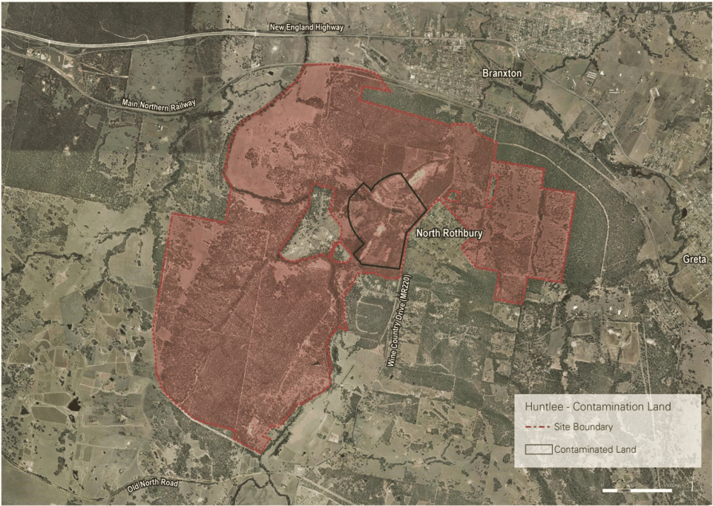

## 3 Managing the Environment

This section outlines the objectives and development controls relating to general environmental management of issues that apply across the entire site including conservation areas, integrated stormwater management, Aboriginal and European heritage, bushfire hazard management, tree and bushland protection, contamination, earthworks, soils and salinity, waste, riparian corridors and acoustics.

### 3.1 Riparian corridors

#### Objectives

(1) To protect, restore and enhance the environmental values and functions of water courses and riparian corridors as shown in Appendix 1.

(2) To ensure that the development has a neutral or beneficial impact on the quality and quantity of water and water courses.

(3) To allow for some limited use of riparian corridor buffers for low impact recreation activities such as walking and cycling.

(4) To maintain a stable naturally functioning watercourse that supports a viable naturally occurring local aquatic community.

(5) To provide, restore, rehabilitate and maintain the riparian corridor with the local provenance vegetation community.

(6) To provide a continuous riparian corridor that links to established stands of remnant vegetation and provides extensive habitat and connectivity for naturally occurring terrestrial fauna.

(7) To ensure vegetation in the core riparian zone (CRZ) is at a density that would occur naturally for the riparian ecotone.

(8) To minimise the number of road crossings to maintain riparian connectivity.

#### Controls

(1) Riparian corridors are to be provided generally in accordance with Section 3 Hydrology of Appendix 1 and designed in accordance with the controls below and generally comply with the ‘Guidelines for Riparian Corridors on Waterfront land’ (DPI-Office of Water, 2012).

(2) The vegetated riparian zone (VRZ) setbacks should generally comply with the ‘Guidelines for Riparian Corridors on Waterfront land’ (DPI-Office of Water, 2012).

(3) Infrastructure services, stormwater infrastructure, water quality treatment ponds, flood compatible activities (i.e. playing fields), pedestrian paths and cycleways, and asset protection zones are to be located outside of the VRZ unless otherwise allowed for in the aforementioned guidelines.

(4) The location of access ways to and within a riparian buffer is not to compromise the ecological integrity of any existing riparian vegetation, the streambed or bank stability.

(5) The impact of pedestrian paths and cycleways, general access points to riparian corridors and road crossings is to be minimised by using ecologically informed design principles (for example, elevated accessways that allow sunlight to penetrate and vegetation to grow beneath).

(6) The impact of salinity on the landscape and watercourses shall be managed.

(7) All VRZs are to be rehabilitated and revegetated with appropriate native vegetation having regard to its drainage function and vegetation management for bushfire protection.

(8) Where wetlands are proposed, a management strategy outlining ownership, ongoing management, annual maintenance costs and initial development costs shall be prepared.

### 3.2 Flooding and water cycle management

#### Objectives

(1) To minimise the potential impact of flooding on development.

(2) To incorporate best practice stormwater management principles and strategies in development proposals.

(3) To mitigate the impacts of urban development on stormwater quality.

(4) To control the impacts of urban development on channel bed and bank erosion by controlling the magnitude and duration of sediment-transporting flows.

(5) Limit changes in flow rate and flow duration within the receiving waterway as a result of development.

#### Controls

(1) The 100 year ARI (Average Recurrence Interval) flood extents are shown on Figure 43 and 44 in Appendix 1 – Site Characteristics.

(2) All habitable rooms shall have floor levels of a minimum of 500mm above the 1% Annual Exceedance Probability (AEP).

(3) Management of ‘minor’ flows using piped systems for the 5 year ARI (residential land use) and 10 year ARI (commercial land use) shall be in accordance with Council’s engineering requirements. Management measures shall be designed to:

• prevent damage by stormwater to the built and natural environment,

• reduce nuisance flows to a level which is acceptable to the community,

• provide a stormwater system which can be economically maintained and which uses open space in a compatible manner,

• control flooding and enable access to lots, stabilise the land form and control erosion,

• minimise urban water run-off pollutants to watercourses, and

• meet the standards for a 20% AEP flood.

(4) Management of ‘major’ flows using dedicated overland flow paths such as open space areas, roads and riparian corridors for all flows in excess of the pipe drainage system capacity and above the 5 year ARI shall be in accordance with Council’s engineering requirements. Management measures shall be designed to:

• prevent both short term and long term inundation of habitable dwellings,

• manage flooding to create lots above the designated flood level with flood free access to a public road located above the 1% AEP flood, • stabilise the land form and control erosion, and

• meet the standards for a 1% AEP flood.

(5) Where practically possible, development shall attenuate up to the 2 year ARI peak flow for discharges into the local tributaries, particularly 2nd Order and 3rd Order Streams. This will be achieved using detention storage within water quality features and detention basins.

(6) The developed 100 year ARI peak flow is to be reduced to the pre-development flows through the incorporation of stormwater detention and management devices.

(7) All development is to incorporate Water Sensitive Urban Design (WSUD). WSUD is to be adopted throughout the development to promote sustainable and integrated management of land and water resources incorporating best practice stormwater management, water conservation and environmental protection.

(8) A Water Sensitive Urban Design (WSUD) Strategy is to be submitted as part of any subdivision DA and shall include:

• an identification of water management and other relevant objectives (relating, for example, to salinity hazard, mosquito risk);

• an identification and assessment of relevant site characteristics and constraints;

• an identification of potentially feasible (storm) water management strategies, which may comprise stormwater reuse options, best planning practices, stormwater treatment measures (in both public and private domain) and indicative maintenance requirements;

• an assessment of the potential strategies, including the nature, basis and outcomes of stormwater modelling used to assess alternative solutions. This assessment of alternative strategies should address compliance with management objectives, life cycle costs, ongoing operations and maintenance requirements, land take requirements, expected reliability, likely level of community acceptance and future management responsibilities; and

• a suitably detailed description of the preferred WSUD strategy and elements therein, in the form of documents, plans and conceptual diagrams (as appropriate).

(9) The WSUD Strategy shall demonstrate how the stormwater quality targets set in Table 3 will be achieved.

(10) Compliance with the targets at Table 2 is to be determined through stormwater quality (MUSIC) modelling.

#### Table 1: Water quality objectives

|  | Percentage reduction in pollutant loads |  |  |
|---|---|---|---|
|  | Total suspended solids | Total phosphorus | Total nitrogen |
| Objective | 85% | 45% | 45% |

(11) The WSUD strategy is to take into account riparian zone and creek management and include the following measures:

• the ephemeral hydrology of creeks is to be maintained or restored, where possible, by diverting excess flow via intercepting stormwater pipes to downstream storages for reuse,

• flow attenuation and/or diversion via the intercepting stormwater pipes will be required to meet the stream erosion index objectives within the ‘Water Sensitive Urban Design – Book 2 – Planning and Management’ guidelines produced by Landcom (2009)

• flow in excess of the 5 year ARI peak flow may flow into the creek and be conveyed to detention basins that form part of the major drainage system, and

• erosion control and bank stabilisation measures shall be incorporated within the waterway where required.

### 3.3 Biodiversity

#### Objectives

(1) To improve or maintain biodiversity values through habitat conservation, wildlife corridors and habitat linkages through the siting and design of open space networks and riparian corridors.

(2) To reduce impacts of runoff from roads and impervious areas on adjacent lands.

(3) To manage weeds on the site during and after construction, to prevent the spread of weeds.

(4) To manage environmental protection zones, passive open space and riparian corridors to reduce erosion, feral animals and loss of essential habitat features such as understorey and tree hollows.

(5) To ensure consideration of groundwater dependent ecosystems in land use planning.

(6) To protect regionally significant vegetation and habitat of threatened species, communities and populations, where possible.

(7) To ensure that the urban / conservation area interface and management regime for conservation areas (including access through development precincts, recreational infrastructure etc.) are appropriately addressed.

#### Controls

(1) Riparian buffers are to be established through future applications for subdivision and infrastructure works in accordance with the Water Management Act and guidelines.

(2) Existing significant trees, in particular large hollow bearing trees, are to be retained wherever practicable within public and community parks, streetscapes and riparian corridors.

(3) Existing Persoonia pauciflora plants are to be conserved in situ with a 30m curtilage of existing native vegetation and incorporated into public open space networks and riparian corridors and not within private property.

(4) Native vegetation (canopy level) shall be provided, where appropriate for biodiversity outcomes, within pocket parks, riparian corridors and street verges to create a ‘stepping-stone corridor’ for terrestrial bio-diversity.

(5) Where development is located within or close to a known biodiversity corridor, fencing shall be sympathetic to that passage of native fauna.

(6) Ensure provision and maintenance of wildlife corridors and connectivity with adjoining Office for Environment and Heritage (OEH) managed conservation land (such as Persoonia Park and the proposed addition to the National Park).

(7) Development that adjoins conservation land managed by the OEH should address the relevant requirements within the ‘Guidelines for developments adjoining land

and water managed by Department of Environment, Climate Change and Water’ (DECCW 2010).

### 3.4 Salinity and soil management

#### Objectives

(1) To ensure development will not significantly increase the salt load in existing watercourses within the site.

(2) To ensure measures are implemented as part of the development to prevent any degradation of the existing soil and groundwater environment.

(3) To minimise the damage caused to property and vegetation by existing saline soils, or processes that may create saline soils.

(4) To minimise erosion and sediment loss during and after construction.

(5) To minimise water pollution due to erosion siltation and sedimentation.

#### Controls

(1) All development must incorporate soil conservation measures to minimise soil erosion, siltation and salinity impacts during construction and following completion of development. Soil and Water Management Plans, prepared in accordance with Managing Urban Stormwater - Soils and Construction (NSW Department of Housing 3rd Edition March 2004 ('The Blue Book')) are to be submitted prior to construction.

(2) All sediment and erosion controls are to be installed prior to the commencement of any construction works and maintained throughout the course of construction until disturbed areas have been revegetated/ established. The applicant will be required to present certification to this effect, to be lodged with Council prior to construction.

(3) Vegetation cover, including groundcover, should be retained on highly erodible soils to keep them stable and minimise risk of erosion.

(4) Groundwater recharge is to be minimised, and preferably maintained at predevelopment levels, by:

• directing runoff from paved areas (roads, car parks, domestic paving etc) into lined stormwater drains rather than along grassed channels as necessary,

• lining or locating any pondages higher in the landscape to avoid recharge where proximity to the water table is likely to create groundwater mounding,

• encouraging on site detention of roof runoff and use of low water demanding plants, and

• encouraging tree planting especially adjacent to watercourses.

### 3.5 Aboriginal heritage

#### Objectives

(1) To require the further investigation of the Aboriginal archaeological significance of the precinct.

(2) To ensure that any Aboriginal heritage significance is appropriately incorporated into the redevelopment of the precinct.

#### Controls

(1) Development shall not proceed within areas known to contain Aboriginal objects without appropriate investigation and consultation with the relevant local Aboriginal groups. The investigations are to identify, where required, conservation areas for the protection and management of archaeological deposits.

(2) A Plan of Management is to be prepared to address the ongoing protection and management of the archaeological deposits. Any DA for development which affects Aboriginal objects is to be accompanied by an Aboriginal Archaeological Report that is supported by the comments of the local Aboriginal groups.

(3) Where development impacts upon on Aboriginal sites previously not identified, Consent to Destroy Permits will need to be sought under Section 90 of the NSW National Parks & Wildlife Act 1974.

(4) Interpretive signage, that provides information on the history and heritage significance of the sites, is to be provided within the public domain areas. Where possible, such signage should be provided in close proximity to the site of any relics or remains that have been uncovered.

### 3.6 European heritage

#### Objectives

(1) To conserve and interpret the Rothbury Mine and the site of the Rothbury Riot in the context of its historical, technological and social significance.

(2) To ensure that information regarding the archaeological heritage significance of the precinct is incorporated into the development of the precinct.

#### Controls

(1) Prior to any development that affects relics associated with the Rothbury Mine or the site of the Rothbury Riot, a detailed assessment of heritage significance is to be undertaken which addresses the significance assessment criteria contained in the NSW Heritage Manual.

(2) Any proposed development that affects the identified heritage sites must respond to any identified archaeological constraints. If any relics are to be retained in situ,

an applicant is to outline all management measures to ensure ongoing protection of the relics.

### 3.7 Bushfire hazard management

#### Objectives

(1) To prevent loss of life and property due to bushfires, by discouraging the establishment of incompatible uses in bushfire-prone areas.

(2) To encourage sound management of bushfire-prone areas.

#### Controls

(1) Subject to detailed design at DA stage, the location and widths of APZs:

• are to be consistent with the requirements in Planning for Bushfire Protection 2019;

• are to be located wholly within the precinct, and indicated on subdivision plans;

• may incorporate roads and flood prone land;

• are to be located wholly outside of a core riparian zone (CRZ) but may be located within the buffer areas to the CRZs;

• may be used for open space and recreation subject to appropriate fuel management;

• are to be maintained in accordance with the Planning for Bushfire Protection 2019;

• are to be located in the public road reserve where possible and encroach onto no more than 1/3 of the lot length of private lots; and

• are to be generally bounded by a perimeter road that is linked to the public road system at regular intervals in accordance with Planning for Bushfire Protection.

(2) Reticulated water is to meet the standards contained within Planning for Bushfire Protection 2019.  Water supply is to be via a ring main system, engineered to the requirements of Australian Standard 2419.1- 2005 Fire Hydrant Installations.

(3) Vegetation within public and community parks and 1st Order watercourses is to be managed as a ‘fuel reduced area’.

(4) Dwellings adjacent to APZs are to be constructed in accordance with the requirements of Appendix 3 of Planning for Bushfire Protection 2019 and Australian Standard 3959-1999 - Construction of Building in Bushfire Prone Areas.

(5) Temporary APZs, identified through a Section 88B instrument, will be required where development is proposed on allotments next to undeveloped land. Once the adjacent stage of development is undertaken, the temporary APZ will no longer be required and shall cease.

(6) School buildings, and other ‘special fire protection purpose’ developments, fronting areas of bushland shall be setback 35 metres from the boundary or in accordance with Rural Fire Service requirements in Planning for Bushfire Protection guidelines or its equivalent.

### 3.8 Contamination management

#### Objectives

(1) To minimise risk to human health and the environment from the development of potentially contaminated land.

(2) To ensure that potential site contamination issues are adequately addressed at the subdivision stages.

#### Controls

(1) Development Applications for development in areas identified in Figure 4 shall be accompanied by a Stage 2 Detailed Site Investigation.

(2) A Remediation Action Plan (RAP) will be required for areas identified as contaminated land in the Stage 2 Site Investigation.

(3) When redevelopment is proposed on a site where Council suspects that contamination may be present or for applications proposing a change of use to a more sensitive land use (e.g. residential, education, public recreation facility etc), Council may request a Stage 1 Preliminary Site Contamination Investigation.

(4) All investigation, reporting and identified remediation works must be in accordance with the protocols of the NSW EPA’s (now OEH) Guidelines for Consultants Reporting on Contaminated Sites and SEPP 55 – Contaminated Land.

> [Picture on page 29: a picture, saved as a picture (images/part-e17-huntlee-page-29-1.gif, 150 dpi).]

#### Figure 4: Contaminated areas

### 3.9 Mine Subsidence Management

#### Objectives

(1) To minimise risk to property arising from development on land with potential mine subsidence issues.

(2) To ensure that potential mine subsidence issues are adequately addressed at the subdivision stages.

#### Controls

(1) Areas of potential mine subsidence are shown in Section 6 Mine subsidence of Appendix 1 and the following lots are affected (as at March 2013): a. Lot 200 DP828486

b. Lot 240 DP 1105591

c. Lot 2 DP 1211767

d. Lot 1 DP 1211767

e. Lot 231 DP 879198

(2) Prior to any development applications for structures within these lots,  the applicant must undertake and submit further geotechnical assessment to verify the depth of cover to mine workings in the location of the proposed development.

(3) As there are mine workings beneath part of the site (where the coal seams dip steeply and the shallow mined areas have a history of mine subsidence potholes), the following restrictions on residential development should be applied:

• Where there is less than 25m of cover to the mine workings, structures are not permitted unless the risk of mine subsidence is removed.

• Between 25m to 50m depth of cover to mine workings, further geotechnical assessment would be required. Building restrictions would apply and this may limit the type and density of structures.

• Between 50m and 75m of cover to mine workings, residential structures not to exceed two storey brick veneer with a maximum length of 30m.

• Where the depth of cover to mine workings is greater than 75m, there would be no restrictions, provided structures do not exceed two storey brick veneer and the upper storey is limited to length of 30m.

• Shafts and mine entries are to be identified and sealed off as required by the Department of Trade and Investment – Minerals and Energy Division. Structures should not be built over these locations.

(4) Infrastructure, such as main pipelines, transmission cables and telecommunications, should not be located over shallow workings unless the risk of mine subsidence has been eliminated and/or specific design is implemented to prevent damage.

(5) Large, higher density structures within the town centre, should be located away from shallow mined areas unless the risk of subsidence has been removed.

(6) The proponent should prepare a long term management plan to deal with the risks associated with the development of potholes and cracks across the site and consider isolating these areas from development.
