## 4 Subdivision design

### 4.1 Street network and design

#### Objectives

(1) To provide a hierarchy of interconnected streets that gives safe, convenient and clear access.

(2) To ensure that the hierarchy of streets is clearly discernible through variations in carriageway width, on-street parking, street tree planting, and pedestrian amenities.

(3) To provide a legible and permeable movement network for pedestrians and cyclists along streets and paths to points of attraction within and adjoining any development.

(4) To ensure sufficient carriageway and verge widths are provided to allow streets to perform their designated functions within the street network and to accommodate public utilities, drainage systems and the majority of Asset Protection Zones.

(5) To encourage the use of streets by pedestrians and cyclists, and to allow cars, buses and other users to proceed safely without unacceptable inconvenience or delay.

(6) To promote passive surveillance of publicly accessible areas thereby increasing safety.

(7) To provide an appropriate buffer between the rail corridor and sensitive land uses.

#### Controls

(1) The street network is to be provided generally in accordance with Figure 5.

(2) Road and intersection upgrades are to be generally in accordance with Figure 6 and Figure 7.

(3) Streets are to be provided in accordance with the cross-sections at Figure 8: Wine Country Drive to Figure 19: Local Park Edge Streets

(4) “Park Edge” roads (Figure 19: Local Park Edge Streets) should accommodate the majority of the required Asset Protection Zone (APZ) within the road reserve, with APZs encroaching on to no more than 1/3 of the lot length of private lots. Where there is a slope or change in level at the boundary of the development, ‘Park Edge’ roads should also incorporate a battered slope within the road reserve to accommodate the changes in level.

(5) Alternative street designs for local streets and accessways may be permitted on a case by case basis to accommodate local features if they preserve the functional objectives and requirements of the design standards.

(6) Where any variation to the residential street network is proposed, the alternative street network is to be designed to achieve the following principles: • a permeable network that is based on a modified grid system;

• encourage walking and cycling and reduce travel distances;

• maximise connectivity between residential areas and community facilities, open space and centres;

• take account of topography and accommodate significant vegetation;

• optimise solar access opportunities for dwellings;

• provide frontage to and maximise surveillance of open space and riparian corridors;

• provide views and vistas to landscape features and visual connections to nodal points and centres;

• maximise the use of water sensitive urban design measures; and

• minimise the number of road crossings of riparian corridors and ensure riparian connectivity is maintained.

(7) Except where otherwise provided for in this DCP, all streets and intersections are to be designed and constructed in accordance with Austroads Guide to Traffic Management and Australian Standards AS 1742, 1743 and 2890.

(8) For road works within areas identified as a salinity hazard, the following must occur as a minimum:

• roads should be perpendicular to the contours as much as possible;

• minimum disturbance of subsoil;

• engineering designs incorporating considerations of salinity impacts are required; and

• subsoil drainage is to be installed along both sides of all roads.

(9) Street trees are generally required for all streets. Street tree planting is to:

• be consistently used to distinguish between public and private spaces and between different classes of street within the street hierarchy;

• minimise risk to utilities and services;

• be durable and suited to the street environment and, wherever appropriate, include endemic species;

• maintain adequate lines of sight for vehicles and pedestrians, especially around driveways and street corners;

• provide appropriate shade; and

• provide an attractive and interesting landscape character and clearly define public and private areas, without blocking the potential for street surveillance.

(10) Signage and lighting is to be:

• designed to reinforce the distinct identity of the development;

• coordinated in design and style;

• located so as to minimise visual clutter and obstruction of the public domain; and

• of a colour and construction agreed by Council.

(11) Locating entry signage and the like within a public road reserve is subject to Council’s agreement.

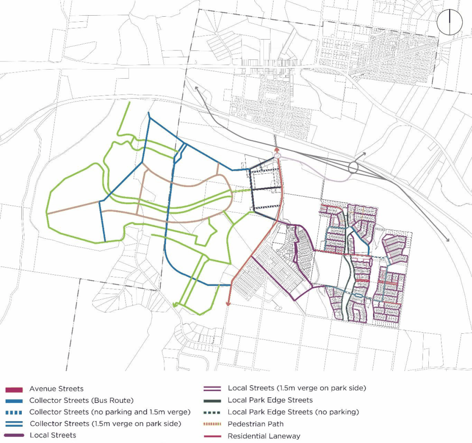

> [Picture on page 33: a picture, saved as a picture (images/part-e17-huntlee-page-33-1.gif, 150 dpi).]

#### Figure 5: Overall road network and hierarchy

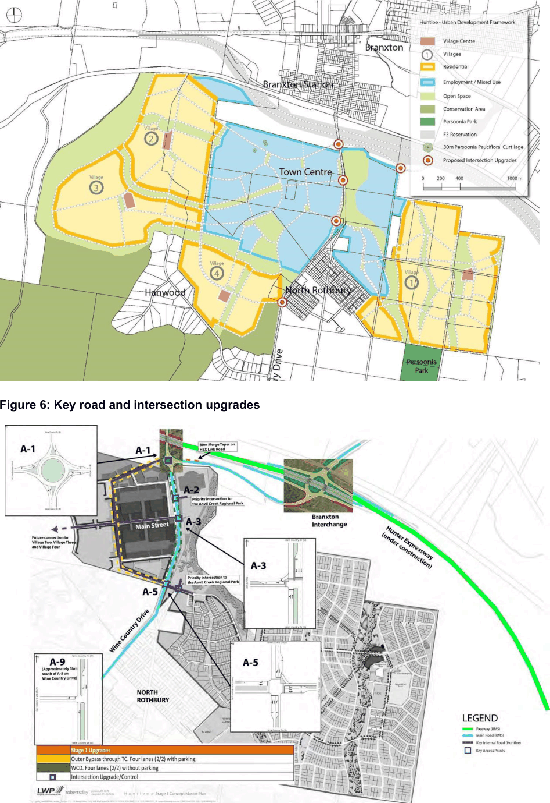

> [Picture on page 34: a picture, saved as a picture (images/part-e17-huntlee-page-34-1.gif, 150 dpi).]

#### Figure 6: Key road and intersection upgrades

#### Figure 7: Detail of road and intersection upgrades

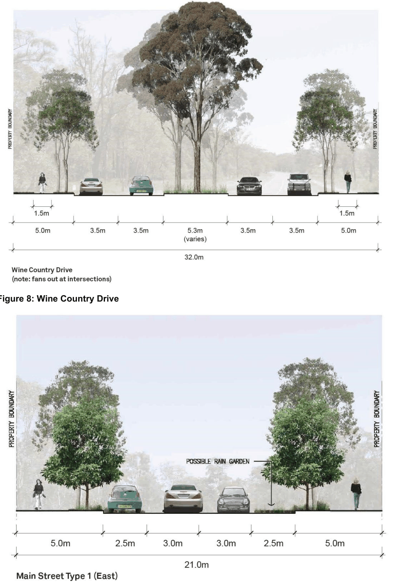

> [Picture on page 35: a picture, saved as a picture (images/part-e17-huntlee-page-35-1.gif, 150 dpi).]

#### Figure 8: Wine Country Drive

#### Figure 9: Main Street Type 1 (East)

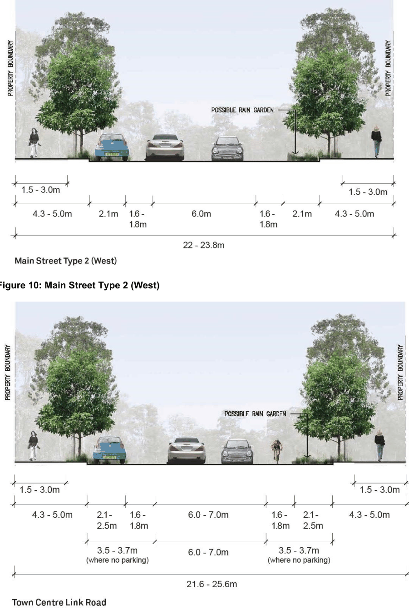

> [Picture on page 36: a picture, saved as a picture (images/part-e17-huntlee-page-36-1.gif, 150 dpi).]

#### Figure 10: Main Street Type 2 (West)

#### Figure 11: Town Centre Link Road

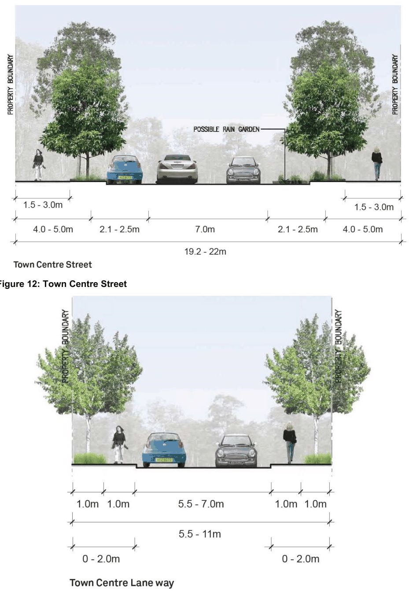

> [Picture on page 37: a picture, saved as a picture (images/part-e17-huntlee-page-37-1.gif, 150 dpi).]

#### Figure 12: Town Centre Street

#### Figure 13: Town Centre Laneway

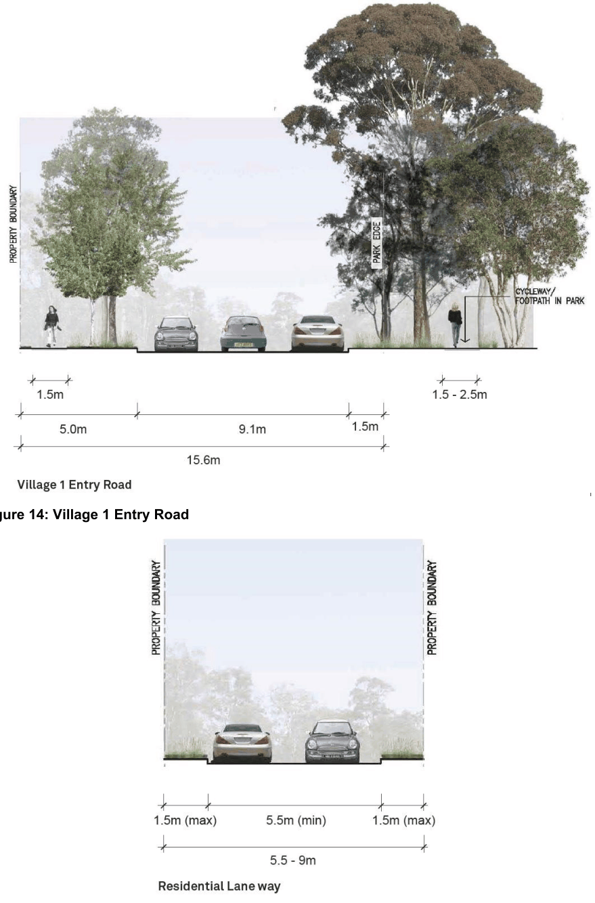

> [Picture on page 38: a picture, saved as a picture (images/part-e17-huntlee-page-38-1.gif, 150 dpi).]

#### Figure 14: Village 1 Entry Road

#### Figure 15: Residential Laneway

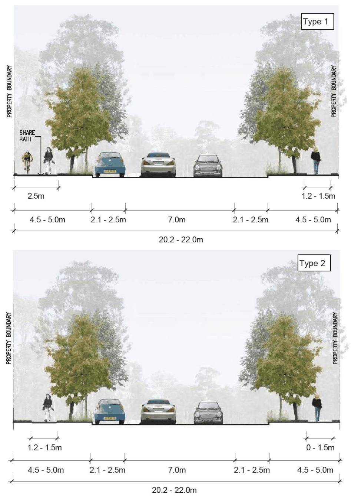

> [Picture on page 39: a picture, saved as a picture (images/part-e17-huntlee-page-39-1.gif, 150 dpi).]

#### Figure 16: Collector Streets

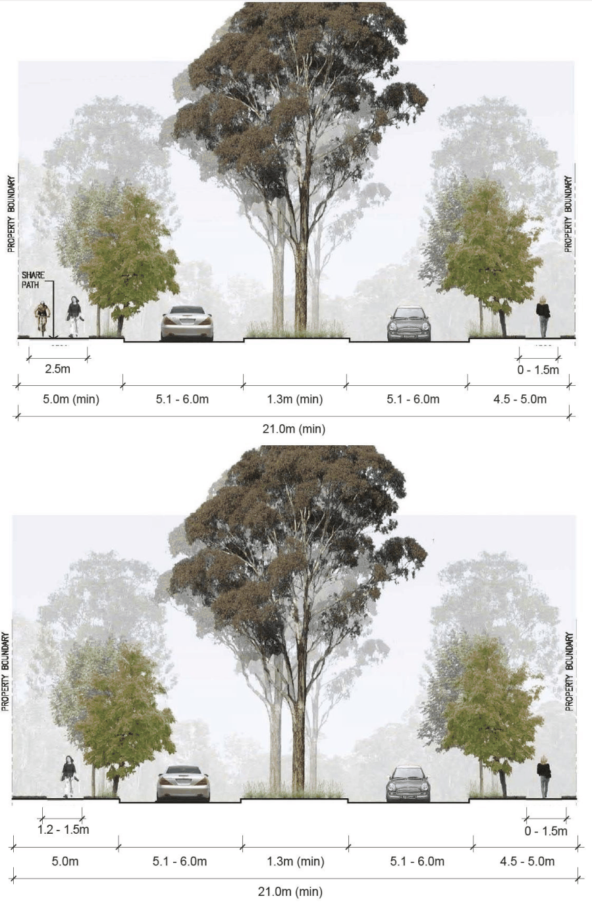

> [Picture on page 40: a picture, saved as a picture (images/part-e17-huntlee-page-40-1.gif, 150 dpi).]

#### Figure 17: Avenue Streets

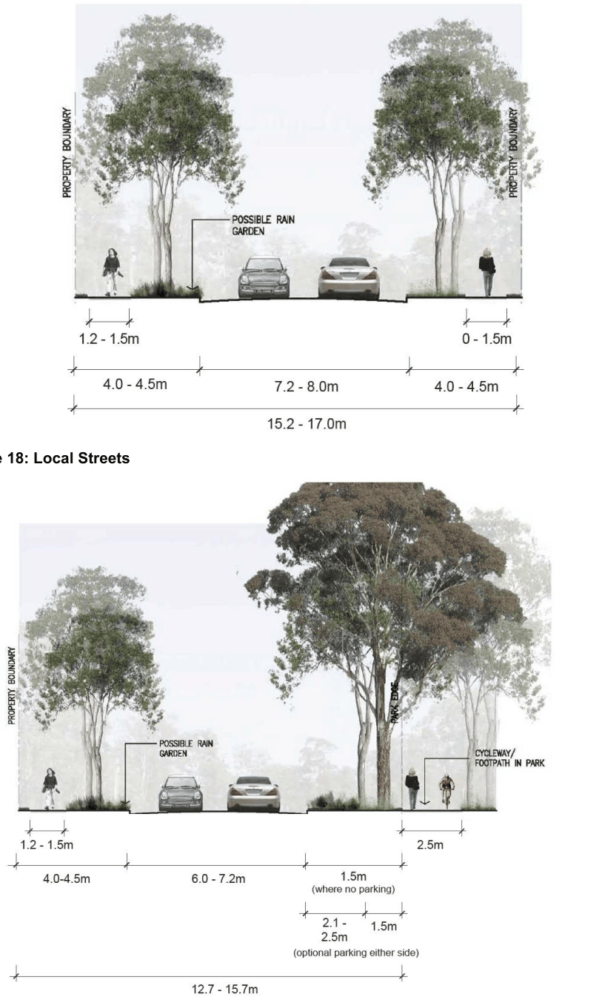

> [Picture on page 41: a picture, saved as a picture (images/part-e17-huntlee-page-41-1.gif, 150 dpi).]

#### Figure 18: Local Streets

#### Figure 19: Local Park Edge Streets

### 4.2 Pedestrian and cycle network

#### Objectives

(1) To provide a convenient, efficient and safe network of pedestrian and cycleway paths for the use of the community, within and beyond the site.

(2) To encourage residents to walk or cycle, in preference to using motor vehicles, as a way of gaining access to the schools, shops, and local community and recreation facilities.

(3) To avoid duplication by allowing pedestrian pathways and cycleways to be located within parks and corridors wherever practical.

#### Controls

(1) Footpaths and cycle paths are to be provided in accordance with street sections provided in Section 4.1. Verge areas may be more generous in order to accommodate local features such as existing trees or provide visual interest.

(2) Pedestrian paths, cycle routes and facilities in public spaces are to be safe, well lit, clearly defined, functional and accessible to all.

(3) Pedestrian paths, cycle paths and pedestrian refuge islands are to be designed to be fully accessible by all in terms of access points and gradients, generally in accordance with Australian Standard 1428:1-4.

(4) Pedestrian and cycle pathways are to be constructed as part of the infrastructure works for each residential stage with detailed designs to be submitted with the construction certificate application. Concept approval will be required at DA stage.

(5) Pedestrian and cycle routes shall be in accordance with

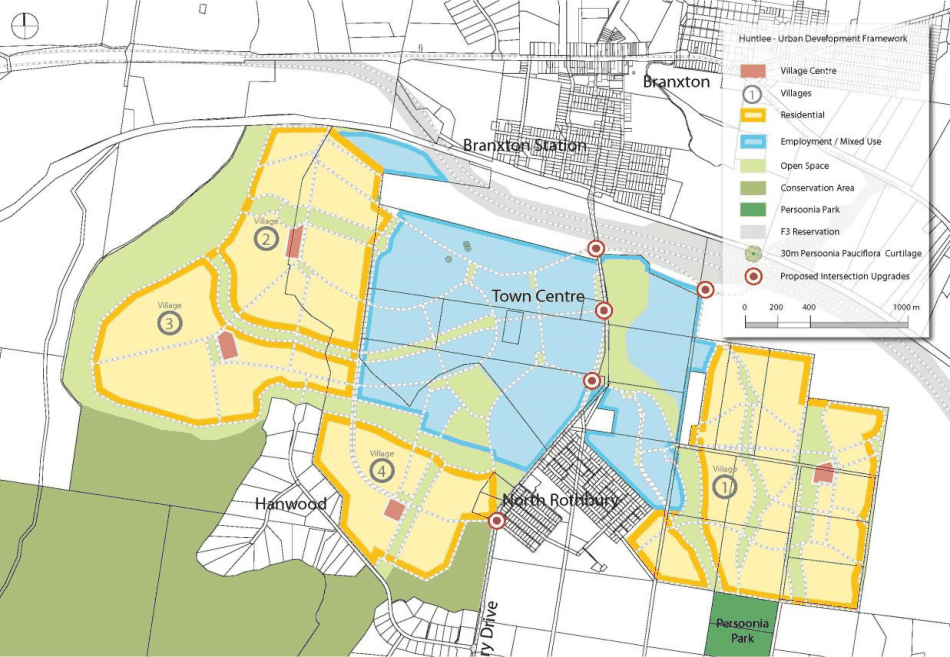

> [Picture on page 43: a picture, saved as a picture (images/part-e17-huntlee-page-43-1.gif, 150 dpi).]

(6) Figure 20.

(7) Minimum footpath width is to be 1.2m and a shared cycle/pedestrian path is to be 2.5m.

> [Picture on page 44: a picture, saved as a picture (images/part-e17-huntlee-page-44-1.gif, 150 dpi).]

#### Figure 20: Overall cycleway network

### 4.3  Public domain works

#### Objectives

(1) To provide public open space that meets the recreational needs of residents.

(2) To provide an equitable distribution of public open space and recreation opportunities.

(3) To ensure a good quality of design and embellishment of the public domain.

(4) To ensure environmentally and visually sensitive land contributes to the landscape character of the precinct.

(5) To ensure that public domain elements contribute to a consistent street character.

(6) To ensure that adequate provision is made for utilities.

(7) To ensure that all utilities are integrated into the development and are unobtrusive.

(8) To ensure that all parks are managed to the extent required to provide acceptable asset protection to adjoining dwellings.

(9) To encourage passive surveillance and safety of the public domain.

(10) To create an attractive and comfortable streetscape for pedestrians that comprise consistent and high quality street tree plantings.

(11) To provide a variety of open spaces to cater for a range of recreational, social and cultural activities.

(12) To develop designs for open spaces in recognition of their different function and characteristics and the environmental and natural qualities of the area.

#### Controls

#### 4.3.1 Public parks and landscape

(1) Open space is to be generally located in accordance with the Indicative Open Space Plan at Figure 21: Indicative open space network.

(2) Open space will be provided in the following forms:

• Urban squares within the Town Centre;

• Neighbourhood and village parks; and

• Active recreation and playing fields.

(3) Provide appropriate car and bicycle parking for active recreation and playing fields (refer to Section 7.10).

(4) Parks, open space areas and riparian corridors are to be provided generally in accordance with Figure 21: Indicative open space network.

(5) Public parks are to:

• be co-located with community and education facilities where appropriate;

• be generally bordered by streets on all sides with houses oriented towards them to encourage passive surveillance;

• be highly accessible and linked by pedestrian and/or cycle routes;

• be linked to and integrated with riparian corridors where possible;

• be located and designed to accommodate remnant vegetation, where possible;

• where applicable incorporate interpretative signage detailing local history and environmental education themes; and

• provide a range of play spaces and opportunities and cater for a range of ages.

(6) Street furniture is to be incorporated into the design of public and community parks and should include seating, shade structures, drinking fountains, lighting, and information signs.

(7) Riparian corridors and conservation areas are to provide opportunities for pedestrian paths and cycleways, fitness trails and additional open space in a manner that maintains the environmental significance of these areas. Themed elements such as boardwalks, eco-pathways, and educational tracks should be utilised in appropriate locations.

(8) The selection of landscape species for public open space areas should incorporate locally endemic species with low water needs.

(9) A Landscape Plan is required to accompany any Development Application for subdivision creating a public park and is to provide details on elements such as:

• asset protection zones;

• earthworks;

• furniture;

• plant species and sizes (with consideration for bush fire risks);

• play equipment;

• utilities and services;

• public art;

• hard and soft landscaping treatments;

• signage;

• any entry statements;

• waste facilities; and

• any other embellishment.

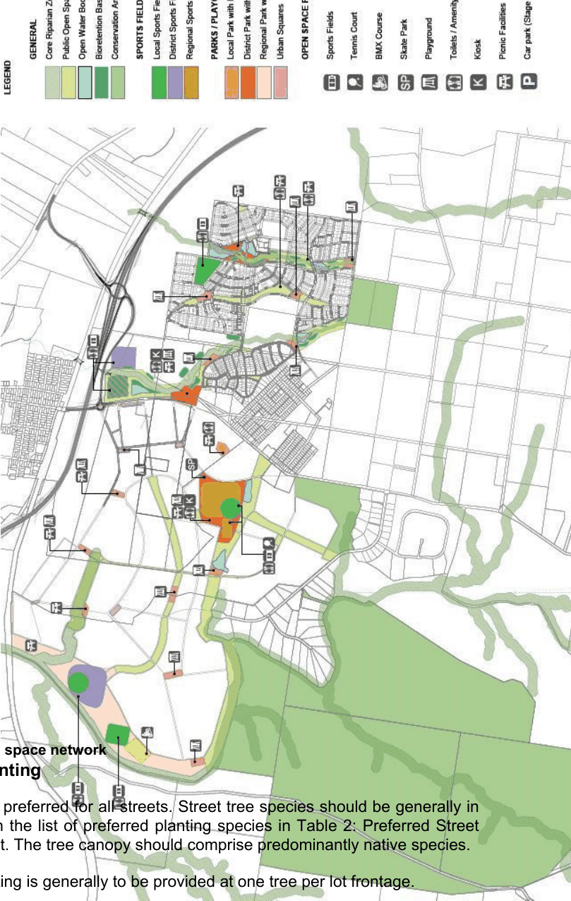

> [Picture on page 47: a picture, saved as a picture (images/part-e17-huntlee-page-47-1.gif, 150 dpi).]

#### Figure 21: Indicative open space network

#### 4.3.2 Street tree planting

(1) Street trees are preferred for all streets. Street tree species should be generally in accordance with the list of preferred planting species in Table 2: Preferred Street trees species list. The tree canopy should comprise predominantly native species.

(2) Street tree planting is generally to be provided at one tree per lot frontage.

(3) Corner lots will have two street trees if space allows.

(4) The location of street trees must complement proposed driveway locations and not compromise sight lines.

(5) Landscape works in roundabout islands may include low-maintenance groundcover planting and native grasses with a mature height of up to 0.5 metres, as well as mature clear-stemmed tree planting, where sight lines are not compromised.

(6) Access streets located adjacent to arterial roads are to include landscape treatment of the verge adjoining the arterial road. Road verges provide opportunities for unifying the appearance and landscape character of the area and should be provided as a continuous design feature along the length of the arterial road.

(7) All street trees should be protected with root barriers to ensure that potential impact on infrastructure is mitigated as far as practicable.

#### Table 2:

#### Preferred Street trees species list

Included in original DCP Addition to original DCP

| BOTANICAL NAME | COMMON NAME |
|---|---|
| WINE COUNTRY DRIVE |  |
| Corymbia maculata | Spotted Gum |
| Quercus palustris ' Pringreen' | Green Pillar |
| TOWN CENTRE & CIVIC STREETS |  |
| Acmena smithii | Common Lilly Pilly |
| Araucaria cunninghamii | Hoop Pine |
| Brachychiton populneus | Kurrajong |
| Elaeocarpus reticulatus | Blueberry Ash |
| Ficus microcarpa var. hillii | Hill's Weeping Fig |
| Lophostemon confertus | Queensland Brush Box |
| Magnolia gradiflora | Bull Bay Magnolia |
| Platanus x hybrida | London Plane Tree |
| Pyrus calleryana cvrs | Bradford Pear |
| Syzygium australe | Brush Cherry |
| Corymbia maculata | Spotted Gum |
| Eucalyptus fibrosa | Red Ironbark |
| Largestroemia indica 'Natchez' | White flowering Crepe Myrtle |
| Liriodendron tulipifera | Tulip Tree |
| Ulmus parvifolia 'Todd' | Chinese Elm |
| COLLECTOR / AVENUE |  |
| Corymbia maculata | Spotted Gum |

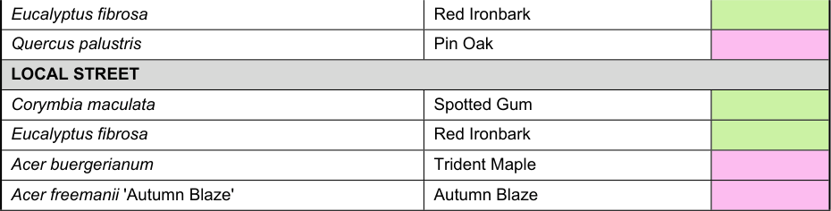

> [Picture on page 48: a map, saved as a picture (images/part-e17-huntlee-page-48-13.gif, 150 dpi); the street names and other small labels are on the picture.]
> Words printed on the picture (title and legend, copied from the PDF):
> Acer freemanii 'Autumn Blaze'

| Acer negundo 'Sensation' | Sensation |
|---|---|
| Acer rubrum "October Glory" | October Glory |
| Cupaniopsis anacardioides | Tuckeroo |
| Elaeocarpus reticulatus | Blueberry Ash |
| Fraxinus pennsylvanica 'Urbanite' | Urbanite Green Ash |
| Largestroemia indica 'Natchez' | Crepe myrtle |
| Liriodendron tulipifera | Tuilp poplar |
| Magnolia grandiflora 'Exmouth' | Magnolia |
| Pyrus calleryana cvrs | Bradford Pear |
| Pyrus ussuriensis | Manchurian Pear |
| Quercus palustris | Pin Oak |
| Tristaniopsis laurina 'Luscious' | Kanooka |
| Waterhousia floribunda | Weeping Lilly Pilly |
| LOCAL PARK EDGE (Ridgelines) |  |
| Corymbia maculata | Spotted Gum |
| Eucalyptus fibrosa | Red Ironbark |
| Eucalyptus glaucina | Slaty Red Gum |
| Angophora costata | Smooth barked apple myrtle |
| Eucalyptus microcorys | Tallowood |
| Ficus microcarpa var. hillii | Hill's Weeping Fig |
| Fraxinus pennsylvanica 'Urbanite' | Urbanite Green Ash |
| Jacaranda mimosifolia | Jacaranda |
| Quercus palustris | Pin Oak |
| Quercus suber | Cork Oak |
| LOCAL PARK EDGE (Creeklines) |  |
| Allocasuarina luehmannii | Bull-oak |
| Elaeocarpus reticulatus | Blueberry Ash |
| Melaleuca decora | White Feather Honeymyrtle |
| Melaleuca nodosa | Prickly-leaved Paperbark |
| Tristaniopsis laurina ‘Luscious’ | Kanooka Gum |
| Agathis robusta | Kauri Pine |
| Corymbia maculata | Spotted Gum |
| Eucalyptus fibrosa | Red Ironbark |
| Eucalyptus microcorys | Tallowood |
| Eucalyptus punctata | Grey Gum |
| Ficus microcarpa var. hillii | Hill's Weeping Fig |
| Jacaranda mimosifolia | Jacaranda |
| Largestroemia indica 'Biloxi' | Crepe myrtle |
| Livistona australis | Cabbage Palm |
| Pyrus calleryana cvrs | Bradford Pear |
| Quercus suber | Cork Oak |
| Ulmus parvifolia 'Todd' | Chinese Elm |

Waterhousia floribunda

Weeping Lilly Pilly

#### 4.3.3 Utilities and services

(1) Gas and water services may be located in a shared trench on one side of the street or rear lane and electricity power and telephone located in a shared trench on the other side of the street or rear lane. Trenches should be designed and located to allow for adequate street tree planting.

(2) All development shall incorporate underground electricity reticulation and telecommunications.

(3) Subject to Ausgrid requirements, any existing aboveground electricity reticulation services shall be relocated underground with the exception of main transmission lines.

(4) Where agreement to develop shared trench practices cannot be met, or location of services are unable to be limited to one side of the road, the alignment of services shall be to a standard acceptable to Council and allow for the inclusion of street trees.

(5) Utilities and services are to be supplied and constructed in accordance with the requirements of the relevant authority.

(6) Pipes and conduits through bushland areas and areas with significant vegetation cover are to be avoided, where possible.

(7) Development is to have a water supply for fire-fighting purposes in accordance with the NSW Rural Fire Service’s requirements.

### 4.4 Public transport network

#### Objectives

(1) To encourage the use of public transport.

(2) To ensure clear, safe pedestrian links to public transport stops.

#### Controls

(1) Bus routes and bus stops are to be provided generally in accordance with the Hyder Stage 1 Bus Servicing Strategy as shown in Figure 22: Overall public transport network (indicative) .

(2) Residential lots should be located generally within a safe walking distance of 800m from an existing or proposed bus stop.

(3) A minimum carriageway width of 3.5m is to be provided along all bus routes. Roundabouts on bus routes are to be designed to accommodate bus manoeuvrability.

(4) Bus stops are preferred to be on-street and generally not within indented bays. Bus shelters can provided at key stops and installed at the subdivision construction stage or at a time agreed with service providers and/or Council.

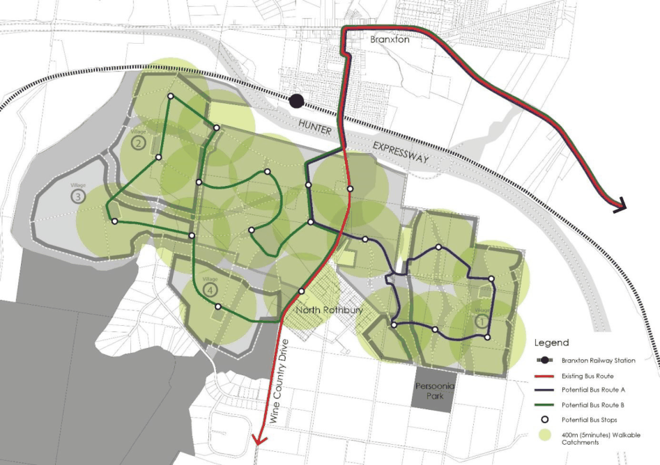

> [Picture on page 51: a picture, saved as a picture (images/part-e17-huntlee-page-51-7.gif, 150 dpi).]

#### Figure 22: Overall public transport network (indicative)

### 4.5 Residential neighbourhoods

#### 4.5.1 Residential character

#### Objectives

(1) To establish a clear urban structure that encourages walking and cycling.

(2) To emphasise the natural attributes of the site and reinforce neighbourhood identity through the placement of visible key landmark features, such as parks, squares and landmark buildings.

(3) To ensure that all residential lots are afforded a high level of amenity in terms of solar access, views, outlook and proximity to public and community facilities and parks.

(4) To ensure that the siting and design of buildings minimises noise impacts from abutting busy roads, rail corridors and other noise-generating land uses.

(5) To ensure that commercial or industrial development does not unreasonably diminish the amenity of nearby residential uses from noise intrusion.

(6) To accommodate a mix of lot sizes and dwelling types.

(7) To encourage variety in dwelling sizes to promote housing choice and create interesting streetscapes.

(8) To reduce the potential for future subdivision of land beyond that carried out under the Major Projects Approval MP10_0137.

#### Controls

(1) Residential neighbourhoods are to be focused on elements of the public domain such as a school, park, retail, or community facilities that are typically within walking distance.

(2) Subdivision is to be consistent with the most recent Project Approval for the Huntlee

Town

Centre.

(https://www.planningportal.nsw.gov.au/majorprojects/projects/huntlee-stage-1-development)

(3) Subdivision layout is to create a legible and permeable street hierarchy that responds to the natural site topography, the location of existing significant trees and solar design principles.

(4) Pedestrian connectivity is to be maximised within and between each residential neighbourhood with a particular focus on pedestrian routes connecting to public open space, bus stops and railway stations, educational establishments and community/recreation facilities.

(5) Street blocks are to be generally 150m to 180m long. Block lengths and widths in excess of 180m may be considered where pedestrian connectivity, stormwater management and traffic safety objectives are achieved.

(6) Residential lots should generally be rectangular in geometry.

(7) Battle-axe lots are not permitted.

(8) The orientation and configuration of lots is to be generally consistent with the subdivision principles shown at Figure 23 and Figure 24.

(9) Preferred lot siting is either on a north-south or east-west orientation.

(10) Alternative lot orientation may be considered where topography is a constraint or where other amenities such as views and outlook over open space are available, and providing appropriate solar access and overshadowing outcomes can be achieved.

(11) Residential subdivision applications should:

• Incorporate a mix of lot sizes for detached dwellings to provide a range of housing choice within the lower density areas.

• Provide cottage lots around open space and village centres

• Provide country lots around the perimeter of the site and where environmental constraints are managed within lots (i.e. Flooding, bushfire APZ etc.).

• Be designed to provide for activation of the public domain, including streets and public open space through the orientation and design of buildings and communal spaces.

• Ensure that pedestrian, cyclist and road links provide legible and direct access to the town centre, public transport and areas of public open space.

(12) Residential development adjacent to sub-arterial roads, arterial roads and the rail line are to consider the effects of road and rail traffic noise, vibration and air quality on residential amenity and, where necessary, should include measures to ameliorate any adverse impacts.

(13) The provisions of the State Environmental Planning Policy (Infrastructure) 2007 and “Development near Rail Corridors and Busy Rods Interim Guideline” 2008 must be taken into consideration, to minimise impacts of busy roads and railway corridors on residential and other sensitive development such as schools, child care centres, places of public worship and health services facilities.

(14) Non-residential development is not to adversely affect the amenity of adjacent residential development as a result of noise, odour, hours of operation and/or service deliveries.

(15) Non-residential development in the residential areas is encouraged where it:

• contributes to the amenity and character of the residential area within which it is located;

• provides services, facilities or other opportunities that meet the needs of the surrounding residential population and contributes to reduce motor vehicle use;

• will not result in detrimental impacts on the amenity and safety of surrounding residential areas, including factors such as noise and air quality; and

• is of a design that is visually and functionally integrated with the surrounding residential area.

(16) No subdivision of lots is permitted beyond that approved or modified under the Major Projects Approval MP10_0137 (as modified), except in accordance with Community Land Development Act 2021 or Strata Schemes Development Act 2015.

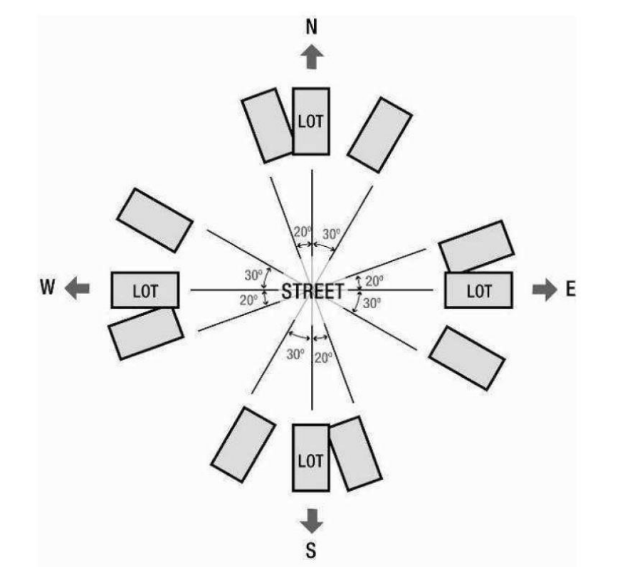

> [Picture on page 54: a picture, saved as a picture (images/part-e17-huntlee-page-54-1.gif, 150 dpi).]

#### Figure 23: Lot orientation principles

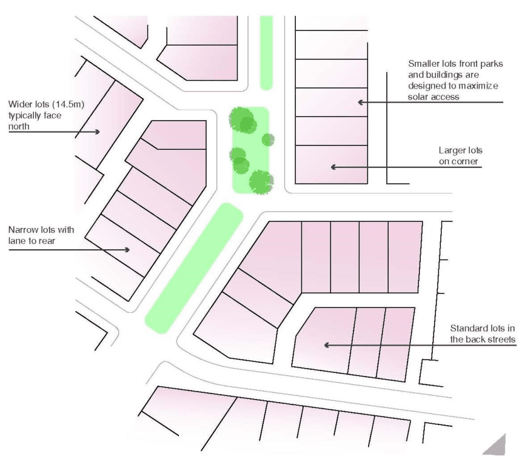

> [Picture on page 55: a picture, saved as a picture (images/part-e17-huntlee-page-55-1.gif, 150 dpi).]

#### Figure 24: Subdivision principles

#### 4.5.2 Minimum subdivision frontage

#### Objective

(1) To provide for a mix of lot frontage widths to enable the development of a range of housing types and sizes.

#### Controls

(1) The subdivision lot type is to be consistent with the Lot Type Map. (Note: this can be found on Council’s online mapping website https://www.cessnock.nsw.gov.au

(2) Lots should be rectangular. Where lots are an irregular shape, they are to be large enough and oriented appropriately to enable dwellings to meet the controls in this DCP.

(3) Battle-axe lots are not permitted.

#### 4.5.3 Corner lots

#### Controls

(1) Corner lots are to be designed to allow dwellings to positively address both street frontages as indicated in Figure 25.

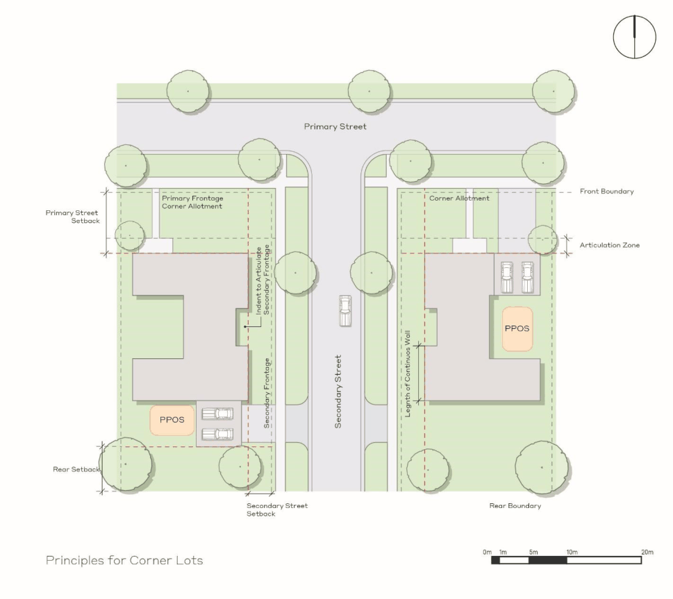

> [Picture on page 56: a picture, saved as a picture (images/part-e17-huntlee-page-56-5.gif, 150 dpi).]

#### Figure 25: Principles for corner lots

#### 4.5.4 Country lots

#### Controls

(1) Country lots should be provided around the perimeter of the site to provide an appropriate transition to adjoining rural land uses, in terms of character, scale and density.

(2) Country lot dwellings should be provided on all residential lots which are affected by the 1:100 flood level and/or require bushfire asset protection zones.

### 4.6 Town centre subdivision design

#### Objectives

(1) To allow for a range of allotment sizes that caters for a diversity of land uses and employment opportunities.

(2) To ensure allotments are oriented and aligned to enable buildings to appropriately address streets and the public domain.

(3) To reduce the potential for future subdivision of land beyond that carried out under the Major Projects Approval MP10_0137.

#### Controls

(1) Lots are to be relatively regular in shape. Irregular shaped allotments with narrow street frontages should be minimised.

(2) Lots should be orientated and aligned:

• so that future buildings can face the arterial, sub-arterial, collector and local streets to increase visual surveillance and to avoid streetscapes with loading docks and long blank walls,

• to facilitate solar efficiency, and

• to encourage building design that has frontage to landscaped areas and riparian corridors.

(3) Access to lots shall be sited to ensure unimpeded sight lines for exiting vehicles.

(4) Subdivision of roads should incorporate a road hierarchy that will accommodate the anticipated traffic volumes and vehicle types and be practical and legible for users.

(5) Battle-axe lots are not permitted unless in the opinion of Council, exceptional circumstances arise that justify their use.

(6) No subdivision of lots is permitted beyond that approved or modified under the Major Projects Approval MP10_0137 (as modified), except in accordance with Community Land Development Act 2021 or Strata Schemes Development Act 2015.

#### 4.6.1 Strata or Community Title

#### Controls

(1) Where a Strata or Community Title subdivision is proposed, any space for parking or other purposes forming part of a sole occupancy unit required by Council must be included in the same strata lot as the unit.

(2) All landscaping, access areas and directory board signs not forming part of an individual unit are required by Council to be included in any strata plan of subdivision as common property.
