## 5 Residential Dwellings

### 5.1 Introduction

This Part sets out the objectives and development controls that relate to the design of all residential dwellings across the Huntlee site. This Part is to be used to design buildings using principles that apply to all residential development and specific controls for certain types of housing.

### 5.2 Site analysis

Site analysis for each individual lot is an important part of the design process. Development proposals need to illustrate design decisions which are based on analysis of the site conditions and their relationship to the surrounding context.  By describing the physical elements of the locality and the conditions impacting on the site, opportunities and constraints for development can be understood and addressed in the design.

The Site Analysis Plan should show the existing features of the site and its surrounding area, together with supporting written material. At minimum the Site Analysis Plan must show the following features:

• the position of the proposed building in relation to site boundaries and any other structures and existing vegetation and trees on the site,

• aspect,

• any easements over the land,

• the location, boundary dimensions, site area and North Point of the land,

• location of existing street features adjacent to the property, such as trees, planting, street lights,

• contours and existing levels of the land in relation to buildings and roads, and whether the proposed development will involve any changes to these levels, and

• a stormwater concept plan (where required).

### 5.3 Residential amenity and sustainability

#### 5.3.1 Cut and fill

#### Objectives

(1) To manage the extent of cut and fill within residential allotments in order to reflect the existing topography the desired future character for Huntlee.

(2) To protect and enhance the aesthetic quality of the area by controlling the form, bulk and scale of land forming operations.

(3) To ensure that filling material is satisfactory and does not adversely affect the fertility or salinity of soil, or the quality of surface water or groundwater.

(4) To ensure that the amenity of adjoining residents is not adversely affected by any land forming operation.

(5) To ensure that adequate provision is made for drainage in relation to cut and fill practices.

#### Controls

(1) Development Applications are to illustrate where it is necessary to cut and/or fill land and provide justification for the proposed changes to the land levels.  Cut and fill shall be generally consistent with Figure 26 and Table 3.

(2) Proposals requiring significant moving and filling of earth will be considered if they contribute to the overall quality of the development and the urban design outcomes for the area. A Validation Report will be required to be submitted to Council prior to the placement of imported fill on site. All fill shall comply with the Department of Natural Resources (now Office of Environment and Heritage - OEH) – “Site Investigation for Urban Salinity” and the DECC (now OEH) Contaminated Sites Guidelines – “Guidelines for the NSW Site Auditor Scheme (2nd edition) – Soil Investigation Levels for Urban Development Sites in NSW.”

(3) Earth moved from areas containing noxious weed material must be disposed of at an approved waste management facility, and transported in compliance with the Noxious Weeds Act 1993.

(4) Lot benching may be used selectively to create diversity in character and streetscapes. On steeply sloping sites, site disturbance is to be reduced by use of split level or pier foundation housing designs.

(5) For sites with a fall over the area of the proposed house pad, the maximum permitted cut and fill is outlined in Table 3: Cut and fill permitted.

#### Table 3: Cut and fill permitted

| Fall Across House Pad | Maximum Cut & Fill Permitted |
|---|---|
| Up to 1.5m | 600mm cut and 600mm fill |
| 1.5m to 2m | 800mm cut and 800mm fill |
| Over 2m | 1,000mm cut and 1,000mm fill |

\* Note: Earthworks exceeding the above controls may be permitted by Council.

(6) No cut or fill greater than 200mm on the boundary is permitted without an engineered solution approved by Council.

(7) Where a dwelling is built within 900mm of the site boundary, the dwelling wall should be integrated with the retaining wall.

(8) Where a retaining wall is located forward of the building line or visible to the public, this shall be constructed of masonry, rock or stone. Retaining walls on the boundary

must be constructed to engineered design in masonry to enable the erection of boundary fencing above.

(9) The maximum height of voids within individual allotments is 3m.

(10) All drainage works associated with retaining walls are to be located within the property boundary.

(11) Where co-operation between landowners to achieve a single retaining wall cannot be achieved, the retaining of cut and fill will need to be achieved by two separate structures.

(12) A secondary retaining wall must take into account the structural integrity of any existing structure and ensure the stability of the existing structure during and post construction of a second retaining wall.

(13) All retaining walls proposed for the site are to be identified within a site plan as part of any development application.

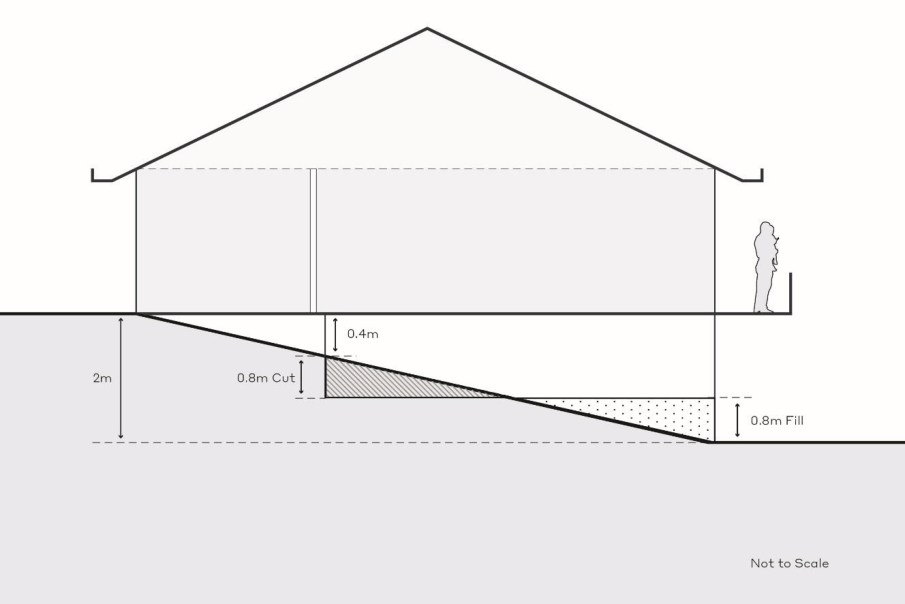

> [Picture on page 60: a picture, saved as a picture (images/part-e17-huntlee-page-60-14.gif, 150 dpi).]

#### Figure 26: Sample cut and fill within residential lots

#### 5.3.2 Fencing

#### Objectives

(1) To ensure boundary fencing is of a high quality and does not detract from the streetscape.

#### Controls

(1) Front fencing is not encouraged, however, where proposed, it is:

a. a maximum height of 1.2 metres;

b. of open appearance for at least 20% of the area of the fence that is more than 400mm above ground level; and

c. not made of sheet metal or timberlap materials.

(2) Front fences and walls are not to impede safe sight lines for traffic.

(3) Side and rear fencing are generally to be a maximum of 1.8m high on all sides, except within the front setback area (some areas of increased height may be considered for privacy on a case by case basis).

(4) Side fences shall not be made of sheet metal or timberlap materials. Areas of open fencing are encouraged to promote boundary planting.

(5) On corner lots or lots adjoining open space:

a. the front fencing style and height is to be continued along the secondary street frontage or open space frontage to at least 4m behind the building line of the dwelling, and

b. fencing that address the secondary frontage is to avoid continuous lengths of blank walls at street level.

c. boundary fencing is to be of a high-quality material and finish. The design of the fencing is to permit casual surveillance of the open space from within the dwelling and provide the dwelling with outlook towards the open space.

d. Where cut is proposed on the boundary of a lot, retaining walls are to be constructed with side fence posts integrated with its construction (relevant construction details are required with retaining wall approval). Otherwise retaining walls must be located a minimum of 450mm from the side or rear boundary of the lot containing the cut.

(6) All side return panels or gates between the side boundary and the principal dwelling are to be:

a. complementary or compatible with the boundary fencing

b. positioned 1m behind the main building line.

#### 5.3.3 Safety and Surveillance

#### Objectives

(1) To ensure that the siting and design of buildings and spaces decreases the opportunities for committing crime through casual surveillance.

(2) To ensure that development encourages people to use streets, parks and other public places without fear of personal risk.

#### Controls

(1) Dwellings should be designed to overlook streets, lanes and other public or communal areas to provide casual surveillance. In the case of corner lots, habitable windows are to be oriented to overlook the side street.

(2) The design of all development, in particular, the public domain and community facilities is to enhance public surveillance of public streets, laneways and open space/conservation areas.

(3) Encourage a sense of community ownership of open and public spaces (eg parks, footpaths, etc) through appropriate design of publicly accessible areas. This may include areas for the community to meet, areas to sit in the sun and the shade, areas to play and interact, accessible areas and paths for mobility impaired, artwork, signage regarding history of area and community gardens. Design should aim to use materials that reduce the opportunity for vandalism and ensure areas can be maintained and cleaned easily.

(4) Use of roller shutters other than garages is not permitted on doors and windows facing the street. Any security railings must be designed to complement the architecture of the building.

(5) Developments are to avoid the creation of areas for concealment and blank walls facing the street.

(6) Pedestrian and communal areas are to have sufficient lighting to ensure a high level of safety. These areas must be designed to minimise opportunities for concealment.

(7) All development should aim to provide casual surveillance of the street as a means of passive security. This should be achieved by maximising outlooks and views, but minimising the overlooking of neighbouring properties. Opportunities for casual surveillance from dwellings are to be incorporated into the design of shared driveways and where rear access is proposed from laneways.

(8) All developments are to incorporate the principles of Crime Prevention through Environmental Design (CPTED).

#### 5.3.4 Visual and Acoustic Privacy

#### Objectives

(1) To site and design dwellings to meet projected user requirements for visual and acoustic privacy, whilst minimising visual and acoustic impacts of development on adjoining properties.

#### Controls

(1) Direct overlooking of main habitable areas and private open spaces should be minimised through building layout, window and balcony location and design, and the use of screening devices, including landscaping.

### 5.4 Dwelling design controls

#### 5.4.1 Summary of key controls

#### Objectives

(1) To encourage the development of a diversity of dwelling types within low density residential areas.

(2) To promote innovative housing solutions that are compatible with the surrounding residential environment.

#### Controls

(1) The following table and figures summarise the key controls that apply to residential development on certain lot types.

(2) The applicable Lot Type is that shown on the Lot Type Map for the Huntlee Town Centre. This can be found on Council’s online mapping website www.cessnock.nsw.gov.au.

#### Table 4: Summary of key controls for Cottage Lot dwelling

| COTTAGE LOT DWELLING (REAR LANEWAY LOTS) |  |
|---|---|
| ELEMENT | CONTROL |
| Preferred Minimum Lot Width to House Width Ratio | 1:0.75 Interpretation: A ratio of 1:0.75 means that for every 1m of lot frontage, the width of the house shall be 0.75m |
| Maximum Site Coverage | 70% of site area |
| Landscape Area | 20% of site area |
| Private Open Space | 20% with min. dimension of 2.5m |
| Principal Private Open Space | 16m² per dwelling with min. dimension of 3m |
| Front Setback | 3.5m 1m articulation zone |
| Corner Lot Secondary Street Setback (min) | 1m single storey 2m second storey and above |
| Side Setback (min) | Nil side setback where the side wall is integrated with a retaining wall – or a minimum of 900mm |
| Length of Zero Lot Line Wall | 17m (Maximum cumulative length of façade without articulation). Articulation in the façade should be a minimum 450mm deep. |
| Rear Setback (min) | 3m (excludes detached garages and other ancillary structures such as pools and garden sheds) |
| Car Parking Spaces | 1 space (min) |
| Pools and garden structures | Garden structures and/or a swimming pool and all associated pipework are not to interfere or alter existing retaining walls or fencing and are to be wholly contained within the lot boundaries. |

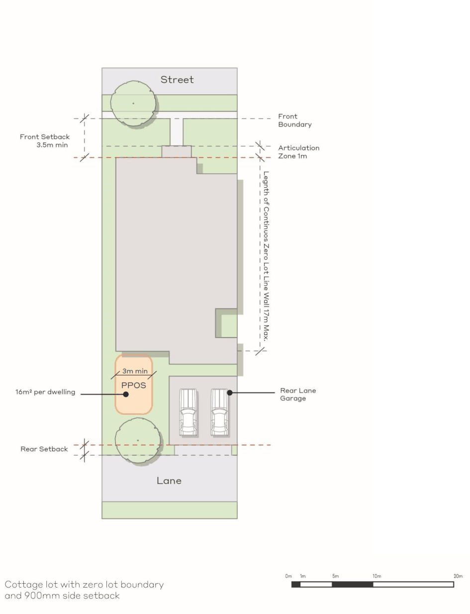

> [Picture on page 65: a picture, saved as a picture (images/part-e17-huntlee-page-65-1.gif, 150 dpi).]

#### Figure 27: Indicative layout for cottage lots (rear loaded)

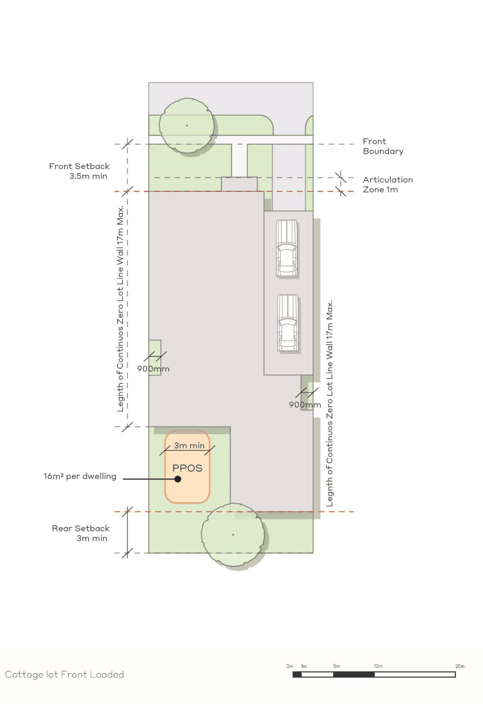

> [Picture on page 66: a picture, saved as a picture (images/part-e17-huntlee-page-66-1.gif, 150 dpi).]

#### Figure 28: Indicative layout for cottage lots (front loaded) nil side setback

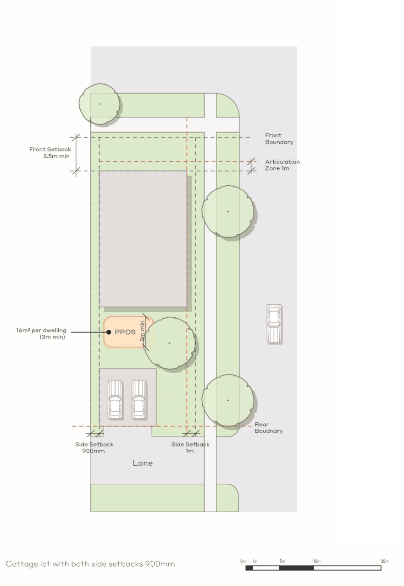

> [Picture on page 67: a picture, saved as a picture (images/part-e17-huntlee-page-67-1.gif, 150 dpi).]

#### Figure 29: Indicative layout for a cottage lot dwelling (rear loaded)

Table 5: Summary of key controls for small Traditional lot dwelling (detached dwelling)

| SMALL TRADITIONAL LOT DWELLING |  |
|---|---|
| ELEMENT | CONTROL |
| Preferred Minimum Lot Width to House Width Ratio | 1:0.65 Interpretation: A ratio of 1:0.65 means that for every 1m of lot frontage, the width of the house shall be 0.65m |
| Maximum Site Coverage of main dwelling | 70% |
| Landscape Area (min) | 20% of site area |
| Private Open Space (min) | 20% of site area with min. dimension of 2.5m |
| Principal Private Open Space (min) | 16m² per dwelling (min. dimension of 4m) |
| Front Setback (min) | 4.5m (building façade) 1m (articulation zone) 5.5m (garage) |
| Corner Lot Secondary Street Setback (min) | 1m – Single storey – 2m – second storey and above |
| Side Setback (min) | 1m – single storey 1.5m – second storey 0m – on one side for garages – where frontage is 15m or less |
| Rear Setback (min) | 3m (excludes detached garages and other ancillary structures such as pools and garden sheds) |
| Car Parking Spaces | 1 space (min) |
| Pools and garden structures | Garden structures and/or a swimming pool and all associated pipework are not to interfere or alter existing retaining walls or fencing and are to be wholly contained within the lot boundaries. |

Table 6: Summary of key controls for Traditional lot dwelling (detached dwelling)

| TRADITIONAL LOT DWELLING |  |
|---|---|
| ELEMENT | CONTROL |
| Preferred Minimum Lot Width to House Width Ratio | 1:0.65 Interpretation: A ratio of 1:0.65 means that for every 1m of lot frontage, the width of the house shall be 0.65m |
| Maximum Site Coverage of main dwelling | 55% of site area for two storeys plus 65% for single storey |
| Landscape Area (min) | 20% of site area |
| Private Open Space (min) | 20% of site area with min. dimension of 2.5m |
| Principal Private Open Space | 24m² per dwelling (min. dimension of 4m) |

| Front Setback (min) | 4.5m (building façade) 1m (articulation zone) 5.5m (garage) |
|---|---|
| Corner Lot Secondary Street Setback (min) | 1m single storey 2m second storey and above |
| Side Setback (min) | 1m – single storey 1.5m – second storey 0m – on one side for garages – where frontage is less than 15m |
| Rear Setback (min) | 4m (excludes detached garages and other ancillary structures such as pools and garden sheds) |
| Car Parking Spaces | 2 spaces (min) |
| Pools and garden structures | Garden structures and/or a swimming pool and all associated pipework are not to interfere or alter existing retaining walls or fencing and are to be wholly contained within the lot boundaries. |

Table 7: Summary of key controls for large Traditional lot dwelling (detached dwelling)

| LARGE TRADITIONAL LOT DWELLING |  |
|---|---|
| ELEMENT | CONTROL |
| Preferred Minimum Lot Width to House Width Ratio | 1:0.60 Interpretation: A ratio of 1:0.60 means that for every 1m of lot frontage, the width of the house shall be 0.60m |
| Maximum Site Coverage of main dwelling | 50% of site area for two storey 60% for single storey |
| Landscape Area (min) | 30% of site area |
| Private Open Space (min) | 20% of site area with min. dimension of 2.5m |
| Principal Private Open Space | 24m² per dwelling (min. dimension of 4m) |
| Front Setback (min) | 4.5m (building façade) 1m (articulation zone) 5.5m (garage) |
| Corner Lot Secondary Street Setback (min) | 1m single storey 2m second storey and above |
| Side Setback (min) | 1m – single storey 1.5m – second storey 0m – on one side for garages – where frontage is less than 15m |
| Rear Setback (min) | 4m (excludes garages and other ancillary structures such as pools and garden sheds) |
| Car Parking Spaces | 2 spaces (min) |
| Pools and garden structures | Garden structures and/or a swimming pool and all associated pipework are not to interfere or alter existing retaining walls or fencing and are to be wholly contained within the lot boundaries. |

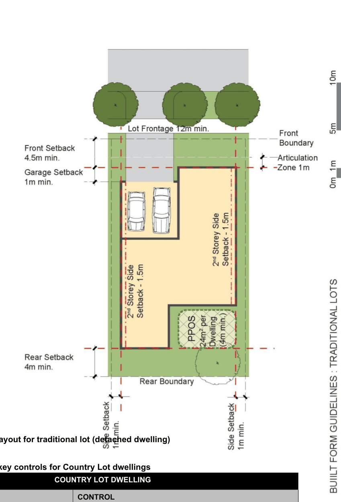

> [Picture on page 70: a picture, saved as a picture (images/part-e17-huntlee-page-70-1.gif, 150 dpi).]

Figure 30: Indicative layout for traditional lot (detached dwelling)

Table 8: Summary of key controls for Country Lot dwellings

| COUNTRY LOT DWELLING |  |
|---|---|
| ELEMENT | CONTROL |
| Site Coverage of main dwelling | 50% of site area |
| Landscape Area (min) | 30% site area |
| Private Open Space (min) | 20% of site area with min. dimension of 2.5m |
| Principal Private Open Space | 24m² per dwelling min. dimension of 6m |
| Front Setback (min) | 6m 1m articulation zone |
| Corner Lot Secondary Street Setback (min) | 3m |

| Side Setback (min) | 1.5m to both sides |
|---|---|
| Rear Setback (min) | 6m (excludes garages and other ancillary structures such as pools and garden sheds) 3m for “Ranch” style lots |
| Car Parking Spaces | 2 spaces (min) |
| Pools and garden structures | Garden structures and/or a swimming pool and all associated pipework are not to interfere or alter existing retaining walls or fencing and are to be wholly contained within the lot boundaries. |

Note: “Ranch” style lots are lots where the area of the lot is greater than or equal to 1,000m2, and:

• the depth of the lot is less than 23m, or

• the frontage is a minimum 1.6 times the depth of the lot.

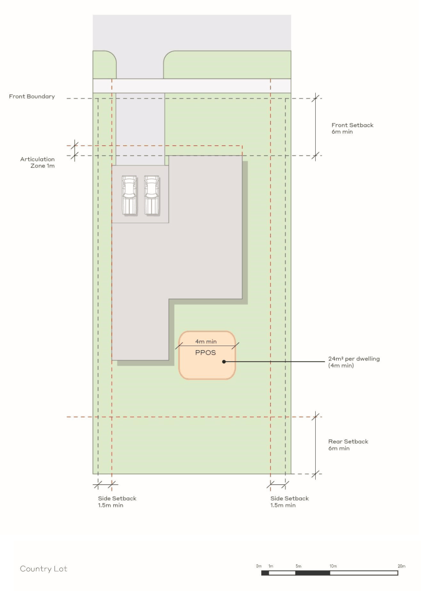

> [Picture on page 72: a picture, saved as a picture (images/part-e17-huntlee-page-72-1.gif, 150 dpi).]

#### Figure 31: Indicative layout for country lot dwelling

#### 5.4.2 Residential streetscape and architectural design

#### Objectives

(1) To ensure that buildings are designed to enhance the built form and character of the neighbourhood by encouraging innovative and quality designs that fit harmoniously with their surroundings.

(2) To encourage a diversity of house types, densities and architectural styles within the residential neighbourhood.

(3) To ensure the provision of equitable access to natural light and ventilation for the occupants of all residential buildings.

(4) To provide a clear distinction between private and public space and to encourage casual surveillance of the street.

(5) To reinforce significant street intersections particularly on open space and other key strategic areas through articulation of corner buildings.

#### Controls

(1) Dwellings are to consider the streetscape design principles illustrated at Figure 32.

(2) The primary street facade of a dwelling should address the street and must incorporate a mixture of building materials, porch, verandah or deck to the primary façade, articulated façade and at least two of the following design features:

• The inclusion of modern federation piers or double post supports with a step up/raised porch or verandah.

• A roof feature for example but not limited to: gable, gambrel, dormer windows, bell tower or a separately pitched roofline or gable feature to a porch, verandah or balcony.

• Provide a minimum ground floor plate / ceiling height of 2570mm for the majority of rooms / areas comprising the front elevation.

• Rendered plinth to a minimum height of 340mm and up to 600mm above floor level with weatherboard cladding above.

• A chimney feature located within the street elevation.

• The incorporation of sandstone or approved cultured stone to an architectural element.

• A corrugated metal deck roof.

• Decorative window hoods, awnings or other features over windows.

(3) The secondary street facade for a dwelling on a corner lot is to incorporate at least one of the following design features:

• the inclusion of modern federation piers or double post supports with a step up/raised porch or verandah;

• a roof feature for example but not limited to: gable, gambrel, dormer windows, bell tower or a separately pitched roofline or gable feature to a porch, verandah or balcony;

• provide a minimum ground floor plate / ceiling height of 2570mm for the majority of rooms / areas comprising the front elevation;

• rendered plinth to a minimum height of 340mm and up to 600mm above floor level with weatherboard cladding above;

• a chimney feature located within the street elevation;

• the incorporation of sandstone or approved cultured stone to an architectural element;

• a corrugated metal deck roof; or

• decorative window hoods, awnings or other features over windows.

(4) Articulation of the façade should be integral to the design of the building.

(5) Eaves are to provide sun shading and protect windows and doors and provide aesthetic interest. Except for walls built to the boundary, eaves should have a minimum of 450mm overhang (measured to the fascia board). Council may consider alternative solutions to eaves so long as they provide appropriate sun shading to windows and display a high level of architectural merit.

(6) Proposed dwelling colours, materials and finishes are to be consistent with the character of the neighbourhood. Bright and highly reflective colours are to be avoided. Multicoloured roof tiles are not permitted.

(7) Exact mirror-imaging of dwelling facades to form dual occupancy or semidetached housing is not permitted. However, symmetrical design is permitted where each dwelling can satisfy two different design features as listed in subclause (1) above and where the overall design of the buildings is appropriate in the streetscape having regard to design, building form and bulk.

(8) The repetition of identical housing designs and colour palette in a group of dwellings, other than for attached dwellings will not be permitted.

(9) Complex roof forms should be avoided. Skillion roofs, roofs hidden from view by parapet walls, roofs on detached garages, studios and ancillary buildings on the allotment are excluded from this control.

(10) Low-pitched roofs behind a parapet need to successfully integrate with the side and rear elevations.

(11) All main entries to dwellings should be orientated to the front / primary street only and not to side streets.

(12) Upper level wall lengths are not to exceed 15m in continuous length.

(13) Windows to living area are to be directed either to the street or rear private open space (and private driveway) to provide visual surveillance to the street and or private open space areas.

(14) Bathroom, ensuite or Laundry windows are to be well disguised into the Primary elevation or areas on the secondary elevation that are visible to the public i.e. no highlight windows or obscure, translucent, opaque or frosted glass. Communication devices, including antennae, satellite dishes and similar elements are not to be visible from the street.

(15) Carports and garages are to be constructed of materials that complement the colour and finishes of the main dwelling.

(16) Where possible, garages/carports must be located for access from the rear laneway where one is provided.

(17) Triple garages (not carports) may be permitted, subject to:

• the frontage width of the triple garage does not exceed more than 50% of the dwelling frontage;

• the third garage component is set back a minimum of 600mm from the double garage to lessen the impact from the street;

• integrated storage areas are located so not to widen the garage unnecessarily.; and

• the roof and design features of garages and carports are consistent with the main dwelling and doors shall be coloured to integrate seamlessly and reduce the dominance of the garage on the primary elevation.

(18) For corner lots, garages/carports shall be located on the lot boundary opposite the corner truncation. For all other lots, garages should be located on the low side of the lot.

(19) Carports on the primary or secondary street frontage are permitted, however shall be fitted with a sectional garage door. Carports wholly within the backyard do not require a garage door.

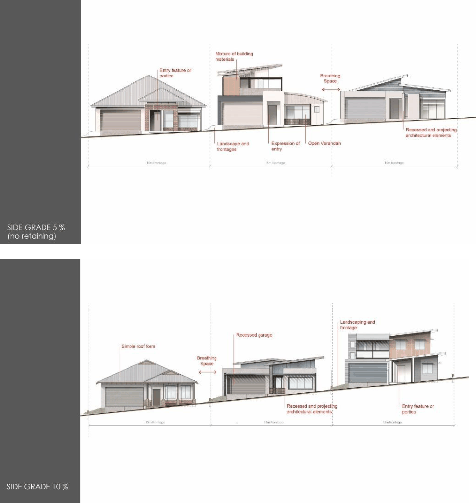

> [Picture on page 76: a picture, saved as a picture (images/part-e17-huntlee-page-76-1.gif, 150 dpi).]

#### Figure 32: Streetscape design principles

#### 5.4.3 Front setbacks

#### Objectives

(1) To enable the integration of built and landscape elements in the streetscape.

(2) To encourage simple and articulated building forms.

(3) To ensure garages do not dominate the streetscape.

#### Controls

(1) All development is to be consistent with the front setback controls in Section 5.4.1.

(2) Elements permitted in the articulation zone include those items listed in Section 5.4.2.

(3) Except for rear loaded garages, the garage line is to have a front set back that is at least 1m behind the building front facade line.

#### 5.4.4 Side and rear setbacks

#### Objectives

(1) To create an attractive and cohesive streetscape that responds to the character areas.

(2) To minimise the impacts of development on neighbouring properties.

(3) To provide appropriate separation between buildings.

(4) To create opportunities for articulation on the side walls.

#### Controls

(1) All development is to be consistent with the side and rear setback controls in Section 5.4.1.

(2) For attached or semi-detached dwellings the side setback only applies to the end of a row of attached housing, or the detached side of a semi-detached house.

(3) Projections permitted into side and rear setback areas include eaves (up to 450mm wide), fascia’s, sun hoods, gutters, down pipes, flues, light fittings, electricity or gas meters, rainwater tanks and hot water units.

(4) Pergolas and other landscape features/structures are permitted to encroach into the rear setback.

(5) Applicants must demonstrate that the use of a zero lot line will not adversely affect the privacy and solar access of an adjoining property.

#### 5.4.5 Dwelling height and massing

#### Objectives

(1) To ensure development is of an appropriate scale to protect residential amenity.

(2) To ensure building heights achieve built form outcomes that reinforce quality urban and building design.

(3) To protect residential amenity.

#### Controls

(1) Dwellings are to be generally a maximum of 2 storeys in height.  A 3rd storey may be permitted where a dwelling is located:

• on a prominent street corner, or

• adjacent to a neighbourhood or local centre or public open space, or a golf course, or riparian corridors, or

• on land with a finished ground level slope equal to or more than 15%, and is not likely to impact adversely on the existing or future amenity of any adjoining land on which residential development is permitted, having regard to overshadowing, visual impact and any impact on privacy, or

• in other circumstances approved by Council.

#### 5.4.6 Landscaped area

#### Objectives

(1) To encourage the use of native species of flora and low maintenance landscaping.

(2) To contribute to effective stormwater management and energy efficiency.

(3) To ensure a balance between built and landscaped elements in residential areas.

(4) To provide for canopy tree planting that provides natural shade to houses.

#### Controls

(1) Landscaped area is to be provided within each residential lot in accordance with the controls in Section 5.4.1.

(2) A minimum of one tree is to be provided on the lot.

(3) Drains are to be installed and be connected to the stormwater system as necessary to prevent accumulation of water and concentration of salts.

(4) Use of low flow watering devices is encouraged to avoid over watering. Use of low water demand drought resistant vegetation is encouraged.

#### 5.4.7 Private open space

#### Objectives

(1) To provide a high level of residential amenity with opportunities for outdoor recreation and relaxation.

(2) To enhance the spatial quality, outlook, and usability of private open space.

(3) To facilitate solar access to the living areas and private open spaces of the dwelling.

#### Controls

(1) Each dwelling is to be provided with an area of Private Open Space (POS) that contains an area of Principal Private Open Space (PPOS) consistent with the requirements in Section 5.4.1.

(2) The location of PPOS is to be determined having regard to dwelling design, allotment orientation, adjoining dwellings, landscape features, topography.

(3) 50% of the area of the required PPOS should receive at least 2 hours of sunlight between 9am and 3pm at the winter solstice (21 June).

(4) Development shall not prevent 50% of the required PPOS of adjacent properties from receiving at least 2 hours of sunlight between 9am and 3pm at the winter solstice (21 June).

(5) The PPOS is required to be conveniently accessible from the main living area of a dwelling or alfresco room and have a maximum gradient of 1:10.

#### 5.4.8 Garages, site access and parking

#### Objectives

(1) To control the number, dimensions and location of vehicle access points. To reduce the visual impact of garages, carports, and parking areas on the streetscape.

(2) To provide safe, secure and convenient access to parking within garages, carports and parking areas, with casual surveillance of private driveways from dwellings and from the street.

(3) To minimise conflict between pedestrians and vehicles at the junction of driveways and footpaths and within the lot.

(4) To provide predominantly onsite parking for residents and visitors.

#### Controls

(1) The driveway crossing the verge between the property boundary and the kerb shall have the smallest configuration possible to serve the required parking facilities and vehicle movements or a maximum of 6m.

(2) Where possible, garages / carports must be located for access from the rear laneway where one is provided.

(3) Driveway crossings are to be consistent with the design requirements illustrated in Figure 33.

(4) Driveways are to have the smallest configuration possible to serve the required parking facilities and vehicle turning movements.

(5) The location of driveways is to be determined with regard to dwelling design and orientation, street gully pits and tree bays and is to maximize the availability of onstreet parking.

(6) On corner allotments, driveways are not to be within 6m of the tangent to the kerb return. Access from secondary streets is preferred.

(7) Planting and walls adjacent to driveways must not block lines of sight for pedestrians, cyclists and vehicles.

(8) Driveways are to have soft landscaped areas on either side, suitable for water infiltration.

(9) Driveways must be in accordance with the relevant Australian Standards for vehicular turning circles, visibility distances and gradients.

(10) Garages are to be designed and located in accordance with the controls in Section 5.4.1.

(11) Garage design and materials are to be similar with the dwelling design.

(12) Garage doors are to be visually recessed through use of materials, colours, and overhangs.

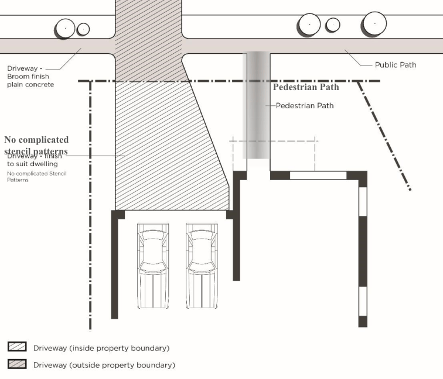

> [Picture on page 80: a picture, saved as a picture (images/part-e17-huntlee-page-80-17.gif, 150 dpi).]
> Words printed on the picture (title and legend, copied from the PDF):
> Pedestrian Path
> No complicated
> stencil patterns

#### Figure 33: Driveway crossing requirements

#### 5.4.10 Detached Secondary dwellings

#### Objectives

(1) To ensure that detached secondary dwellings are integrated with the overall design of the principal dwelling.

(2) To ensure that detached secondary dwellings are designed to be subordinate to the principal dwelling.

(3) To ensure that detached secondary dwellings are sited to reduce apparent scale of the overall residential development from the streetscape.

(4) To maintain a reasonable level of amenity to the principal dwelling, the site and surrounding properties.

#### Controls

(1) Detached secondary dwellings are to be subordinate in height and scale to the principal dwelling.

(2) The maximum floor area of a detached secondary dwelling is not to exceed 60m2 or 50% of the total floor area of the principal dwelling, whichever is the greater.

(3) Development of a detached secondary dwelling is to be sited behind the front or secondary elevation building line.

(4) A detached secondary dwelling is to be constructed of the same materials, finishes and colour scheme of the principal dwelling.

(5) Where visible to the public, detached secondary dwellings are to be designed with vertically proportioned windows or dormer windows are to address the road, street, parkway or laneway.

(6) A roof feature, verandah, porch or balcony and a garden bed and / or feature planting / planter box is to be incorporated into the design of a detached secondary dwelling.

(7) Roof pitch of detached secondary dwellings is to complement the principle dwelling.

(8) Detached secondary dwellings are not to increase site coverage or reduce landscaped areas for the property to less than the minimum required in section 5.4.1 of this DCP.

#### 5.4.11 Outbuildings

Note an outbuilding is defined under the State Environmental Planning Policy (Exempt and Complying Development Codes) 2008.

#### Objectives

(1) To minimise the visual impact of outbuildings and ancillary buildings.

(2) To ensure that outbuildings visually integrate with the overall design of the principal dwelling.

(3) To ensure that outbuildings are designed to be subordinate to the principal dwelling.

(4) To maintain a reasonable level of amenity to the principal dwelling, the site and surrounding properties.

#### Controls

(1) The maximum floor area of an outbuilding is not to exceed the areas shown below:

Maximum gross floor area 36m2 45m2

Lot size <300m2 >300m2–600m2 >600m2–900m2

60m2

\>900m2

100m2

(2) Development of an outbuilding is to be sited behind the front or secondary elevation building line.

(3) An outbuilding is to be constructed of similar materials, finishes and colour scheme of the principal dwelling.

(4) The appearance of an outbuilding is not to detract from the visual amenity of the development on the site and surrounding locality.

(5) The visual impact of an outbuilding should be mitigated using landscaping and other suitable screening measures, where practical.

(6) Where an outbuilding is proposed on a dual frontage lot, the use of a single, two single or a double garage door is permitted.

(7) Outbuildings are not to increase site coverage or reduce landscaped areas for the property to less than the minimum required in Section 5.4.1 of this DCP.

(8) Outbuildings are not to interfere or alter existing retaining walls, drainage and fencing.

### 5.5 Additional controls for other dwelling types

#### 5.5.1 Multi-dwelling housing

#### Objectives

(1) To ensure that the design of multi-dwelling housing is consistent with the character of the residential areas

(2) To ensure the quality of multi-dwelling housing is of a high quality and contributes to the amenity of residents.

(3) To provide flexible design outcomes for medium density and multi-dwelling housing in non-residential zoned land.

#### Controls in Residential Zoned Land

(1) Multi-dwelling housing is to be located on sites with a minimum street frontage of 30m and a minimum depth (from front to rear) of 25m.

(2) Garages and car parking areas are to be located at the rear of the lot with access provided from a lane to activate building facades.

(3) Multi-dwelling housing sites should incorporate canopy trees within the landscaped area.

(4) Multi-dwelling housing in residential zones is to comply with the controls in Table 9.

#### Table 9: Key controls from multi-dwelling housing in residential zones

| Element Controls |  |
|---|---|
| Site coverage (max) | 70% of site area |
| Landscaped area (min) | 30% of site area |
| Communal open space (min) | 15% of site area |
| Private open space (min) | 10m² per dwelling with min. dimension of 2.5m |
| Front setback (min) | 4.5m 1m articulation zone |
| Corner lots secondary street setback (min) | 3m |
| Side setback (min) | 1m |
| Rear setback (min) | 4m (excluding garages) |
| Car parking spaces | 1-2 bedrooms: up to 2 spaces 3 or more bedrooms: 2 spaces Visitor parking: 1 space per 5 dwellings Bicycle parking: 1 space per 2 dwellings |

#### 5.5.2 Residential flat buildings and shop top housing

#### Objectives

(1) To establish a high quality residential environment where all dwellings have a good level of amenity.

(2) To encourage a variety of housing forms within residential areas.

(3) To ensure the provision of housing that will, in its adaptable features, meet the access and mobility needs of any occupant.

#### Controls

(1) Residential flat buildings are to:

• be located on sites with a minimum street frontage of 20m and minimum depth (from front to rear boundaries) of 30m, and

• have direct frontage to an area of the public domain (including streets and public parks), and

• not adversely impact upon the existing or future amenity of any adjoining land upon which residential development is permitted with respect to overshadowing impact, privacy impact or visual impact.

(2) All residential flat buildings are to be consistent with:

• the guidelines and principles outlined in SEPP No. 65 – Design Quality of Residential Apartment Development, and

• the primary controls set out in Table 10.

(3) In all residential flat building developments containing 10 dwellings or more, a minimum of 10% of all apartments are to be designed to be capable of adaptation for disabled or elderly residents.

(4) Dwellings must be designed in accordance with the Australian Adaptable Housing Standard (AS 4299-1995), which includes ‘pre-adaptation’ design details to ensure visitability is achieved.

(5) Where possible, adaptable dwellings are to be located on the ground floor. Dwellings located above the ground level of a building may only be provided as adaptable dwellings where lift access is available within the building. The lift access must provide access from the basement to allow access for people with disabilities.

(6) The development application must be accompanied by certification from an accredited Access Consultant confirming that the adaptable dwellings are capable of being modified, when required by the occupant, to comply with the Australian Adaptable Housing Standard (AS 4299-1995).

(7) Car parking and garages allocated to adaptable dwellings must comply with the requirements of Australian Standards for disabled parking spaces.

#### Table 10: Key controls for residential flat buildings and shop top housing

| Element | R1 zone | B4 zone |
|---|---|---|
| Site coverage (max) | 70% of site area | 85% of site area |
| Landscaped area (min) | 30% of site area | 15% of site area |
| Private open space (min) | 10m² per dwelling with min. dimension of 2.5m | 10m² per dwelling with min. dimension of 2.5m |
| Front setback (min) | 6m | 0m for first floor 3m from 3rd floor |
| Corner lots secondary street setback (min) | 6m | 0m for first floor 3m from 3rd floor |
| Side setback (min) | 2m | 0m |
| Rear setback (min) | 6m | 3m |
| Height | 4 Storeys |  |
| Car parking spaces | 1-2 bedrooms: up to 2 spaces 3 or more bedrooms: 2 spaces Visitor parking: 1 space per 5 dwellings Bicycle parking: 1 space per 2 dwellings | 1-2 bedrooms: up to 2 spaces 3 or more bedrooms: 2 spaces Visitor parking: 1 space per 5 dwellings Bicycle parking: 1 space per 2 dwellings |

#### 5.5.3 Medium density format housing

#### Objectives

(1) To promote medium density, active, residential and mixed use housing formats within the B4 mixed use zone of the Town Centre.

(2) To provide a variety of urban, rather than suburban, housing choices that are located within a Town Centre setting with good access to retail and commercial services.

(3) To accommodate a preference for low-maintenance, compact housing.

(4) To ensure small lot subdivision occurs in a planned and orderly manner.

#### Controls

(1) The following table and figures summarise the key controls that apply to medium density dwellings within the B4 Mixed use zone.

(2) The applicable Lot Type is shown on the Lot Type Map for the Huntlee Town Centre (note this can be found on the Council’s online mapping website located at www.cessnock.nsw.gov.au)

(3) Lots designated as an Urban One lot type may not be subdivided.

Table 9A: Summary of Key Controls for Urban medium density residential lots (including Urban

#### One lot types)

| Element Control |  |
|---|---|
| Site Coverage (maximum) | 70% of site area |
| Landscape Area (minimum) | 20% of site area Minimum dimension 1m |
| Private Open Space (minimum) | 20% of site area Minimum dimension 1.5m Includes balconies and terraces |
| Principal Private Open Space (minimum) | 16m2 per dwelling Minimum dimension 3m |
| Front Setback (minimum) | • 1.5m to building line • 1m articulation zone • 3m to garage |
| Corner Lot Secondary Street Setback (minimum) | 1m single storey 2m second storey and above |
| Side Setback (minimum) | 900mm Nil side setback required on one side for lots less than or equal to 12m wide Nil side setback permitted to both sides for rearloaded (laneway) lots less than or equal to 10m wide. |
| Length of Zero Lot Line Wall (maximum) | 50% of lot length Articulation of zero lot walls must be a minimum of 450mm deep and 3m long Articulated areas must be accessible for maintenance |

| Rear Setback (minimum) | 1.5m for single storey elements 3m for two storey elements Nil for detached garages (and associated garage-top “Fonzie flats”) abutting laneways 900mm for ancillary structures such as pools and outbuildings |
|---|---|
| Car Parking Spaces (minimum) | 1 |
| Garages | Double garage doors on street frontages permitted only for lots with a width of 10m or over For lots with 10m or less frontage, double garage doors on street frontages are only permitted if; • the building is at least 2 storeys, and • there is a projecting balcony above for the full width of the garage. |
| Pools and Garden Structures | Garden structures and/or a swimming pool and all associated pipework are to be wholly contained within the lot boundaries. |
| Floor to Ceiling Height | A minimum 2750mm floor to ceiling height is required for all ground floor and single storey dwellings. |

#### Design

(1) Buildings should adopt a modern, contemporary, urban architectural style, compatible with an inner-city urban setting.

(2) Due to the compact nature of the urban style, buildings should have a high-quality front elevation/façade, with an emphasis on increased building height, steep roof pitches, and articulation in colours and materials.

(3) The repetition of identical housing designs, facades, and colour palettes is not permitted.

(4) The repetition of site and floor plans are permitted, where significant variation is provided in the front façade treatments.

(5) Landscaped Areas should satisfy the objectives of 5.4.6

(6) Private Open Space should satisfy the objectives of 5.4.7

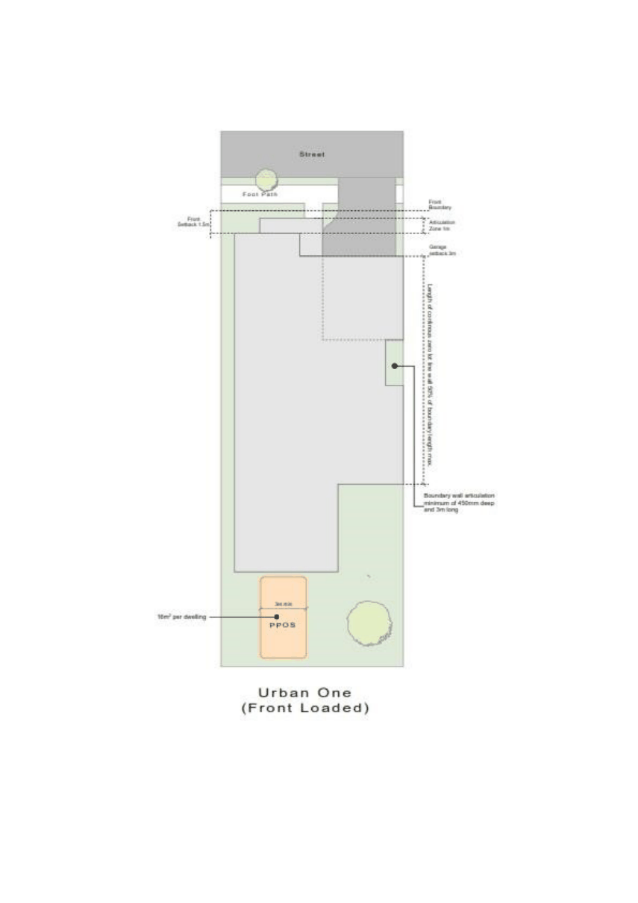

> [Picture on page 88: a picture, saved as a picture (images/part-e17-huntlee-page-88-1.gif, 150 dpi).]

#### Figure 34: Indicative layout for Urban One lots (front loaded)

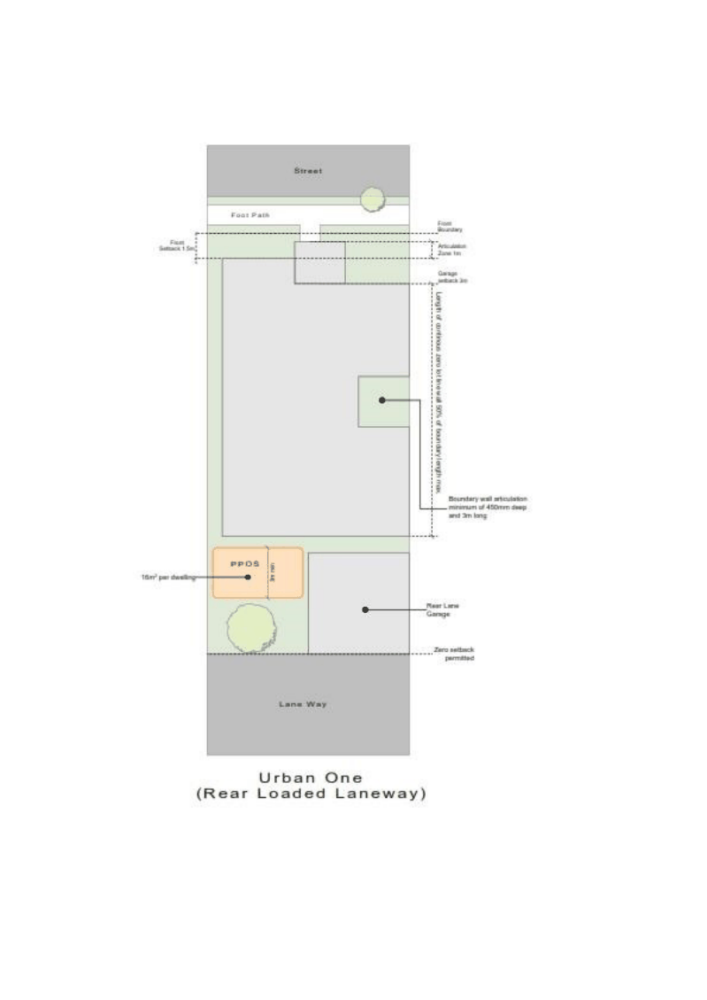

> [Picture on page 89: a picture, saved as a picture (images/part-e17-huntlee-page-89-1.gif, 150 dpi).]

#### Figure 35: Indicative layout for Urban One lots (rear loaded)

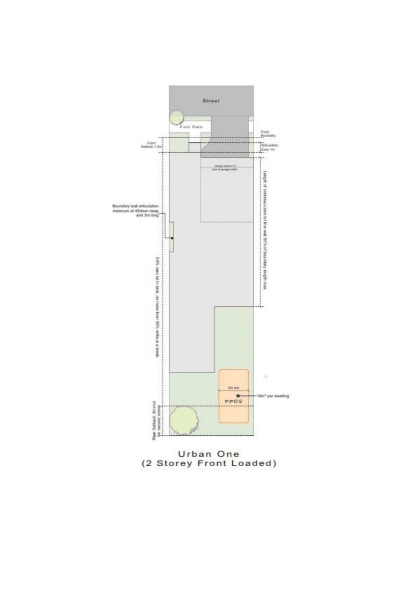

> [Picture on page 90: a picture, saved as a picture (images/part-e17-huntlee-page-90-1.gif, 150 dpi).]

#### Figure 36: Indicative layout for Urban One lots (2 storey front loaded)

### 5.6 Other development in residential areas

The residential zones permit a range of non-residential land uses which, depending on their scale, suitability, location and design, may be compatible with adjoining residential uses. Allowing non-residential development in the residential zones is appropriate providing that controls are in place to minimise the negative impacts of noise, loss of privacy, traffic, parking and other nuisances on local residential amenity.

#### 5.6.1 General requirements

#### Objectives

(1) To establish appropriate controls to minimise the adverse effects of non-residential development on surrounding residential development.

(2) To maintain consistency in development standards between non-residential and residential land uses and ensure that buildings are similar in height, bulk and scale to surrounding buildings.

(3) To ensure that non-residential development is appropriately located.

(4) To avoid concentrations of non-residential uses in any particular area where the cumulative impact on residential amenity would be unacceptable.

#### Controls

(1) Site analysis information as required by Section 5.2 is to be submitted with all applications for non-residential development in residential zones.

(2) Non-residential development on residential zoned land is to comply with the requirements of Section 5.3 of this DCP in relation to residential amenity and sustainable building design.

(3) The maximum site coverage of buildings is 60% of the total site area.

(4) The minimum landscaped area for non-residential development is 20% of the total site area of the allotment.

(5) Provision of car parking for non-residential uses will be assessed by Council on an individual basis but must be sufficient to meet demand generated by staff and visitors.

(6) Where there is an inconsistency between the general requirements of this clause and the specific controls in the following sections, the specific controls prevail.

(7) Council will have particular regard to the effects of non-residential development in the residential zones. Council will consider whether:

• the proposed development will be out of character with surrounding residential development, particularly in relation to the height and/or scale of any proposed buildings and the controls in Section 0,

• the proposed development will contribute to an undesirable clustering of that type of development, or non-residential uses in general, in the area,

• an undesirable effect on the amenity of the surrounding area will be created,

• the proposed use will draw patronage from areas outside of the surrounding neighbourhood, and the extent to which that patronage might impact on the amenity of residents through factors such as traffic generation, noise or the overall scale of the non-residential use,

• a noise nuisance will be created,

• the development will generate traffic out of keeping with the locality,

• adequate facilities are provided for the purposes of parking, loading and deliveries, and

• adequate provision is made for access by disabled persons.

(8) Non-residential development in residential zones should be similar in bulk, scale, height and siting to the surrounding buildings.

(9) Finishes, materials, paving and landscaping are to be consistent with those of surrounding residential development.

#### 5.6.2 Education establishments and places of public worship

#### Objectives

(1) To encourage the appropriate location of facilities to create community focal points, centres of neighbourhood activity and enhance community identity.

(2) To mitigate the impacts of noise, privacy, increased traffic and nuisance on surrounding residential development.

#### Controls

(1) Development for the purpose of an educational establishment are to satisfy the provisions of the State Environmental Planning Policy (Education and Child Care) 2017.

(2) Places of worship are to be located within centres or co-located with other community facilities in residential areas so as to create a community focal point, to share facilities such as parking, and to minimise impacts on residential areas.

(3) Places of public worship and educational establishments are preferably to be located on land with frontage to a collector road. Corner sites are preferred.

(4) In assessing applications, Council will consider the following:

• the privacy and amenity of adjoining developments,

• the need and adequacy for provision of buffer zones to surrounding residential development,

• urban design,

• location,

• the size of the land where the development is proposed,

• traffic generation and the impacts of traffic on the road network and the amenity of nearby residents,

• the availability of parking,

• the scale of buildings and their capacity, and

• hours of operation and noise impacts.

(5) A traffic and transport report/statement is to accompany the Development Application addressing the impact of the proposed development on the local road system and defining car parking requirements.

(6) A landscape plan and associated documentation is to be submitted with the Development Application identifying existing vegetation and community plant species and/or existing design elements of the site layout, and the proposed landscaping treatment of the development.

(7) Car and bicycle parking spaces for places of public worship and educational establishments shall be provided on site in accordance with Table 11 .

Table 11: Car and bicycle parking for places of public worship and educational establishments

| Land use Parking requirement |  |
|---|---|
| Places of public worship | 1 space per 4 seats or 1 space per 10m2 of seating area (whichever is greater) and 1 bicycle parking space per 10 seats |
| Primary and secondary schools | 1 space per staff member; and 1 space per 100 students |
| Senior high school | 1 space per staff member; and 1 space per 5 students in Year 12 |
| Tertiary and adult education establishments | 1 space per 5 seats or 1 space per 10m2 of seating area (whichever is greater) |
| All Educational Facilities | 1 bicycle parking space per 5 students |

(8) Development must be designed to minimise the possibility of noise disturbance to the occupants of adjoining or neighbouring dwellings.

(9) Development must be designed to minimise the possibility of noise to the occupants of adjoining or neighbouring dwellings.

(10) Where appropriate buffers should be put in place to limit noise impacts on the surrounding area.

(11) Sources of noise such as garbage collection, machinery, parking areas and air conditioning plants are sited away from adjoining properties and screened/ insulated by walls or other acoustic treatment.

(12) The general hours of operation for places of public worship and educational establishments are between 7am and 9pm.  Variation to the approved hours of operation may be approved by Council subject to other requirements or a merit assessment.

#### 5.6.3 Neighbourhood shops

#### Objectives

(1) To ensure the appropriate provision of retail uses to serve the needs of the local community.

(2) To minimise the impacts of retail activities on surrounding residential areas.

(3) To ensure that retail activities in residential areas do not detract from the function or viability of nearby centres.

(4) To ensure the appropriate location of neighbourhood shops.

#### Controls

(1) For neighbourhood shops, the controls in the following sections of this DCP apply:

• Section 5.4.2 - Streetscape and architectural design,

• Section 5.4.4 - Side and rear setbacks,

• Section 5.4.5 - Dwelling height, massing and siting, and

• Section 5.4.8 - Garages, site access and parking.

(2) Shops fronts are to encourage active and interactive street frontages that are sympathetic to the streetscape with similar materials to adjoining buildings to be used.

(3) Neighbourhood shops must have a minimum 1m setback, unless on a corner site, and footpath activation is required within any setback provided.

(4) Address and entry points for any residential use on the same allotment of land are to be separate from the retail use access points and be readily identifiable.

(5) Design of the building frontage, front and side setbacks are to include safe and convenient pedestrian facilities such as weather protection, shade, seating and landscaping.

(6) On corner sites, shop fronts are to wrap around the corner and zero setbacks are permitted.

(7) Entrances are to be visible from the street and well lit.

(8) Car parking areas are to be located at the side or rear of the site.

(9) The site should not gain direct access to:

• A road with clearway or other parking restrictions, or

• An arterial road.

(10) Plant and equipment (particularly cooling or heating plant), is to be located so as to not cause noise annoyance to neighbours.

(11) Waste storage areas must be designed to minimise visual impact and should be screened and properly positioned so as to not to attract pests and cause odour problems for neighbours.

(12) All goods storage is to be internal.

#### 5.6.4 Seniors housing

#### Objectives

(1) To ensure that the design of seniors housing is consistent with the character of surrounding residential areas.

#### Controls

(1) Applications for seniors housing are to comply with the controls for multi-dwelling housing in Section 5.5.1 of this DCP and the controls within State Environmental Planning Policy (Housing for Seniors or People with a Disability) 2004.
