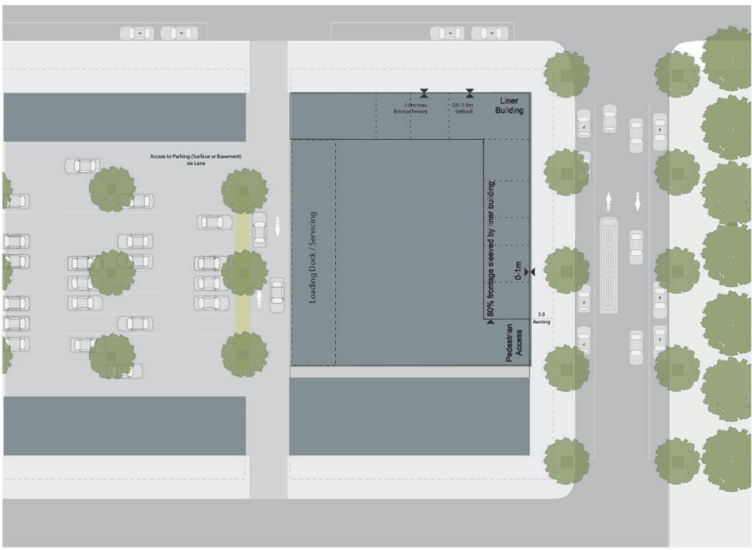
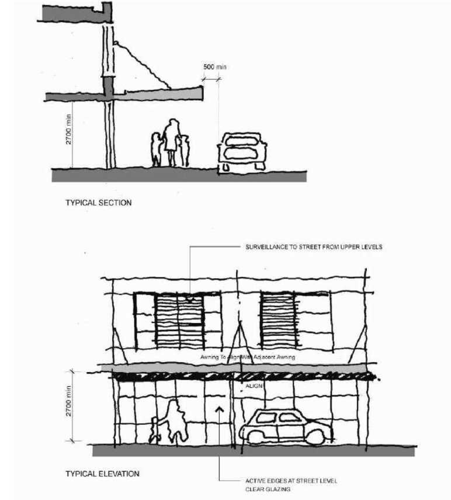
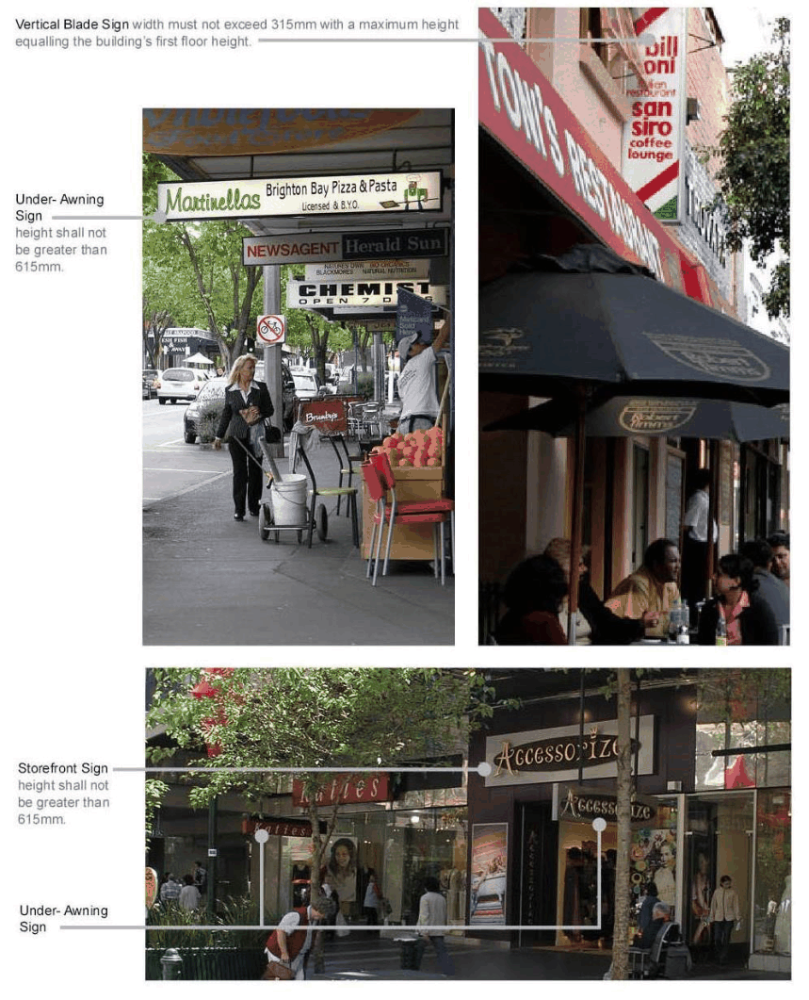
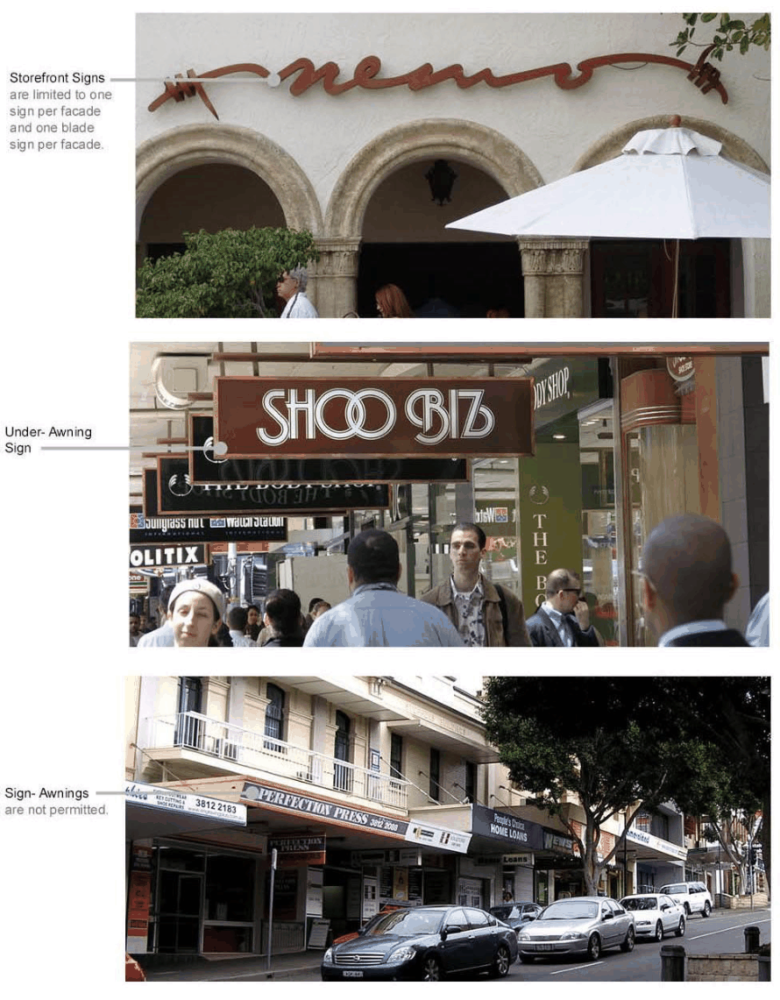
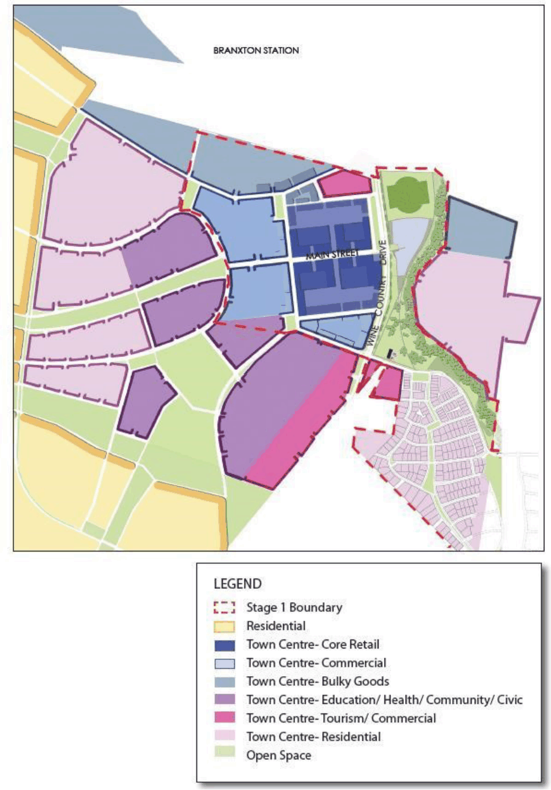
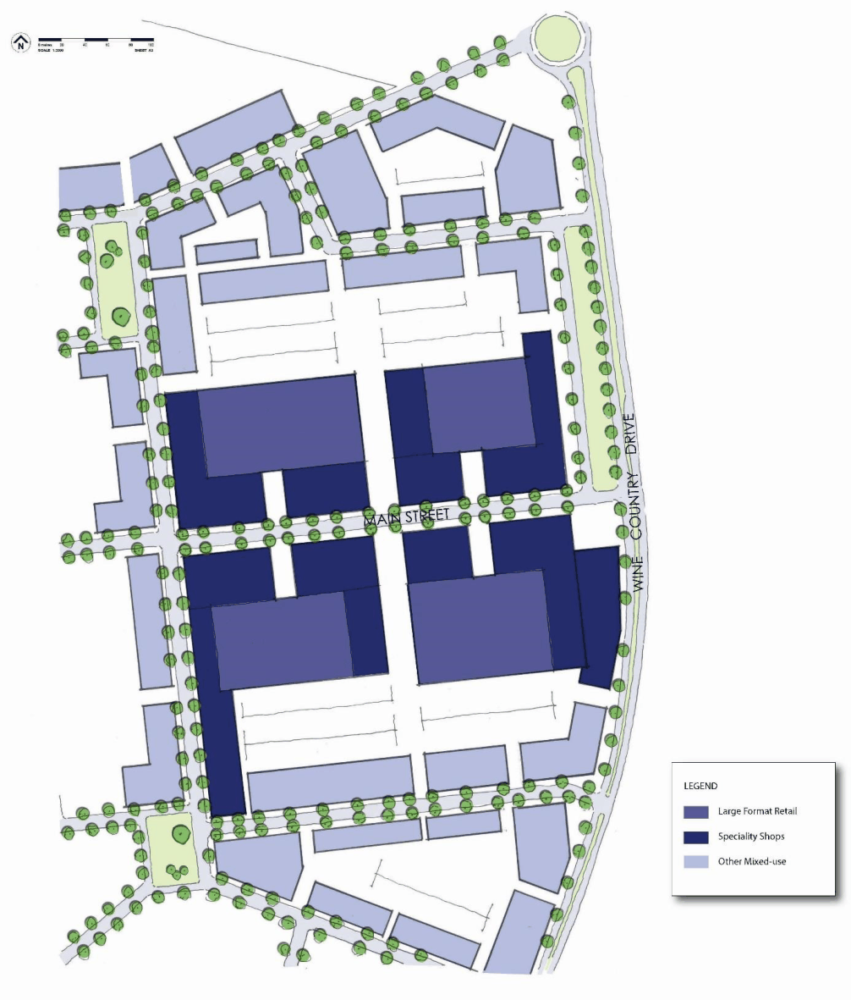
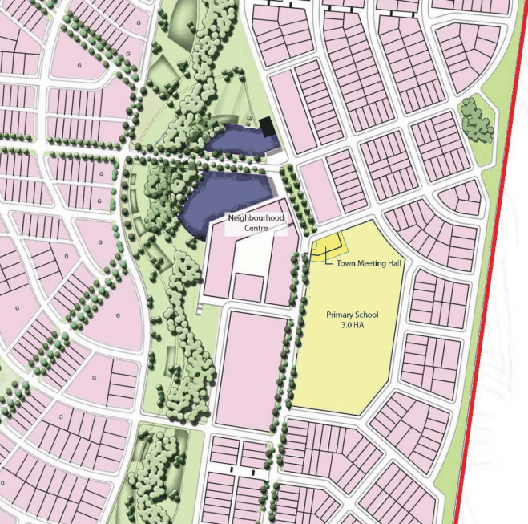

## 6 Town and Village Centres

This part of the DCP outlines the objectives and design principles for the town centre retail, commercial and service uses within the B4 Mixed Use zone and neighbourhood shops and services within the village centres. The overall controls in Section 6.1 apply to retail and commercial development within both the town and village centres with more specific controls for the town centre in Section 6.2 and village centres in Section 6.3.

#### Overall objectives

(1) To provide a range of retail, business, bulky goods retailing, service commercial and support uses to service the needs of people living, working and visiting the town centre, as well as the broader area.

(2) To provide new jobs in a concentration of retail, community, entertainment, health and professional services for the local and broader population.

(3) To ensure a high level of self-sufficiency in employment within the region, with opportunities for maximising home based and localised employment.

#### 6.1.1 Active street frontages

#### Objectives

(1) To promote pedestrian activity and safety in the public domain.

(2) To maximise active street fronts in the town and village centres.

(3) To define areas where active streets are required.

(4) To provide an identifiable and desirable street address to residential buildings outside of areas where active street fronts are required.

(5) To clearly and consistently define the street edge.

(6) To allow for outlook to and surveillance of the street.

#### Controls

(1) Active frontage uses are defined as any of the following at street level:

• entrance to retail,

• shop front,

• glazed entries to commercial and residential lobbies,

• café or restaurant if accompanied by an entry from the street,

• active office uses, such as reception, if visible from the street, and/or

• public building if accompanied by an entry.

• Alfresco dining areas visible from the street

(2) Active street fronts, built to the street alignment, are required on the ground level of all retail and commercial development

(3) Large format retail such as supermarkets and parking areas are to be sleeved or hidden by retail and commercial uses as shown in Figure 37.

(4) Ground floor residential uses (other than entries to lobbies to residential uses above ground level) are not permitted along Empire Street in the retail core area.

(5) Restaurants, cafes and the like are to consider providing openable shop fronts.

(6) Only open grill or transparent security shutters (at least 50% visually transparent) are permitted to retail and commercial frontages.

(7) On corner sites, shop fronts are to wrap around the corner.

(8) Entrances are to be visible to the street and well lit.

> [Picture on page 97: a picture, saved as a picture (images/part-e17-huntlee-page-97-14.gif, 150 dpi).]

#### Figure 37: Large format building and liner

#### 6.1.2 Awnings

#### Objectives

(1) To provide shelter for public streets where most pedestrian activity occurs.

(2) To address the streetscape by providing a consistent street frontage in the centres.

#### Controls

(1) Provide street frontage awnings to all new commercial and retail developments within the town centre and village centres of varying styles.

(2) Wrap awnings around corners on street corner buildings.

(3) Cantilever awnings from buildings are to have a minimum soffit height of 3.2m and a maximum of 4.5m.

(4) Low profile awnings with slim vertical fascias and/or eaves (not to exceed 300 mm) are encouraged.

(5) Awnings are to be a minimum of 2.5m deep (dependant on street width) and setback from the kerb a minimum of 500mm to allow clearance for street furniture, trees etc.

(6) Steps for design articulation or to accommodate sloping streets are to be integrated with the building design and should not exceed 700mm.

(7) Provide under awning lighting to facilitate night use as well as improve public safety. Lighting is to be recessed into the soffit of the awning, or wall mounted onto the building.

(8) Any under awning signage is to maintain a minimum clearance of 2.7m from the level of the pavement.

> [Picture on page 99: a picture, saved as a picture (images/part-e17-huntlee-page-99-1.gif, 150 dpi).]

#### Figure 38: Awnings

#### 6.1.3 Signage

#### Objectives

(1) To permit adequate identification and business advertising that achieves a very high level of design quality in terms of graphic design, its relationship to the architectural design of buildings and the character of streetscapes.

(2) To promote signage that complements the scale and character of a building.

(3) To avoid the creation of visual clutter on buildings and streetscapes.

(4) To ensure compatibility with the desired urban character of adjacent land uses.

(5) To consider the amenity of residential development and the visual quality of the public domain.

(6) To ensure that advertising signs do not adversely affect the safety of motorists and other road users.

#### Controls

General Signage

(1) Signage must be integrated into the building façade and achieve a high degree of compatibility with the architectural design of the supporting building having regard to its composition, fenestration, materials, finishes, and colours. Architectural features of the building are not to be obscured.

(2) One under-awning sign is permitted on each shop or commercial premises.

(3) Signs including real estate signs and temporary signs are not allowed to stand on the top of awnings.

(4) The total area of all signs is not to exceed 1m2 of advertising area per 1m of shop frontage. This includes signs painted on blinds or windows.

(5) Signs that contain additional advertising promoting products or services not related to the approved use of the premises or site (such as the logos of brands or products) are not permitted.

(6) Signs painted on or applied to the roof are not permitted.

(7) Directional signage and public notices are to have a coordinated appearance and help to establish the town centre as a unique destination and place.

Illuminated Signs

(1) Illumination (including cabling) of signs is to be

• concealed, or

• integral with the sign, or

• provided by means of carefully designed and located remote or spot lighting.

(2) Restricted hours shall be imposed on the operation of illuminated signs where continuous illumination is considered to impact adversely on the amenity of residential buildings, serviced apartments or other visitor accommodation, or have other adverse environmental effects.

(3) Up-lighting of signs is prohibited. Any external lighting of signs is to be downward pointing and focused directly on the sign and is to prevent or minimise the escape of light beyond the sign.

Signage and Road Safety

(1) Signs are regarded as prejudicial to the safety of road users if they:

• are to obscure or interfere with road traffic signs and signals or with the view of a road hazard, oncoming vehicles, or any other vehicle or person, or an obstruction which should be visible to drivers or other road users,

• give instructions to traffic by use of the word ‘stop’ or other directions, which could be confused with traffic signs,

• are of such a design or arrangement that any variable messages or intensity of lighting impairs drivers’ vision or distracts drivers’ attention, and

• are situated at locations where the demands on drivers’ concentration due to road conditions are high such as at major intersections or merging and diverging lanes.

> [Picture on page 102: a picture, saved as a picture (images/part-e17-huntlee-page-102-1.gif, 150 dpi).]

(Figure continued next page)

> [Picture on page 103: a picture, saved as a picture (images/part-e17-huntlee-page-103-1.gif, 150 dpi).]

#### Figure 39: Preferred location of signage

#### 6.1.4 Parking

#### Objectives

(1) To provide an appropriate level of on-site car and bicycle parking to cater for a mix of development types and location.

(2) To minimise the visual impact of on-site parking.

(3) To integrate parking facilities with the overall site planning and landscape.

(4) To encourage the use of bicycles.

#### Controls

(1) On-site car and bicycle parking for commercial and retail premises is to be provided in accordance with the standards set out in Table 12 and Table 13.

(2) The parking area per vehicle is to be in accordance with Australian Standard AS 2890:1.

(3) All outdoor parking areas shall be appropriately screened by planting and/or fencing.

(4) At grade car parks shall provide landscaping and tree planting and consider providing weather protection.

(5) Basement parking must not to be raised more than 1m above ground level.

(6) In the Core retail precinct, town centre and all village centres, parking is not permitted within the front setback. Parking and servicing is to be located to the rear of buildings, or below grade, to minimise impacts on the streetscape and pedestrian amenity.

(7) Rear lanes should be utilised where possible to access parking areas.

(8) All bicycle parking is to be in secure and accessible locations. Bicycle parking for employees is to have weather protection.

#### Table 12: Car parking for commercial and retail premises

| Use | Requirement |
|---|---|
| Retail uses | 1 space per 25m2 GFA for supermarkets and discount department stores 1 space per 50m2 for main street, village centre and other retail |
| Commercial | 1 space per 50m2 |

#### Table 13: Bicycle parking for commercial and retail premises

| Use | Requirement |
|---|---|
| Supermarkets | 1 space per 750m2 GFA for employees 1 space per 1000m2 GFA for shoppers |
| Specialty stores | 1 space per 300m2 GFA for employees 1 space per 300m2 GFA for shoppers |
| Commercial | 1 space per 150m2 GFA for employees 1 space per 750m2 GFA for shoppers |
| Community centres | 6 spaces at community centre |

#### 6.1.5 Site servicing

#### Objectives

(1) To ensure that site facilities are functional and accessible to all residents and are easy to maintain.

(2) To ensure that site facilities are thoughtfully integrated into the development and are visually and physically unobtrusive.

(3) To minimise the impact of service access on pedestrians and retail, commercial and residential frontage.

(4) To minimise the visual and acoustic impact of site servicing.

#### Controls

(1) Garbage, mail box structures, service meters, air conditioners and the like are to be integrated with the overall design of the buildings and/or landscaping. Garbage storage areas are not permitted along the primary and / or secondary street frontage.

(2) Provide adequate space within any new development for the unloading and loading of service vehicles.

(3) Loading facilities must be located to the rear of each development.

(4) Ventilation stacks are to be utilised wherever possible to vent shops and basements.

(5) All service areas are to be screened from existing developments.

(6) Service access is permitted from rear lanes, side streets or right of ways.

(7) Vehicles must be able to enter/exit in a forward direction.

(8) Provide truck turning facilities.

### 6.2 Town Centre

#### Objectives

(1) To create a vibrant Town Centre that provides a high level of amenity.

(2) To ensure that the detailed design of the Town Centre is undertaken in a coordinated manner in order to achieve a high quality urban design outcome.

(3) To create a sense of place through the relationship of the Town Centre to the landscape.

(4) To promote a pedestrian friendly main street through the Town Centre.

(5) To ensure that the Town Centre is centrally located and easily accessible by pedestrians, cyclists and public transport users.

(6) To ensure that the Town Centre can be serviced by public transport.

(7) To provide a good range of retail and commercial services for the future communities.

(8) To promote a Town Centre that is financially viable and easy to stage.

#### Controls

(1) The Town Centre and its various land use types are to be located generally in accordance with Figure 40. An indicative layout plan of the Town Centre core retail area is shown at Figure 41.

(2) Any departure from Figure 40 or Figure 41 must demonstrate that the objectives for the Town Centre can be met, and show how the residual lots can be developed in the future.

(3) The Town Centre is to be consistent with the following principles:

Function and uses

(1) Incorporate a range of retail, commercial and community uses to serve the needs of the community.

(2) Incorporate higher density housing and mixed use development.

(3) Concentrate intensive retail uses along and fronting Empire Street.

(4) Provide a mix of uses that promote an active and vibrant town centre.

> [Picture on page 107: a picture, saved as a picture (images/part-e17-huntlee-page-107-1.gif, 150 dpi).]

#### Figure 40: Huntlee Town Centre (indicative)

> [Picture on page 108: a picture, saved as a picture (images/part-e17-huntlee-page-108-1.gif, 150 dpi).]

#### Figure 41: Huntlee Town Centre indicative retail core layout

Built form

(1) Provide a range of building heights, up to a maximum of six storeys with a transition in heights to surrounding residential areas.

(2) Relate building heights to street widths and functions to promote a comfortable urban scale of development.

(3) Define streets and open spaces with buildings that are generally built to the street edge, have a consistent street wall height and provide a continuous street frontage along all key streets.

(4) Sleeve all large format retail premises and decked parking areas with active uses. Blank walls visible from the public domain are to be avoided.

(5) Promote diversity and activity along the main street with a variety of frontage widths for retail shops.

(6) Building heights are to take into account view lines and solar access to the public domain.

(7) A high quality built form and energy efficient architectural design that promotes a ‘sense of place’ and modern character for the Town Centre.

(8) Waste storage and collection areas are to be accommodated and designed appropriately to minimise impacts, in particular within mixed use development.

Parking and access

(1) Access to parking, loading docks and waste collection areas must not be provided from Main Street frontages.

(2) At grade parking areas are to be generally located behind building lines and within the centre of street blocks away from street corners.

(3) On-street parking is to be provided on all streets within the Town Centre to contribute to street life and surveillance.

(4) Allowance should be made for potential direct pedestrian access to the train station from the town centre core retail area. Pedestrian access paths should be incorporated into the road layout for the service industry area north of the core retail area.

Public domain

(1) Parks and plazas are to act as a focal point for the Town Centre and community activities and are to be designed to ensure adaptability and flexibility in use and function over time.

(2) Incorporate a town square/civic plaza, adjacent to the main street which provides an urban landscape setting and a civic focus for the community.

(3) Provide high amenity, pedestrian streets with generous footpath widths.

(4) Incorporate the principles of ‘Crime Prevention Through Environmental Design’ and ‘Safer by Design’ into all development within the Town Centre.

(5) Weather protection for pedestrians is to be provided in key locations.

(6) Provide a high quality landscape design including a co-ordinated package of street furniture and lighting that enhances the character of the Town Centre.

(7) Provide street tree and open space planting that establishes generous shade for pedestrians.

(8) Design all signage and advertising in a co-ordinated manner.

(9) Site servicing and loading facilities, waste storage and other infrastructure are to be designed to minimise visual impact on the public domain and impacts on neighbours.

### 6.3 Village centres

#### Objectives

(1) To create a vibrant village that provides a range of small-scale retail, business and community uses which serve the needs of people who live and work in the surrounding area.

(2) To ensure that the detailed design of the village is undertaken in a co-ordinated manner in order to achieve a high quality urban design outcome.

(3) To create a vibrant village adjacent to residential areas and schools.

> [Picture on page 110: a picture, saved as a picture (images/part-e17-huntlee-page-110-17.gif, 150 dpi).]

#### Figure 42: Village 1 centre layout (indicative)

#### Controls

(1) The Stage 1 Village Centre is to be located generally in accordance with Figure 42.

(2) The village centres, including Stage 1 and the remaining precincts, shall be generally consistent with the following principles:

Function and uses Incorporate a range of local retail, commercial and community uses to serve the needs of the local community.

Built form

(1) Provide a range of building heights, up to a maximum of four storeys.

(2) Buildings are to define the entry to the residential areas and open spaces adjacent to the village and are to be generally built to the street edge.

(3) Avoid blank walls visible from surrounding streets and the public domain.

(4) Establish a high quality built form and energy efficient architectural design that promotes a ‘sense of place’ for the village.

Parking and access

(1) Locate at grade parking areas behind building lines and screened from streets and public open space.

(2) Opportunities for shared parking provision for complementary uses within the village centre are to be provided.

(3) On-street parking is to be provided within the village centre.

Public domain

(1) Provide a high quality landscape design including a co-ordinated package of street furniture and lighting that enhances the character of the village.

(2) Provide street tree and open space planting that establishes generous shade for pedestrians.

(3) Incorporate the principles of Crime Prevention through Environmental Design (CPTED) and Safer by Design (NSW Police) into all development within the village centre.

(4) Site servicing and loading facilities, waste storage and other infrastructure are to be designed to minimise visual impact on the public domain and impacts on neighbours.
