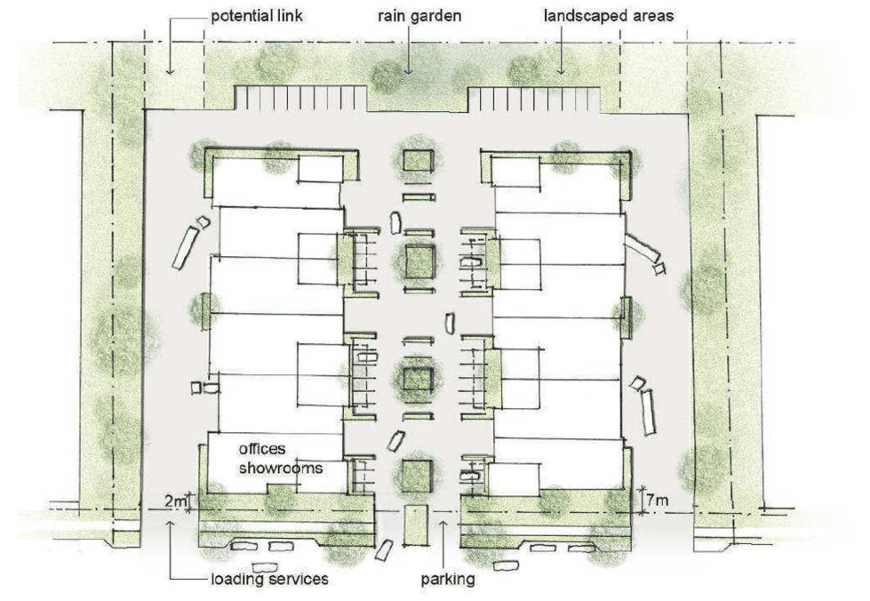

## 7 Employment Areas

### 7.1 Introduction

This section applies to the non-residential, non-retail uses within the employment areas of Huntlee Town Centre such as service industry and bulky goods uses.

### 7.2 Landscape design

#### Objectives

(1) To ensure a balance between built form and landscaped elements

(2) To encourage landscaping as a means of screening industrial development.

(3) To enable landscaping to contribute to energy efficiency water management and amenity for employees.

(4) To encourage a high standard of landscape design that enhances the streetscape and amenity of the zone.

#### Controls

#### 7.2.1 Allotment frontages

(1) Street tree planting is to be implemented at the subdivision stage to ensure plantings are visually consistent in height, spread and form across the zone.

(2) A landscape area must be provided along the street front.

(3) The selection of plant species for street tree planting must be in accordance with Table 2.

#### 7.2.2 Allotment landscaping

(1) A Landscape Plan must be prepared for all new industrial subdivisions and new buildings.

(2) Landscaped areas are required between buildings.

(3) Allotment landscape design is to be integrated with site planning and building design to:

• reduce the perceived scale of built form from the street,

• reduce visual impact and the extent of continuous building facades,

• highlight architectural features and complement façade articulation,

• identify site and building entries, car park entries and parking areas, in coordination with signage,

• mitigate adverse site conditions through buffering of western sun, provision of shade, wind protection, and screening of poor views,

• maximise northern sun exposure, and

• integrate usable and attractive external seating and amenity areas for staff incorporating paved areas, soft landscape, and shade planting (and canopies where necessary).

(4) Allotment landscape should incorporate hard and soft landscape elements in pavements, retaining walls, low walls and terracing, trees, garden bed planting, turfed areas and irrigation.

(5) Indigenous species from the area are encouraged for all landscape plantings however, non-native species may be considered in limited use to external courtyard areas to achieve seasonal climate management. Trees should be a minimum height of one metre at the time of planting. Mass plantings may use a variety of sizes including viro tubes.

(6) The allotment landscape is to be provided with an automatic trickle irrigation system installed below mulch level. The system is to be supplied by rainwater collected from the site.

(7) Landscaped areas are to be separated from vehicular access areas by an appropriate edge, preferably a raised kerb.

(8) Landscaped areas are to be separated from storage areas by an appropriate edge, preferably low walls. Signage and management strategies are to be put in place to ensure that storage activities do not impact on, or extend into, landscaped areas. No storage is allowed in landscaped areas.

#### 7.2.3 Landscaping of car park areas

(1) Car parking areas are to be effectively landscaped to:

• reduce their visual impact,

• reduce heat generation and glare from hard paved surfaces,

• provide shade for parked vehicles, and

• maximise potential for soft drainage (non-piped) to soft landscaped areas or collection zones.

(2) Car park lighting design is to be coordinated with the preferred tree layout.

(3) Dividing zones between parking bays should be landscaped as applicable to specific site conditions:

• where pedestrian access will generate desire lines across the dividing zone, pedestrian trafficable wearing surface is required (eg. stabilised gravel),

• where pedestrian access is not required and some infiltration drainage may be provided, mass planted landscape areas (requiring flush kerb edge and wheel stops to car parking bays) must be provided, and

• where a major drainage role is envisaged and pedestrian access is not required, a gravel surfaced trench with collection pipework draining to on site storage or stormwater must be provided.

(4) Clearly defined and appropriately surfaced pedestrian access links from parking areas to building entry points must be provided, incorporating kerb crossing ramps as required.

(5) Car park landscaping is to be provided with an automatic trickle irrigation system installed below mulch level. Irrigation services provision must be implemented before car park surfacing. The system is to be supplied by the rainwater tanks on site.

### 7.3 Built form and streetscape

#### 7.3.1 Building setbacks

#### Objectives

(1) To achieve attractive streetscapes by ensuring that buildings present an acceptable scale and bulk when viewed from the public domain.

(2) To provide appropriate setbacks to the proposed use and characteristics of the location of the land.

(3) To define building envelopes within each allotment by specifying minimum setbacks.

#### Controls

(1) All buildings erected in employment areas are to be set back a minimum of 2m from the front property boundary.

(2) No building or hardstand area (concrete or bitumen pavement) other than a public utility undertaking shall be erected within any setback.

(3) All setback areas should be landscaped and maintained in accordance with the landscape provisions in Section 7.2.

(4) Pedestrian access should be provided to all landscaped setback areas for maintenance and security purposes.

#### 7.3.2 Building design and siting

#### Objectives

(1) To activate streets and the public domain with building frontages.

(2) To provide a variety of building orientations and create defined streetscapes that respond to site conditions.

(3) To ensure that building design enhances the existing and future desired built form character by encouraging innovation and quality architectural design.

#### Controls

(1) Blank building facades facing the primary street frontage are not permitted.

(2) The built form and architecture of buildings located at street corners should enhance its location and positively respond to and emphasize the street corner.

(3) Building orientation and siting should respond to natural elements such as topography, wind and sunlight.

(4) Parking is not permitted in front of the building line.

> [Picture on page 115: a picture, saved as a picture (images/part-e17-huntlee-page-115-14.gif, 150 dpi).]

#### Figure 43: Typical building layout for light industrial area

(5) Buildings should provide variety to facades by the use of projecting upper storeys over building entries, upper storey display windows, emphasizing street corners and varying roof forms.

(6) Buildings should provide effective sunshading for windows, wall surfaces and building entries, (other than loading docks) by the use of design elements such as overhanging eaves and awnings, undercrofts, colonnades and external sunshading devices including screens.

(7) Building design should be integrated with landscape elements.

(8) Building facades should be articulated by elements such as:

• external structures, finishes, etchings and recessed patterns,

• decorative features, textures and colours,

• locating offices and highlighting entries within front facades, •

emphasized customer entries and service access doors, and

• protrusions and penetrations in building elements.

(9) Buildings with dual street frontage should be designed to ensure:

• the building addresses the primary street frontage, and

• distinctive identifying architectural elements are incorporated to provide sufficiently interesting and varied facades.

(10) The building design should consider the amenity of any landscaped or communal areas in adjoining properties.

(11) The location of roller shutters, loading docks and other building openings should be so that they do not detract from the overall appearance of the building. Where possible, roller shutters and the like should not be located on the primary street frontage.

(12) Roof design should be visually interesting and provide for natural lighting, and compatibility with the overall building design. Where visible from a public area, all rooftop or exposed structures (lift motor rooms, plant rooms etc), must be suitably screened and integrated with the building.

#### 7.3.3 External building materials and colours

#### Objectives

(1) To enhance the visual quality of development through the selection of appropriate materials and colours.

(2) To encourage the use of materials that minimise impact on the environment.

(3) To ensure that any reflective materials are used with sensitivity to neighbouring development, vehicular traffic and public domain areas.

(4) Create identifiable, attractive and safe entrances to buildings.

#### Controls

(1) External finishes should be constructed of durable, high-quality and low maintenance materials.

(2) External finishes should contain a combination of materials and/or colours.

(3) Any wall visible from the public domain must be finished with a suitable material to enhance the appearance of that façade.

(4) Building materials should be selected to minimise reflection.

#### 7.3.4 Entrance treatment

#### Objectives

(1) To create clear and legible entries that address the street.

#### Controls

(2) Entries to buildings should be clearly visible, well sign posted and lit to pedestrians and motorists.

(3) Architectural features are to be provided at ground level giving an entrance element to the building and addressing the primary street frontage.

(4) All entrance treatments, such as directory boards, must be located on private property, with appropriate positive covenants and restrictions on title to ensure the ongoing management of such treatments.

(5) No third party advertising will be permitted on any entrance treatment facility.

#### 7.3.5 Ancillary buildings, storage and service areas

#### Objectives

(1) To ensure that ancillary buildings, storage and service areas are considered part of the overall design, and do not detract from the amenity and appearance of the development.

(2) To ensure that site facilities are functional and accessible and are easy to maintain.

(3) To ensure that site facilities are thoughtfully integrated into the development and are visually and physically unobtrusive.

(4) To minimise the impact of service access on pedestrians and industrial, commercial and retail frontage.

(5) To minimise the visual and acoustic impact of site servicing.

#### Controls

(1) Ancillary buildings and storage sheds are to be located behind the setback lines and be consistent with the design of the main building.

(2) Details of any proposed ancillary buildings, open storage and services areas must be submitted with all Development Applications.

(3) Storage areas should be located within the confines of the primary building. Appropriate screening must be provided where this can not be achieved.

(4) Above ground open storage areas visible from the public domain are not permissible.

(5) Above ground open storage areas should not compromise truck or vehicle maneuvering and car parking areas.

(6) Vehicular access to loading facilities is to be provided from secondary and tertiary streets.

(7) Rubbish and recycling areas must be provided. These areas must:

• be integrated with the development,

• minimise the visibility of these facilities from the street, and • be

located away from openable windows to habitable rooms.

(8) Sunken loading docks should be avoided.

### 7.4 Ecologically Sustainable Development

#### Objectives

(1) To improve energy efficiency through the design and siting of buildings;

(2) To ensure that developments are environmentally sustainable in terms of energy and water use, and management of waste and discharge.

(3) To encourage the utilisation of materials and construction techniques with low energy inputs in their production for construction energy systems.

#### Controls

(1) A Site Water Management Plan must be prepared.

(2) Development Applications are required to demonstrate consideration of:

• measures that will reduce waste and conserve water through water recycling,

• measures to minimise run-off and stormwater generation,

• implementing total water cycle management by including measures that reduce consumption of potable water for non-potable uses, minimise site runoff and promote stormwater re-use,

• utilising recycled materials and renewable building resources,

• promoting biological diversity through appropriate retention, planting and maintenance of indigenous flora of the area,

• implementing a waste management strategy that promotes the overall reduction of waste levels, and

• implementing energy conservation measures that include reducing energy consumption and increasing inherent energy efficiency through design and materials selection, and adopting energy management plans.

(3) Roof stormwater should be collected in tanks or street level reticulation which would serve as a retention system. The water in the retention system would be available for use for non-potable uses such as the watering of landscaped areas and use in toilet and hot water systems.

(4) Consideration should be given to the feasibility of any measures to substitute gridsource power with environmentally sustainable alternatives such as tri-generation (green transformers), co-generation (i.e. recovery of waste energy) or photovoltaics.

(5) Development shall incorporate water efficient fixtures such as taps, showerheads, and toilets. The fixtures must be rated to at least AAA under the National Water Conservation Rating and Labelling Scheme. Where the building or development is water intensive (ie. high water user), specific water conservation objectives must be resolved with Council.

(6) Appropriate use of energy efficient materials during construction is to be demonstrated.

(7) Development should incorporate energy efficient hot water systems, airconditioning, lighting and lighting control systems.

### 7.5 Waste water and sewage treatment

#### Objectives

(1) To ensure best practice water management and sewerage treatment practices are implemented within Huntlee.

#### Controls

(1) All sewage treatment plants should use best practice, and ensure design and capacity is adequate.

(2) Appropriate use of grey water is encouraged in all new developments.

### 7.6 Fencing, Signage and Lighting

#### Objectives

(1) To use fencing to define boundaries and provide security, as well as contribute to streetscape and amenity of the zone.

(2) To enhance pedestrian safety, security and amenity within the precinct.

(3) To ensure that signage and lighting supports the visual appearance of the building and the visual appeal of the zone.

#### 7.6.1 Fencing

#### Controls

(1) Low feature walls are encouraged at entry driveways. These walls should be used for retaining purposes, as garden beds or as landscaped features and should be integrated into the overall design of the development.

(2) Front and side boundary fences forward of the building line should consist of an open style fence finished in a dark colour.

(3) Side fencing behind the building line may comprise chain wire mesh or similar open style fence, plastic coated in dark green or black.

(4) Pre-painted solid metal fencing and other solid fencing is not permissible.

(5) High fencing should be located behind the building line. Where high fencing in the front setback cannot be avoided, Fencing must be set back 1m from the front property boundary to allow for perimeter landscaping.

(6) Fencing should be sited so it does not impede sightlines for drivers.

(7) Fencing along boundaries should not exceed a height greater than 3m, measured from finished ground level.

#### 7.6.2 Signage and Lighting

#### Controls

(1) Signage is to relate to the use occurring on the respective property, and should identify the relevant business name.

(2) Business identification signage should be attached to the wall of the main building and be designed to complement the architectural style of the building. Free standing signs will only be permitted where signs are integrated with the landscaping and visual character of the site and surrounding area.

(3) Directional signs for car parking areas, loading docks, delivery areas and the like should be located close to the main access of a development site. The design, colouring, type and scale of signage within individual properties should be consistent with signage across the zone as a whole.

(4) Signage is only to display corporate logos and company names and is not to occupy more than 10% of any façade or wall of a building, unless it can be demonstrated that characteristics of the site or the building require a larger area of signage.

(5) Details of all signage, including free standing, fascia, and wall signs must accompany Development Applications.

(6) The design and lux of any internal or spot lighting shall be designed to avoid offsite or traffic safety impacts.

(7) No form of moving or flashing signage or lighting is permitted.

(8) Signage is not to have a detrimental impact on the visual character of the site or surrounding area.

### 7.7 Access and Parking

#### 7.7.1 Vehicular Access

#### Objectives

(1) To ensure that vehicles can enter and exit premises in a safe and efficient manner in a forward direction.

(2) To minimise the impact of vehicle access points on the quality of the public domain and pedestrian safety.

(3) To provide off-street manoeuvring, loading and docking facilities that are adequate for the operational needs of the activity and use.

#### Controls

(1) Applicants are required to submit plans and details of proposed vehicular access and circulation for Council’s approval with the Development Application. Details must specifically relate to vehicular movement, layout and turning circles.

(2) Adequate vehicular entrance to and exit from the development is to be provided and designed in order to provide safety for pedestrians and vehicles using the site and adjacent roadways. In some cases combined ingress and egress will be permitted.

(3) Vehicular ingress and egress to the site must be in a forward direction at all times.

(4) Driveway crossovers accesses by heavy vehicles should be a minimum of 9m wide, when measured at the kerb alignment.

(5) Turning circles will not be permitted to encroach upon any building.

(6) Adequate space is to be provided within the site for the loading, unloading and fuelling (if applicable) of vehicles. These areas are to be screened from the road.

(7) All parking areas and access roadways must be provided with a drainage system comprising surface inlet pits. Details of pipe sizes (with calculations) and drainage layouts (including discharge points) must be submitted with the Development Application.

(8) Vehicular access should be designed to avoid conflicts with pedestrians.

(9) Adequate space shall be provided within any development site for the loading and unloading of service vehicles. The standard of loading facilities required will depend upon the nature of the development and the uses to be carried out.

(10) Council may require the provision of parking for courier vehicles. Loading facilities should be located at the rear of developments.

(11) Vehicular movements associated with loading facilities and customer/employee parking should be separated and all pedestrian movements should be segregated from vehicular movements to avoid possible conflict and congestion.

(12) Ingress to and egress from a site should be located where they will cause least interference with vehicular and pedestrian movement on public roads. Direct access will not be permitted off arterial and sub-arterial roads. Access to parking areas will not be permitted in close proximity to traffic signals, intersections or where sight distance is inadequate.

(13) The potential for on-street queuing should be eliminated by the provision of sufficient standing areas on-site for vehicles entering the car parking and loading areas.

(14) Provision is to be made for all vehicles to enter and leave a site in a forward direction.

#### 7.7.2 Car parking

#### Objectives

(1) To provide an appropriate level of on-site car and bicycle parking.

(2) To minimise the visual impact of on-site parking.

(3) To integrate parking facilities with the overall site planning and landscape.

(4) To encourage the use of other modes of transport including bicycles and public transport.

#### Controls

(1) The provision of car parking in employment areas must comply with Table 14 and otherwise specified in the relevant Precinct Schedule.

(2) Secure bicycle parking is to be provided for employees at a rate of 1 space per 200m2 GFA.

#### Table 14: Car and bicycle parking for employment areas

| Use | Requirement |
|---|---|
| Light industrial | 1 space per 75m2 up to 7500m2 GFA 1 space per 200m2 thereafter 1 space per 40m2 GFA (office component) |
| Bulky goods retailing | 1 space per 45m2 GFA |
| Business park / offices | 1 space per 40m2 GFA |
| Bicycle Parking for above uses | 1 space per 200m2 GFA |

(3) At-grade parking areas are to be located so as to minimise visual impacts from the street, public domain and communal open space areas, using site planning and appropriate screen planting or structures.

(4) Parking areas are to be located generally behind front building lines.

(5) The car parking area should be accessible to all parts of the industrial development which it serves.

(6) The use of stack parking is not permitted.

(7) Parking facilities for commercial vehicles should be designed in accordance with Australian Standard 2890.2 to accommodate the largest type of truck which could reasonably be expected to park on the site.

(8) Sufficient spaces should be provided for disabled parking and shall be clearly marked and signposted for this purpose and located as close as possible to the building’s entrance.

(9) All parking areas shall be constructed of hard-standing, all-weather material, with parking bays and circulation aisles clearly delineated.

### 7.8 Waste Management

#### Objectives

(1) To maximise opportunities for re-use through source separation and on-site storage.

(2) To minimise waste generation and maximise re-use and recycling.

(3) To minimise waste generation through design, material selection and building practices.

(4) To ensure efficient storage and collection of waste and quality design of facilities.

#### Controls

(1) Facilities to allow on-site source separation and re-use of materials on-site should be provided.

(2) The siting of any stockpile must take into account environmental factors such as slope, drainage, location of watercourses and native vegetation.

(3) Sufficient space must be provided for the storage of garden waste and other waste materials on site.

(4) Re-use of stockpile materials on-site should be facilitated.

(5) Sufficient space for storage of recyclables and garbage should be provided onsite.

(6) Adequate space should be provided for the temporary storage of recyclables, garbage and compostable materials in each unit.

(7) Waste cupboards should be designed and located so as to be accessible, useable and cater for change of use.

(8) The area or room allocated for garbage and recycling is to be of a sufficient size to store Council’s standard bins in an efficient manner.

(9) Garbage and recycling areas/rooms must be accessible to all users and have unobstructed access to Council’s standard bins in an efficient manner.

(10) Areas for the storage of bulky waste (e.g. clean up materials) should be provided.

(11) Where the development is large or where the site characteristics warrant, multiple garbage and recycling areas should be provided.

### 7.9 Safety and Surveillance

#### Objectives

(1) To ensure personal safety for workers and visitors to the development.

(2) To ensure design minimises the opportunity for crime and maximises opportunities for passive surveillance.

#### Controls

(1) Buildings should be designed to overlook public domain areas and provide casual surveillance.

(2) Building entrances should be orientated towards the street to ensure visibility between entrances, foyers, car parking areas and the street.

(3) Appropriate lighting should be provided to all cycle and pedestrian paths, bus stops, car parks and buildings.

(4) Development should provide clear sight lines and well-lit routes between buildings and the street, and along pedestrian and cycle networks within the public domain.

(5) Consideration should be given to the use of landscape elements so as to not compromise the perceived level of safety.

### 7.10 Additional Land Use Controls

#### 7.10.1 Neighbourhood Shops

#### Objectives

(1) To enable the provision of neighbourhood shops in business and industrial zones which serve the daily convenience needs of the local workforce, or for the benefit of the local workforce and businesses. Controls

(1) Neighbourhood shops within the employment area should serve the daily convenience needs of the workforce in the zone, or be for the benefit of the local workforce and businesses.

(2) Neighbourhood shops must not detrimentally affect the viability of any other centre within a business zone.

#### 7.10.2 Childcare centres

#### Objectives

(1) To ensure all communities have access to a local child care centre and to minimise travel distances to and from child care facilities.

(2) To provide communities with child care centres that are appropriate in size and scale to the surrounding neighbourhood and to reduce excessive built form within residential streetscapes.

(3) To ensure the appropriate location and operation of child care centres in order to minimise any adverse impact on the amenity of residential areas.

(4) To ensure that child care centres provide a safe, healthy and active environment for children of all ages.

(5) To enable the provision of child care centres to address the needs of the local workforce within the zone.

#### Controls

(1) Child care centres are to comply with the requirements of the State Environmental Planning Policy (Education and Child Care) 2017 and Education and Care Services National Regulations.

#### 7.10.3 Car Parking for Other Uses

#### Objectives

(1) To ensure appropriate provision of car parking for uses not outlined specifically within this Development Control Plan (DCP). Controls

(1) The provision of car parking should generally be in accordance with the RTA Guide to Traffic Generating Developments (2002) where applicable.

(2) The provision of car parking for uses that are not outlined in this DCP and not listed in the RTA guide noted in (1) above, may be individually assessed by Council as part of the development application assessment.
