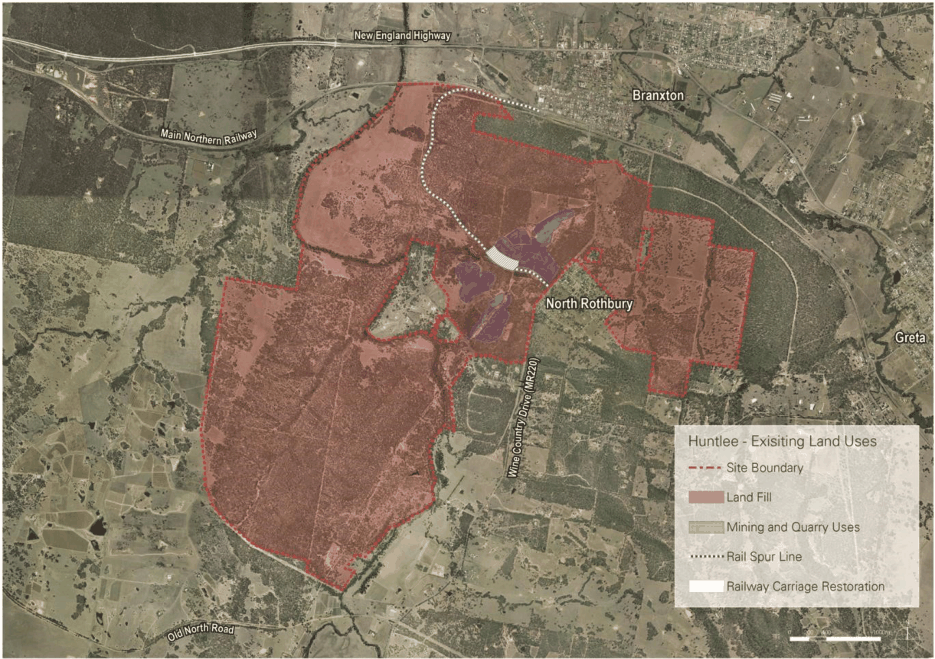

### Appendix 1 - Site characteristics

## 1 Existing development

The site is predominantly characterised by areas of woodland vegetation and cleared areas used for agricultural purposes. The agricultural uses are generally limited to grazing and are largely located along the western boundary of the site along the Black Creek floodplain and to the east of the village of North Rothbury.

The key developed features of the site include infrastructure associated with the former Ayrfield Colliery including a number of buildings and structures, rail infrastructure and water storage dams.  Areas of mine waste emplacement and land fill occur in the central section of the site.

Part of the former colliery area is used for the storage and restoration of historic train carriages, locomotives and other commercial vehicles such as decommissioned buses.  To the south of the colliery area are gravel quarry operations.

> [Picture on page 128: a picture, saved as a picture (images/part-e17-huntlee-page-128-14.gif, 150 dpi).]

#### Figure 44: Existing development on the site
