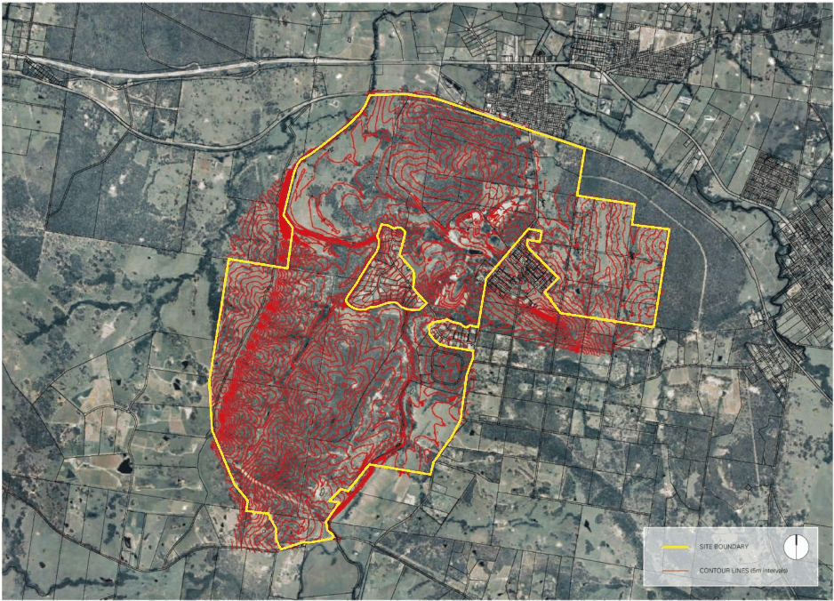

## 2 Topography and slope

The topography of the site is characterised by gently undulating terrain.  Key features include the Terrace Ridge that runs along the western boundary of the site, with a secondary ridge that forms a steep valley containing a minor tributary to Black Creek.

The remainder of the site is generally undulating with a predominantly defined 5-10% grade. Flatter areas of 0-5% and various low ridgelines run north-south across the site.

The highest point on the site is located to the west of the site along Terrace Ridge and reaches 121m AHD.  The lowest point on the site is 22m AHD at the north-western boundary where Black Creek exits the site.

> [Picture on page 129: a picture, saved as a picture (images/part-e17-huntlee-page-129-4.gif, 150 dpi).]

#### Figure 45: Topography
