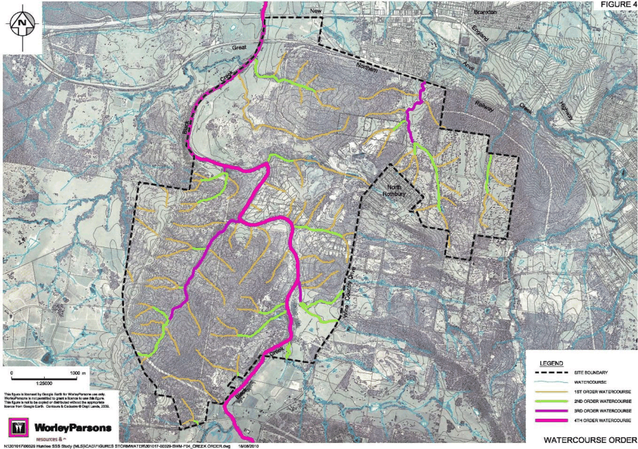
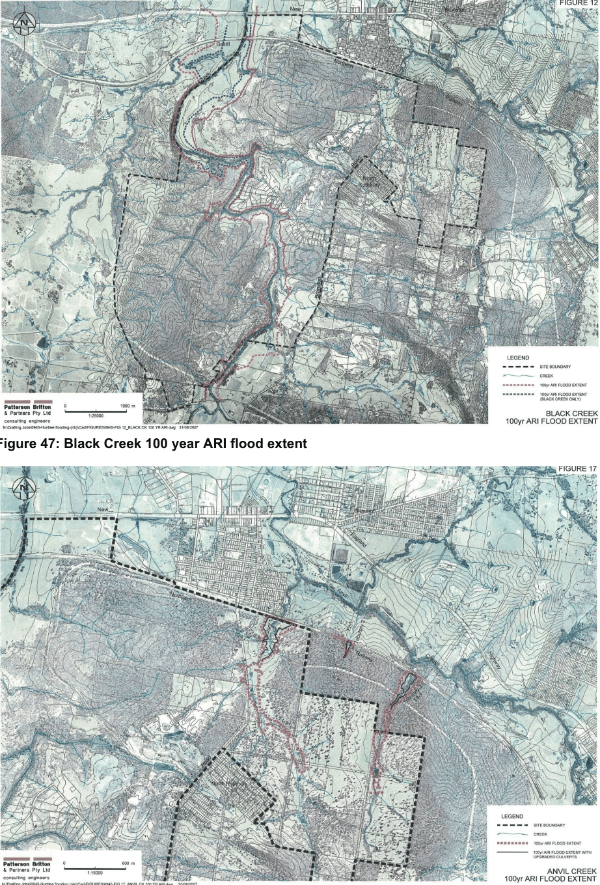

## 3 Hydrology

The site is located within the catchments of Black and Anvil Creeks which are tributaries of the Hunter River.

Black Creek is the largest of the two creek lines and runs north-south through the site and marks the north-western boundary.  The entire catchment of Black Creek is approximately 304km2 and extends from the Broken Back Range in the west to the Cessnock State Forest in the east. The catchment headwaters are in the Aberdare State Forest to the south of Cessnock. The junction of Black Creek with Hunter River is downstream of the site and to the north of the New England Highway.

Anvil Creek is located to the north-east of the site outside its boundary. However, three minor tributaries drain under the Main North Railway before meeting Anvil Creek which then drains into Black Creek north of Branxton.

Both Black and Anvil Creeks are 3rd order streams and generally sustain permanent flows. A number of minor tributaries drain across the site and into these creeks. These streams are ephemeral and of 1st and 2nd order.  A number of water storage dams of varying sizes, associated with agriculture and mining are present across the site.

Patterson Britton & Partners Pty Ltd has prepared a flood study of the site.  The study models the flooding across the site to determine the 100 year and 20 year ARI (average recurrence interval) peak flows.

> [Picture on page 130: a picture, saved as a picture (images/part-e17-huntlee-page-130-4.gif, 150 dpi).]

#### Figure 46: Hydrology

> [Picture on page 131: a picture, saved as a picture (images/part-e17-huntlee-page-131-1.gif, 150 dpi).]

#### Figure 47: Black Creek 100 year ARI flood extent

#### Figure 48: Anvil Creek 100 year ARI flood extent
