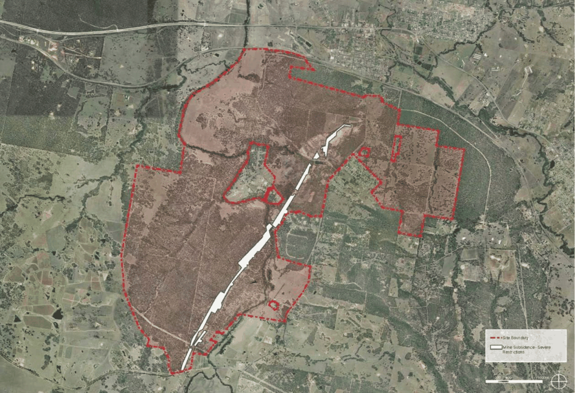

## 6 Mine subsidence

Extensive mining activities took place at the Ayrfield / Maitland extended area to the west of North Rothbury village from 1908 until 1974.  Mining activity occurred along a band that runs northeast – southwest through the length of the site associated with where Greta coal measures outcrop at the surface.

Areas where mine workings and subsidence risks are located are shown in Figure 49: Mine subsidence.

> [Picture on page 133: a picture, saved as a picture (images/part-e17-huntlee-page-133-15.gif, 150 dpi).]

#### Figure 49: Mine subsidence
