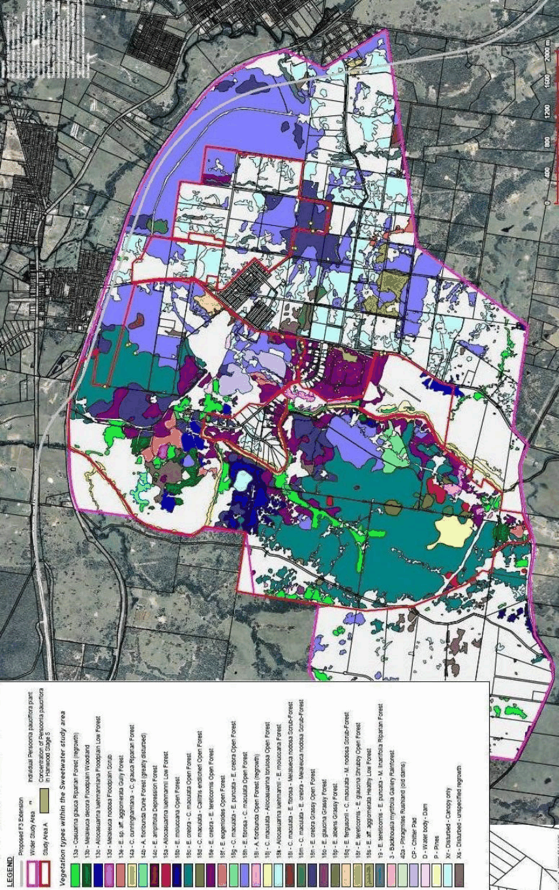

## 7 Vegetation

Vegetation on the site consists largely of regrowth forest following the extensive clearing of vegetation associated with mining activities and agriculture.

There are six native vegetation communities identified on the site, five of which are listed as an Endangered Ecological Community (EEC) under the NSW Threatened Species Conservation Act 1995. Where significant vegetation and threatened species habitat exists attempts to conserve these where possible are encouraged. However, the entire development area of Huntlee has been appropriately offset as part of the Voluntary Planning Agreement at the time of rezoning.

> [Picture on page 135: a picture, saved as a picture (images/part-e17-huntlee-page-135-1.gif, 150 dpi).]

#### Figure 50: Vegetation Types
