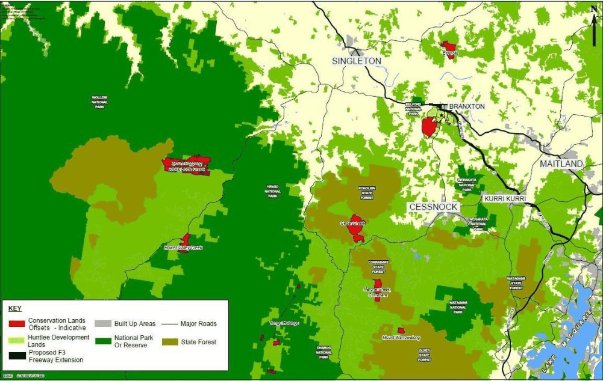

## 8 Flora, fauna and aquatic habitat

Flora and fauna species listed under the NSW Threatened Species Conservation Act 1995 and the Environmental Protection and Biodiversity Conservation Act 1999 have been identified on the site in various historical studies, including studies undertaken as part of the rezoning of the site. Where significant vegetation and threatened species habitat exists, attempts to conserve these where possible are encouraged. Water courses present on the site are unlikely to contain threatened species.  However, the habitat value they provide at a local level is important.

The entire development area of Huntlee has been appropriately offset as part of the Voluntary Planning Agreement at the time of rezoning.  This agreement between the Developer, the Minister for Environment and Climate Change and the Minister for Planning was executed in connection with the rezoning of the site under the Major Development SEPP (State Environmental Planning Policy).  The Planning Agreement provided that the Developer make various environmental conservation offset contributions including:

• Transfer of up to 5,612 hectares of environmentally significant land for environmental conservation purposes which is proposed to be dedicated under the National Parks and Wildlife Act 1974 comprising: o approximately 607 hectares of conservation land within Huntlee; o “Persoonia Park” (approximately 17 hectares) within Huntlee; and o up to 4988 hectares of conservation land elsewhere within the Lower Hunter Region.

• $100,000 contribution towards the conservation of Persoonia pauciflora; and

• $1 million contribution towards the management of the conservation offset lands.

> [Picture on page 136: a picture, saved as a picture (images/part-e17-huntlee-page-136-22.gif, 150 dpi).]

#### Figure 51: Environmental offsets plan

The offset agreement provides robust ecological outcomes for threatened species and ecological communities and is consistent with the outcomes proposed in the Lower Hunter

Regional Strategy and ensuring that environmental conservation lands identified in the Lower Hunter Regional Conservation Strategy will be transferred into public ownership.
