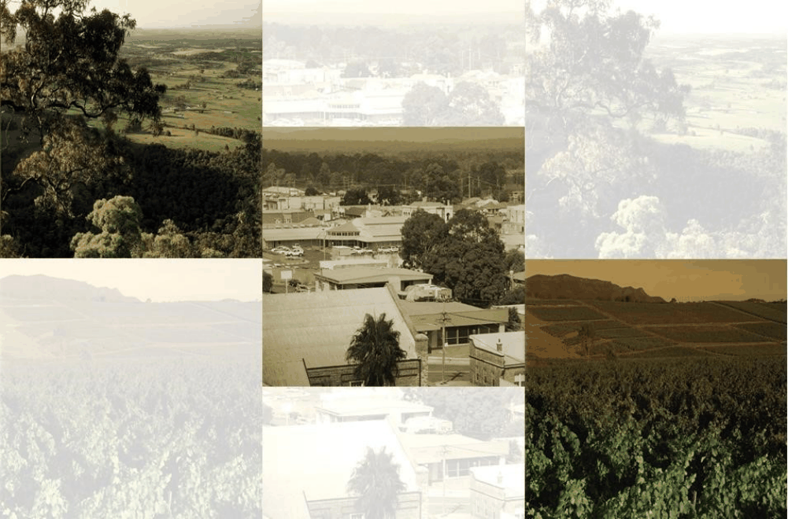

# Cessnock Development Control Plan 2010 - Part E17 Huntlee

> This chapter is split into 22 section file(s), one per numbered heading, in the order they appear in the PDF.

Source PDF: [E17 - Huntlee.pdf](E17%20-%20Huntlee.pdf)

CESSNOCK

DEVELOPMENT CONTROL PLAN 2010

PART E

SPECIFIC AREAS

> [Picture on page 1: a picture, saved as a picture (images/part-e17-huntlee-page-1-5.gif, 150 dpi).]

#### Amendment History

| Version No. | Nature of Amendment | Date in force |
|---|---|---|
| 1 | Draft |  |
| 2 | DCP Chapter adopted at the Ordinary Council Meeting 8 March 2018. | 14 March 2018 |
| 3 | Draft Amendment 3 medium density housing format, no further subdivision control and other minor amendments to references. Adopted at the Ordinary Council Meeting 15th March 2023 | 29 March 2023 |

Chapter E17: Huntlee

#### TABLE OF CONTENTS

<!-- sections -->
## Sections

1. [17 Huntlee](01-17-huntlee.md)
2. [1 Introduction](02-1-introduction.md)
3. [2 Vision and Character](03-2-vision-and-character.md)
4. [3 Managing the Environment](04-3-managing-the-environment.md)
5. [4 Subdivision Design](05-4-subdivision-design.md)
6. [5 Residential Development](06-5-residential-development.md)
7. [2 Vision and Character](07-2-vision-and-character.md)
8. [3 Managing the Environment](08-3-managing-the-environment.md)
9. [4 Subdivision design](09-4-subdivision-design.md)
10. [5 Residential Dwellings](10-5-residential-dwellings.md)
11. [6 Town and Village Centres](11-6-town-and-village-centres.md)
12. [7 Employment Areas](12-7-employment-areas.md)
13. [1 Existing development](13-1-existing-development.md)
14. [2 Topography and slope](14-2-topography-and-slope.md)
15. [3 Hydrology](15-3-hydrology.md)
16. [4 Geology](16-4-geology.md)
17. [5 Contamination](17-5-contamination.md)
18. [6 Mine subsidence](18-6-mine-subsidence.md)
19. [7 Vegetation](19-7-vegetation.md)
20. [8 Flora, fauna and aquatic habitat](20-8-flora-fauna-and-aquatic-habitat.md)
21. [9 Aboriginal and European heritage](21-9-aboriginal-and-european-heritage.md)
22. [10 Access and transport](22-10-access-and-transport.md)
