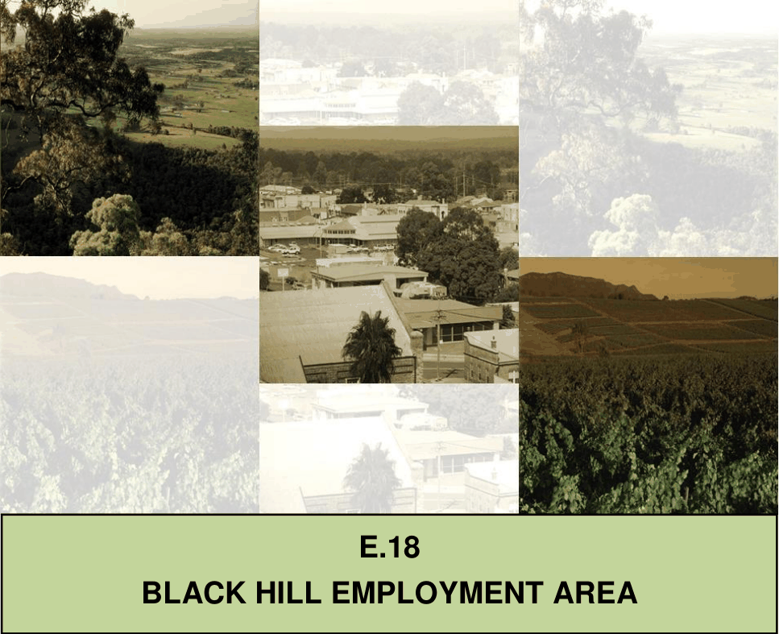
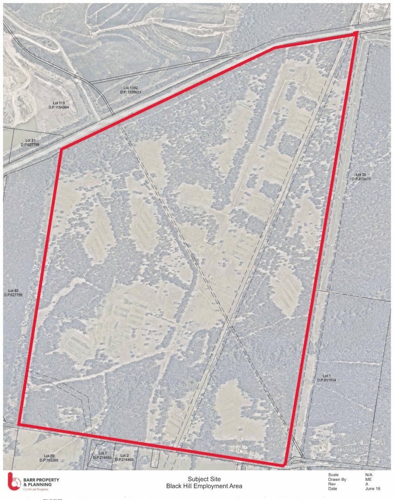
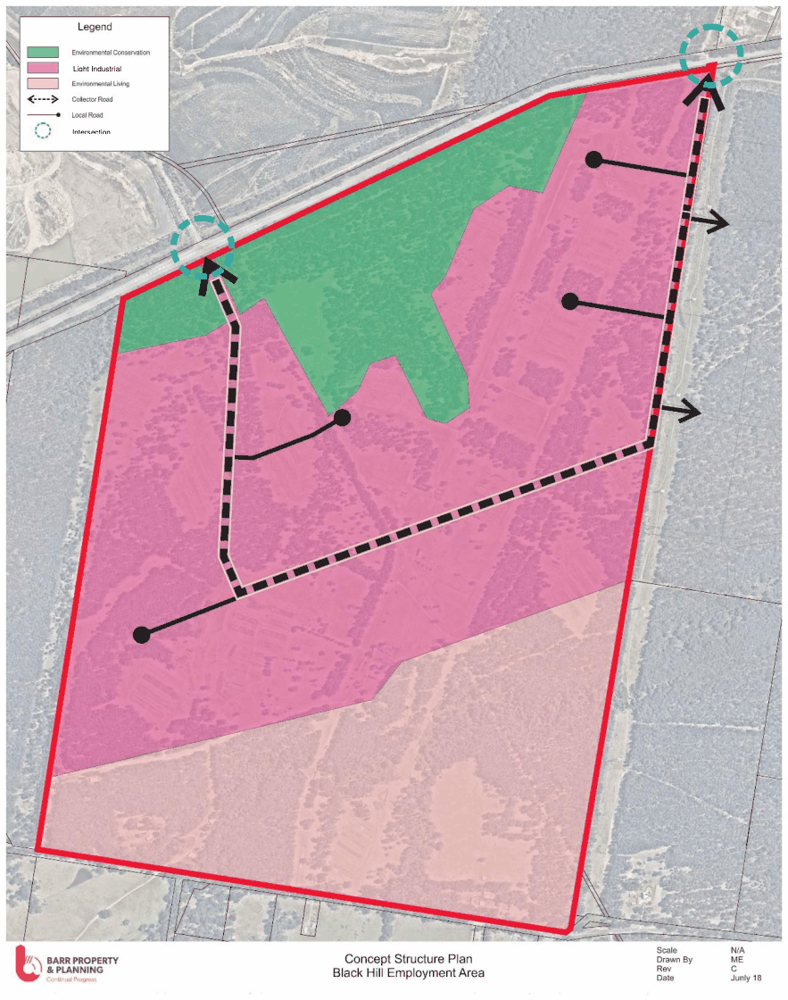
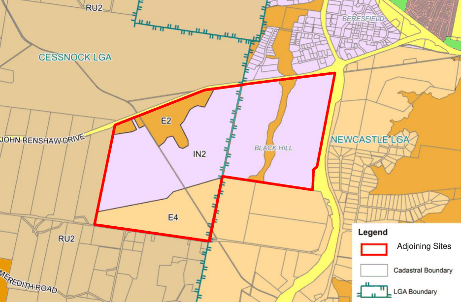
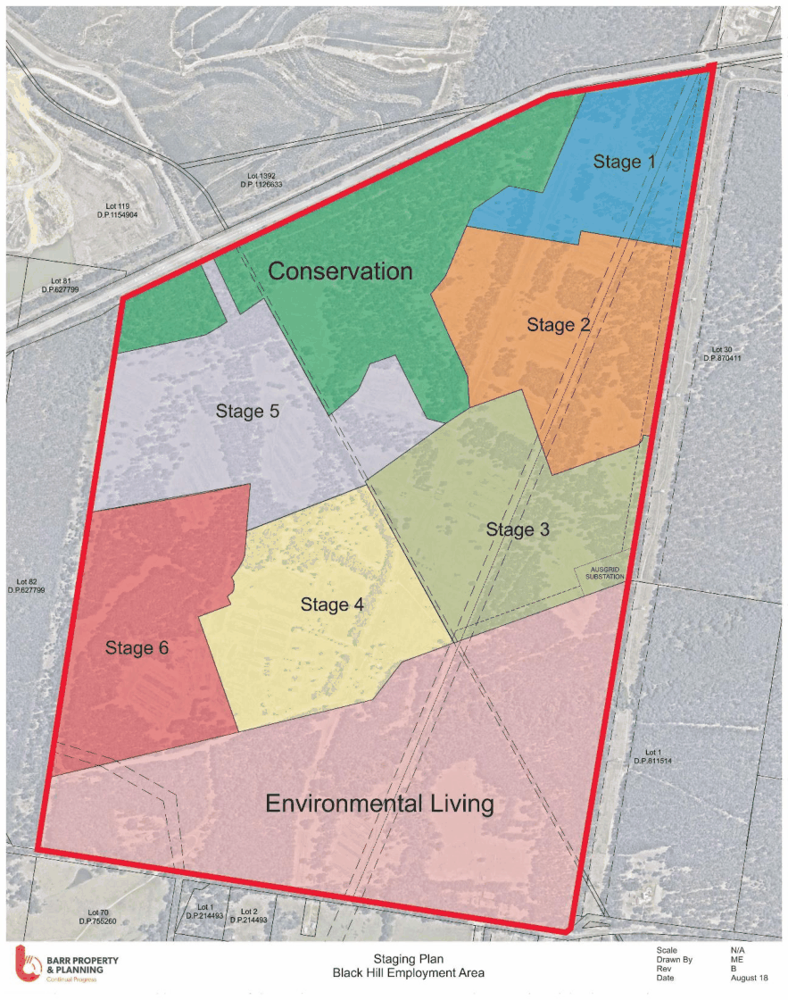
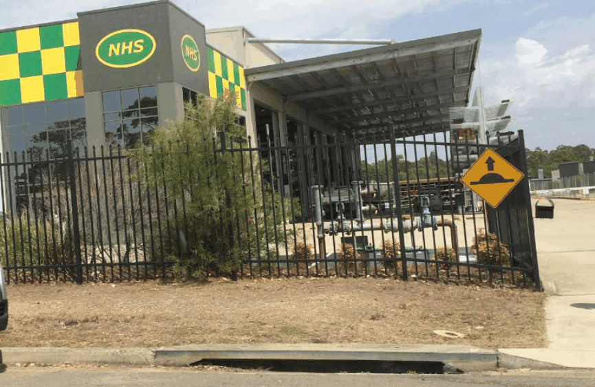
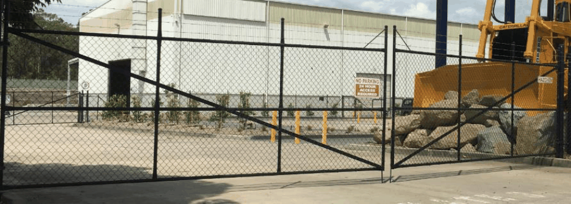

# Cessnock Development Control Plan 2010 - Part E18 Black Hill Employment Area

Source PDF: [E18 - Black Hill Employment Area.pdf](https://planfortomorrow.sharepoint.com/sites/Planfortomorrow/Shared%20Documents/00%20NSW-Planning-Resources/dcp/cessnock-development-control-plan-2010/part-e18-black-hill-employment-area/E18%20-%20Black%20Hill%20Employment%20Area.pdf)

### CESSNOCK

### DEVELOPMENT CONTROL PLAN 2010

### PART E – SPECIFIC AREAS

> [Picture on page 1: a picture, saved as a picture (images/part-e18-black-hill-employment-area-page-1-4.gif, 150 dpi).]

### E.18

### BLACK HILL EMPLOYMENT AREA

#### TABLE OF CONTENTS

#### E.18: BLACK HILL EMPLOYMENT AREA

Overview ................................................................................................... 3 Objectives ................................................................................................. 3 Application ................................................................................................ 3 Purpose of the Plan .................................................................................. 5 Priority Precinct ......................................................................................... 5 Relationship to other Plans and Chapters of the DCP ............................... 6 Concept Structure Plan ............................................................................. 6 Subdivision ............................................................................................... 9 Staging and Servicing ............................................................................. 10 Access and Transport ............................................................................. 11 Parking ................................................................................................... 12 Landscaping ........................................................................................... 13 Water Management ................................................................................ 13 Siting and Separation .............................................................................. 14 Appearance and Materials ...................................................................... 14 Outdoor Storage areas ........................................................................... 16 Lighting ................................................................................................... 16 Residential Development within the E4 Zone .......................................... 17

#### FIGURES

Figure 1 – Black Hill Employment Area .................................................................... 4 Figure 2 – Black Hill Employment Area Concept Structure Plan .............................. 8 Figure 3 – Two Adjoining Industrial Sites in the Cessnock and Newcastle LGA ....... 9 Figure 4 – Black Hill Employment Area Staging Plan ............................................. 11 Figure 5 – Black palisade fencing along front boundary. ........................................ 15 Figure 6 – Black chain wire fencing along secondary, side and rear boundaries. .. 16

#### Overview

This chapter of the Cessnock Development Control Plan 2010 (DCP 2010) provides development controls for development on land comprising the ‘Black Hill Employment Area’, as shown in Figure 1.

The subject site, identified as Lot 1131 in DP 1057179 and part Lot 119 DP 1154904, comprises an area of approximately 300 hectares. The land is divided into two portions by a long and narrow lot (part Lot 119 in DP 1154904) that bisects the site from the north-west to the south-east. Lot 119 has been excised to accommodate a Hunter Water Corporation water supply pipeline.

The Black Hill Employment Area comprises land zoned:

IN2 Light Industrial;

E2 Environmental Conservation; and

E4 Environmental Living. The Black Hill Employment Area is adjacent to the rural community, school, church and national park conservation corridor of Black Hill. Land to the north and north-east of the subject site is used for mining and industrial land uses. This includes the development of several business and industrial parks west of Beresfield, sited to take advantage of the accessible road network.

#### Objectives

The principal objectives of this Chapter are:

1\. To facilitate the efficient provision of infrastructure within the Black Hill Employment Area.

2\. To enable and facilitate light industrial development on the land.

3\. To promote employment generating development on the land.

4\. To promote industrial development that demonstrates ecologically sustainable design principles.

5\. To provide development that incorporates a high level of amenity.

6\. To promote the protection and conservation of land with high ecological value in the Black Hill Employment Area.

7\. To protect the area surrounding the industrial precinct from potentially adverse impacts and acknowledge the established rural character of the area surrounding the industrial precinct.

#### Application

This Plan is called ‘Black Hill Employment Area’ and forms part of the DCP 2010. The Plan consists of the written statement and plans referred to in the document.

Figure 1 details the land to which the Plan applies (shown edged heavy red).

> [Picture on page 4: a picture, saved as a picture (images/part-e18-black-hill-employment-area-page-4-2.gif, 150 dpi).]

#### Figure 1 – Black Hill Employment Area

#### Purpose of the Plan

The purpose of this Plan is to give detailed guidance for development within the Black Hill Employment Area. It provides more detailed provisions than those contained in the Cessnock Local Environmental Plan 2011 (LEP 2011) and more locally specific provisions than other chapters of the DCP 2010.

This Plan also seeks to satisfy the requirements of Clause 6.3 of the LEP 2011 by supplementing other chapters of the DCP 2010.

Council will take into account the provisions of this Plan in determining development applications within the Black Hill Employment Area. Council may consent to an application that departs from the provisions of this Plan. Where applications seek to depart from the provisions of this Plan, they should be accompanied by a written justification.

#### Priority Precinct

The Black Hill Employment Area is recognised in the Greater Newcastle Metropolitan Plan 2018 as a key catalyst site, due to the employment generating opportunities that the Area will provide. The economic importance of the Black Hill Employment Area is also recognised by Council. Council sees opportunities for employment and business growth in freight, logistics and industrial sectors at Black Hill. The Black Hill Employment Area will assist in connecting Greater Newcastle and the Hunter region to global markets, providing a significant advantage in attracting large scale industry to the region. This is consistent with Council’s resolution of 3 May 2017 to promote the Cessnock Local Government Area (LGA) as a location of choice for business. It is also consistent with Council’s adopted Economic Development Strategy, which seeks to:

- ensure that the customer service procedures for handling development enquiries and processing development applications are ‘best practice’ – welcoming, helpful, professional and efficient. (Initiative 1.1); and

- explore options for accelerating the release and development of industrial/employment land within the Cessnock LGA. (Initiative 7.8).

To achieve this, Council has put in place mechanisms, which seek to facilitate positive outcomes for development applications in the Black Hill Employment Area; to encourage best practice processing and accelerated determinations.

These mechanisms include:

- priority access to pre-application meetings with Council staff;

- a ‘Black Hill Precinct Management Working Group’, which will meet quarterly; and

- a commitment to meeting the statutory approval timeframes identified in the Environmental Planning and Assessment Regulation 2000, being generally:

(a) 40 days in the case of local development

(b) 60 days in the case of:

- Designated development

- Integrated development

- Development for which concurrence is required

- Development proposing discount in biodiversity credits

(c)  90 days in the case of State significant development

Note: Council’s ability to meet the timeframes will be dependent on the quality and completeness of applications submitted and will be subject to referral responses/comments provided by external authorities.

#### Relationship to other Plans and Chapters of the DCP

The following chapters of the DCP 2010 also apply to the Subject Site: Part A: Introduction Part B: General Information Chapter C.1: Parking and Access Chapter C.2: Flora and Fauna Survey Guidelines Chapter C.3: Contaminated Lands Chapter C.4 Land Use Conflict and Buffer Zones Chapter C.5: Waste Management and Minimisation Chapter C.8: Social Impact Assessment and CPTED Chapter C.9: Development on Flood Prone Land Chapter D.1: Subdivision Guidelines Chapter D.3: Industrial Development Chapter D.5: Outdoor Signage Chapter D.10 Sex Services Premises

Where there is an inconsistency between this Chapter and other chapters of the DCP 2010, the provisions of this Chapter will prevail.

Where there is any inconsistency between this Chapter and any environmental planning instrument that applies to the land, the provisions of the instrument will prevail. An environmental planning instrument includes a State Environmental Planning Policy (SEPP) or a Local Environmental Plan (LEP).

#### Concept Structure Plan

The Concept Structure Plan at Figure 2, has been developed to provide an indication of the acceptable land use zones and basic road structure and hierarchy. Future developments must be generally consistent with the Concept Structure Plan.

#### Objectives

1\. Ensure development accords with the overall strategic vision for the Black Hill Employment Area as outlined in the Concept Structure Plan.

2\. Ensure development controls in regard to road hierarchy within the Cessnock LGA and Newcastle LGA are generally consistent. Refer to Figure 3 that shows two adjoining sites and LGA boundary.

3\. Ensure the road hierarchy acknowledges the adjoining industrial land in the Newcastle LGA (Figure 3) to achieve the following outcomes:

a. the number of intersections on John Renshaw Drive will be determined to minimise impacts of road network efficiency, with a preference of a shared intersection on the common boundary between the Newcastle and Cessnock LGA;

b. there are suitable road connections between the two precincts to reduce traffic impacts on John Renshaw Drive;

c. a staging plan for the timely and efficient release of employment land making provision for necessary infrastructure and sequencing; and

d. an overall transport movement hierarchy showing the major circulation routes and connections to achieve a simple and safe movement system for private vehicles, public transport, pedestrians and cyclists.

4\. The location of intersections with John Renshaw Drive will have regard to the proposed Pacific Motorway to Raymond Terrace (M12RT) upgrades.

#### Controls

(a) Development is to be generally consistent with the Concept Structure Plan at Figure 2.

(b) The location of the easternmost access to John Renshaw Drive:

i. will be prioritised at the common boundary between the subject site and the adjoining industrial land (in the Newcastle LGA); and

ii. will be supported by a Traffic  Impact Assessment that demonstrates the access is capable of managing the relevant traffic generation from the subject site and the adjoining industrial land (in the Newcastle LGA).

(c) Before determining development applications for traffic generating development or subdivision of land, a Traffic Impact Assessment will be provided to the satisfaction of the consent authority.

(d) Subclause (c) does not apply to any of the following development:

i. a subdivision for the purpose of a realignment of boundaries that does not create additional lots;

ii. a subdivision of land if any of the lots proposed to be created is to be reserved or dedicated for public open space, public roads or any other public or environmental protection purpose;

iii. a subdivision of land in a zone in which the erection of structures is prohibited; or

iv. proposed development on land that is of a minor nature only, if the consent authority is of the opinion that the carrying out of the proposed development would be consistent with the objectives of the zone in which the land is situated.

> [Picture on page 8: a picture, saved as a picture (images/part-e18-black-hill-employment-area-page-8-1.gif, 150 dpi).]
> Words printed on the picture (title and legend, copied from the PDF):
> Light Industrial
> Intersection

#### Figure 2 – Black Hill Employment Area Concept Structure Plan

> [Picture on page 9: a picture, saved as a picture (images/part-e18-black-hill-employment-area-page-9-1.gif, 150 dpi).]
> Words printed on the picture (title and legend, copied from the PDF):
> Adjoining Sites

#### Figure 3 – Two Adjoining Industrial Sites in the Cessnock and Newcastle LGA

#### Subdivision

#### Objectives

1\. To facilitate the orderly subdivision of the Black Hill Employment Area.

2\. To provide for the provision of appropriate levels of landscaping within the street and public domain.

3\. To facilitate and regulate the establishment of Black Hill Employment Area as a business identity.

#### Controls

(a) A Landscape Masterplan must be submitted with each application for subdivision. See Appendix 1 – Landscaping Guidelines for Species and Density Requirements.

(b) Street trees shall be planted to:

i. soften the streetscape;

ii. act as traffic calming measures through perceived narrowing of the road;

iii. provide shade to footpaths and roads; and

iv. enhance views.

(c) Riparian vegetation along watercourses is to be re-established using locally occurring native species from locally sourced seed stock.

(d) Landscape entry features identifying the Black Hill Employment Area (or subsequent “brand”) shall be permitted on private land at the intersection of the collector road network and John Renshaw Drive.

(e) The design of a landscape entry feature shall have regard to:

i. impact on sight lines;

ii. ongoing maintenance; and

iii. reflectivity and lighting requirements.

#### Staging and Servicing

#### Objectives

1\. To enable the development of the site to proceed in a timely and efficient manner, following the provision of infrastructure.

2\. To allow for the integrated consideration of access, security, drainage, bushfire management and infrastructure provision across the site.

#### Controls

(a) The site shall be developed in stages following the adequate provision of infrastructure to service each allotment in the stage.

(b) The order of release of each stage (Figure 4) may be amended as appropriate to enable the logical and cost-effective development of the site.

(c) Applicants are required to demonstrate adequate servicing of allotments including access to water, sewer and electricity.

(d) To facilitate the cost effective and timely release of stages, development should proceed from the north-east corner of the Black Hill Employment Area.

(e) All development lots must be provided with underground services.

> [Picture on page 11: a picture, saved as a picture (images/part-e18-black-hill-employment-area-page-11-1.gif, 150 dpi).]

#### Figure 4 – Black Hill Employment Area Staging Plan

#### Access and Transport

#### Objectives

1\. Facilitate safe access for all vehicles to and from the site.

2\. To provide a simple and safe movement system for heavy vehicles, private vehicles and public transport within the site.

3\. To minimise the cumulative impact of traffic from the industrial subdivision on John Renshaw Drive.

4\. Ensure that all roads can accommodate large vehicles, including B Doubles.

#### Controls

(a) Access to the Black Hill Employment Area shall be provided generally in accordance with the Concept Structure Plan at Figure 2.

(b) All internal roads will be designed with reference to Chapter D.1 Subdivision Guidelines and Chapter D.3 Industrial Development of the Cessnock DCP and in accordance with Council’s Engineering Design Guidelines.

(c) The collector road network shall allow for future access to the east, including the provision of rights of carriageway where necessary.

(d) Provision for on road cycleways shall be made within the Collector Road network.

(e) Adequate directional signage is required at the vehicular entries and exits of each site.

(f) An Internal Movement Plan (IMP) is to be submitted with a development application for any primary building on a site. The IMP is to clearly identify:

i. heavy vehicle movement routes;

ii. private vehicle movement routes and parking areas;

iii. pedestrian access routes; and must include turning circles diagrams for the largest vehicle that is reasonably expected to enter the site.

(g) Development applications for each site must demonstrate that all vehicles can enter and exit the allotment in a forward direction.

(h) The road network is to be designed to provide for a clear and convenient bus route throughout the site, including the provision of bus shelters and seating as required.

(i) Provide details with the subdivision application for each stage, demonstrating consultation with the relevant bus company and the demand to extend or provide an additional bus route throughout the development including the proposed location of bus stops to service the development.

#### Parking

#### Objective

1\. To ensure that adequate off-street vehicular parking is provided for traffic generating developments.

#### Controls

(a) Development in the Black Hill Employment Area is to provide on-site parking in accordance with Chapter C.1 ‘Parking and Access’ of Cessnock DCP.

(b) All car parking facilities shall be located behind the front landscaped area.

(c) Despite (a), the following car parking requirements prevail for the following specific uses:

i. Warehouse or distribution centre - 1 car space per 300m2 gross floor area plus 1 bicycle parking space per 20 employees.

ii. Ancillary office premises – 1 car space per 75m2 gross floor area plus 1 bicycle parking space per 200m2 gross office floor area.

(d) Despite (a) or (c), Council may consider reducing the car parking requirements on the submission of a detailed traffic assessment report that demonstrates that a reduced level of parking is satisfactory for the proposed development and the immediate and general locality.

#### Landscaping

#### Objectives

1\. To protect and enhance riparian areas.

2\. To retain bushland within visually prominent locations.

3\. To reduce the visual impact of development on the streetscape.

4\. To provide adequate area for low maintenance landscaping.

5\. To screen unsightly development from public view.

6\. To create a pleasant and attractive working environment.

#### Controls

(a) Landscaping shall be provided in accordance with Chapter D.3 Industrial Development of the DCP 2010.

(b) A detailed site Landscape Plan is to be submitted with a development application for any primary building on a site.

(c) A physical barrier of kerb is to be constructed between all landscaped and grassed areas, and areas for the standing or manoeuvring of vehicles on the site.

#### Water Management

#### Objectives

1\. To protect and enhance riparian areas.

2\. To manage and control the quantity and quality of stormwater generated by the development

3\. To encourage and facilitate the capture and appropriate re-use or slow release of stormwater.

4\. To encourage and facilitate the capture and appropriate re-use of grey water.

5\. To encourage water sensitive urban design.

#### Controls

(a) A Stormwater Management Plan is to be prepared for the development of each allotment.

(b) The Stormwater Management Plan shall include:

i. an Onsite Detention (OSD) Plan; and

ii. a Water Quality Management Plan.

(c) The OSD Plan shall:

i. ensure detention structures are designed so as not to increase the total volume and peak discharges from predevelopment levels over the range of 1:1 to 1:100 year Annual Exceedance Probability Storms in accordance with Cessnock City Council Engineering Requirements for Development; and

ii. allow for a maximum of 50% of the capacity of rainwater tanks to be utilised for Onsite Detention.

(d) The Water Quality Management Plan shall ensure stormwater quality treatment is designed to meet the following minimum requirements in accordance with Australian Runoff Quality (ARQ) 2006 - A guide to Water Sensitive Urban Design:

- 80% Total Suspended Solids (TSS) reduction

- 45% Total Phosphorus (TN) reduction

- 45% Total Nitrogen (TN) reduction when compared to the unmitigated development scenario

(e) Hydrologic and Hydraulic design is to be undertaken based on Australian Rainfall and Runoff 2016 Guidelines.

#### Siting and Separation

#### Objectives

1\. To reduce the bulk and visual impact of industrial buildings, including on the area surrounding the industrial precinct.

2\. To retain bushland within visually prominent locations.

#### Controls

(a) Buildings are to be orientated towards the primary street frontage.

(b) All buildings and structures are to be set back a minimum of 6 metres from the primary street frontage.

(c) All buildings and structures are to be set back a minimum of 2 metres from a secondary street frontage.

(d) Asset Protection Zones (APZs) required for bushfire protection purposes are to be located and maintained within each individual site.

#### Appearance and Materials

#### Objectives

1\. To enhance visual amenity in the Black Hill Industrial Area and minimise negative impact on the area surrounding the industrial precinct through the selection of appropriate building materials and colours.

2\. To encourage the use of materials that minimise impact on the environment.

3\. To ensure that any reflective materials are used with sensitivity to neighbouring development, vehicular traffic and public domain areas.

#### Controls

(a) The external walls of industrial buildings are to be a combination of profiled colour treated cladding or masonry materials, or a combination of both.

(b) Flat blank walls in excess of 30m must be treated with fenestration, etchings, recessed patterns/textures and/or colours to reduce the perceived bulk.

(c) Offices and highlighted entries are to be located within front facades to ensure easy way finding.

(d) Building materials are to be selected such that reflection is minimised and does not adversely affect adjacent development, traffic and public domain areas.

(e) Where visible from a public area, all rooftop or exposed structures including lift motor rooms, plant rooms, air conditioning units, satellite dishes, ventilation and exhaust systems, are to be suitably screened and integrated with the building design to ensure an integrated overall appearance.

(f) Showrooms, ancillary offices, retail or commercial uses, staff amenities and low scale building elements are, wherever practical, to be located at the front of the premises.

(g) All sites are to be securely fenced and gated for access control.

(h) Fencing along street frontages is to be black palisade (refer to Figure 5).

(i) Fencing along other side or rear boundaries may be either black chain mesh fencing (refer to Figure 6) or black palisade.

(j) Applicants are required to submit a panel of external finishes and detail of coloured elevations when lodging a development application.

> [Picture on page 15: a picture, saved as a picture (images/part-e18-black-hill-employment-area-page-15-19.gif, 150 dpi).]

#### Figure 5 – Black palisade fencing along front boundary.

> [Picture on page 16: a picture, saved as a picture (images/part-e18-black-hill-employment-area-page-16-1.gif, 150 dpi).]

#### Figure 6 – Black chain wire fencing along secondary, side and rear boundaries.

#### Outdoor Storage areas

#### Objective

1\. To ensure that external storage and work areas are suitably screened from public view.

#### Control

(a) Where any work or storage of materials is proposed to be undertaken outside the confines of a building, the following information is to be provided:

- location of impacted area;

- identification of materials to be used; and

- access requirements.

#### Lighting

#### Objectives

1\. To ensure that lighting does not detract from amenity within the estate.

2\. To ensure that lighting or security measures do not adversely impact upon other sites within the estate, the neighbouring development, or surrounding residences.

3\. To ensure lighting contributes to worker and visitor safety and amenity.

#### Controls

(a) On site lighting shall be designed to avoid spill or glare onto adjoining sites, neighbouring developments, and public roads.

(b) Security lighting shall not be used to flood parking area or pedestrian path lighting.

(c) Security lighting shall be restricted to loading and storage locations or other limited service areas where it can be cowled or screened to prevent light-scatter.

(d) Diffuse, down lit illumination shall be provided at key locations, such as building entries, driveways, within car parks, key pedestrians routes within the allotment, and external work areas.

#### Residential Development within the E4 Zone

#### Objectives

1\. To allow for the protection and conservation of ecologically sensitive land identified within the subject site;

2\. To permit the development of certain land within the site for residential use, without detracting from the potential for light industrial development; and

3\. To protect residents from any adverse effects of industrial use and development of the subject site.

#### Controls

(a) No permanent access to the IN2 Light Industrial Zone will be granted from the E4 Environmental Living zoned land.

(b) No permanent access from Black Hill Road to land zoned IN2 Light Industrial will be granted.

(c) New dwellings shall be located a minimum of 100 metres from industrial zoned land to mitigate impact from industrial development.

(d) New dwellings shall have regard for the relevant general and specific guidelines (Part C and Part D) of the DCP 2010.

#### Appendix 1 – Landscaping Guidelines for Species and Density Requirements

In accordance with Section 18.1.8 of this Plan, street tree planting shall be provided within the Black Hill Employment Area during the initial subdivision works. This appendix sets out the requirements for planting and the species that are to be used. These requirements will need to be reflected in the Landscape Masterplan.

#### Species

The following tree species are considered suitable street trees:

- Corymbia maculate (Spotted Gum)

- Eucalyptus microcorys

- Waterhousia floribunda.

#### Design Guidelines

While preference shall be given to the tree species nominated above, alternative species may be used subject to approval from Council. Trees shall be planted in accordance with the Cessnock City Council Street Tree Planting Guideline, be located within the nature strip and not impede personnel surveillance. Hedges are not permitted.
