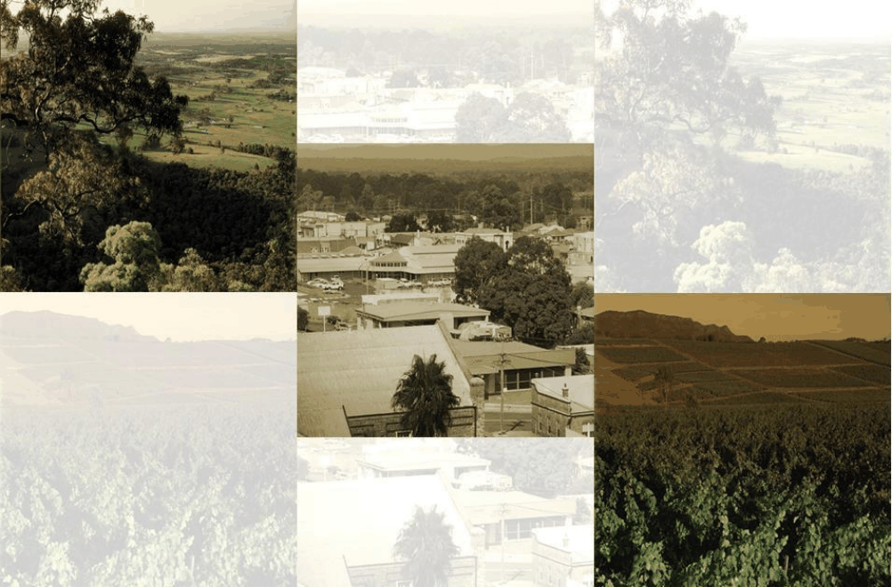

### PART E: SPECIFIC AREAS

> [Picture on page 1: a picture, saved as a picture (images/part-e2-the-vintage-page-1-4.gif, 150 dpi).]

> [Picture on page 1: a picture, saved as a picture (images/part-e2-the-vintage-page-1-5.gif, 150 dpi).]
