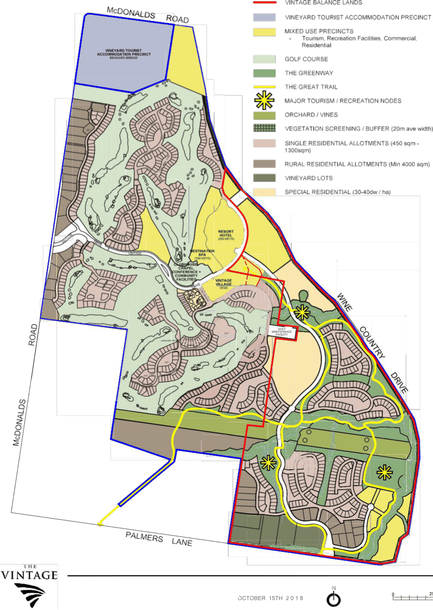
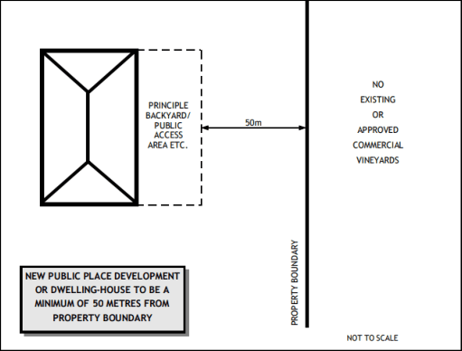
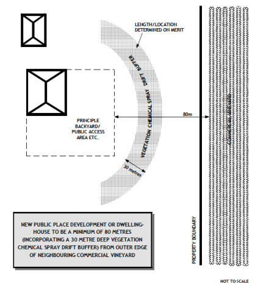
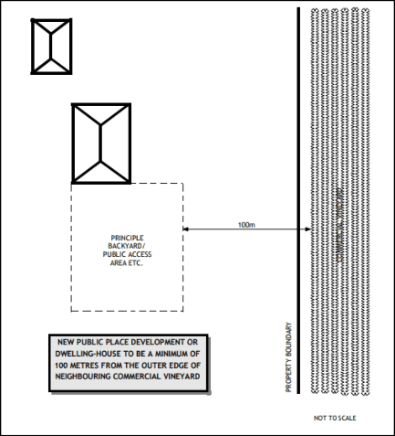

### AREA BASED PROVISIONS

The Cessnock Development Control Plan (CDCP) is comprised of 4 parts. Development applications must address all relevant sections of Part 2, Part 3 and Part 4.

Area-based provisions apply to discrete areas and may include provisions that are different from those in Parts 2 and 3 of the CDCP. Where there is a difference between any development provision/s in Parts 2 or 3 and Part 4, the provision/s in Part 4 prevail for that area.

### The Vintage

#### Preamble

The Vintage is defined as an integrated tourist development1. The area incorporates a mix of tourist and visitor accommodation, residential accommodation, indoor and outdoor recreation and other uses as outlined by Clause 7.11A,  Schedule 1 – 9 Use of certain land at Wine Country Drive, Palmers Lane and McDonalds Road, Rothbury and Schedule 1 - 12 Use of certain land at Wine Country Drive and Vintage Drive, Pokolbin of the Cessnock Local Environmental Plan 2011 (CLEP).

#### Application

This chapter applies to the land known as ‘The Vintage’ identified in Figure 1: Master Plan. The land is zoned SP3 Tourist under the CLEP and part of the land is subject to the Additional Permitted Use provisions outlined within Schedule 1 of the CLEP.

Design Review Committee

All development is required to be submitted to the Design Review Committee (DRC). The DRC is comprised of the following representatives:

1\. a representative of the developer;

2\. two members nominated from the Residential, Rural Residential, Vineyard lots and Special Residential Precincts; and

3\. A representative of council.

The DRC reviews all applications for development to determine whether the design is consistent with the provisions of this chapter and the Vintage Architectural and Landscape Guidelines prior to any development application being lodged with Council. For the purposes of this chapter, Applications that have been approved by DRC are deemed to be consistent with the Architectural and Landscape Guidelines.

The DRC is also responsible for notifying adjoining landowners within the complex that the Committee is reviewing an application. Any issues raised by these property owners or

1 Integrated tourist development means development that is predominantly tourist and visitor accommodation and tourist facilities in combination with other uses permissible on the land.

interested parties should, wherever possible, be resolved by the DRC prior to any development application being lodged with Council.

Development applications must be consistent with the approval issued by DRC. Development applications must include evidence of the approval including full details of certificates and stamped plans. Any issues/objections raised by adjoining landowners within the complex, or interested parties, which cannot be resolved by the DRC, will be forwarded to Council by the Committee.

Council (as the consent authority) will notify development applications in accordance with the provisions of Council’s Community Engagement Strategy and will give due consideration to all submissions received when determining applications.

#### Development provisions

Master plan

Objective/s

Development control/s

To ensure development is carried out in accordance with the Master Plan. To provide guidelines for each specific development component in accordance with the approved Master Plan as follows:

Development is to be consistent with the Master Plan at Figure 1: Master Plan. Development and the Master Plan is consistent with Clause 7.11A Integrated tourist development at Wine Country Drive, Palmers Lane and McDonalds Road, Rothbury and Schedule 1 of the Cessnock LEP 20112.

• Tourist recreation facilities, including: − Golf course − Clubhouse − Chapel − Function centre − Recreation and community facilities

• Mixed use precincts including: − Tourist and recreation facilities − Commercial development − Residential development

• Vineyard Tourist Accommodation Precinct

• Tourist and visitor accommodation

2 This clause stipulates that development consent must not be granted to any development on land to which it applies unless—

a) the consent authority is satisfied that the development is integrated tourist development, and

b) the total number of dwellings on the land does not exceed 1,022, and

c) the total number of serviced apartments and hotel or motel accommodation units used for the purposes of tourist and visitor accommodation on that land does not exceed 995, and

d) the total number of residential lots or dwellings does not exceed 822 until at least 344 serviced apartments and hotel or motel accommodation units on the land have been issued with occupation certificates, and

e) the total gross floor area of shops on the land, not including neighbourhood shops, will not exceed 1,000 square metres.

• Residential precincts comprising: − Single residential lots − Vineyards Lots − Large lot residential lots − Special residential precincts

• The proposed Greenway, Great Trail and Major Tourism/Recreation Nodes that may include: − Recreation facilities (children’s play spaces − Food and drink premises − Bicycle hire facilities

• Areas of orchards and vines.

To encourage tourism development that is compatible with the environment and surrounding viticultural and rural industries.

To ensure that the subdivision pattern, site layout, and building design do not detract from the rural character of the locality. To allow discrete areas of the Vintage development to be appropriately managed.

Torrens subdivision of development lots may be required prior to the establishment of community title schemes.

> [Picture on page 6: a picture, saved as a picture (images/part-e2-the-vintage-page-6-1.gif, 150 dpi).]

Figure 1: Master Plan

Development Components

Residential Flat Buildings and Serviced Apartments

Residential flat buildings are an additional permitted use (APU) on part of the Vintage under Schedule 1 of the CLEP. Residential flat buildings are assessed under the State Environmental Planning Policy (Housing) 2021 and the Environmental Planning and Assessment Regulation 2021 (the Regulation) and the Apartment Design Guide.

| Objective/s | Development control/s |
|---|---|
| To achieve built form that is as compatible with the surrounding landscape, while reflecting the desired aesthetics of buildings and of the streetscapes and the public spaces at The Vintage. To maximise amenity, safety and security for the benefit of its occupants and the wider community. To minimise the consumption of energy from non-renewable resources, to conserve the environment and to reduce greenhouse gas emissions. To contribute to the provision of a variety of dwelling types to meet population growth. | Development for Residential Flat Buildings and Serviced Apartments are assessed under State Environmental Planning Policy (Housing) 2021and the Environmental Planning and Assessment Regulation 2021 (the Regulation) and the Apartment Design Guide. |
| To ensure development is consistent with Schedule 1 of the CLEP. | Residential flat buildings are limited to 14.0m in height. |

Tourist recreation facilities

| Objective/s | Development control/s |
|---|---|
| To provide guidelines for development of land for each specific development component in accordance with the approved Master Plan. | The golf course is constructed in accordance with the Master Plan at Figure 1: Master Plan. The clubhouse facilities shall have a distinctive low-scale, rural character, using materials consistent with the Architectural and Landscape Guidelines A swimming pool and tennis courts will be provided as recreational facilities to the country club. |
| To enhance the rural character of the overall development. | Landscaped open space shall be provided in accordance with the Master Plan at Figure 1: Master Plan |
| To establish an integrated visual link with the residential and rural residential components of the project. | Construction of all tourist recreation facilities and tourist precincts shall adhere to the colour schemes, material selections and landscaping as set out in the Architectural and Landscape Guidelines |

Single Residential allotments

| Objective/s | Development control/s |
|---|---|
| To provide guidelines for development of land for each specific development component in accordance with the approved Master Plan. | Lot sizes will range between 450m2 - 1300m2. Lot frontages are to be between 15 - 22 metres in width. Battle-axe lots will include a 4.0 metre wide access handle. One dwelling house will be permitted on each allotment. The dwelling house may take the form of multiple structures consistent with the cluster style construction of contemporary rural buildings. Residential flat buildings, multi-dwelling housing, dual occupancies and other residential land-use typologies are prohibited in the residential allotment area. Residential allotments and dwellings are to be consistent with the Architectural and Landscape Guidelines |

Large lot residential allotments

| Objective/s | Development control/s |
|---|---|
| To provide guidelines for development of land for each specific development component in accordance with the approved Master Plan. | The large lot residential allotments are to be located in accordance with the Figure 1: Master Plan. The minimum lot size for large lot residential allotments is 4000m2. One dwelling house will be permitted on each allotment. The dwelling-house may take the form of multiple structures consistent with the cluster style construction of contemporary rural buildings. Residential flat buildings, multi-dwelling housing, dual occupancies and other residential land-use typologies are prohibited in the large residential allotment area. Driveways are required to be setback a minimum of 4.0 metres from the side property boundary. A 3.0 metre landscape transition zone is provided along the front property boundary of all lots. Large lot residential allotments and dwellings are consistent with the Architectural and Landscape Guidelines. Landscaping plans for large lot residential allotments are consistent the Architectural and Landscape Guidelines |

Vineyard allotments

| Objective/s | Development control/s |
|---|---|
| To provide guidelines for development of land for each specific development component in accordance with the approved Master Plan. | The vineyard allotments are to be located in accordance with Figure 1: Master Plan. Only one detached dwelling house will be permitted on each allotment. The dwelling house may take the form of multiple structures consistent with the cluster style construction of contemporary rural buildings. Residential flat buildings, multi-dwelling housing, dual occupancies and other residential land-use typologies are prohibited in the vineyard allotment precinct. |
| The existing vineyard is retained and impacts are managed to preserve the amenity of the area and the ongoing function of the vineyard. | The existing vineyard is to be retained and managed to avoid spray drift and noise impacts. |

Special Residential Precincts

Special residential precincts are in locations suitable for higher density accommodation types. These precincts will accommodate small lot housing, villa style developments, or multi-unit dwellings.

| Objective/s | Development control/s |
|---|---|
| To provide guidelines for development of land for each specific development component in accordance with the approved Master Plan. | Within the special residential precincts housing typologies achieve a density of 30– 40 units per hectare. Accommodation within these precincts may be made up of a combination of detached buildings and serviced apartments comprising standard rooms, one and two- bedroom suites and two, three and four bedroom villas, providing short stay opportunities for a broad range of users. The built form and landscaping of these areas to be consistent with the Architectural and Landscape Guidelines. Tourist and visitor accommodation and facilities shall adhere to colour schemes, material selections and landscaping that is consistent with the residential and large lot residential precincts. |

Mixed Uses Precincts

There are several mixed use precincts throughout the Vintage development including the resort hotel precinct. These precincts are expected to contain a mixture of tourism, recreation, commercial and residential uses.

| Objective/s | Development control/s |
|---|---|
| To provide guidelines for development of land for each specific development component in accordance with the approved Master Plan. | Residential development in the Mixed Use Precincts will achieve a minimum density of 30 dwellings per hectare. The built form should be low-scale and incorporate simple architectural design treatments consistent with the Architectural and Landscape Guidelines. A maximum of two storeys is permitted with a maximum building height of 8.5 metres. Two storey buildings must have a varied height and mass. Roof top observatories, attics and lofts are not permitted. Setbacks to development lot boundaries are limited to a minimum of 4.0 metres for buildings and 3.0 metres for verandas, pergolas and terraces. |
| To create interest to the streetscape. | Staggered building setbacks are required. |
| To minimise the visual impact of retaining walls from outside the precinct. | Retaining walls that are visible from outside the precinct shall be built within 2.0 metres of development lot boundaries. |
| To provide a soft interface between properties and the golf course. | A 2.0 metre landscaped transition zone is provided within the property boundary along the golf course frontage for all lots with direct golf course frontage. The landscape transition zone and all general landscaped areas must be landscaped with plant species specified in the Architectural and Landscape Guidelines. |
| To provide recreation facilities within each resort community. | Separate recreation facilities to be provided for each individual resort community. |
| To provide adequate car parking for the development. | Vehicular parking will be provided at the rate of one space for each unit that has 2 bedrooms or less and two spaces for every unit that has more than 2 bedrooms. Visitor parking to be provided at the rate of 1 space for every 5 units. |
| To minimise the visual impact of waste infrastructure. To provide recycling infrastructure within the development. | Communal garbage collection areas to be incorporated in the design of each individual resort community and include provisions for recycling. |

Resort Hotel Precinct

| Objective/s | Development control/s |
|---|---|
| To provide guidelines for development of the Resort Hotel Precinct in accordance with the approved Master Plan. | The resort hotel precinct is to contain the Resort Hotel Building and may also provide for general resort community accommodation. |
| To provide short-stay opportunities for a broad range of users. | The resort hotel precinct shall be developed to a maximum density of 40 units per hectare. Development within resort hotel precinct may include: hotel accommodation; suites; as well as serviced apartments and one, two, and three bedroom, single storey villas. |
| To provide recreation and tourist commercial facilities for the use of the hotel’s visitors. | The following facilities are considered appropriate within the within Resort Hotel Precinct: reception area/s; food and drink premises; function centres; shops (tourist); and recreation facilities. |
| The Resort Hotel Building is to provide a landmark focal point for ‘The Vintage’. The Resort Hotel Building site should be the centre of activity within ‘The Vintage’. | The resort hotel building to be an architecturally significant building that is compatible with its prominent location on the hill top site overlooking the golf course. The resort hotel building should be constructed with a stepped design with a maximum wall height of 12 metres above the highest point of the Resort Hotel site. |
| The Resort Hotel apartments, villas and tourist facilities should respond to the topography of the site and overall landscape vision of the golf course and other residential precincts. | A maximum of 2 habitable storeys with a maximum wall height of 10 metres above natural ground is permitted. Buildings are to have a varied height and mass. Roof top observatories, attics and lofts are not permitted. |
| To add interest to the streetscape. | Setbacks to development lot boundaries are limited to a minimum of 4.0 metres for buildings and 3.0 metres for verandas, pergolas and terraces. A staggered building setback is encouraged. |
| To provide a soft interface between properties and the golf course. | A 2.0 metre landscape transition zone is provided within the property boundary along the golf course frontage of all developments and lots with direct golf course frontage. This buffer and all general landscaped areas must be landscaped with plant species specified in the Architectural and Landscape Guidelines. |

| Objective/s | Development control/s |
|---|---|
| To provide adequate car parking for the development. | Parking for the Resort Hotel and for ancillary tourist related facilities shall be provided in accordance with the Cessnock Development Control Plan: Parking and Access provisions - Google Search. |
| To minimise the visual impact of parking from the street. | Parking shall be screened from perimeter access roads by either built form or landscaping consistent with Architectural and Landscape Guidelines |

Vineyard Tourist Accommodation Precinct (Beggars Bridge)

This site is on the corner of McDonalds and Coulson Roads and is anticipated to be a tourist accommodation precinct. All of the existing vineyards and homestead will be retained.

| Objective/s | Development control/s |
|---|---|
| To provide guidelines for development of land for each specific development component in accordance with the approved Master Plan. | No residential development is permitted in the Vineyard Tourist Accommodation Precinct. The built form and landscaping of these areas is to be consistent with the Architectural and Landscape Guidelines. Tourist and visitor accommodation and facilities to adhere to colour schemes, material selections and landscaping that is consistent with the residential and large lot residential precincts. |

Vehicular Access and Internal Road System

| Objective/s | Development control/s |
|---|---|
| To provide acceptable levels of access, safety and convenience for all street users while ensuring compatibility within the Vineyard District context. | Access to the development will be at the locations shown on the Master Plan at Figure 1: Master Plan or as may be approved by Council in consultation with the Transport for NSW. Transport for NSW and Council will determine the access to Wine Country Drive. The relevant standards for road widths and access to McDonalds Road to be in accordance with Council’s ‘Engineering Requirements for Developments’. Such road widths and design standards shall be determined in conjunction with Council at the engineering design stage. Public roads shall be constructed road pavements, with variable width footpaths and landscaped buffer zones. |

| Objective/s | Development control/s Public roads shall be maintained as follows: • constructed road pavement from rear of kerb to rear of kerb and associated stormwater drainage (up to the point of discharge to an approved outlet point) shall be maintained by Council; • all other land within the road reserve comprising variable width footpaths and landscape buffers (within the road reserve and adjoining private lots) are to be maintained by either the Golf Club Proprietor or the Community Association for the scheme in which that road is located; • maintenance of the footpath areas / landscape buffer zones shall be undertaken in a manner and at a frequency satisfactory to Council; • either the Golf Club Proprietor or the Community Association for the scheme in which drainage lines are located shall maintain all stormwater drainage lines with the exception of those stormwater drainage lines referred to in a) above. Construction of the 200 key hotel on the hilltop will trigger the requirement for the construction of the second entry to The Vintage in accordance with the Master Plan at Figure 1: Master Plan. |
|---|---|

Servicing

| Objective/s | Development control/s |
|---|---|
| To ensure the provision of adequate infrastructure to ‘The Vintage’ complex. | A reticulated water supply (including a fire- fighting capacity) and sewerage service shall be provided to all residential lots within the complex to the requirements of the Hunter Water Corporation. Electrical and all telecommunication utilities are to be provided to each allotment, by way of underground conduits. Provision shall be made for gas supply. |

Public open space

| Objective/s | Development control/s |
|---|---|
| To ensure the provision of adequate public open space to service the needs of tourists and residents. | Public open space is provided in accordance with the Master Plan at Figure 1: Master Plan. Public open space3 on the Vintage Balance Lands is to be augmented with: • An under 5’s playground with appropriate play equipment • A gymnasium • A 25m (minimum) swimming pool. The ‘Great Trail’ will provide a multipurpose pathway for cyclists and pedestrians and incorporate various tourism and recreation nodes. The Greenway will provide a landscaped corridor that incorporates the ‘Great Trail’. |
| Public open space and facilities are accessible and meet Australian Standards. | Cycleways and pathways will be designed to Australian Standards AS1428 - Design for access and mobility. |

Tree preservation

| Objective/s | Development control/s |
|---|---|
| To maintain existing, native trees that exist on the site. | Mature native trees are retained wherever possible through careful subdivision and building design. Every application for development is to be accompanied by a plan accurately describing the location and type of all existing mature trees and indicating those trees for which approval is sought for removal. |

Buffers to Vineyards

| Objective/s | Development control/s |
|---|---|
| To minimise impact on development from aerial spraying. | New public place developments and dwelling-houses are to be setback a minimum of 50 metres from a property boundary where no existing or approved commercial vineyards are adjoining or on adjacent land (Figure 2: Setback to land not comprising a commercial vineyard). |

3 These facilities will be provided for residents of the Vintage.

| Objective/s | Development control/s |
|---|---|
| To minimise the impact on surrounding viticultural/agricultural uses from the development. To ensure development is appropriately sited having regard to the location of neighbouring commercial vineyards To reduce the potential for impacts associated with chemical spray drift from both the ground and aerial application of chemicals. To incorporate the use of vegetation to capture chemical spray drift and reduce the required separation distance between commercial vineyards and specified developments. | Where development adjoins or is adjacent to an existing or approved commercial vineyard, a minimum separation distance of 100 metres is provided (Figure 3: Setback to existing or commercial vineyard). New public place developments and dwelling-houses which incorporate a minimum 30m vegetated chemical spray barrier are to have a minimum separation distance of 80 metres from an existing or approved commercial vineyard on adjoining or adjacent land (Error! Reference source not found.). A vegetated chemical spray drift buffer and any associated fencing must be established prior to occupation of the premises. A detailed landscaping plan for vegetated buffers indicating the extent of the buffer area, the location and spacing of trees and shrubs and a list of tree and shrub species will be required. The vegetated buffer is to: • contain random plantings of a variety of tree and shrub species of differing growth habits, at spacings of 4.0 to 5.0 metres; • include species which have long, thin and rough foliage which facilitates the more efficient capture of spray droplets (Table 1: Recommended vegetation species for vegetated chemical spray drift buffers); and • provide a permeable barrier which allows air to pass through the buffer (at least 50% of the buffer should be open space). The landscaping plan shall also contain details demonstrating how the buffer is to be maintained. Where development is separated from vacant land by a public road the width of the road reserve can be included in the calculation of the setback. |

> [Picture on page 16: a picture, saved as a picture (images/part-e2-the-vintage-page-16-1.gif, 150 dpi).]

Figure 2: Setback to land not comprising a commercial vineyard

> [Picture on page 16: a picture, saved as a picture (images/part-e2-the-vintage-page-16-3.gif, 150 dpi).]

> [Picture on page 16: a picture, saved as a picture (images/part-e2-the-vintage-page-16-4.gif, 150 dpi).]

Figure 3: Setback to existing or commercial vineyard

Figure 4: Setback to existing or approved commercial vineyard where a minimum 30m vegetated buffer is provided

Vegetated buffer species list

| Broadleaved Hickory Acacia falciformis | Silver Stemmed Wattle- Acacia parvipinnula | River Oak Casuarina Cunninghamiana | Lemon Scented Tea Tree- Leptospermum Petersonii |
|---|---|---|---|
| Fern Leaf Wattle Acacia filicifolia | Black Oak Allocasuarina littoralis | Swamp Oak Casuarina glauca | Paperbark Tea Tree Leptospermum Petersonii |

| Fringed Wattle Acacia fimbriata | Forest Oak Allocasuarina torulosa | Tuckeroo Cupaniopsis Anarcardioides | Broad Leaved Paperbark- Melaleuca quinquenervia |
|---|---|---|---|
| Sydney Golden Wattle Acacia longifolia | Honeysuckle Banksia integrifolia | Hop Bush Dodonaea triquetra | Prickly Leaved Paperbark- Melaleuca styphelioides |
| Blackwood Acacia melanoxylon | White Bottlebrush Callistemon salignus | Red Bloodwood Eucalyptus gummifera | Sticky Daisy Bush Olearia eliptica |
| Parramatta Green Wattle Acacia parramattensis | White Cyprus Callitris columellaris | Willow Leaf Hakea Hakea salicifolia |  |

Table 1: Recommended vegetation species for vegetated chemical spray drift buffers
