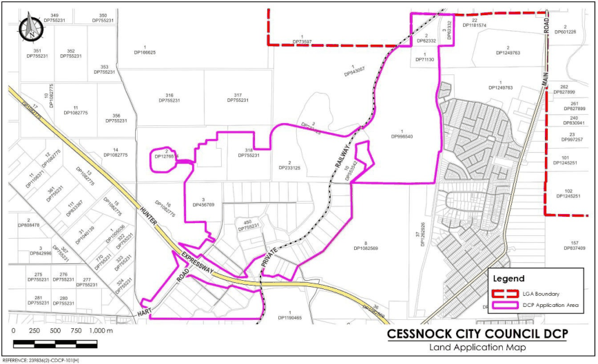

#### AREA-BASED PROVISIONS

The Cessnock Development Control Plan is comprised of 4 parts. Development applications must address all relevant sections of Part 2, Part 3 and Part 4 and supporting guidelines, such as Council’s Engineering Guidelines for Design and Construction.

Area-based provisions apply to discrete areas and may include provisions that are different from those in Parts 2 and 3 of the CDCP. Where there is a difference between any development provision/s in Parts 2 or 3 and Part 4, the provision/s in Part 4 prevail for that area.

#### REGROWTH KURRI KURRI

Preamble

The closure of the Kurri Kurri Hydro Aluminum Smelter presented opportunities to redevelop the site for employment, industrial, residential and conservation purposes. The site extends into the Maitland Local Government Area and includes extensive areas of environmental lands.

The area is now known as Regrowth Kurri Kurri.

These area-based provisions aim to guide the design, conservation and management of residential, industrial, commercial and infrastructure development to achieve the masterplan envisaged for the area.

Application

This chapter of the DCP applies to the land known as Regrowth Kurri Kurri as outlined in Figure 1.

> [Picture on page 4: a picture, saved as a picture (images/part-e20-regrowth-kurri-kurri-page-4-19.gif, 150 dpi).]

Figure 1 - Land application map.
