#### DEVELOPMENT PROVISIONS

Staging

The development is staged generally in accordance with Figure 2.

Objective/s

Development Control/s

Staging of development occurs in a timely and efficient way, making provision for necessary infrastructure and sequencing.

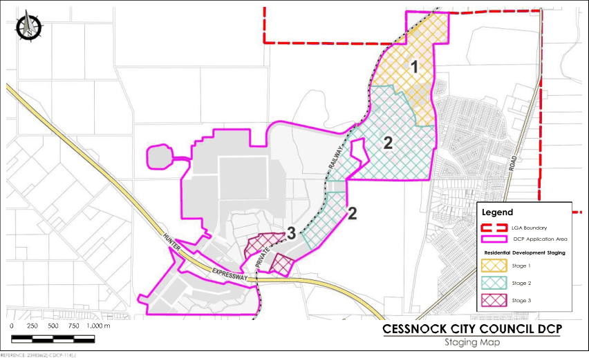

> [Picture on page 5: a picture, saved as a picture (images/part-e20-regrowth-kurri-kurri-page-5-10.gif, 150 dpi).]
> Words printed on the picture (title and legend, copied from the PDF):
> Legend

Figure 2 Strategic Plan

Environment

Watercourses and riparian corridors

Swamp Creek and an unnamed 2nd order stream are within Kurri Kurri Regrowth Area. These will be managed in accordance the NSW State Government ‘Guidelines for Riparian Corridors on Waterfront Land’.

There are a number of 1st order streams throughout the development and these will be subject to more detailed hydrological modelling to understand their role and function in the subdivision. The Department may determine that a 1st order stream that does not exhibit the features of a defined channel with bed and banks, is not waterfront land for the purposes of the Water Management Act.

| Objective/s | Development Control/s |
|---|---|
| To protect, restore and enhance the environmental values and functions of watercourses, waterbodies and riparian corridors. | Watercourses and riparian corridors are maintained generally in accordance with Figure 3. |
| To understand the role and function of 1st order streams within the development. To protect the role and function of 1st order streams in relation to flooding and conveyance of overland flow. | Detailed hydrological modelling of the 1st order streams in a subdivision application is required. Modelling is to determine the role and function of the 1st order stream in the subdivision particularly in relation to flooding and the conveyance of overland flow and inform their ongoing management1. |
| To protect, restore and enhance the environmental values and functions of watercourses, waterbodies and riparian corridors. | Watercourses are to be maintained in a natural state, buffered by an appropriate vegetated riparian zone (VRZ), with the maintenance of habitat features such as hollow-bearing trees and fallen debris. VRZs are to be designed in accordance with the NSW State Government ‘Guidelines for riparian corridors on waterfront land’. Applications on land that contain watercourses or VRZs nominated for retention are to include a Vegetation Management Plan (VMP). Each VMP shall respond to the function of the watercourse and detail: The existing native plant community types, The extent of invasive and non-native vegetation, A schedule of works for the regeneration, vegetation and maintenance of the VRZ and watercourse, A monitoring methodology for the maintenance period. The VMP is to be prepared by a suitably qualified and experienced ecologist or bush regeneration professional (Certificate IV in Conservation and Land Management (or equivalent)). VRZs are to be rehabilitated and revegetated with appropriate native vegetation, using species associated with the existing native plant community type and locally sourced seed stock. Bushfire Asset Protection Zones (APZ) are to be located outside of the VRZ. |

1 Additional flood modelling for Regrowth Kurri Kurri is currently being undertaken that may meet the requirements of this development provision.

Watercourse crossings are to be designed to minimise impacts to the VRZ and aquatic habitat in accordance with NSW State Government requirements for fish passage. Watercourse crossings are to be maintained to retain habitat connectivity and water quality.

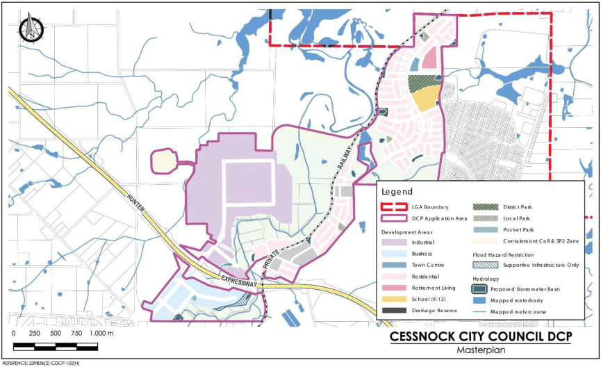

> [Picture on page 7: a picture, saved as a picture (images/part-e20-regrowth-kurri-kurri-page-7-7.gif, 150 dpi).]

Figure 3 - Regrowth Kurri Kurri Master Plan

Biodiversity and environmental areas

An application for the Biocertification (BCAR) of Regrowth Kurri Kurri is currently being assessed by the Department of Planning and Environment – Biodiversity and Conservation Division (BCD). If the BCAR is approved, no further consideration of biodiversity issues in the certified area is required. Evidence that commitments required under the BCAR have been met will need to be provided with the DA.

In the interim, if a development application triggers the Biodiversity Assessment Methodology, that development application shall be accompanied by a Biodiversity Development Assessment Report (BDAR) under the Biodiversity Conservation Act 2016. The BDAR process will determine the footprint of development and any commitments including offsets that need to be satisfied ahead of, or as part of the DA.

The following provisions apply to those areas outside BCAR/BDAR process.

| Objective/s | Development Control/s |
|---|---|
| To improve or maintain biodiversity values through habitat conservation, wildlife corridors and habitat linkages through the siting and design of open space networks and riparian corridors. To retain existing significant trees, where possible due to their potential to habitat for biodiversity. | Subdivisions are to be designed with consideration of movement of native fauna within and through wildlife corridors by: Ensuring development, services and landscaping design do not create barriers to the movement of fauna along and within wildlife corridors Managing fauna from potential construction hazards through the pre- construction and construction process. |
| Development that interfaces environmental areas is designed to minimise impact on those areas from clearing. Perimeter roads contribute to asset protection zones, discourage illegal access and dumping or garden waste. Perimeter roads allow for surveillance over environmental areas. | Perimeter roads are to be provided in accordance with Figure 6: Road network map. Where perimeter roads are not proposed, the development application must demonstrate that: Asset protection zones are wholly within the development footprint; No solid fences, e.g. colorbond are permitted between the development and the environmental area. |
| Street lighting does not generate light spill into adjoining environmental areas. | All street lighting is designed and installed in accordance with AS4282 Control of the Obtrusive Effects of Outdoor Lighting. |
| To minimise the risk of car-strikes on wildlife. Road design includes measures protect wildlife moving through the development area. | The road network design is to consider biodiversity management design measures including: exclusion fencing; fauna underpasses or bridges with reference to Transport for NSW biodiversity guidelines; and/or traffic calming measures such as signposting of roads near biodiversity areas, speed humps or audible surfacing. |
| High value biodiversity assets are maintained in situ on public lands, environmental areas and riparian corridors. | Existing significant trees and large hollow bearing trees are to be retained, wherever practicable, within public land (e.g. parks), environmental lands and riparian corridors. |

| Objective/s | Development Control/s |
|---|---|
| Suitable endemic and native species are incorporated into the landscaping of public spaces including streets and parks. | Applications for subdivision are to include landscape design plans for streets and open/recreational spaces with consideration of suitable indigenous local provenance species (trees, shrubs and groundcovers). |

Stormwater and Water Quality

| Objective/s | Development Control/s |
|---|---|
| To manage and control the quantity and quality of stormwater generated by the development. | Development applications for subdivision are to be accompanied by a Stormwater Management Plan and associated modelling and report which will include: 1. an On-Site Detention (OSD) Plan; and 2. a Water Quality Management Plan. |
| To ensure that potential impacts of overland flow path modifications are negligible. To encourage and facilitate the capture and re- use or slow release of stormwater where appropriate. To facilitate unimpeded release of stormwater for improved flooding outcomes where appropriate. | The OSD plan shall: 1. Assess the impacts of any proposed alteration, filling, piping or modification of overland flow paths on the local catchment, particularly the impacts on the neighbouring properties and downstream/upstream environments must be identified and resolved. 2. Ensure that development achieves the unimpeded release of stormwater where there is no adverse effect on adjacent properties. 3. Where OSD is proposed, structures are in accordance with Council’s Engineering Guidelines for Design and Construction. 4. Consider the capacity of the Hunter Expressway Culvert. 5. Allow for a maximum of the capacity of rainwater tanks to be utilised for on- site detention. |
| The development meets the minimum requirements of the Australian Runoff Quality (ARQ) 2006 – A Guide to Water Sensitive Urban Design. To encourage water sensitive urban design (WSUD). | The Water Quality Management Plan shall ensure stormwater quality treatment is designed to meet the following minimum requirements in accordance with the Australian Runoff Quality (ARQ) 2006 – A Guide to Water Sensitive Urban Design: Total suspended solids: 80%, Total phosphorus: 45%, Total nitrogen: 45% |

Heritage

Aboriginal Cultural Heritage

The site contains several Aboriginal Archaeological sites of high, low and no sensitivity.

| Objective/s | Development Control/s |
|---|---|
| To require further investigation of Aboriginal archaeological sites identified as significant on lands to be developed for urban purposes. | Applications for the subdivision of land are to be accompanied by a preliminary Aboriginal cultural assessment prepared by an appropriately qualified person in accordance with the NSW State Government’s ‘Due Diligence Code of Practice for the Protection of Aboriginal Objects in NSW’. |
| To ensure that any Aboriginal significance is appropriately incorporated into the development of the precinct. | Where required, the application for subdivision of land is to be accompanied by an Aboriginal cultural heritage assessment report prepared by an appropriately qualified person in accordance with the NSW State Government’s ‘Guide to investigating, assessing and reporting on Aboriginal cultural heritage in NSW’. |

European Heritage

The site contains a local Heritage Item I212 South Maitland Railway System. This comprises a main operable rail line, South Maitland Railway and the former Stanford Railway. The following provisions apply to the Stanford Railway only.

| Objective/s | Development Control/s |
|---|---|
| To conserve and interpret the previous uses of the site in the context of its historical, technological, and social significance. | Interpretation signage and/or in ground pavement treatment is to be considered at locations where new roads or shared pathways intersect the former Stanford Railway. A Heritage Impact Statement (HIS) prepared by a suitably qualified Heritage Consultant that considers the visual and physical impacts of the proposed development works on or within the vicinity of the South Maitland Railway System corridor is required. The subdivision design and road layout must respond the railway system alignment and ensure its continued interpretation. Any roadway, footpath or cycleway across the railway corridor must provide for some tactile interpretation of the corridor, such as a change pavement design, interpretative art or other appropriate treatment. |

Hazards

Flooding

| Objective/s | Development Control/s |
|---|---|
| To ensure clarity of the final landform heights and minimum fill levels to be applied to development. | For a period of five (5) years from the date of this Chapter coming into effect, the following levels/heights1 are to be utilised: The final landform height for residential development generally is to be at or above the Hunter River 0.5% AEP flood level (i.e., 10.7m AHD). The final landform for residential development along and surrounding Dawe’s Road is to be at or above the Swamp Creek PMF flood level (i.e., between 11.7m AHD and 13.1m AHD). The final landform for residential roads (exclusive of those nominated as flood safe access roads) is to be at or above the Hunter River 1% AEP flood level + 0.5m (i.e., 10.2m AHD) The final landform height for land zoned B1 Local Centre is to be at or above the 0.5% AEP Hunter River flood level (i.e., 10.7m AHD). The final landform height for the main employment area (the former Hydro Aluminium Facility) is to be 9.7m AHD (Hunter River 1% AEP flood level). The minimum fill level within the employment areas (south of the Hunter Expressway) is to be the 1% Swamp Creek AEP (i.e., 10.9m AHD to 12.2m AHD). In the event that the parameters (such as but not limited to those arising from staging or detailed subdivision design works, amendments to the FRM 2023 or Australian Rainfall and Runoff Guidelines) of the Flood Impact and Risk Assessment (FIRA) from which these levels were derived change, OR at the conclusion of the five (5) year period, a revised FIRA, consistent with the Flood Risk Management (FRM) Manual 2023 and supporting guidelines (as amended or revised) is to be prepared to support any development application for subdivision of the land. |
| To provide clarity as to the flood levels to be applied when determining the location and supply of open space. | For a period of five (5) years from the date of this Chapter coming into effect, the following flood levels2 are to be utilised for the purposes |

1 The levels specified are derived from: Torrent Consulting (2024) Regrowth Kurri Kurri Planning Proposal Flood Impact and Risk Assessment, Wallsend, NSW, Australia. 2 As above

| Objective/s | Development Control/s of determining the location of open space as per Council’s Recreation and Open Space Strategic Plan: Central Precinct: Hunter River 1% AEP (i.e., 9.7m AHD) and Hunter River 2% AEP (i.e., 7.7m AHD) Southern Residential Precinct: Hunter River 1% AEP (i.e., 9.7m AHD) Eastern employment area upstream of the Hunter Expressway: Swamp Creek 1% AEP (i.e., between 10.9m AHD and 12.2m AHD) In the event that the parameters (such as but not limited to those arising from staging or detailed subdivision design works, amendments to the FRM 2023 or Australian Rainfall and Runoff Guidelines) of the Flood Impact and Risk Assessment (FIRA) from which these levels were derived change, OR at the conclusion of the five (5) year period, a revised FIRA, consistent with the Flood Risk Management (FRM) Manual 2023 and supporting guidelines (as amended or revised) is to be prepared to support any development application for subdivision of the land. |
|---|---|
| To ensure flood safe access to and from the site during Hunter River Floods. Flood-free access above the Hunter River PMF level is to be achieved for the development and Gillieston Heights. | Flood safe access for storm events up to PMF is provided generally in accordance with Figure 4. |
| To ensure the Hunter Expressway culvert has the capacity to accommodate increased run- off from development within the Zone E3 Productivity Support land. Development within the Zone E3 Productivity Support land does not result in increased flood risk to properties upstream of the Hunter Expressway culvert. | The capacity of the Hunter Expressway culvert and the need for on-site detention shall be assessed as part of any subdivision application relating to the Zone E3 Productivity Support land. |
| To accommodate potential future risks associated with Climate Change and flooding within the Swamp Creek catchment and clarify the minimum floor levels for employment land development3. | The minimum floor level for development within the employment areas (south of the Hunter Expressway) will be required to include a 0.5m freeboard above the 1% AEP Swamp Creek flood levels. |

3 The levels specified are derived from: Torrent Consulting (2024) Regrowth Kurri Kurri Planning Proposal Flood Impact and Risk Assessment, Wallsend, NSW, Australia.

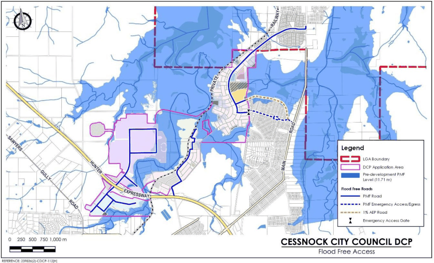

> [Picture on page 13: a picture, saved as a picture (images/part-e20-regrowth-kurri-kurri-page-13-1.gif, 150 dpi).]

Figure 4 – Flood safe access

Bushfire

The site is mapped as Bushfire Prone Land (BPL).

| Objective/s | Development Control/s |
|---|---|
| To afford buildings and their occupants protection from exposure to a bush fire. To provide for a defendable space to be located around buildings. To provide appropriate separation between a hazard and buildings which, in combination with other measures, prevent the likely fire spread to buildings. To ensure that appropriate operational access and egress for emergency service personnel and occupants is available. To provide for ongoing management and maintenance of Bushfire Protection Measures (BPMs). To ensure that utility services are adequate to meet the needs of firefighters. | Development Applications for subdivision must be accompanied by a Bushfire Assessment Report in accordance with the NSW Rural Fire Service document titled ‘Planning for Bushfire Protection’ to the satisfaction of NSW Rural Fire Services (RFS) and Council. Asset Protections Zones (APZs) shall be located within land zoned for urban development and outside of the VRZ. |

Contamination

The site has been subject to potentially contaminating activities. Part of the site was formerly an aluminium smelter, a railway corridor runs through the area and some areas are still used for agriculture.

The management of contamination across the site is complex. The remediation works for the Smelter site were approved under State Significant development application number: SSD 6666 issued by the Department of Planning, Industry and Environment dated 23 December 2020. The regulation and compliance of that remediation is overseen by the State Government and there is no onus on the State to report to Council on this matter. However, when assessing a development on the site, Council needs to be assured that the contamination issues have been addressed. Therefore, the following controls require the applicant to provide evidence that the site has been remediated and is suitable for development.

Areas outside the E4 and E5 zones, will be assessed in accordance with State Environmental Planning Policy (Resilience and Hazards) 2021, Council’s Contaminated Lands Development Control Plan and Contaminated Land Policy-Land Use Planning.

| Objective/s To minimise risk to human health and the environment from the development of potentially contaminated land. To ensure commitments to the remediation of the site have been completed. | Development Control/s Any application located within the E4, E5 zones are to be accompanied by a remediation validation report for the subject land. The remediation validation report is to include: The remediation works undertaken Validation testing carried out and assessment against the validation criteria Final condition of the subject land Documentation that the report has been completed to the satisfaction of the appointed Site Auditor. Any application located within the E4, E5 zones are to be accompanied by a Site Audit Report and Site Audit Statement prepared by an accredited Site Auditor under the Contaminated Land Management Act 1997. The Site Audit Report and Site Audit Statement are to include: Confirmation the remediation works at the subject site have been completed in accordance with the approved remedial action plan Risk to human health and the environment have been addressed in accordance with the approved remedial action plan Suitability of the site for the intended use. |
|---|---|

Noise and Vibration

The area is affected by noise and vibration of the South Maitland Railway Line, Main Road and Hunter Expressway. Future subdivisions must ensure that the design responds to impacts from these sources and that any acoustics treatments such as noise walls do not exacerbate flooding.

| Objective/s | Development Control/s |
|---|---|
| To minimise risk to human health from noise at the time of subdivision. To protect the safety and integrity of key transport infrastructure from adjacent development. To ensure that adjacent development achieves an appropriate acoustic amenity by meeting the internal noise criteria specified in the Infrastructure SEPP. | Development Applications for subdivision are accompanied by an acoustic and vibration assessment. The assessment shall: measure the expected noise levels, and vibration impacts from the South Maitland Railway Line, Main Road and the Hunter Expressway; map the affected areas; and provide mitigation measures to meet the internal noise criteria specified in the SEPP (Transport and Infrastructure) 2021. The assessment should be undertaken by a suitability qualified acoustic consultant to ensure that the properties are designed and constructed in accordance with the NSW DPE’s document titled ‘Development near Rail Corridors and Busy Roads – Interim Guideline’ to achieve acceptable internal noise amenity, regarding the external noise exposure levels. |
| To increase the likelihood that fencing will be maintained. | Where fencing is identified as an appropriate mitigation mechanism, that fencing shall be: located within the development area; constructed as part of the subdivision; and maintained in perpetuity by that landowner. |
| Hard interventions such as earthen mounds and noise walls do not increase the risk of flooding to properties or alter flood behaviour. | A Flood Impact Assessment must be provided for all noise walls and mounds. The Flood Impact Assessment must demonstrate that the intervention will not impact flooding and flood behaviour. |

Subdivision in proximity to the South Maitland Railway Line will require security fencing.

To minimise the risk of pedestrians and animals crossing the South Maitland Railway Line.

To restrict access to the railway corridor and improve safety.

Security fencing shall be constructed along the full alignment of the subdivision adjoining the rail corridor, and be a minimum height of 1.8m; be constructed to deter climbing; located within the development area; constructed as part of the subdivision; and maintained in perpetuity by that landowner.

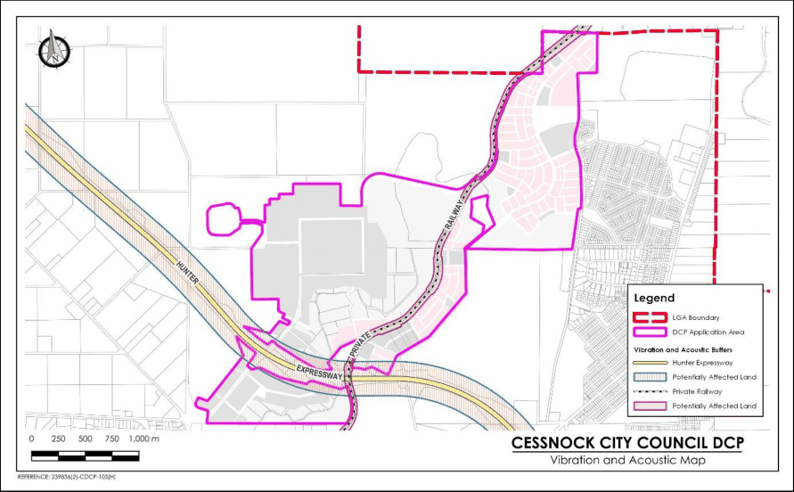

> [Picture on page 17: a picture, saved as a picture (images/part-e20-regrowth-kurri-kurri-page-17-17.gif, 150 dpi).]

Figure 5 - Regrowth Kurri Kurri Master Plan

Subdivision Design

Street Network and Design

| Objective/s | Development Control/s |
|---|---|
| To provide a hierarchy of interconnected streets that provide safe, convenient, and clear access. To ensure that the hierarchy of streets is clearly discernible through variations in the carriageway width, on-street parking, street tree planting, and pedestrian amenities. | The street network is generally provided in accordance with the Figure 6. The road design/layouts/reservations are to be provided generally in accordance with Road Sections Figure 7 - Figure 12, subject to the requirements and agreement of Council and/or TfNSW. |
| To support redistribution of traffic on the State road network and to mitigate local traffic volumes on HEX | Prior to development of the employment land exceeding a total floor area (equivalent to 50% of the employment land zoning), and unless otherwise agreed in writing by TfNSW, a continuous local road connection linking Hart Road to the Maitland LGA must be in place. |
| To encourage the use of streets by pedestrians and cyclists and to allow cars, buses, and other users to proceed safely without unacceptable inconvenience or delay. | Except where otherwise provided for in this Chapter, all streets and intersections are to be designed and constructed in accordance with Austroads Guide to Traffic Management and Australian Standards AS 1742, 1732 and 2890. Cycleways, pedestrian paths and shared pathways will be provided and integrated in the subdivision as shown in Figure 13. |

Public Transport Network

| Objective/s | Development Control/s |
|---|---|
| To encourage the use of public transport. To ensure clear, safe pedestrian links to public transport stops. | Bus routes are generally provided on sub- arterial, and collector roads in accordance with Figure 6 and in consultation with local bus service providers. Bus stops are provided in consultation with local bus service providers. |

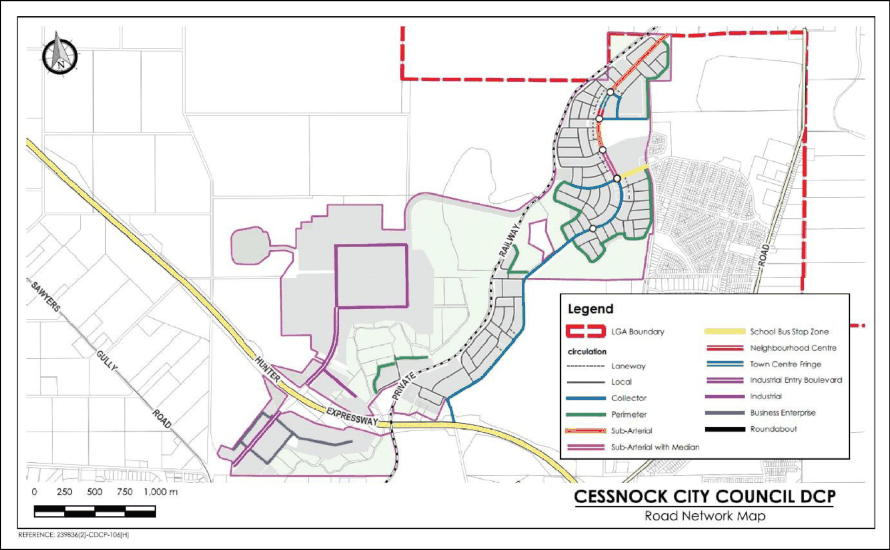

> [Picture on page 19: a picture, saved as a picture (images/part-e20-regrowth-kurri-kurri-page-19-3.gif, 150 dpi).]

Figure 6 – Road Network Map

.

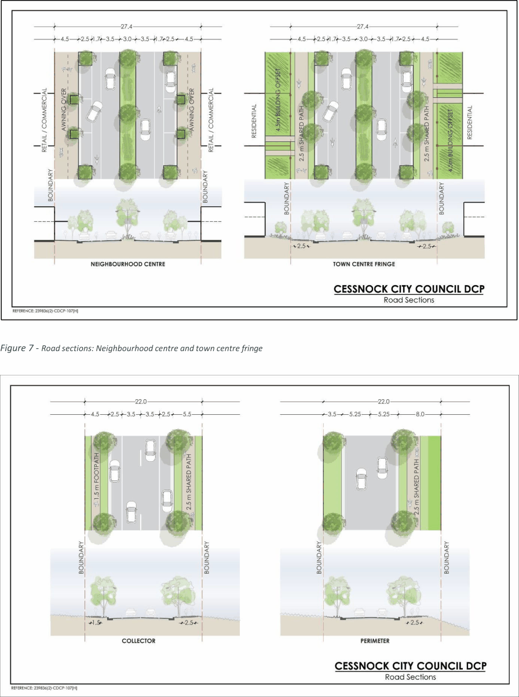

> [Picture on page 20: a picture, saved as a picture (images/part-e20-regrowth-kurri-kurri-page-20-1.gif, 150 dpi).]

Figure 7 - Road sections: Neighbourhood centre and town centre fringe

Figure 8 - Road sections: Collector and perimeter roads

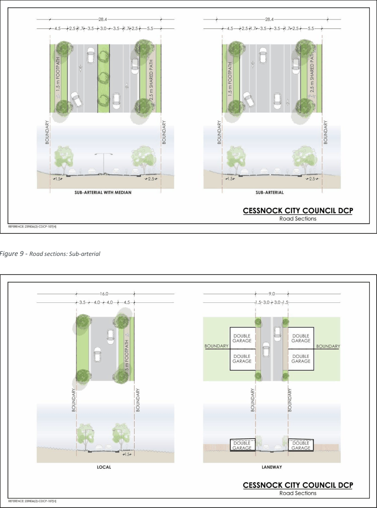

> [Picture on page 21: a picture, saved as a picture (images/part-e20-regrowth-kurri-kurri-page-21-1.gif, 150 dpi).]

Figure 9 - Road sections: Sub-arterial

. Figure 10 - Road sections: Local and laneway

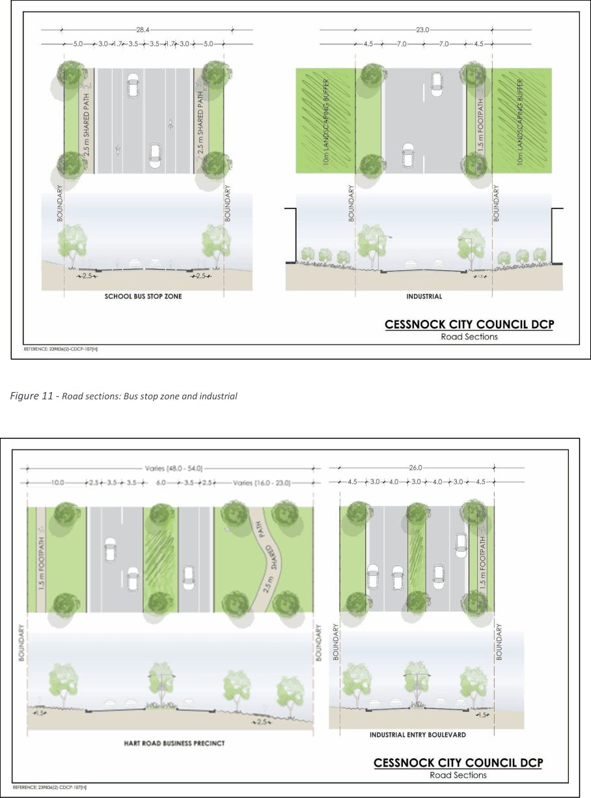

> [Picture on page 22: a picture, saved as a picture (images/part-e20-regrowth-kurri-kurri-page-22-1.gif, 150 dpi).]

Figure 11 - Road sections: Bus stop zone and industrial

Figure 12 - Road sections: Business and industrial entry boulevard

Pedestrian and Cycle Network

| Objective/s | Development Control/s |
|---|---|
| To provide a convenient, efficient, and safe network of pedestrian and cycleway paths for the use of the community, within and beyond the site. To provide a functional network of footpaths and cycle paths throughout the development. | Footpaths and cycle paths are to be provided in accordance with Figure 7 - Figure 13. |
| To allow residents to walk or cycle. To encourage active transport alternatives to motor vehicles. | Pedestrian paths, cycle routes and facilities are to be safe, well lit, clearly defined, and accessible. Pedestrian paths and cycle pathways are to be constructed as part of the infrastructure works for each residential stage. |
| To avoid duplication by allowing pedestrian pathways and cycleways to be located within parks and corridors wherever practical. | Pedestrian paths, cycle paths and pedestrian refuge islands are to be designed in accordance with Council’s Engineering Standards and Australian Standard 1428:1-4. |

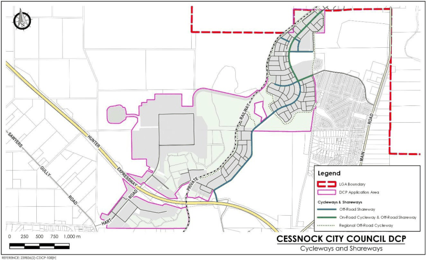

> [Picture on page 23: a picture, saved as a picture (images/part-e20-regrowth-kurri-kurri-page-23-3.gif, 150 dpi).]

Figure 13 - Cycleway and shareways map

Open Space

| Objective/s | Development Control/s |
|---|---|
| Public open space complies with the requirements of the Cessnock Recreation and Open Space Strategic Plan. To provide public open space that meets the recreational needs of residents. | Open space is to be provided generally in accordance with Figure 14. The embellishment of open spaces shall be in accordance with the Cessnock Recreation and Open Space Strategic Plan 2019. |

Low Density Residential

| Objective/s | Development Control/s |
|---|---|
| To establish a clear urban structure that encourages walking and cycling. To create permeable local areas. | Street blocks are generally in accordance with Figure 3. Where this cannot be achieved, street blocks are to be generally 150m to 180m in length. |
| To provide lot sizes, lot shapes and orientation that encourage sound design and development outcomes. | Residential lots should generally be rectangular in geometry. Where lots are irregular in shape, they are to be large enough and orientated appropriately to enable dwellings to meet relevant DCP controls relating to front, side, and rear setbacks. |
| To ensure that all residential lots are afforded a high level of solar access, views, outlook and proximity to public and community facilities and parks. | Lots shall be oriented on a north-south or east- west orientation. Where this is not possible, Council may consider alternative lot orientation where it is demonstrated: that other amenities, such as views or frontage to sufficient open space is available; or increased lot size or widths provide adequate solar access. |
| To encourage surveillance over both streets from corner lots. To minimise the visual impact of fences and retaining walls constructed on corner lots. | Corner lots are to be designed to address both street frontages. Corner lots are to be sized to accommodate a dual occupancy that addresses both streets. Where a dwelling house is proposed on a corner lot, the fence on the secondary street: Is not a solid colorbond-type fence; Uses changes in materials, landscaping and articulation. Retaining walls on the boundary are generally not supported on secondary frontage unless satisfactorily integrated into the streetscape. |

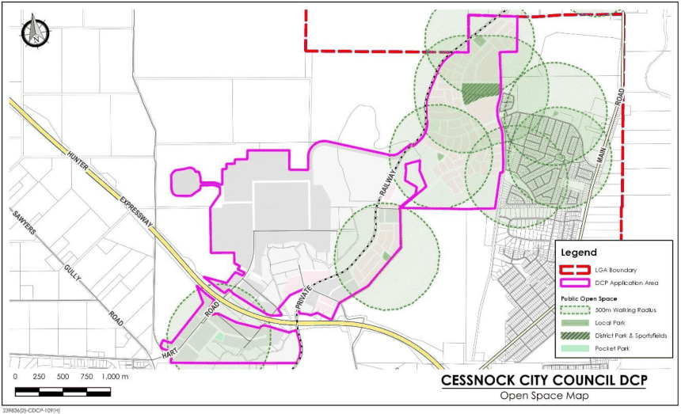

> [Picture on page 25: a picture, saved as a picture (images/part-e20-regrowth-kurri-kurri-page-25-1.gif, 150 dpi).]

Figure 14 – Open space map

Town Centre and Market Square

The development includes a small town2 centre that is around 1Ha in area. The centre may provide a range of local services and facilities to meet the day-to-day needs of the community. The centre should be integrated with adjoining open space to reinforce it as a community node and be highly accessible by walking and cycling paths from the surrounding residential areas. Where appropriate, higher-density residential uses should adjoin the town centre and park lands.

| Objective/s | Development Control/s |
|---|---|
| To achieve a sense of street enclosure where distinct edges to public spaces and important streets are required. To ensure informal surveillance of streets and public spaces. To ensure the provision of adaptable development blocks capable of accommodating a range of urban uses. To encourage the provision of interconnecting streets and public spaces which promote direct connectivity, wayfinding and ease of use and functionality. To promote community interaction through the provision of a town centre with well-designed public open spaces and centrally located community facilities. | The town centre and market square are designed and developed generally in accordance with Figure 15. Zero lot boundaries and active street frontages are provided by retail uses along the main street. |
| To define the town centre as a destination through urban form and design, distinctive and high-quality architecture. To create a dynamic, safe, aesthetic and multifunctional node. | A public domain plan shall accompany the first development application for any built-form component on the land with the E1 Local Centre zone to the satisfaction of Council. The public domain plan shall include: a plan showing proposed buildings locations, potential uses, parking areas, access locations, public areas, loading facilities; detailed street design including crossing points, gateway treatments, landscaping, signage and street furniture; cycle and pedestrian facilities; public transport stops; materials, street furniture and landscaping palettes. |

2 Note: The generic Centres DCP Chapter applies to development in this centre. The generic controls apply to the development and only where there is a control in this DCP that is unique to the site, that control prevails.

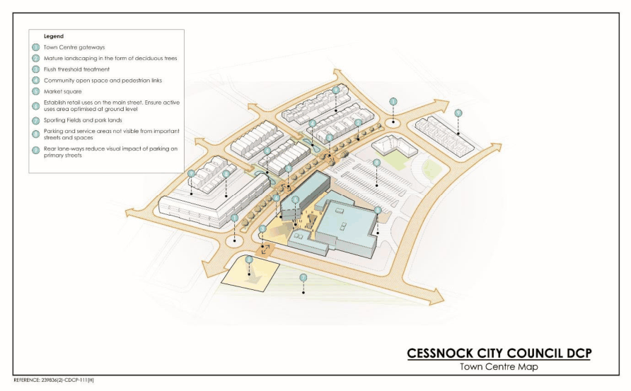

> [Picture on page 27: a picture, saved as a picture (images/part-e20-regrowth-kurri-kurri-page-27-1.gif, 150 dpi).]

Figure 15 - Indicative town centre plan

E3 Productivity Support Precinct

Regrowth Kurri includes an area of E3 Productivity Support zoned land along Hart Road. The purposes of the E3 Productivity Support zone is to provide a range of facilities and services, light industries, warehouses and offices that are generally ill-suited in other business zones such as those with large floor plates.

The area is a very important gateway from the Hunter Expressway into the LGA. The Hart Road interface will be a high exposure corridor and the development is likely to be visible from the Expressway in both directions.

The SEPP (Exempt and Complying Development Codes) 2008 allows new buildings in the E3 zone for a specified use to be assessed as complying development where the design of the development is consistent with the relevant design criteria set out in the Business Zone Design Guide.

Development assessed through a development application under Part 4 of the Environmental Planning and Assessment Act 1979, will be assessed against the relevant design criteria in the Business Zone Design Guide. Any variation to the design criteria will be assessed against the future desired character for the precinct and the corresponding objective/s.

| Objective/s | Development Control/s |
|---|---|
| The E3 Productivity Support Precinct is holistically designed to create an integrated, functional and cohesive precinct. | A masterplan prepared for the whole of the E3 Productivity Support zone must be prepared to Council’s satisfaction and submitted with the first subdivision application. |

| Objective/s | Development Control/s |
|---|---|
| To define a future character that informs quality and enduring design outcomes for developments in the precinct that are responsive to place and context. To create a high-quality gateway into the Local Government Area from the Hunter Expressway. To encourage a built form that contributes to the character of the precinct and reinforces the Hart Road corridor. To minimise the visibility of signage and built from on the Hunter Expressway. To protect, restore and enhance the environmental values and functions of watercourses, waterbodies and riparian corridors. | The masterplan must: address the principles of the Business Zone Design Guide3; describe the future desired outcome for the precinct4; demonstrate how the Hart Road interface is to be treated to contribute positively to the corridor and as a gateway into the LGA; be informed by the a Visual Impact Assessment that assesses the visibility of the development, including signage from the Hunter Expressway; provide streetscape details including road configuration, cross-sections, pedestrian and cycling infrastructure, access points and landscaping; provide an appropriate interface with Swamp Creek that minimises impact of development on the riparian corridor, addresses bushfire protection requirements and stormwater management and allows for the management of the corridor; and Provide guidance on materials, landscaping, fencing and any street furnishing. The design of the development is consistent with the relevant design criteria set out in the Business Zone Design Guide and the approved masterplan. A DA for development within land zoned SP2 Stormwater Management for purposes other than for stormwater management purposes is to be accompanied by a Flood Impact and Risk Assessment (FIRA) that demonstrates that the proposed development is compatible with the flood hazard of the land. |
| To protect, restore and enhance the environmental values and functions of watercourses, waterbodies and riparian corridors. | The Swamp Creek corridor at the rear of the development is managed in accordance with the relevant provisions under ‘Watercourses and riparian corridors’ above. |

3 The DPE Business Zone Design Guide includes 5 principles: Place and Context, Integration and Connection, Aesthetics and Appearance, Greening the Grey and Resilient Buidlings. 4 The ‘Desired Future Character’ is a requirement of the Business Zone Design Guide.

E4 General Industry and E5 Heavy Industry Precinct

This part applies to development located within those locations zoned E4 General Industrial and E5 Heavy Industrial.

| Objective/s | Development Control/s |
|---|---|
| To achieve functional and attractive environments. To minimise the impact of large expanses of walls and create visual interest. To provide clear entry points to buildings. To provide for convenient and legible access by vehicles and pedestrians. To minimise conflict between vehicles and pedestrians. To reduce the dominance of building frontages in the street scape. To locate site servicing infrastructure and equipment away from public view. | Industrial building siting and design are to be consistent with the following principles: Blank walls must be minimised by incorporating a combination of change in materials, setback variation, architectural details and/or landscaping. Buildings are oriented to the street with offices, showrooms or cafes addressing the street. Pedestrian entries are provided on the street façade. Separate vehicle and pedestrian access are provided to the site from the street. Visitor parking is located at front of the building or to its side near the front, away from areas where loading vehicles may be queuing or reversing. Staff parking areas are located to the side of the building (screened by landscaping) or behind it. High-quality landscaping is provided within front setbacks, including visitor parking areas. Loading areas, truck queuing and parking, and outdoor storage areas are located to the side or rear of the building. A dedicated rubbish bin storage area is provided in a concealed location. Landscape buffers are provided at interfaces with other uses. Service equipment and plant is located within the building design or screened from view. Business identification signage is minimal and integrated within the design of the building. |

| Objective/s | Development Control/s |
|---|---|
| To provide a consistent approach to setbacks, so that consistent building envelopes are achieved in this precinct. Buildings in the front setback are integrated into the main building. The built form positively contributes to the streetscape. | Front setbacks are: A minimum of 10m, Where the site is a corner lot a minimum 10m setback is provided on both frontages, and Single storey offices or industrial retail outlets5 are permitted within the front setback area if they are ancillary to the primary industrial building’s use. Such a structure must be designed as an integral part of the built and must not exceed 50% of the primary building frontage. |
| To allow for the planting and healthy growth of large canopy trees which enhance amenity and street character. | A landscaping plan must be prepared to the satisfaction of Council for any development application. The landscaping plan must provide the following in the front setback: Landscaping must include installation and maintenance of at least one advanced clear-trunked broad canopy tree for every 20m2 of front setback area. The deep soil volume for each tree in the front setback area must be a minimum of 8m2 and between 600 and 750mm deep. Each area allocated to tree planting must have a corresponding clear air space that is at least eight metres high and six metres in width. All trees installed must be advanced stock, and at least 45L container size. Understorey planting must comprise low growing species less than 900mm in height. |

5 Clause 5.4 of the Cessnock Local Environmental Plan 2011 limts the floor area of an industrial retail outlet to the lesser of 10% of the gross floor area or 100m2.

| Objective/s | Development Control/s |
|---|---|
| To provide broad-canopy tree cover in car parks for shade and shelter. | The landscaping plan must provide the following in in car parks: The supply, installation, and maintenance of at least one advanced clear-trunked broad canopy tree for every six at-grade car parking spaces. Each landscaping planting area must include at least one medium to large tree species, with suitable ground covers or low shrubs below. Each landscape planting area must have a minimum width of two metres. The root volume for each tree in the front setback area must have a minimum width of two meters. The deep soil volume for each tree in the front setback area must be a minimum of 8m3 and between 600 and 750mm deep. The root volume must be either existing deep soil or equivalent volume of hap graded (load bearing) soils with a porous vehicle pavement on top, which is installed to the manufacturers' specifications. Each area allocated to tree planting must have a corresponding clear air space that is at least eight metres high and six metres in width. All trees installed must be advanced stock of at least 75L container size. All trees installed must be established and maintained for the life of the development. Any failed trees must be replaced immediately. |
| To avoid the dominance of fences on the streetscape and potentially hostile designs, and to soften the built environment in industrial areas. | Security gates and fencing may be erected on or just forward of the building line, provided: it does not exceed a height of 2 metres, is designed for maximum visibility, and is screened by landscaping. Fencing forward of the 5-metre setback must: not exceed a height of 1.2 metres. be constructed of masonry or dark coloured Diplomat style fencing, in combination with vegetation. |
