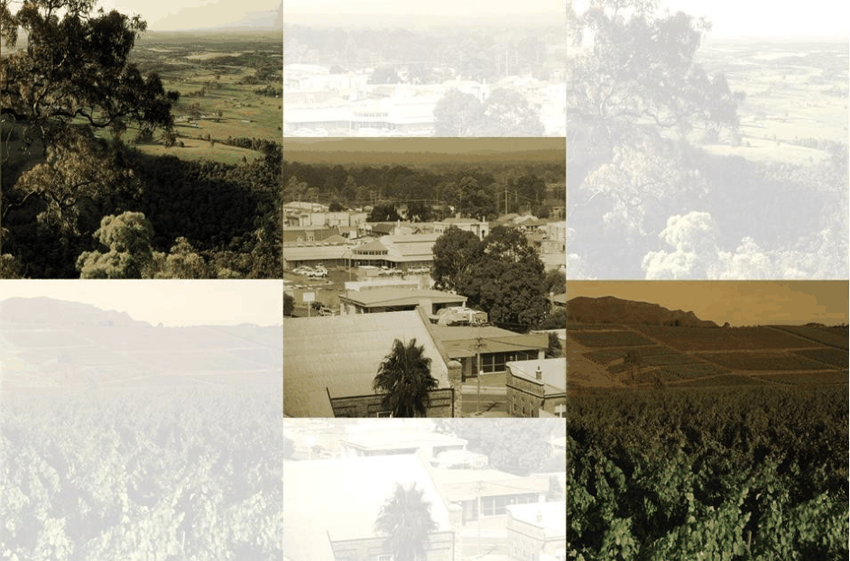

# Cessnock Development Control Plan 2010 - Part E20 Regrowth Kurri Kurri

> This chapter is split into 3 section file(s), one per main heading, in the order they appear in the PDF.

Source PDF: [E20 - Regrowth Kurri Kurri.pdf](https://planfortomorrow.sharepoint.com/sites/Planfortomorrow/Shared%20Documents/00%20NSW-Planning-Resources/dcp/cessnock-development-control-plan-2010/part-e20-regrowth-kurri-kurri/E20%20-%20Regrowth%20Kurri%20Kurri.pdf)

### CESSNOCK

### DEVELOPMENT CONTROL PLAN

### PART E: SPECIFIC AREAS

> [Picture on page 1: a picture, saved as a picture (images/part-e20-regrowth-kurri-kurri-page-1-4.gif, 150 dpi).]

> [Picture on page 1: a picture, saved as a picture (images/part-e20-regrowth-kurri-kurri-page-1-5.gif, 150 dpi).]

## Chapter 20: Regrowth Kurri Kurri

<!-- sections -->
## Sections

1. [Amendment History](01-amendment-history.md)
2. [AREA-BASED PROVISIONS](02-area-based-provisions.md)
3. [DEVELOPMENT PROVISIONS](03-development-provisions.md)
