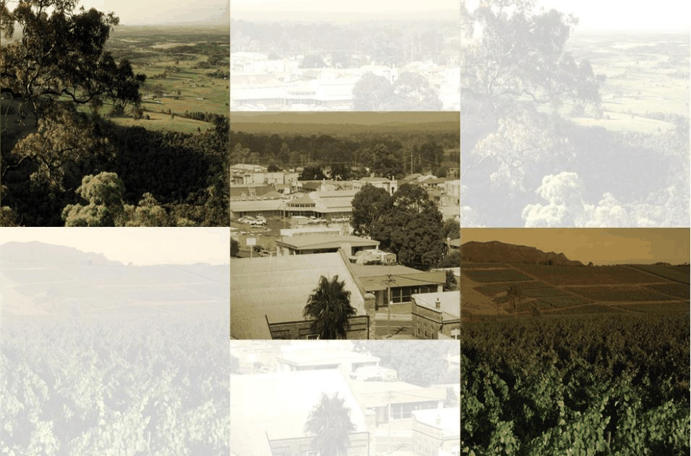

### PART E: SPECIFIC AREAS

> [Picture on page 1: a picture, saved as a picture (images/part-e21-centres-page-1-5.gif, 150 dpi).]

> [Picture on page 1: a picture, saved as a picture (images/part-e21-centres-page-1-6.gif, 150 dpi).]

## Chapter 21: Centres

Cessnock Comprehensive Development Control Plan |Area-based Provisions| Centres

#### Amendment History

| Version No. | Nature of Amendment | Date in force |
|---|---|---|
| 1 | Draft |  |
| 2 | DCP Chapter adopted at the Ordinary Council Meeting 13 December 2023. | 09/01/2024 |

Cessnock Comprehensive Development Control Plan |Area-based Provisions| Centres

DEVELOPMENT-BASED PROVISIONS .................................................................................. 1

Centres ............................................................................................................................. 1

Preamble ................................................................................................................................. 1

Application ............................................................................................................................... 1

Development provisions ........................................................................................................... 1

Active street frontages ................................................................................................................................... 1

Addressing the Street and Public Domain ...................................................................................................... 3

Awnings .......................................................................................................................................................... 3

Building materials, finishes and colours ......................................................................................................... 4

Built Form, Setbacks and Street Hierarchy ..................................................................................................... 4

Building height ................................................................................................................................................ 5

Roof form ....................................................................................................................................................... 6

Gateways and landmark sites ......................................................................................................................... 6

Site servicing ................................................................................................................................................... 7

Landscaping .................................................................................................................................................... 7

Sustainable Development and Water Sensitive Urban Design ....................................................................... 8

Parking and access.......................................................................................................................................... 8

AREA-BASED PROVISIONS ............................................................................................... 10

Cessnock Commercial Precinct ......................................................................................... 10

Preamble ............................................................................................................................... 10

Application ............................................................................................................................. 10

Development provisions ......................................................................................................... 11

Master plan and public domain plan ............................................................................................................ 11

Active street frontages ................................................................................................................................. 12

Built Form, Setbacks and Street Hierarchy ................................................................................................... 12

Building height .............................................................................................................................................. 12

Cessnock Comprehensive Development Control Plan |Area-based Provisions| Centres

Parking and Access ....................................................................................................................................... 13

Public art ...................................................................................................................................................... 13

Existing and future desired character ........................................................................................................... 14

Design Excellence ......................................................................................................................................... 18

Kurri Kurri Town Centre .................................................................................................. 28

Preamble ............................................................................................................................... 28

Application ............................................................................................................................. 28

Development provisions ......................................................................................................... 28

Master plan and public domain plan ............................................................................................................ 28

Building height .............................................................................................................................................. 29

Active street frontages ................................................................................................................................. 29

Awnings ........................................................................................................................................................ 29

Parking and access........................................................................................................................................ 30

Mixed use sites ............................................................................................................................................. 31

Weston Town Centre ...................................................................................................... 33

Preamble ............................................................................................................................... 33

Application ............................................................................................................................. 33

Development provisions ......................................................................................................... 34

Master plan and public domain plan ............................................................................................................ 34

Active street frontages ................................................................................................................................. 34

Awnings ........................................................................................................................................................ 34

Building height .............................................................................................................................................. 35

Branxton Town Centre .................................................................................................... 36

Preamble ............................................................................................................................... 37

Application ............................................................................................................................. 37

Development provisions ......................................................................................................... 37

Cessnock Comprehensive Development Control Plan |Area-based Provisions| Centres

Master plan and public domain plan ............................................................................................................ 37

Active street frontages ................................................................................................................................. 37

Building materials, finishes and colours ....................................................................................................... 38

Built Form, Setbacks and Street Hierarchy ................................................................................................... 39

Building height .............................................................................................................................................. 39

Signage ......................................................................................................................................................... 39

Parking and Access ....................................................................................................................................... 40

Public Open Space and Landscaping ............................................................................................................. 40
