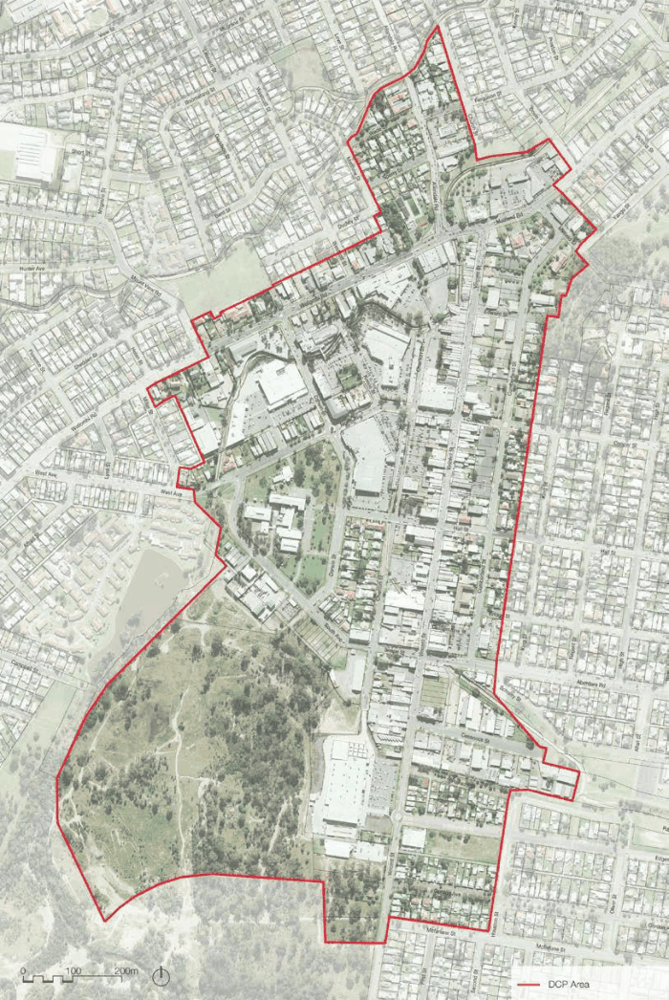
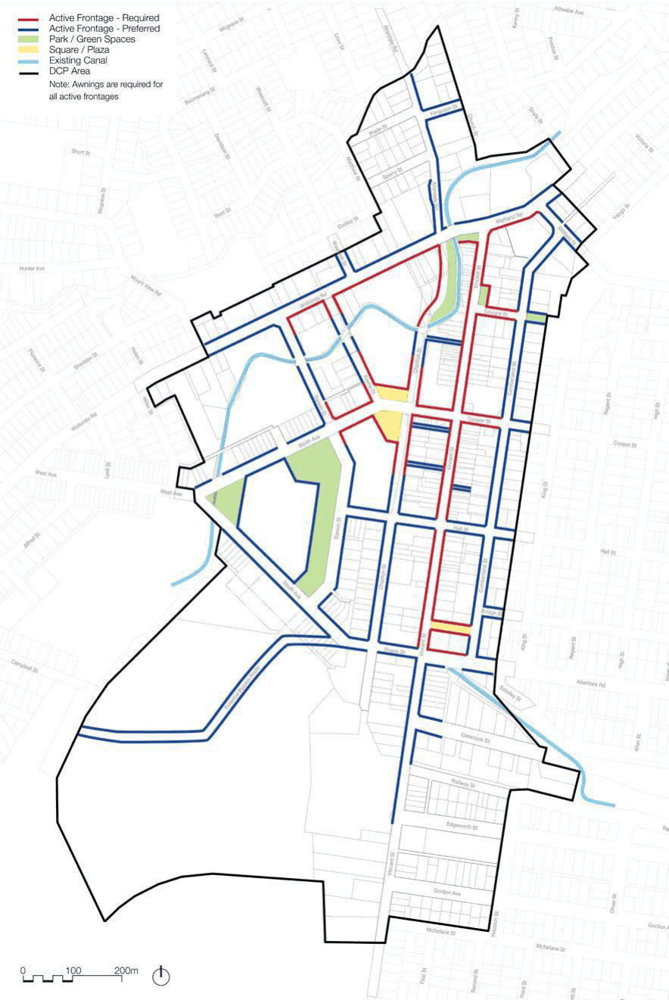
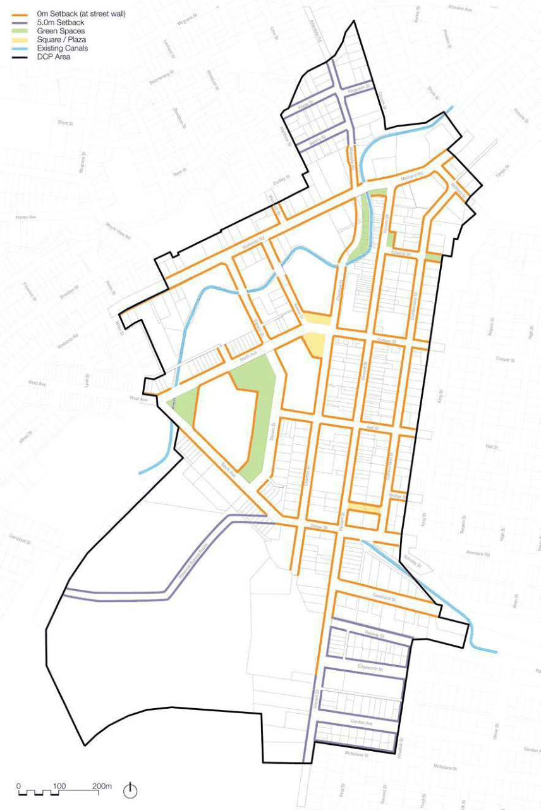
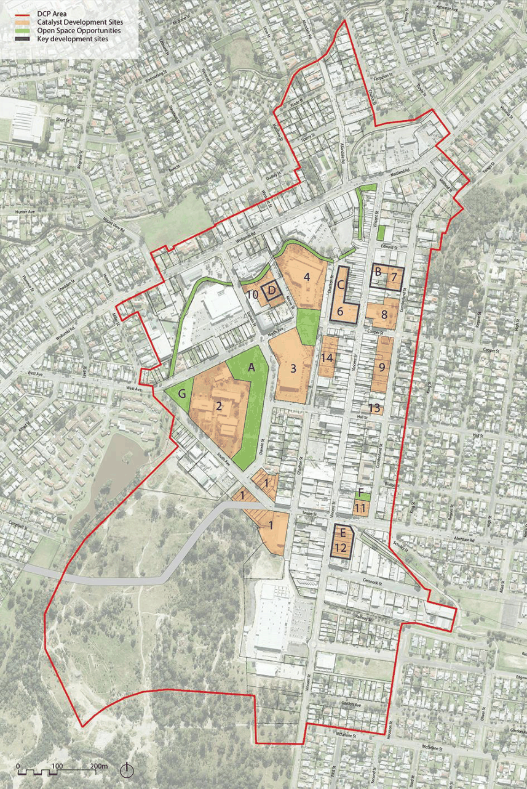
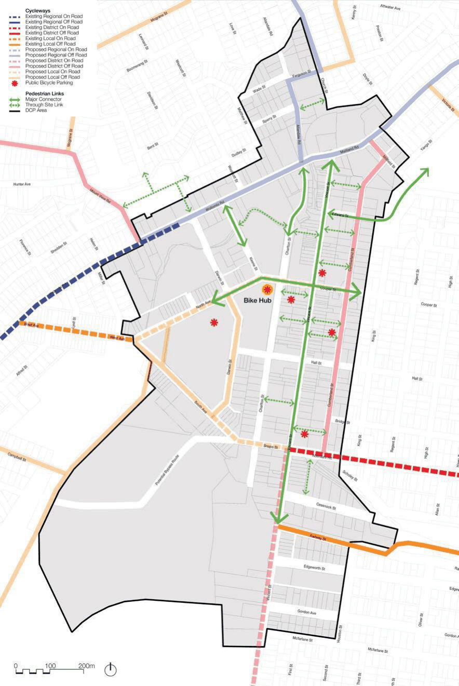
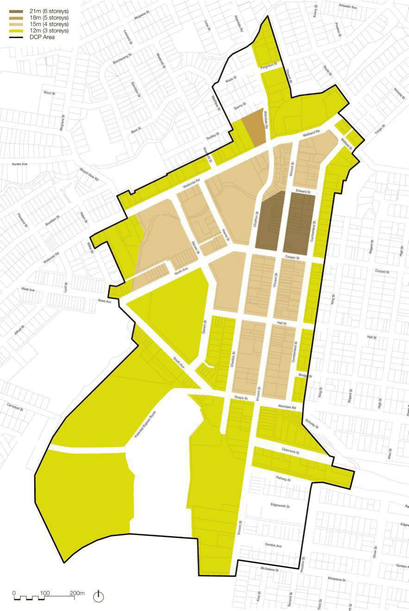
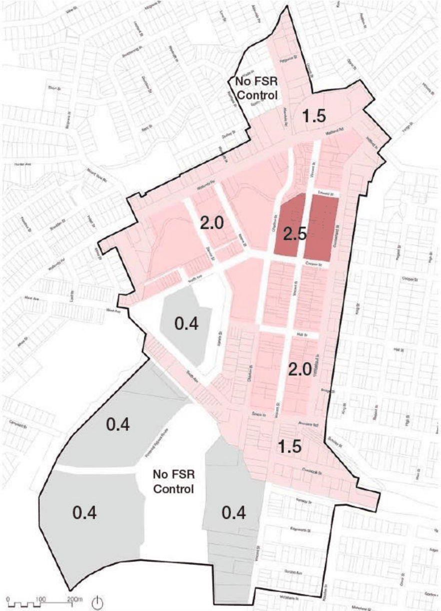
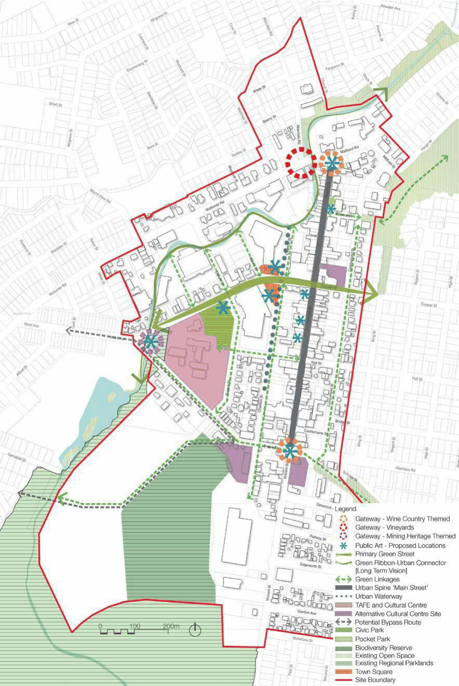

### AREA-BASED PROVISIONS

### Cessnock Commercial Precinct

#### Preamble

Cessnock is the primary strategic centre for the Cessnock Local Government Area. It provides high level retail, services and entertainment venues.

Cessnock is a key location within the region as the first point of contact for visitors, the majority of whom travel to the region from the south. It is positioned to harness the influx of visitors making their way to the wineries further north, building upon its current identity as a regional centre.

Council has undertaken comprehensive strategic planning for the centre including the adoption of the Cessnock Commercial Precinct Master Plan and Public Domain Plan. These plans have informed many of the development provisions and initiatives in this Development Control Plan.

#### Application

These provisions apply to the Cessnock Commercial Precinct as illustrated in Figure 1.

> [Picture on page 16: a picture, saved as a picture (images/part-e21-centres-page-16-1.gif, 150 dpi).]

Figure 1: Cessnock Commercial Precinct.

#### Development provisions

Master plan and public domain plan

| Objective/s | Development Controls |
|---|---|
| The development contributes to the strategic vision for the Cessnock Commercial Precinct. | The development is consistent with the Cessnock Commercial Precinct Master Plan and Public Domain Plan. |

Active street frontages

| Objective/s | Development Controls |
|---|---|
| To encourage lively, active streets. To contribute to the vitality of streets by maximising entries and display windows to retail uses and minimising blank walls. To promote pedestrian activity and safety in the public domain. To allow for outlook to and surveillance of the street. Development contributes to the quality, activity, safety and amenity of streets and public domain. | Active street frontages are provided in accordance with Figure 2. |

Built Form, Setbacks and Street Hierarchy

| Objective/s | Development Controls |
|---|---|
| Development within existing or established centres is consistent with the existing or established setbacks in the street. Achieve strong, consistent built form definition of streetscapes and all other areas of public domain. | Setbacks are consistent with Figure 3. |

Building height

| Objective/s | Development Controls |
|---|---|
| The bulk and scale of the building is consistent with, or complimentary to the established buildings in the street and the streetscape. Avoid significant overshadowing of parks, public streets and places. A pedestrian-scale streetscape is maintained. | The maximum height of buildings is in accordance with Figure 6. |

Parking and Access6

| Objective/s | Development Controls |
|---|---|
| Adequate car parking to meet the needs of the Commercial Precinct is to be provided. Economic growth within the Commercial Precinct is encouraged through reduced parking requirements for nominated uses. | No parking is required for development in the Commercial Precinct for the purposes of a neighbourhood shop, a restaurant or café, a take away food and drink premises, or small bar where this is accommodated in an existing premises. |
| Prioritise pedestrian and bicycle access, connectivity and safety in the Commercial Precinct. Promote cycling through the mandatory provision of bike storage for nominated land uses. | Provision of cycleways, through-links and bike parking facilities7 are provided generally in accordance with Figure 5. Through-site links are to be designed to: • generally, have a minimum width of 4m, or 6m where bike access is provided; • generally, be open to the sky or provide naturally ventilated glazed roofs for weather protection; • have a clear line of sight between public places; • be fully accessible 24 hours per day; and • be well lit for the safety of users. |

Public art

| Objective/s | Development Controls |
|---|---|
| To develop a Public Art collection that is progressive, innovative, contemporary, challenging and stimulating, and that explores a variety of mediums, scales and approaches. To support the development and commissioning of a diverse range of Permanent, Temporary and Ephemeral Public Art in Public Spaces which contribute to the social, cultural, environmental and economic value of the area. | Any public art installed at the locations identified in Figure 8 is consistent with Council’s Public Art Policy for guidelines. |

6 All other development is assessed against the requirements of the car parking and access chapter.

7 Bike parking facilities and the thresholds for provision are provided in DCP Chapter: Parking and Access.

To support integration of Public Art into the urban and natural landscape through adopting a whole of Council approach to planning, selection and maintenance of Public Art.

To support local established and emerging artists and facilitate community participation.

To improve the quality of the built environment and enhance the relationship between the community and their urban landscape providing an increased sense of identity, ownership, place and pride.

Existing and future desired character

The Cessnock Commercial Precinct Master Plan includes statements about the future desired character of specific sites in the precinct.

The following provisions apply to development sites listed in Table 1.

| Objective/s | Development Controls |
|---|---|
| The development of specific sites achieves excellent design outcomes. Key sites provide a catalyst for other development in the area. | Development is strongly encouraged to meet the future desired character for the site as listed in Table 1. |
| Provide development incentives to enable design excellence and sustainable design for new development within Catalyst Sites. Identify redevelopment opportunities and development objectives for Catalyst Sites. Reduce the isolated nature of the major shopping centre areas. Improve the appearance and reduce the environmental impacts of public car parks. Identify options for the redevelopment of the TAFE site as a regional cultural/educational centre and district-level park. Identify the long-term renewal plan for the Commercial Precinct’s major stormwater canal as an attractive landscaped linear green space and access way. | Development of ‘Catalyst Sites’ shown in Figure 4 in accordance with the development opportunities and objectives outlined in Table 1 and that achieves design excellence8 are eligible for the following reduced car parking rates: • 25% less than the required for land uses including business & office premises; entertainment facilities; function centre; places of public worship; restaurant; shops and general business; or • 50% less than that required for shop top housing including business & office premises; entertainment facilities; function centre; places of public workshop; restaurant; shops and the residential component as a floor space equal to or greater than 50% of the total floor space of the development. |

| In considering whether the development |  |
|---|---|
| exhibits | design excellence, the council must |
| have regard to the following matters: |  |
| 1. | whether a high standard of architectural design, materials and detailing appropriate to the building type and location will be achieved, |
| 2. | whether the form and external appearance of the development will improve the quality and amenity of the public domain, |
| 3. | whether the development detrimentally impacts on view corridors identified in the Cessnock Commercial |
| Precinct Master Plan or Public Domain Plan, |  |
| 4. | how the development addresses the following matters: |
| a. | the suitability of the land for development, |
| b. | existing and proposed uses and use mix, |
| c. | heritage issues and streetscape constraints, |
| d. | the relationship of the development with other development (existing or proposed) on the same site or on neighbouring sites in terms of separation, setbacks, amenity and urban form, |
| e. | bulk, massing and modulation of buildings, |
| f. | street frontage heights, |
| g. | environmental impacts such as sustainable design, overshadowing, wind and reflectivity, |
| h. | the achievement of the principles of ecologically sustainable development, |
| i. | pedestrian, cycle, vehicular and service access, circulation and requirements, |
| j. | the impact on, and any proposed |
| improvements to, the public domain. |  |

8 In considering whether the development exhibits design excellence, the council must have regard to the matters listed above.

Table 1: Existing and future desired character. Important sites and catalyst sites (Refer Figure 4).

|  | Site | Existing character | Future desired character |
|---|---|---|---|
| 1 | South Avenue properties | These sites include modern commercial premises, vacant land and a large industrial site. | Properties along South Avenue have important frontages and visually prominent to proposed future Bypass route (Snape to James Streets). The development of high quality commercial, retail and business premises are encouraged on these sites. |
| 2 | TAFE | This site provides both an important educational facility and a significant green space in the Cessnock Commercial Centre. | To redevelop as a revived educational facility serving the region. There is an opportunity to better define and activate adjoining streets, rather than current significant setbacks. To encourage the continuing use of the TAFE site as an education hub, potentially in conjunction with a compatible civic use. |
| 3 | Coles supermarket | A large, and key site in the heart of the Centre and a major retail destination. A key site on the Cooper Street cross axis link to 'Main Street' and with an important frontage to TAFE Park. | To better define and activate adjoining streets, and proposed Town Square, rather than current blank walls or activity setback from street frontages by large parking areas on the east and south. To better screen 'back of house' activities on west. To provide improved weather protection for pedestrians - to better link supermarket and 'Main Street' retail. |
| 4 | Cessnock Plaza | A large, and key site in the heart of the Centre and a major retail destination. A key site on the Cooper Street cross axis link to 'Main Street' and with important street frontages. | To better define and activate adjoining streets, rather than current setbacks for parking on west, south and east. To upgrade the environment along the canal to the north. To coordinate/ collaborate with IGA site to realise a better urban development outcome. To provide weather protection (e.g. awnings) for pedestrians - to better link supermarket and 'Main Street' retail. |
| 6 | Former cinema and carpark | A prominent 'Main Street' corner property with | To re-establish as a night-time entertainment venue, to better |

|  | (catalyst site) | significant frontage to Cooper Street and an important west-east connector street. The former cinema provided one of the few night-time entertainment venues in the Commercial Centre. | define and activate adjoining streets, particularly Charlton Street, and to screen existing parking area with active ground level frontages. |
|---|---|---|---|
| 7 | Vincent Street car park site (Cumberland Street) | Consolidated, current carpark site in the heart of the commercial precinct, with both Vincent Street and Cumberland Street frontages. Elevated with views west over the valley. (Note: the Vincent Street lot has been developed). | To realise a high-quality urban development outcome - a 'model' mixed-use development of high-quality architecture with attractive landscaped street frontages. |
| 8 | Cessnock City Council (catalyst site) | Current Cessnock City Council, Council Chamber, offices, public address and associated car parking. A key consolidated site within the precinct with Vincent Street, Cooper Street and Cumberland Street frontages. | To realise a high-quality urban development outcome - a 'model' civic development of high-quality architecture with attractive, landscaped street frontages. |
| 9 | Public carpark (Cumberland Street) | Consolidated Commercial Centre site, currently used for public car park. Significant CBD corner/street frontages. | To develop as multi-level car park, sleeved with ground level retail/active street frontages. To develop rooftop as hotel/motel accommodation, private apartments or affordable housing. Potential to be a relocation site for Council. |
| 10 | Mixed use & public carpark site (Cessnock Leagues Club) | Large consolidated site, including on-site parking and green space. | To ensure any future development of the site achieves high quality architectural design and public domain outcomes. |
| 11 | Public carpark (CPAC) | Consolidated Commercial Centre site currently used for public car park that services CPAC and Pedens Bar and Restaurant. Significant corner/street frontages. | To develop as multi-level car park, sleeved with ground level retail/active street frontages. To develop rooftop as hotel/motel accommodation, private apartments or affordable housing. |
| 12 | Vincent St site | Consolidated, prominent 'Main Street' corner site, currently three-quarters vacant. Significant issues with | Any development of this site should be designed in a way that provides a high-quality |

|  | (Corner Vincent Street and Aberdare Road) | flooding and contamination are present that would need to be addressed to allow development. | gateway to the Cessnock Commercial Precinct. |
|---|---|---|---|
| 13 | Hall St site (Corner of Hall and Cumberland Streets) | Prominent centre corner site, currently vacant. | To realise a high-quality urban development outcome - a 'model' mixed use development of high-quality architecture with attractive landscaped street frontages. |
| 14 | Potential multi-storey public carpark (Charlton Street car park). | Consolidated Commercial Centre site currently used for public car park. | To develop a new multi-level public carpark with potential ground floor active uses. |

Design Excellence

| Objective/s | Development Controls |
|---|---|
| Design excellence is encouraged for development of key sites in the precinct. Development exhibits design excellence that contributes to the natural, cultural, visual and built character of the Cessnock Commercial Precinct. | These provisions apply only to sites listed in Table 2 and Figure 4. Consent may be granted for the erection or alteration of a building that has: 1. A floor space ratio of not more than 20% greater than that allowed by Figure 7; and/or 2. A height of not more than 3 metres greater than that allowed by Figure 6, but only if: 1. the design of the building or alteration has been reviewed by a design review panel9 that determines the development exhibits design excellence, and 2. the council considers that the development exhibits design excellence; and |

9 In this clause design review panel has the same meaning as it has in the State Environmental Planning Policy No 65 – Design Quality of Residential Apartment Development.

| 3. | the development within Area B, C or D (Figure 4) achieves a minimum Floor Space Ratio (FSR) that is 80% of the maximum FSR identified on Figure 7; and |
|---|---|
| 4. | the development achieves a 5 Star Green Star rating; and |
| 5. | the development is designed by a registered Architect; and |
| 6. | the development meets the specifications in Table 2. |
| In considering whether the development |  |
| exhibits | design excellence, the council must |
| have regard to the following matters: |  |
| 1. | whether a high standard of architectural design, materials and detailing appropriate to the building type and location will be achieved, |
| 2. | whether the form and external appearance of the development will improve the quality and amenity of the public domain, |
| 3. | whether the development detrimentally impacts on view corridors identified in the Cessnock Commercial Precinct Master Plan and Public Domain Plan, |
| 4. | how the development addresses the following matters: |
| a. | the suitability of the land for development, |
| b. | existing and proposed uses and use mix, |
| c. | heritage issues and streetscape constraints, |
| d. | the relationship of the development with other development (existing or proposed) on the same site or on neighbouring sites in terms of separation, setbacks, amenity and urban form, |
| e. | bulk, massing and modulation of buildings, |
| f. | street frontage heights, |
| g. | environmental impacts such as sustainable design, overshadowing, wind and reflectivity, |
| h. | the achievement of the principles of ecologically sustainable development, |

Table 2: Design excellence sites and criteria.

|  | Site | Specifications relating to site |
|---|---|---|
| B | Vincent Street car park site (Cumberland Street) | The proposed development includes a publicly accessible through-site pedestrian link with a minimum width of 4 metres connecting Vincent Street to Cumberland Street and Council Car Park adjacent. The proposed development includes active frontages in accordance with the Figure 2. |
| C | Former Cinema & carpark | The proposed development includes a publicly accessible through site pedestrian link, centrally positioned along the eastern façade, with a minimum width of 4 metres connecting Charlton Street to Vincent Street. The proposed development includes public entertainment uses such as a cinema. The proposed development includes active frontages in accordance with the Figure 2. The proposed development provides a sensitive or complimentary response to heritage items in the vicinity of the site. |
| D | Mixed use & public carpark site (Cessnock Leagues Club) | The proposed development is a mixed-use development including residential flats. The proposed development includes active frontages in accordance with the Figure 2. |
| E | Aberdare Road / Vincent Street car park | The proposed development architecturally presents as a major gateway to the city. The proposed development is sympathetic or complimentary to the character of heritage items. |

| i. | pedestrian, cycle, vehicular and service access, circulation and requirements, |
|---|---|
| j. | the impact on, and any proposed improvements to, the public domain. |

> [Picture on page 26: a picture, saved as a picture (images/part-e21-centres-page-26-1.gif, 150 dpi).]

Figure 2: Active street frontages in the Cessnock Commercial Precinct.

> [Picture on page 27: a picture, saved as a picture (images/part-e21-centres-page-27-1.gif, 150 dpi).]

Figure 3: Setbacks in the Cessnock Commercial Precinct.

> [Picture on page 28: a picture, saved as a picture (images/part-e21-centres-page-28-1.gif, 150 dpi).]

Figure 4: Catalyst and key development sites.

> [Picture on page 29: a picture, saved as a picture (images/part-e21-centres-page-29-1.gif, 150 dpi).]

Figure 5: Active transport map.

> [Picture on page 30: a picture, saved as a picture (images/part-e21-centres-page-30-1.gif, 150 dpi).]

Figure 6: Height of buildings in the Cessnock Commercial Precinct.

> [Picture on page 31: a picture, saved as a picture (images/part-e21-centres-page-31-1.gif, 150 dpi).]

Figure 7: Floor space ratios in the Cessnock Commercial Precinct.

> [Picture on page 32: a picture, saved as a picture (images/part-e21-centres-page-32-1.gif, 150 dpi).]

Figure 8: Open space strategy.
