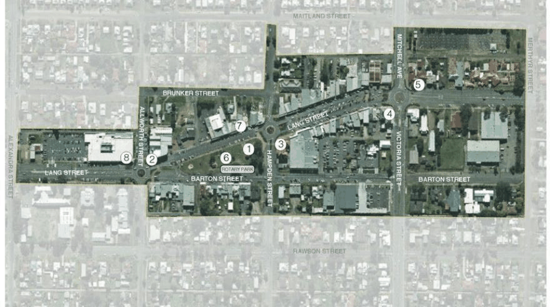
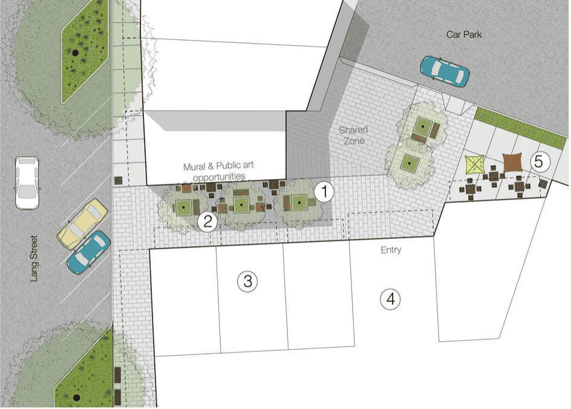

### Kurri Kurri Town Centre

#### Preamble

Kurri Kurri is a unique town and important retail centre in the Cessnock Local Government Area (LGA). Kurri Kurri has a distinct character and history and is identified as a ‘gateway’ to the Hunter Valley Wine Region.

The Kurri Kurri District is located approximately 15 minutes from the major regional centres of Cessnock and Maitland and is the second largest settlement in the Cessnock LGA.

The Centre contains a primary area of activity along Lang Street between Hampton and Victoria Streets and less active commercial fringe, zoned MU1 Mixed Use.

#### Application

The provisions apply to the Kurri Kurri Town Centre.

> [Picture on page 33: a picture, saved as a picture (images/part-e21-centres-page-33-12.gif, 150 dpi).]

Figure 9: Kurri Kurri Town Centre.

#### Development provisions

Master plan and public domain plan

| Objective/s | Development Controls |
|---|---|
| The development contributes to the strategic vision for the Kurri Kurri Commercial Precinct. | The development is consistent with the Kurri Kurri District Plan and Master Plan. |

Building height

| Objective/s | Development Controls |
|---|---|
| Height controls (on Lang Street and Barton Street in particular) to retain streetscape and ‘country town’ character. | Height of buildings are a maximum of two storeys. |
| Building heights should not impact on the visual curtilage of heritage buildings. To protect significant views to significant buildings. Ensure long distance views along streets are maintained and framed where possible. | Additional storeys may be permitted where they are supported by a visual design analysis that demonstrates that the additional height: • does not impact on the visual curtilage of heritage buildings. • protects significant views to significant buildings. • ensures long distance views are maintained and framed. |

Active street frontages

| Objective/s | Development Controls |
|---|---|
| To encourage lively, active streets. To contribute to the vitality of streets by maximising entries and display windows to retail uses and minimising blank walls. To promote pedestrian activity and safety in the public domain. To allow for outlook to and surveillance of the street. Development contributes to the quality, activity, safety and amenity of streets and public domain. | Active street frontages are to be provided along: 1. Barton Street between Allworth and Hampden Streets; and 2. Lang Street between Allworth and Mitchell Avenue. |

Awnings

| Objective/s | Development Controls |
|---|---|
| Shelter is provided for public streets where most pedestrian activity occurs. The pedestrian environment is comfortable through the provision of awnings. The street edge is clearly and consistently defined. | A continuous awning is provided along: 1. Barton Street between Allworth and Hampden Streets; and 2. Lang Street between Allworth and Mitchell Avenue. |

Parking and access

Objective/s

Development Controls

A through-link is provided between Lang Street and Barton Street.

An open arcade is provided from Lang Street to Barton Street in accordance with the Kurri Kurri Master Plan.

Greater pedestrian permeability is provided between the Lang Street and parking facilities in the centre. The arcade is designed in accordance with the Master Plan.

The through-link:

• provides tree planting within the arcade;

• is an active frontage which may include outdoor dining, a new entry to the supermarket, specialist retail;

• is appropriately signed; and

• establishes setbacks to open and improve sight lines along the length of the arcade.

> [Picture on page 35: a picture, saved as a picture (images/part-e21-centres-page-35-25.gif, 150 dpi).]

Figure 10: Pedestrian arcade 172 Lang Street, Kurri Kurri – for further details see Kurri Kurri Master Plan.

Mixed use sites

| Objective/s | Development Controls |
|---|---|
| Mixed-use developments are encouraged in the Kurri Kurri Town Centre. The Kurri Kurri Town Centre is activated by increased residential uses. Key developments sites in the centre provide a mixture of commercial and residential development. Mixed use development is designed to respect the heritage streetscape, heritage items and views into, through and out of the centre. | Shop top housing is encouraged throughout the town centre. Up to three storeys, shop-top housing is strongly encouraged for the redevelopment of: • 209 Lang Street (former Workers Club site; • 247/249 Lang Street (Goodyear Auto Care); and • the Kingsway Plaza site. Development of these sites must be supported by a design statement that: • Exhibits a high standard of architectural design, materials and detailing appropriate to the building type and location, • Demonstrates that the form and external appearance of the development will improve the quality and amenity of the public domain, • Addresses the following matters: o the suitability of the land for development, o existing and proposed uses and use mix, o heritage issues and streetscape constraints, o the relationship of the development with other development (existing or proposed) on the same site or on neighbouring sites in terms of separation, setbacks, amenity and urban form, |

| Objective/s | Development Controls o bulk, massing and modulation of buildings, o street frontage heights, o environmental impacts such as sustainable design, overshadowing, wind and reflectivity, o the achievement of the principles of ecologically sustainable development, o pedestrian, cycle, vehicular and service access, circulation and requirements, o the impact on, and any proposed improvements to, the public domain. |
|---|---|
