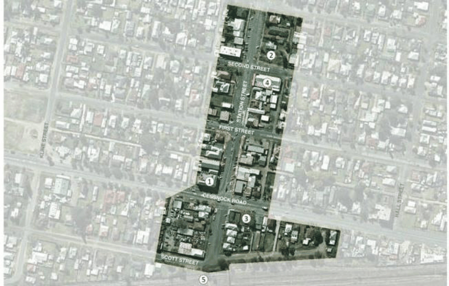

### Weston Town Centre

#### Preamble

Weston is a small town centre between Cessnock and Kurri Kurri. The commercial centre is predominantly along Station Street between Cessnock Road and First Street; however commercial uses extend from Scott Street to First Street.

Cessnock Road, Station Street and First Street are the main thoroughfare between Cessnock and Kurri but the installation of the Frame Drive/Gingers Lane bypass to the Hunter Expressway has reduced traffic volumes travelling through the centre.

A Master Plan has been prepared for Weston that aims to reinvigorate the centre through public domain works.

#### Application

These provisions apply to the Weston Town Centre as illustrated in Figure 11.

> [Picture on page 38: a picture, saved as a picture (images/part-e21-centres-page-38-13.gif, 150 dpi).]

Figure 11: Weston Town Centre.

#### Development provisions

Master plan and public domain plan

| Objective/s | Development Controls |
|---|---|
| The development contributes to the strategic vision for the Weston Commercial Precinct. | The development is consistent with the Kurri Kurri District Plan10 and Weston Commercial Precinct Master Plan. |

Active street frontages

| Objective/s | Development Controls |
|---|---|
| To encourage lively, active streets. To contribute to the vitality of streets by maximising entries and display windows to retail uses and minimising blank walls. To promote pedestrian activity and safety in the public domain. To allow for outlook to and surveillance of the street. Development contributes to the quality, activity, safety and amenity of streets and public domain. | Active street frontages are to be provided along Station Street between Cessnock Road and First Street. |

Awnings

| Objective/s | Development Controls |
|---|---|
| Shelter is provided for public streets where most pedestrian activity occurs. The pedestrian environment is comfortable through the provision of awnings. The street edge is clearly and consistently defined. | Awnings are to be provided along Station Street between Cessnock Road and First Street. |

10 The Kurri Kurri District Plan includes the Weston Town Centre. The Weston Town Centre has its own Commercial Precinct Master Plan.

Building height

| Objective/s | Development Controls |
|---|---|
| Height controls (on Station Street in particular) retain the established streetscape and town character. Building heights do not impact on the visual curtilage of heritage buildings. The dominance of the Criterion Hotel in the streetscape is maintained. | Development is restricted to a single storey. A second storey is permitted if the second storey is setback 3.0m from the building line. |
