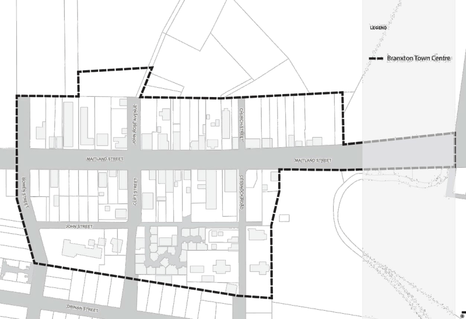
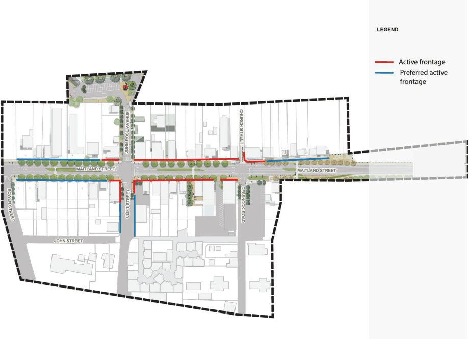
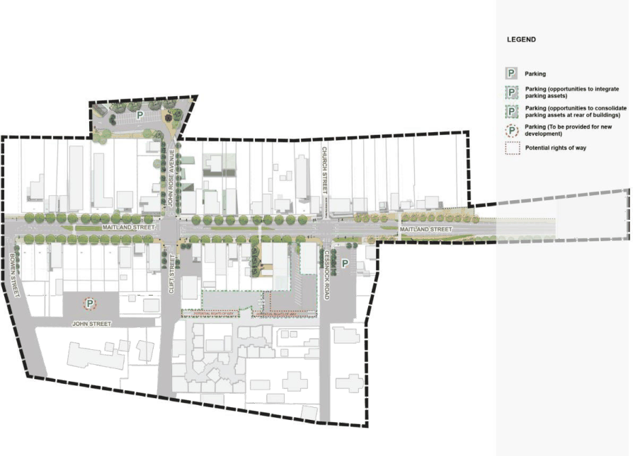

### Branxton Town Centre

#### Preamble

Branxton is a small township with a distinct heritage character and rural landscape setting. Its main street, Maitland Street, forms part of the old New England Highway. A number of heritage buildings address the street. Most of the town centre is within a Heritage Conservation Area which requires assessment against Clause 5.10 of the Cessnock Local Environmental Plan 2011.

There are two significant changes that have occurred or are occurring in the area that have implications for the Branxton Town Centre.

Until recently, the centre had serviced passing trade associated with the New England Highway. Since the opening of the Hunter Expressway, there has been a significant reduction in traffic volumes. However, this has contributed greatly to the amenity of the centre and provides opportunities to reclaim the corridor for more people-friendly activities and functions.

The second major change in the area is the development of the Huntlee Town Centre. Branxton has been the focus of commercial and social activities for the broader sub-region. The Huntlee Town Centre comprises a mixed-use area of approximately 200 hectares. Plans indicate that the centre will provide a range of uses including retail, service industries, bulky goods, commercial, entertainment, residential, educational and community. The size and diversity of uses at Huntlee will service the Branxton Sub-regional Area. However, Branxton has a unique streetscape that contains many heritage buildings. With appropriate treatment, Branxton will become a very attractive and unique centre.

#### Application

The following controls apply to the Branxton Town Centre illustrated in Figure 12.

> [Picture on page 42: a picture, saved as a picture (images/part-e21-centres-page-42-1.gif, 150 dpi).]

Figure 12: Branxton Town Centre DCP.

#### Development provisions

Master plan and public domain plan

| Objective/s | Development Controls |
|---|---|
| The development contributes to the strategic vision for the Branxton Town Centre. | The development is consistent with the Branxton Town Centre Master Plan and Public Domain Plan. |

Active street frontages

| Objective/s | Development Controls |
|---|---|
| Lively, active streets are created through a diversity of commercial and retail premises. Pedestrian movement in the centre is safe, convenient and intuitive. Improved surveillance of the street and the public domain is achieved. Development contributes to the quality, activity, safety and amenity of streets and public domain. | Active street frontages are provided in accordance with Figure 13. |

> [Picture on page 43: a picture, saved as a picture (images/part-e21-centres-page-43-1.gif, 150 dpi).]

Figure 13: Active Street Frontages Branxton Town Centre.

Building materials, finishes and colours

| Objective/s | Development Controls |
|---|---|
| The built heritage of the centre is respected, protected and celebrated. New buildings complement the existing built heritage of the centre. | Building materials and finishes should be reflective of, or complimentary to the built heritage in the centre. |

Built Form, Setbacks11 and Street Hierarchy

| Objective/s | Development Controls |
|---|---|
| Development reinforces the existing and desired character of the centre. Development creates a legible street environment with a good human scale. | Development shall be within 20% of the average setback of buildings on each side. If there is no building on one side; within 20% of the other building. If there are no buildings, generally consistent with the streetscape. Each building facade is to be well articulated to differentiate between the base, middle and top. Building design shall reflect design elements of the established buildings in the streetscape; including roof pitch, bulk and scale, materials and verandahs. Side setback should maintain the rhythm of the buildings in the street. |

Building height

| Objective/s | Development Controls |
|---|---|
| The height of buildings reinforces the desired future character of the centre. View corridors from the Town Centre to the surrounding rural areas are protected. | Building heights should be within 20% of the average height of the adjoining buildings. If there is an adjoining building on one side or the building is on a corner, the building height is within 20% of the adjoining building. If there is no adjoining building the maximum height of the building is 8.5 metres (2 storeys). Taller buildings may be considered on the corners of Maitland Street where it is demonstrated that the building design contributes positively to the streetscape. |

Signage

| Objective/s | Development Controls |
|---|---|
| Signage is respectful of the heritage setting of the town and the era and architecture of the heritage buildings. Signage does not dominate the building or streetscape. | Development within the heritage conservation area shall be accompanied by a signage strategy that is approved by Council’s Heritage Advisor. |

11 Additional setback controls apply to Active street frontages.

Parking and Access

| Objective/s | Development Controls |
|---|---|
| Parking is provided in accordance with Cessnock DCP Chapter Parking and Access. Parking arrangements consider the recommendations of the Branxton Town Centre Public Domain Plan (see Figure 14). | Where car parking cannot be achieved in accordance with Figure 14, or it is varied because of impact on heritage or streetscape, council will consider entering into a Planning Agreement to contribute to car parking facilities or access improvements (for example; bus, cycle or walking facilities) elsewhere in the town centre. |

> [Picture on page 45: a picture, saved as a picture (images/part-e21-centres-page-45-3.gif, 150 dpi).]

Figure 14: Indicative integrated parking solution and development opportunity area at the rear of buildings - Maitland Street (Southern side).

Public Open Space and Landscaping

| Objective/s | Development Controls |
|---|---|
| To integrate high quality, consistent landscaping into the built environment of the Branxton Town Centre. | Development is to be consistent with the with Branxton Town Centre Public Domain Plan. |
