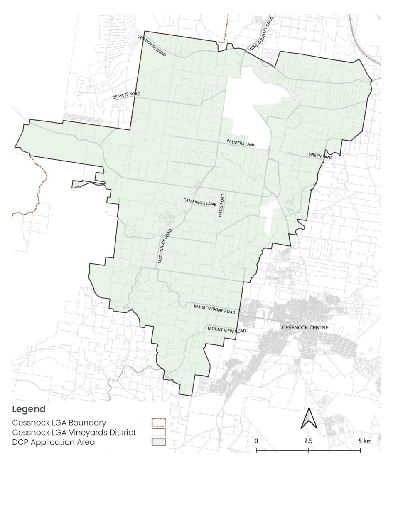
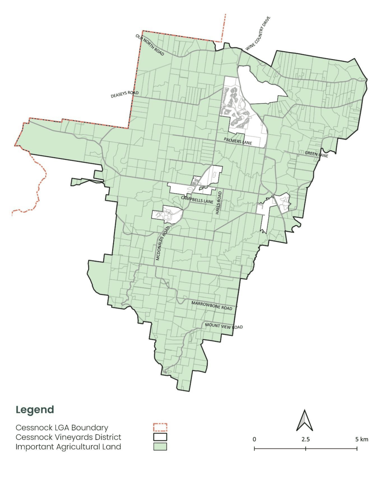
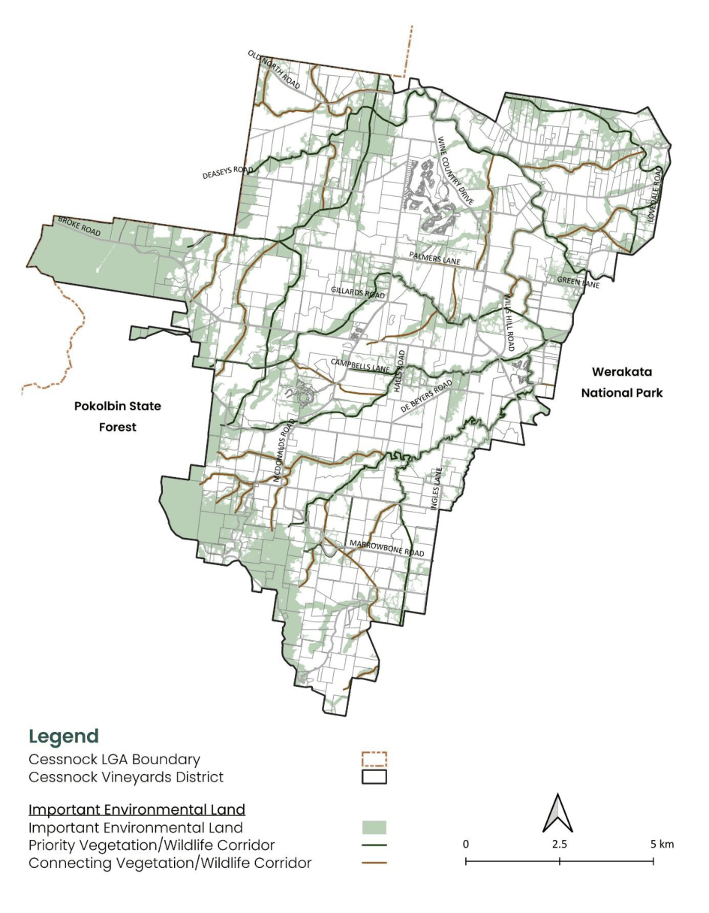
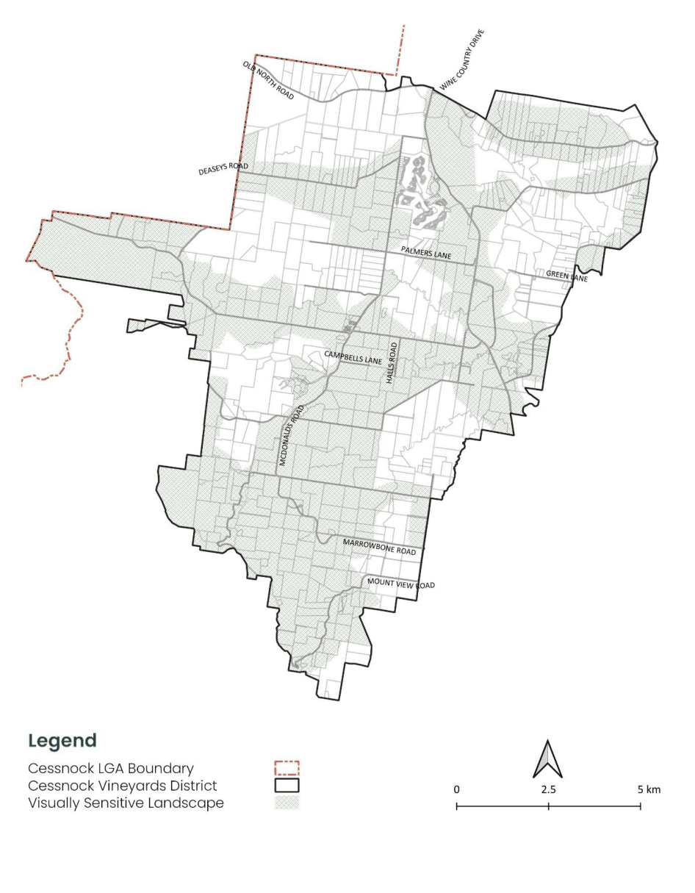
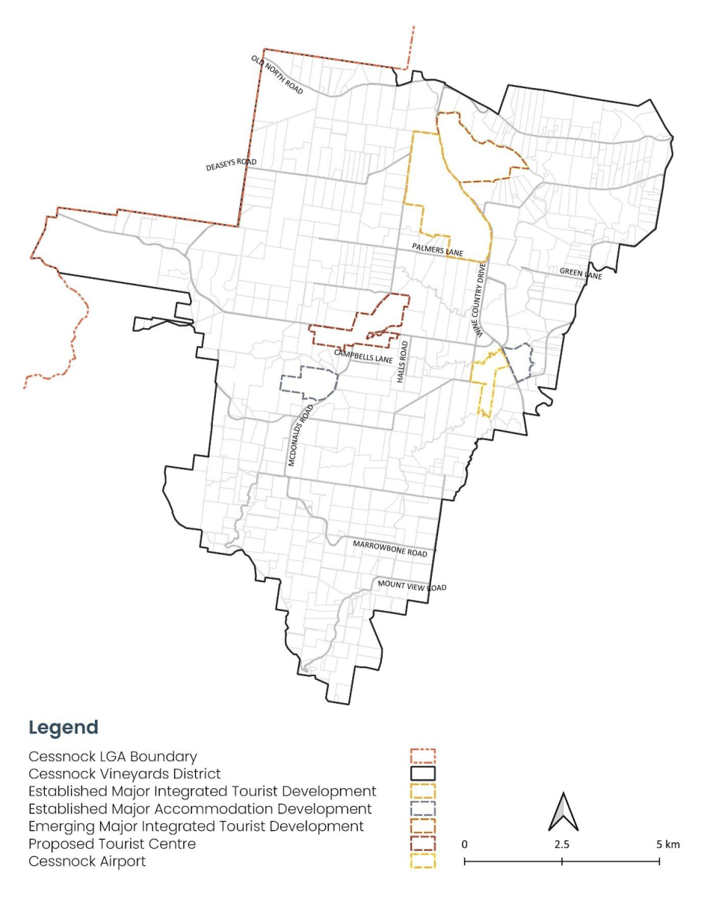
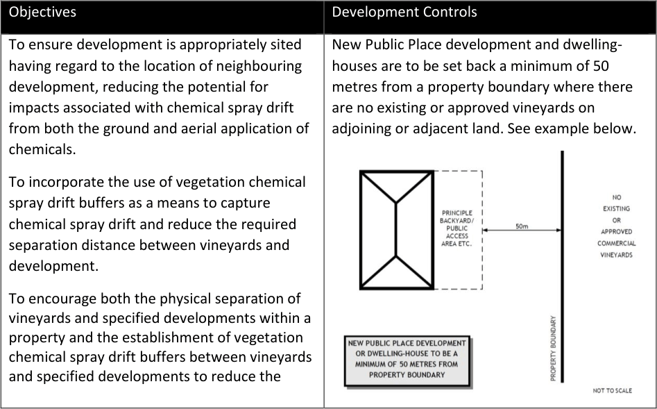
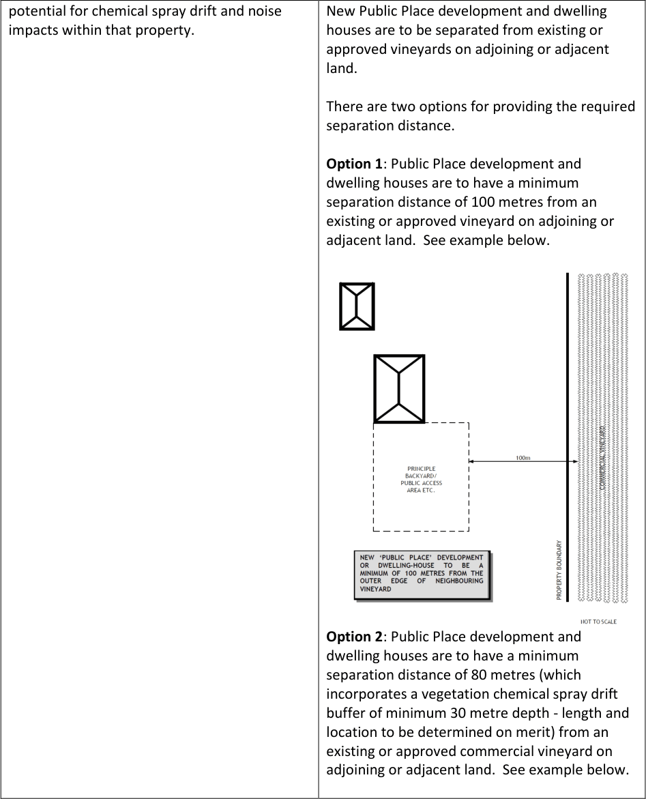
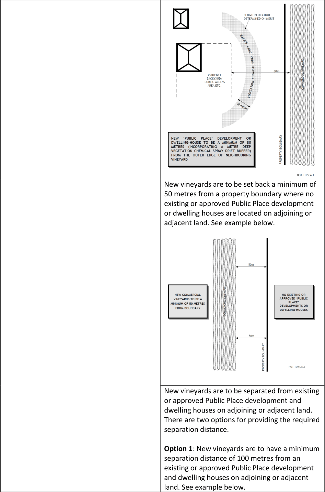
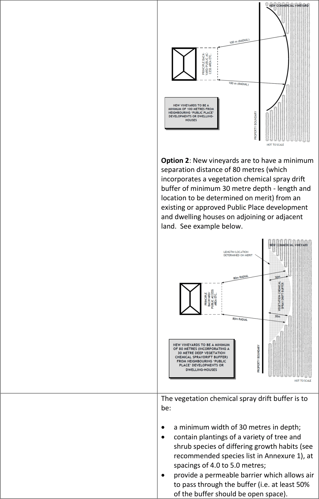

# Cessnock Development Control Plan 2010 - Part E3 Vineyards District

Source PDF: [DCP-Chapter-E3-Vineyards-District-_-CCC-_-website-doc.pdf](DCP-Chapter-E3-Vineyards-District-_-CCC-_-website-doc.pdf)

#### Table of Contents

AREA-BASED PROVISIONS ................................................................................................. 2 Cessnock Vineyards District ............................................................................................... 2 Preamble .................................................................................................................................. 2 Application ............................................................................................................................... 2 Cessnock Vineyards District Vision and Key Development Principles .......................................... 2 Definitions................................................................................................................................ 4 Local Character of the Cessnock Vineyards District .................................................................... 5 Future Desired Character Statements ........................................................................................ 6 Important Agricultural Land ............................................................................................................................ 6 Important Environmental Land ....................................................................................................................... 8 Visually Sensitive Land .................................................................................................................................. 10 Tourist Centre and Major Tourist Nodes ....................................................................................................... 12 Development Provisions ......................................................................................................... 14 Compatibility with the Cessnock Vineyards District Future Character Statements ...................................... 14 Site Assessment ............................................................................................................................................. 14 Development Siting and Scale ....................................................................................................................... 14 Car Parking for Tourist and Visitor Accommodation ..................................................................................... 17 Building Materials ......................................................................................................................................... 19 Boundary Fencing and Gates ......................................................................................................................... 19 Landscaping ................................................................................................................................................... 20 Heritage ......................................................................................................................................................... 20 Agricultural Spray Drift .................................................................................................................................. 21 Noise and Odour Impacts .............................................................................................................................. 25 Additional controls for larger scale development ......................................................................................... 25

#### List of Figures

Figure 1: Land Application and Overview Map ....................................................................................... 3 Figure 2: Important Agricultural Land ..................................................................................................... 7 Figure 3: Important Environmental Land ................................................................................................ 9 Figure 4: Visually Sensitive Land ........................................................................................................... 11 Figure 5: Tourist Centre and Nodes ...................................................................................................... 13

#### AREA-BASED PROVISIONS Cessnock Vineyards District

The Cessnock Development Control Plan is comprised of 4 parts. Development applications must address all relevant sections of Part 2, Part 3 and Part 4 and supporting guidelines, such as Council’s Engineering Guidelines for Design and Construction.

Area-based provisions apply to discrete areas and may include provisions that are different from those in Parts 2 and 3 of the CDCP. Where there is a difference between any development provision/s in Parts 2 or 3 and Part 4, the provision/s in Part 4 prevail for that area.

#### Preamble

The Cessnock Vineyards District (see Figure 1) encompasses an area of land in the vicinity of Pokolbin, Lovedale, Nulkaba and Mount View, zoned predominantly RU4 Primary Production Small Lots. Agriculture occurring within the Cessnock Vineyards District is presently supported by a diverse range of tourist development. The relationship between viticulture and tourism in the Cessnock Vineyards District is highly interdependent. Some tourist development is necessary to ensure the ongoing viability of viticulture in the area. However, if tourist development is not sited and scaled appropriately, it has the potential to negatively impact the character and amenity of the area. For this reason, tourist and other forms of non-agricultural development requires meticulous planning to ensure it is capable of harmonising with the principal agricultural objectives and rural and environmental characteristics of the land.

#### Application

This Development Control Plan (DCP) chapter applies to the Cessnock Vineyards District, as described in Figure 1. This DCP does not apply to development within the Special Activities Nodes (comprising The Vintage and Lovedale Integrated Tourist Development), or Cessnock Airport. These developments are subject to separate development control plan chapters or, in the case of Lovedale Integrated Tourist Development, a concept masterplan.

When assessing and determining a development application for development in the Cessnock Vineyards District, Council will consider the application against the:

1\. Vision for the Cessnock Vineyards District and Key Development Principles, set out in this DCP;

2\. Future desired character of the area in which the development is proposed, and

3\. Relevant development objectives and controls.

#### Cessnock Vineyards District Vision and Key Development Principles

The overarching vision for the Cessnock Vineyards District is, ‘The leading wine and tourism region in Australia.’ Key principles for development are set out below.

Development:

• recognises and protects the primacy of the viticulture land use;

• maintains and enhances the rural amenity, character, cultural landscapes and scenic vistas of the region for future generations to enjoy; and

• allows and fosters a mix of complementary business, accommodation and employment options.

Figure 1: Land Application and Overview Map

> [Picture on page 3: a picture, saved as a picture (images/part-e3-vineyards-district-page-3-2.gif, 150 dpi).]

#### Definitions

All terms used in this Local Character Statement and DCP chapter have the same meaning as defined in the Cessnock Local Environmental Plan 2011, with the exception of the following.

means Important Environmental Land identified in Figure 3.

#### Important Environmental Land Open Landscape

means land that is predominantly cleared of trees and on which development is highly visible when viewed from a Public Place or road.

Important Agricultural Land means Important Agricultural Land identified in Figure 2.

#### Public Place

means any park, garden, playing field, outdoor dining area or place, which the public is permitted to enter, but excludes roads and travelling stock reserves.

Visually Sensitive Land means Visually Sensitive Land identified in Figure 4.

#### Tourist and Visitor Accommodation Building

means a building used for tourist and visitor accommodation containing up to 4 tourist accommodation rooms that provides temporary or short-term accommodation to tourists or visitors on a commercial basis. Individual stays must not exceed 42 consecutive days.

#### Tourist and Visitor Accommodation Room

means a single bedroom within a Tourist Accommodation Building, for use by tourists or visitors.

Tourist Centre and Nodes means the Vineyards District Tourist Centre and major

accommodation nodes identified in Figure 5.

Tourist Related Development means any of the following land uses individually or in

combination:

• Agritourism

• Artisan food or drink premises

• Farm gate premises

• Function centres

• Information and education facilities

• Restaurants or cafes

• Tourist and visitor accommodation

#### Local Character of the Cessnock Vineyards District

The Cessnock Vineyards District is the major component of the broader Hunter Valley Wine Region, which is the nation’s oldest, continuous wine producing area and is internationally recognised for its premium wines.

The Cessnock Vineyards District has a unique combination of land uses, native vegetation, topography and waterways, which combine to create a landscape setting which is the main reason for people visiting the vineyards.

The topography of the Cessnock Vineyards District is one of low-rolling hills in the north and east, increasing to steep land of the Broken Back Range in the west to Mount View in the south. It is the interplay of the low hills set amongst the backdrop of the Broken Back Range which gives the area such a distinctive landscape setting.

The local character of the Cessnock Vineyard’s District is embodied by the following major aspects of the natural and built environment:

▪ important agricultural land;

▪ important environmental land;

▪ visually sensitive land; and

▪ the Tourist Centre and nodes.

The Vintage and Lovedale Integrated Tourist developments together form a large ‘special activities node’ to the north of the Tourist Centre. The special activities node contains, or is likely to contain, integrated tourist and residential development. Development within the special activities node is not subject to this chapter, but is addressed elsewhere in the DCP (The Vintage), or approved concept masterplan (Lovedale Integrated Tourist Development). Development at Cessnock Airport is also not subject to this chapter, but is addressed within a site specific chapter.

#### Future Desired Character Statements

Important Agricultural Land

The Cessnock Vineyards District Important Agricultural Land is identified in Figure 2. Important Agricultural Land is dominated by vineyards and other low impact horticultural uses, horse and cattle grazing.

The established vineyards are a mixture of production vineyards and vineyards with cellar doors and restaurants located on them. Some vineyards have supporting tourist uses, such as accommodation, artisan food and drink premises, farm gate premises, or gardens, and are typically of a scale that is compatible with the principal agricultural use of the land.

Smaller scale tourist developments are vital to the overall economic viability of agriculture that occurs on Important Agricultural Land in the Cessnock Vineyard District.

Future desired character

The principal objective of the Cessnock Vineyards District Important Agricultural Land is to encourage viticulture, wine production, low impact horticultural uses, and horse and cattle grazing. Development that has the potential to conflict with these uses is to be minimised on Important Agricultural Land.

Non-agricultural development on Important Agricultural Land should avoid areas of the property used for viticulture or horticulture, or that contain mature trees. New development should not reduce opportunities for primary production to be carried out within the property in the future.

Agriculture on Important Agricultural Land may be supported by complementary tourist related development and other non-agricultural development that:

• Does not conflict with agriculture occurring on the property, or on adjoining land;

• Does not significantly reduce opportunities to carry out agriculture within the property in the future;

• Is consistent with, and proportionate to, the scale of agriculture or rural residential development occurring within the property;

• Is proportionate to the size and environmental characteristics of the property;

• Incorporates adequate design and operational measures to address natural hazards and any potential land use conflict with agriculture; and

• Does not require any major infrastructure upgrades or augmentation.

Tourist Related Development does not dominate the use of Important Agricultural Land, but supports the agricultural and/or rural residential development already occurring within the property. Tourist Related Development provides additional revenue for rural property owners, while enabling opportunities for tourists and visitors to experience the unique character and amenity of the Vineyards District and locally produced food, wine and goods. Tourist Related Development is carried out in a manner that protects and strengthens the agricultural uses occurring on the land, and is carefully designed, sited and clustered to minimise land use conflict.

Development in the vicinity of Cessnock Airport should not reduce opportunities for the expansion or intensification of the facility for airport related infrastructure or hours of operation in the future.

Figure 2: Important Agricultural Land

> [Picture on page 7: a picture, saved as a picture (images/part-e3-vineyards-district-page-7-2.gif, 150 dpi).]

Important Environmental Land

The Cessnock Vineyards District Important Environmental Land is identified in Figure 3.

Native vegetation within the Cessnock Vineyards District is patchy and significantly altered by agricultural and viticultural activity. A number of creek lines in the highly modified agricultural and vineyard areas have been cleared and replaced by fast-growing vegetation like Casuarina glauca to form typically dense, monospecific stands. Remnant native vegetation within the Cessnock Vineyards District provides important habitat for wildlife and contributes to the distinctiveness of the area. Pockets of native vegetation exist throughout the Cessnock Vineyards District, but most are disconnected from one other and other important environmental assets like Werakata National Park and Pokolbin State Forest. The vegetated waterways and corridors that traverse the Vineyards District are in varying levels of health, function and aesthetic value, but are nonetheless important for biodiversity.

Future desired character

Native tree removal is avoided on properties containing Important Environmental Land. There is to be no net loss of native vegetation as a result of new development. Buildings and structures, roads, driveways, fences, dams, infrastructure, drainage and asset protection zones are located outside of areas containing native habitat or priority and connecting vegetation/wildlife corridors.

Development sites are carefully chosen to minimise impacts on areas containing existing native flora and fauna and appropriate buffer distances are adopted to protect these areas.

Additional plantings of native and endemic species on areas of private land not suitable for agriculture is encouraged and increases primary habitat and the integrity of primary and connecting vegetation/wildlife corridors. Additional planting also connects fragmented vegetation communities throughout the Vineyards District.

Attention is given to improving biodiversity along watercourses and rehabilitating and enhancing vegetation/wildlife corridors between the Pokolbin State Forest and Werakata National Park. Particular attention is given to improving biodiversity within the Black Creek riparian area and its tributaries.

Where possible, site landscaping is adopted that enhances Important Environmental Land within the property. Larger scale development has a higher potential for environmental impacts and therefore, the scope of required site landscaping within the property will be proportionate to the scale of the development and may include requirements to rehabilitate and maintain degraded areas of native vegetation within the property.

Figure 3: Important Environmental Land

> [Picture on page 9: a picture, saved as a picture (images/part-e3-vineyards-district-page-9-2.gif, 150 dpi).]

Visually Sensitive Land

The Cessnock Vineyards District Visually Sensitive Land is identified in Figure 4.

The Visually Sensitive Land of the Cessnock Vineyards District is composed of the topography, the agricultural land, Open Landscapes, the native vegetation, the dramatic and iconic ranges, and the mix of historic and modern buildings and structures. These elements collectively create the established character of the Cessnock Vineyards District. Visually, the built form of development in the Cessnock Vineyards District is a mixture ranging from small dwelling houses, small and large wineries and cellar doors, to more densely occupied development, such as that which occurs within the Vineyards Tourist Centre and within the established major tourist, infrastructure and accommodation nodes. Overwhelmingly, the built form is set into the landscape and, on the whole, does not dominate it. Buildings of the early to late-19th century and early 20th century, which are usually associated with mixed farming, remain and are important reminders of early settlement and vineyards. These buildings are of increasing interest to visitors and the community alike and are also important landmark structures within the Cessnock Vineyards District.

Future desired character

The siting of new development on Visually Sensitive Land requires an assessment of site suitability and visual impact, which is proportionate to the proposed scale and potential impact of the development.

Development on Visually Sensitive Land is ‘built into’ the natural environment and is designed to ensure it does not dominate Open Landscapes, or views from Public Places or public roads to significant natural features, such as the Broken Back Range.

Visible parts of development complement, rather than dominate the existing rural amenity and are finished in materials and colour palate that is consistent with the fabric and tones that exist in the natural environment. New Tourist Related Development and other non-agricultural development on Visually Sensitive Land is a recessive feature within the broader rural and agricultural environment, when viewed from Public Places and roads.

New keystone buildings such as cellar doors and tourist and visitor accommodation are designed with design excellence in mind, are complimentary to their surroundings, and are innovative, evocative and unique. Historic buildings and structures are retained, adapted, reused and celebrated, whilst maintaining an appropriate setting and curtilage.

Development infrastructure, such as internal access roads, car parking, and ancillary structures are sited to minimise visual impacts when viewed from public roads. The screening of buildings and structures on Visually Sensitive Land with trees is only considered when all other options to reduce the visual impact of a development has been exhausted, including avoiding development on the most visually sensitive parts of the land.

Public road infrastructure in the Tourist Centre retains its rural, tree lined appeal, wherever possible.

Figure 4: Visually Sensitive Land

> [Picture on page 11: a picture, saved as a picture (images/part-e3-vineyards-district-page-11-2.gif, 150 dpi).]

Tourist Centre and Major Tourist Nodes

The Cessnock Vineyards District Tourist Centre and major tourist nodes are identified in Figure 5.

Several areas within the Cessnock Vineyards District contain a scale and density of development that constitutes a major tourist, infrastructure or accommodation node. The extent of non-agricultural development within these major nodes has largely rendered them unusable for any commercial scale, intensive plant agriculture development.

Future desired character

The Vineyards District Tourist Centre and major tourist accommodation nodes are the primary focus for larger scale Tourist Related Development in the area. The number and density of development within these areas, warrant them being classified as major tourist nodes and managed accordingly.

New development within the Vineyards District Tourist Centre and major tourist accommodation nodes compliments the established pattern, scale and typology of development that already exists those areas. Where opportunities are available for more intense Tourist Related Development, these opportunities are to be balanced with a requirement to achieve design excellence and minimisation of development and environmental impacts, such as traffic and roadside tree removal.

Fragmentation of land for permanent residential development is not consistent with the objective of the Tourist Centre to provide a range of larger-scale facilities, services, and accommodation for the benefit of tourists and visitors to the Cessnock Vineyards District. Instead, the focus is on enhancing the visitor experience and reinforcing the tourism economy, while maintaining clear boundaries between the Centre and surrounding agricultural or rural areas.

Development within the Tourist Centre and major tourist accommodation nodes does not detract from the landscape, but enhances it. Visible parts of development complement, rather than intrude on the roadside environment and are finished in materials and colour palate that is consistent with the fabric and tones that exist in the natural environment.

Development infrastructure, such as internal access roads, car parking, lighting and ancillary structures are sited and landscaped to minimise visual impacts when viewed from public roads. Development infrastructure is sensitively screened, wherever possible.

The ongoing role of The Vintage and Lovedale Farm as major integrated tourist nodes is essential. These areas should continue to provide outward-facing services and amenities that attract visitation and tourism, while maintaining strong visual, functional, and economic connections to the broader Vineyards District. Development within these nodes should continue to demonstrate a clear nexus to the region’s agricultural base, reinforcing the identity and appeal of the Hunter Valley as a premium wine and food destination.

Public road infrastructure in the Tourist Centre retains its rural, tree-lined appeal, contributing to the scenic and immersive nature of the visitor journey through the Vineyards District.

Figure 5: Tourist Centre and Nodes

> [Picture on page 13: a picture, saved as a picture (images/part-e3-vineyards-district-page-13-2.gif, 150 dpi).]

#### Development Provisions

Compatibility with the Cessnock Vineyards District Future Character Statements

| Objectives | Development Controls |
|---|---|
| To ensure development is compatible with the future desired character of the Cessnock Vineyards District. | New development has considered and demonstrates consistency with the future desired character statements relevant to the property. Note: Council may require a Compatibility Assessment, prepared by a suitably qualified person, to substantiate the proposed development’s consistency with the relevant future desired character statements. The level of information provided will be proportionate to the scale and location of the proposed development. |

Site Assessment

| Objectives | Development Controls |
|---|---|
| To reduce the potential for environmental impacts and land use conflict. | The development must be accompanied by a Site Assessment demonstrating the site chosen for the development is the most suitable within the property having regard to the following matters: • established vineyards; • natural watercourses; • native vegetation, including roadside vegetation and existing mature trees; • landform; • natural hazards; • existing buildings; • development on adjoining land; • property boundaries and access points; and • existing development within the property. Note: The detail and scope of the Site Assessment is to be proportionate with the scale of the development proposed. |

Development Siting and Scale

| Objectives | Development Controls The maximum building height1 is 9m, except for buildings associated with wine production. |
|---|---|

1 Building height is measured as the vertical distance from ground level (existing) to the highest point of the building.

| Objectives | Development Controls |
|---|---|
| To ensure development does not detract from the rural character of the Vineyards District due to its height. | The proposed height of buildings associated with wine production will be assessed in consideration of the justification of need supplied with the development application. The highest point of any building, or alterations and additions to any existing building, is to be at least 5m below the highest ridgeline of any hill within 100m of the building. |
| To reduce the risk of development impacts on existing and future agricultural land use on adjoining properties. | Buildings and structures are setback a minimum of 75m from road frontages. Buildings and structures are setback a minimum of 50m from side and rear property boundaries. Development is not to restrict the day-to-day functions of adjacent farms or other existing activities or known future uses on adjoining land. The design and placement of buildings and structures should minimise and mitigate any potential impact on the amenity of nearby residents. |
| To ensure that Tourist Related Development does not adversely affect rural amenity, agricultural productivity, or ecology. | Rural tourist accommodation buildings should be grouped together in a cluster arrangement within the curtilage of existing buildings on the lot, unless a dispersed arrangement can be clearly demonstrated to be a more appropriate solution having regards to ecological and / or visual impacts and agricultural activities within the site and on adjoining properties. Tourist Related Development shall not be sited in a straight line that would result in a continuous visual wall of buildings. |
| To ensure adequate infrastructure is available for Tourist Related Development. | Applications must demonstrate appropriate access arrangements including: • all weather access for two-wheel drive vehicles and emergency service vehicles; and • A vehicle access point to the property is to demonstrate compliance with the sight distance requirements of AS 2890.1 Off- street car parking and should be adequate to service the development. All effluent waste generated by the development and its ongoing use is to be disposed: • to a reticulated sewerage system connected to the landholding; or |

| Objectives | Development Controls • using a system of sewerage management for which the approval of Council is obtained under the Local Government Act 1993. A Water Management Plan consistent with NSW Government publication Private Water Supply Guidelines is required for proposed development including details on: • water budget for development; • sourcing and treatment details; • hydrologic design of water control, storage, and supply works; • analysis of downstream effects; and • arrangements for ongoing maintenance. Development is not to adversely impact existing water supplies for residential and primary production uses on the landholding. Provisions for the appropriate storage and screening of operational waste are to be demonstrated, together with suitability for the development to be serviced by Council’s waste collection service. If the development cannot be serviced by Council’s waste management vehicles, evidence must be provided that the site will be serviced by a private waste management contractor. |
|---|---|
| To ensure risks to the safety of visitors are identified and mitigated. | Where the proposal is located on bushfire affected land, a bushfire report prepared completed by a BPAD Accredited Consultant in accordance with the NSW Rural Fire Service publication Planning for Bush Fire Protection is required2. Proposals located within areas potentially impacted by natural hazards, e.g. flooding and bushfire, must prepare an Emergency Management and Evacuation Plan that includes procedures for the safe evacuation of all occupants. Relevant details including assembly points and evacuation routes are to displayed for guests and staff. |
| To minimise development conflict and potential encroachment on Cessnock Airport operations. | Development on properties adjoining the SP2 Infrastructure Zone (Air Transport Facility) must be consistent with any adopted masterplan for the Cessnock Airport Precinct. |

2 Under Rural Fires Act s.100B, a Bush Fire Safety Authority from the NSW RFS is required for Special Fire Protection Purpose (SFPP) development. As such, an Integrated Development approval may be required under of the EP&A Act s.4.46. Tourist and visitor accommodation is a SFPP under the Act.

Car Parking for Tourist and Visitor Accommodation

| Objectives | Development Controls |
|---|---|
| To ensure adequate car parking is available within the property to support tourist and visitor accommodation. | Car parking is to be provided at the following rates: Development Type Car Parking Rate Tourist and Visitor 1 space per bedroom Accommodation: Serviced Apartments: 1 space per unit, plus 1 space per 2 employees. Car parking areas must be finished in a surface that will allow for vehicle movements in all weather conditions. |

Development on Visually Sensitive Land

| Objectives | Development Controls |
|---|---|
| To ensure development on Visually Sensitive Land does not dominate the rural landscape when viewed from public places or roads. | Sealed property access roads do not intrude on the rural landscape when viewed from public roads. Property access roads are aligned to achieve the shortest, safest route while following contours in the natural landscape. Car parking areas and sealed property access roads are screened from view from public roads. Buildings and structures are built into the environment, or otherwise designed and orientated in a manner that minimises visual impacts when viewed from public places and roads. Views from public roads to planted vines, Open Landscapes, or significant natural landmarks, such as the Broken Back Range are not obstructed by development. The screening of buildings and structures on Visually Sensitive Land with trees is only applied when all other options to reduce the visual impact of a development, including avoiding development on that part of the land, has been considered. |

Biodiversity

| Objectives | Development Controls |
|---|---|
| To avoid and minimise impacts on existing native flora and fauna. | Where the proposed development is likely to have an impact on Important Environmental Land, or where four or more native trees are proposed to be removed, a flora and fauna assessment must be submitted with the development application. The flora and fauna assessment must be sufficient to adequately identify and assess all the impacts of the proposed development. This includes cumulative, direct and indirect impacts, as well as the impacts of Asset Protection Zones. Where a proposed development is likely to impact Important Environmental Land, it must be demonstrated that no other suitable development site is available within the property. |
| To ensure no net loss of vegetation within the Vineyards District. | Where consent is sought to remove native vegetation within a property, an equivalent amount of vegetation must be re-established within either the specified native vegetation corridors specified in Figure 3, or within other acceptable locations within the property as determined on merit. Note: 1. Preference will be given to re-establishing the native vegetation corridors shown in Figure 3, rather than other locations within a property. 2. The treed areas of Asset Protection Zones will be treated as areas of vegetation loss. 3. Tree planting to buffer development or reduce the impact of spray drift will not be treated as compensatory planting for tree loss. |
| To protect and enhance significant flora and fauna, vegetation communities and significant habitat on the site and on adjoining land. | Development must be setback from Important Environmental Land. The width of the setback should be determined with reference to the function of the habitat or corridor and the type of development proposed. The setback should be designed to keep the area of significance in natural condition. Development applications which will result in trees being cleared within the road reserve must be: |

|  | • supported by a Biodiversity Development Assessment Report (BDAR) that considers the tree removal within the road reserve; and • supported by a Visual Impact Assessment; • required as an outcome of a Traffic Impact Assessment; and • consistent with the relevant desired future character statements for the area. |
|---|---|
| To ensure the development will promote positive environmental outcomes and any impact on watercourses is minimised. | The natural drainage features on the site are not altered. Natural water courses are revegetated and erosion and sediment control installed. Stormwater is detained on site through the use of water tanks, swales and existing dams. |

Building Materials

| Objectives | Development Controls |
|---|---|
| To ensure development does not detract from the rural character of the Vineyards District due to construction materials and finishes. | The use of timber, stone, rammed earth (or other sustainable material) and corrugated iron is encouraged. Bricks and rendered surfaces should only be used only as minor elements of a building’s exterior. Buildings and structures are finished in earthy, muted tones. Wall and roof finishes are non-reflective and are compatible with the rural character and amenity of the Vineyards District. |

Boundary Fencing and Gates

| Objectives | Development Controls |
|---|---|
| To ensure boundary fencing, boundary walls and entrance gates and structures do not dominate the road environment. | Front boundary fencing and gates are of modest appearance, do not visually obstruct the landscape and are in keeping with the character of established fencing in the area. Materials, height, lighting and other elements complement rather than dominate the existing character of the roadside environment. The sense of spaciousness and openness of the landscape along rural roads is not compromised by fencing that is urban in character. Fences and gate posts at property entries comprise traditional materials, such as painted or natural timber, or stone. |
| To maximise opportunities for native fauna to move freely within the Vineyard’s District. | Fencing on Important Environmental Land is designed and constructed to: |

• delineate landholdings;

| • | maximise opportunities for native fauna movement; and |
|---|---|

• minimise the use of barbed wire.

Landscaping

| Objectives | Development Controls |
|---|---|
| To ensure landscaping is consistent with the rural character of the Vineyards District. To ensure landscaping achieves positive visual and environmental outcomes. To ensure landscaping does not intensify risks associated with natural hazards. | Where located on bushfire prone land, the development is to comply with the NSW Rural Fire Service requirements for landscaping. Landscaping around buildings is to be clumped, rather than planted in rows. Landscaping is to be planted before building occupation and is to be sufficiently mature to achieve its intended purpose. Landscaping is consistent with and reinforces any important vegetation corridors and areas of remnant native vegetation occurring within the property. Where a locality has a specific character derived from existing native vegetation, similar or compatible species are planted on the site (except where the existing species are undesirable weed species). The height of plants selected must relate to the scale of the building(s), helping to visually break up hard surfaces and providing a balance between built and natural forms when the development is viewed from adjoining public places or neighbouring properties. |

Heritage

| Objectives | Development Controls |
|---|---|
| To ensure new development is sympathetic to the character, setting, appearance and cultural significance of places with European or Aboriginal heritage. | For any development on land that is identified as an item of heritage significance or within a Heritage Conservation Area (including alterations and additions, demolition, change of use, removal of trees or vegetation, or the construction of a building or structure), a Heritage Impact Statement (HIS) must be provided, which considers the extent to which a proposal would affect the heritage significance of a heritage item of heritage conservation areas. The HIS must be prepared by a suitably qualified Heritage Consultant in accordance |

with the NSW Heritage Manual guidelines produced by the Heritage Council of NSW. The development is sympathetic to any Aboriginal Cultural Heritage associated with the land, or adjoining land. Advice is to be sought from Council’s Heritage Advisor at an early stage in the design process and addressed in the Development Application. A Conservation Management Plan (CMP) may be required for any proposal involving substantial changes to a heritage item. The CMP will be required to establish a conservation management framework for the heritage item and mechanisms to facilitate and ensure the heritage significance is retained. The CMP must be prepared by a suitably qualified heritage consultant and in accordance with the National Trust of Australia (J.S.Kerr) guidelines ‘Conservation Plan – A guide for the preparation of Conservation Plans for places of European Cultural Significance’ . Any new development or change must ensure significant views and visual relationships are protected, together with maintaining an appropriate curtilage and setting. A curtilage assessment is required for any development proposal involving subdivision.

Agricultural Spray Drift

> [Picture on page 21: a picture, saved as a picture (images/part-e3-vineyards-district-page-21-29.gif, 150 dpi).]
> Words printed on the picture (title and legend, copied from the PDF):
> Objectives
> Development Controls

New Public Place development and dwelling-houses are to be set back a minimum of 50 metres from a property boundary where there are no existing or approved vineyards on adjoining or adjacent land. See example below.

To ensure development is appropriately sited having regard to the location of neighbouring development, reducing the potential for impacts associated with chemical spray drift from both the ground and aerial application of chemicals.

To incorporate the use of vegetation chemical spray drift buffers as a means to capture chemical spray drift and reduce the required separation distance between vineyards and development.

To encourage both the physical separation of vineyards and specified developments within a property and the establishment of vegetation chemical spray drift buffers between vineyards and specified developments to reduce the

> [Picture on page 22: a picture, saved as a picture (images/part-e3-vineyards-district-page-22-1.gif, 150 dpi).]

potential for chemical spray drift and noise impacts within that property.

New Public Place development and dwelling houses are to be separated from existing or approved vineyards on adjoining or adjacent land.

There are two options for providing the required separation distance.

Option 1: Public Place development and dwelling houses are to have a minimum separation distance of 100 metres from an existing or approved vineyard on adjoining or adjacent land.  See example below.

Option 2: Public Place development and dwelling houses are to have a minimum separation distance of 80 metres (which incorporates a vegetation chemical spray drift buffer of minimum 30 metre depth - length and location to be determined on merit) from an existing or approved commercial vineyard on adjoining or adjacent land.  See example below.

> [Picture on page 23: a picture, saved as a picture (images/part-e3-vineyards-district-page-23-1.gif, 150 dpi).]

New vineyards are to be set back a minimum of 50 metres from a property boundary where no existing or approved Public Place development or dwelling houses are located on adjoining or adjacent land. See example below.

New vineyards are to be separated from existing or approved Public Place development and dwelling houses on adjoining or adjacent land. There are two options for providing the required separation distance.

Option 1: New vineyards are to have a minimum separation distance of 100 metres from an existing or approved Public Place development and dwelling houses on adjoining or adjacent

land. See example below.

> [Picture on page 24: a picture, saved as a picture (images/part-e3-vineyards-district-page-24-1.gif, 150 dpi).]
> Words printed on the picture (title and legend, copied from the PDF):
> • a minimum width of 30 metres in depth;
> • contain plantings of a variety of tree and
> • provide a permeable barrier which allows air

Option 2: New vineyards are to have a minimum separation distance of 80 metres (which incorporates a vegetation chemical spray drift buffer of minimum 30 metre depth - length and location to be determined on merit) from an existing or approved Public Place development and dwelling houses on adjoining or adjacent

land.  See example below.

The vegetation chemical spray drift buffer is to be:

shrub species of differing growth habits (see recommended species list in Annexure 1), at spacings of 4.0 to 5.0 metres;

to pass through the buffer (i.e. at least 50% of the buffer should be open space).

Noise and Odour Impacts

| Objectives | Development Controls |
|---|---|
| To reduce the potential for land use conflict by appropriately siting developments that contain habitable components. | Applications are required to consider, and address the potential for noise and odour related land use conflict. Development that is likely to be impacted upon by, or likely to result in the emission of noise or atmospheric pollutants, including odour will require the undertaking of an Odour Impact Assessment and/or Acoustic Impact Assessment. dependant on the type of pollutant/s being assessed. An odour impact assessment must be prepared by a suitably qualified and experienced practitioner (e.g. Certified Air Quality Professional – CAQP or a person with other appropriate professional qualifications) in accordance with NSW EPA Technical Framework “Assessment and Management of Odour from Stationary Sources in NSW”. An acoustic Impact assessment must be prepared by a suitably qualified and experienced acoustic practitioner (e.g. a member of the Australian Acoustical Society, the Institution of Engineers, the Association of Australian Acoustical Consultants or a person with other appropriate professional qualifications). |
| To require the provision of noise and odour attenuation measures in building design and site planning in certain circumstances. |  |
| To require effective site planning for new wineries to manage odour and noise impacts on existing sensitive receptors |  |
| To protect existing winery operations from urban encroachment |  |

Additional controls for larger scale development

| • | the minimum height of the buffer should be double the release height of the chemical. For example, if chemicals are released at a height of 2 metres, the buffer height should be at least 4 metres. |
|---|---|

Beyond a certain scale, the following land uses, which are permitted with consent in the RU4 Primary Production Small Lots Zone, may have the potential to negatively impact the desired future character and amenity of the Cessnock Vineyards District, increase the risk of land use conflict with primary production, or markedly reduce the potential for the property, or adjacent properties, to be used for primary production in the future.

• Farm gate premises

• Function centres

• Health services facilities

• Information and education facilities

• Neighbourhood shops

• Plant nurseries

• Respite day care centres

• Restaurants or cafes

• Rural supplies

• Rural workers’ dwellings

• Secondary dwellings

• Tourist and visitor accommodation

• Agricultural produce industries

• Agritourism

• Animal boarding or training establishments

• Aquaculture

• Artisan food or drink premises

• Centre-based child care facilities

• Community facilities

• Dwelling houses

• Educational establishments

• Electricity generating works

• Emergency services facilities

• Environmental facilities

• Farm buildings

Any land use listed above that exceeds one or more of the thresholds below, has the potential to negatively impact the future desired character and amenity of the Cessnock Vineyards District.

The development, together with any existing development on the land, will result in:

• a building associated with wine production that has a height above 9m; or

• more than 3 detached buildings on the land; or

• more than 10 Tourist and Visitor Accommodation bedrooms; or

• a total gross floor area of 400m2 or more on the land; or

• 50 or more car parking spaces (whether sealed or unsealed) on the land; or

• is designated development.

The following controls apply to these larger scale development:

| Objectives | Development Controls |
|---|---|
| To ensure the scale of Tourist and Visitor Accommodation is consistent with the rural and viticultural character of the Vineyard’s District and the objectives of the RU4 Primary Production Small Lots Zone. | The maximum number of Tourist Accommodation Buildings / Rooms is as follows: Lot Size* Buildings Tourist Tourist Rooms of Number Max. Accommodation of Number Max. Accommodation Up to 10Ha NA NA > 10Ha, to < 20Ha 4 16 > 20Ha, to < 30Ha 6 24 > 30Ha, to < 40Ha 8 30 > 40Ha 10 30 * For the purpose of this table, ‘Lot Size’ is the cumulative area of all lots associated with the development. |

| To protect and enhance Important Environmental Land and increase connections between habitats. | Consent may be granted to Tourist and Visitor Accommodation in accordance with the following table, where a proposal seeks to establish and maintain the full length of native vegetation/wildlife corridors within the property in accordance with Figure 3, and a Vegetation Management Plan accompanies the application detailing how the native vegetation/wildlife corridor will be managed in perpetuity. Lot Size* Buildings Tourist Tourist Rooms of Number Max. Accommodation of Number Max. Accommodation Up to 10Ha NA NA > 10Ha, to < 20Ha 5 20 > 20Ha, to < 30Ha 8 32 > 30Ha 10 40 * For the purpose of this table, ‘Lot Size’ is the cumulative area of all lots associated with the development. A Vegetation Management Plan must be submitted, clearly indicating: • the location of the development in relation to existing vegetation communities and significant flora and fauna species and significant habitat and corridors within the site; and • how existing native flora (including tree canopies and underground roots systems) and fauna will be protected and maintained during the development construction phase and during the ongoing operation of the development. Note: The detail and scope of the Site Vegetation Plan is to be proportionate with the scale of the development proposed. |
|---|---|

|  | Buildings and structures, roads, driveways, fences, dams, infrastructure, drainage and asset protection zones are located outside of areas identified as containing flora and fauna, native vegetation corridors and buffers. |
|---|---|
|  | Rehabilitation of degraded areas of the development site should comprise local native species to establish a self-maintaining ecosystem as close as possible to the natural state. |
| To minimise the impact of development on Visually Sensitive Land. | Development on Visually Sensitive Land is to be accompanied by a Visual Impact Analysis prepared by a suitably qualified professional. The Visual Impact Analysis will assess the impact of the development, primarily when viewed from public places and roads. The analysis is to consider the compatibility of the development within the visually sensitive landscape and detail measures that have been implemented to mitigate the visual impact of the development. The Visual Impact Analysis must include: • a photomontage showing the development within its visual setting; • any existing or proposed fixed plant and equipment; • all existing or proposed signage; • the location of access roads; • the clustering of buildings; • the use of landscaping; • relationship to the slope of the land; and • any off-site impacts, such as tree removal associated with road upgrades. The development is to be accompanied by a Landscape Plan prepared by a suitably qualified consultant. The detail and scope of the Landscape Plan is to be proportionate with the scale of the development proposed, and give consideration to any existing structures on site. |
| To ensure development maintains a high standard of amenity for guests, local residents and the greater community. | A Plan of Management is to be prepared for ongoing operation of all Tourist Related Development. The Plan of Management is to include details in relation to: • the proposed days and hours of operation; • the maximum number of guests at one time; • proposed maximum length of stays; • noise / anti-social behaviour / complaint handling procedures; |

|  | • how visitors and guests will be advised to limit impacts to operational farms or sensitive ecological areas; • cleaning and maintenance procedures; • measures to minimise any biosecurity risk through dispersal of weeds, seeds, insects and contaminants; and • any safety hazards on the property and how they will be managed to ensure the safety of visitors and guests. |
|---|---|
| To ensure large buildings, structures and/or clusters of buildings are sympathetic to the rural and viticultural context and blend into the natural landscape in terms of scale, mass, roof form and external materials. | Buildings, structures and/or clusters of buildings are designed to complement their setting and reinforce the rural character of the landscape. The development application is to be accompanied with a materials and colour palette, noting that building design and materials are to reflect the rural and viticultural landscape and the traditions of rural development. Fixed plant and equipment, such as water tanks, wine storage tanks, air conditioning units, telecommunication structures and related infrastructure, do not visually intrude into or dominate the landscape. |
| To ensure the traffic safety and efficiency | Development resulting in 50 or more vehicle movements per hour is to be accompanied by a Traffic Impact Assessment, prepared by a suitably qualified professional. Note: The Traffic Impact Assessment will make recommendations regarding necessary road upgrades to be undertaken in accordance with applicable standards guidelines and technical directions and identify the impacts of the road upgrades, such as tree removal. |
| Development adopts best practice environmentally sustainable development principles | New buildings are designed for energy efficiency, considering solar access and utilising sustainable energy and construction techniques. Sites are developed to maximise retention of existing vegetation and landscape design that assists in passive solar heating/cooling. New development incorporates water sensitive urban design techniques. |
| Buildings complement the predominant building form in the area and are of high architectural quality. | Buildings and structures reflect the scale of existing development in the Tourist Centre. New developments are designed and sited to complement the desired future character of the area and take account of existing landform, |

vegetation, dominant building forms in the area and the unique attributes of the property. Building facades comprise an appropriate scale, rhythm and proportion, and are designed and orientated in a manner that minimises visual impacts when viewed from public places and roads.

On-site car parking areas are located and designed to reduce their visual impact from public places or roads.

Design of parking and access is safe, practical and visually unobtrusive.

Car parking areas provide convenient, safe and efficient vehicle movements and connections within the development and the rural road network.

On-site parking for vehicles is located to have minimal visual impact when viewed from roads and other public spaces. The number of vehicle access points to the property are minimised. Car park lighting is unobtrusive and light spill is to be contained to the car park area. Landscape finger planting is to be incorporated into the design of open air car parks to provide shade.

Schedule 1: Recommended Vegetation Species for Vegetation Chemical Spray Drift Buffers

| Tree/Shrub | Height | Growth Rate | Soil |
|---|---|---|---|
| Broadleaved Hickory Acacia falciformis | 5 to 12 metres | Fast | Sandstone and rocky soils |
| Fern Leaf Wattle Acacia filicifolia | 6 to 10 metres | Fast | Grows best in clay loam, silt |
| Fringed Wattle Acacia fimbriata | 10 to 15 metres | Fast | Grows best on deep moist acid soil |
| Sydney Golden Wattle Acacia longifolia | 5 to 6 metres | Fast | Prefers moist, acid soils, although grows in other conditions |
| Blackwood Acacia melanoxylon | 10 to 20 metres | Fast | Grows best on deep moist acid soil |
| Parramatta Green Wattle Acacia parramattensis | To 8 metres | Fast | Dry, shallow sandy or clay soils |
| Silver Stemmed Wattle Acacia parvipinnula | To 10 metres | Fast | Sandy soils, especially along creek lines |
| Black Oak Allocasuarina littoralis | 8 to 10 metres | Moderate | Grows well on both poor and well drained acid soils |
| Forest Oak Allocasuarina torulosa | 15 to 20 metres | Moderate | Will grow on light soils but more suited to the better types |
| Honeysuckle Banksia integrifolia | 12 to 18 metres | Fast | Poor, low phosphorous soil (don’t fertilise), well or poorly drained soil |
| White Bottlebrush Callistemon salignus | 5 to 7 metres | Fast | Light to heavy soil. Frost tolerant. |
| White Cyprus Callitris columellaris | 10 to 20 metres | Moderate | Frost resistant, prefers sandy loamy soil. |
| River Oak Casuarina cunninghamiana | 10 to 20 metres | Fast | Good, well drained loam, needs plenty of moisture, responds to irrigation. |
| Swamp Oak Casuarina glauca | 10 to 12 metres | Fast | Moisty, will grow on marshy or saline soil or poorly drained pug. |
| Tuckeroo Cupaniopsis anarcardioides | 5 to 10 metres | Fast (if fertilised) | Good to medium heavy clay and loamy soils |
| Hop Bush Dodonaea triquetra | To 2 metres | Moderate to Fast | Grows best in heavy soil |
| Red Bloodwood Eucalyptus gummifera | 18 to 30 metres | Fast | Hardy, grown on a wide range of soils |
| Willow Leaf Hakea Hakea salicifolia | 5 to 7 metres | Fast | Grows well on acid soils with good drainage |
| Lemon Scented Tea Tree Leptospermum petersonii | 6 to 10 metres | Fast | Light to heavy soil but not waterlogged, responds to hedging. |
| Paperbark Tea Tree Leptospermum petersonii | 10 to 12 metres | Moderate | Grows well in most soils |
| Broad Leaved Paperbark Melaleuca quinquenervia | 15 to 20 metres | Fast | Light to medium clay, low frost tolerant, can withstand heavy and long term flooding. |
| Prickly Leaved Paperbark Melaleuca styphelioides | 5 to 8 metres | Moderate | Grows well on damp, brackish soils and heavy clays. |
| Sticky Daisy Bush Olearia eliptica | To 1 metre | Moderate | Grows well in sandy/light loam soil. |

Source: Centre for Coastal Management, 1995. Cessnock City Council, 1998.
