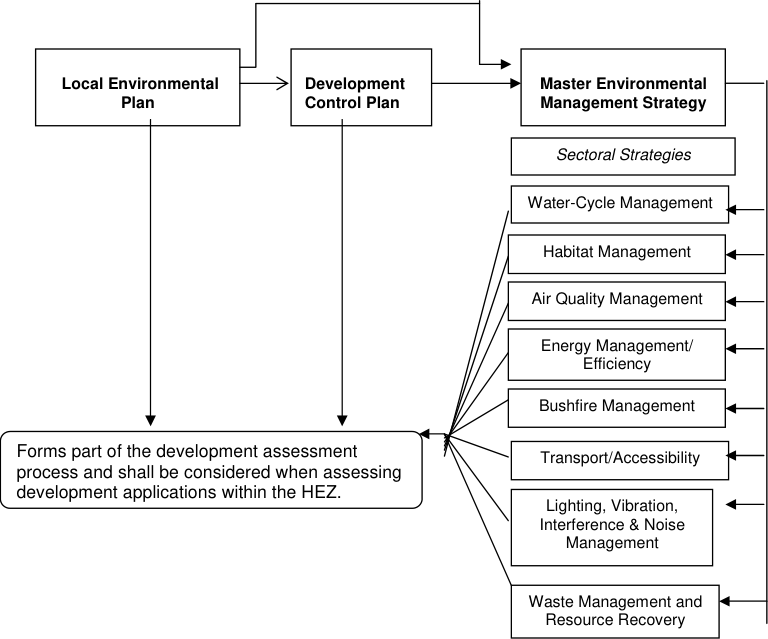
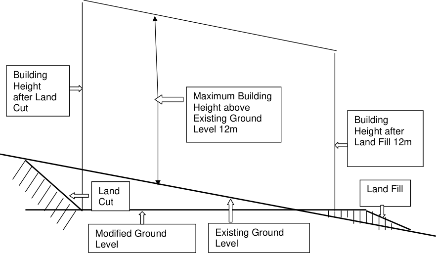

### 6.1 Subdivision in the Hunter Economic Zone

(1) Consent must not be granted to the subdivision of land within the IN1 or

SP2 zones within the Hunter Economic Zone unless the subdivision

Chapter 6: HEZ

specifically relates to the use of the land for which consent has previously

been or will concurrently be granted.

(2) Despite sub-clause (1) consent may be granted to the subdivision of land

within the Hunter Economic Zone solely for the purpose of making a minor

adjustment to the IN1, SP2 or E2 zone boundaries.

This provision is directed at preventing the speculative breaking up of land for industrial

purposes into smaller allotments or allotments that destroy the sites ability to provide large

tracts of land that are significantly buffered from adjoining land uses. Traditional speculative subdivision of industrial lands is often based upon expected demand for

lands of a certain size but often results in lots that do not meet the end users requirements for

building design, setbacks and need for separation from other uses. In order that the advantage of the unfragmented land tenure characteristics of the Hunter

Employment Zone are not lost to industries seeking lands of a size and area specific to their

needs, subdivision of land within the Hunter Employment Zone can only follow or be carried out

concurrently with the development of the land for a purpose permissible within the particular

zone. Whilst the development of lands within the Hunter Employment Zone for industrial or

employment generating purposes may result in the creation of smaller allotments these

allotments may only be considered for approval where it can be clearly demonstrated that such

development is consistent with the objectives of the zone.

Additionally, consent must not be granted to development of land within the Hunter Economic

Zone unless:

(a) the consent authority has had regard to the provisions of Cessnock Development

Control Plan, Part E: Specific Areas, Chapter 6: HEZ and the environmental

management strategies; and

(b) a surface inspection of the land has been undertaken that the consent authority

is satisfied was undertaken in conjunction with the relevant Aboriginal community

group and the consent authority has had regard to the results of that inspection

to the extent they relate to issues of Aboriginal heritage.

Having regard to the provisions of CLEP, the contents of this Chapter and the Environmental

Management Strategies appended hereto are to be applied by the Council of the City of

Cessnock in its consideration of the grant of consent to any development within HEZ. A number of the Environmental Management Strategies have been reviewed with the Master

Environmental Strategy to include the ‘must do’s’ in relation to: water quality assessment;

habitat; bushfire; noise and vibration; air quality assessment; traffic; waste and energy

requirements.

#### 6.1.1 Application

This chapter applies to land at Tomalpin as outlined heavy black on the attached Map No. 1 –

Subject Lands.  The Plan consists of a written statement, maps attached entitled Map 1 –

Subject Lands and HEZ Masterplan and a series of Environmental Management Strategies.

Chapter 6: HEZ

#### 6.1.2 Aims and Objectives

The principal objectives of this Chapter are:

• To promote and foster:

a) major industrial development or employment generating development that is

accessible to urban centres and arterial roads and that retains the potential for

rail access;

b) employment opportunities; and

c) new development that incorporates the principles of ecologically sustainable

development;

• To ensure that ecosystems are protected and conserved, including important habitats,

plant communities and watercourses within and adjoining HEZ;

• To ensure a high level of environmental protection;

• To ensure that satisfactory measures are incorporated into new development to

ameliorate any impacts from noise, air and water pollution, dust, lighting, traffic, etc onto

surrounding communities;

• Encourage innovative development which integrates well with the built form, landscaped

areas and bushland setting to enhance the character of the HEZ estate;

• Provision of adequate infrastructure and facilities to service the development of the site;

and

• To promote the conservation of any items of environmental heritage, including aboriginal

heritage and heritage precincts.

#### 6.1.3 Relationship with Other Plans

This supplements the provisions of the CLEP, which contains the legal planning controls for

development of land within the City of Cessnock.

This shall be read in conjunction with:

- Hunter Employment Zone S.94 Contributions Plan;

- HEZ Landscape Strategy;

- HEZ Social and Economic Assessment Guidelines; and

- HEZ Signage Strategy.

#### 6.1.4 Definitions

Terms used in this plan are defined in CLEP and the Environmental Planning and Assessment

Act, 1979.

If unclear of any definitions please consult with Council’s City Planning Department.

Chapter 6: HEZ

#### 6.1.5 Advice and Consultation

It is recommended that those wishing to carry out any form of development within HEZ should

initially discuss their proposal with Council’s City Planning Department prior to the formal

lodgment of an application. Council officers will be able to advise on whether a proposal

complies with Council requirements, and on procedures for lodging of a development

application.

Depending on the nature of the development proposal, consultation with government authorities

may also be necessary.

#### 6.1.6 Preparing a Development Application

In preparing a development application, applicants need to address the range of matters

contained within this Chapter and such additional information as is contained in the overall

Environmental Management Strategy.

#### 6.2

#### ENVIRONMENTAL MANAGEMENT STRATEGY

#### 6.2.1 What is the Environmental Management Strategy (EMS)?

The Environmental Management Strategy for the HEZ is a set of estate management principles

and guidelines, which complement the site specific aspects of the CLEP 2008 and this Chapter.

It sets out the environmental goals, objectives, requirements and procedures for the HEZ as a

whole and for businesses and industries establishing facilities within the HEZ.

The EMS aims to achieve ecologically sustainable development and protection of the

environment in the development of the HEZ. It will achieve this by:

• setting out actions and responsibilities for estate management and individual site

management; and ,

• providing guidelines for conditions for attachment to any consent granted to

development applications or complementing such conditions.

The EMS will be reviewed periodically, to ensure that relevant environmental information is

made available or as site specific monitoring data becomes available.

#### 6.2.2 Structure of the EMS

The Environmental Management Strategies for HEZ have two components:

1\. Environmental Management Strategy (EMS)

This EMS defines a broad strategy for conservation and environmental protection for the HEZ

estate and establishes a framework for environmental management. The Strategy also outlines

the essential requirements of the sectoral components which are outlined below.

Eight environmental sectors for which specific requirements have been developed include:

water cycle management;

habitat management;

air quality management;

energy management / efficiency;

Chapter 6: HEZ

hazard / bushfire management;

transport / accessibility;

lighting, vibration, interference and noise attenuation management; and

waste management and resource recovery.

The original Sectoral Strategy documents and appendices to the former Environmental

Management Master Strategy will become background reference documents and can be found

on Council’s website.  These documents may be used for reference purposes and provide

useful supporting material.

The diagram below shows the process through which the environment of the HEZ will be further

assessed and managed and the inter relationship between these statutory documents.

> [Picture on page 8: a map, saved as a picture (images/part-e6-hunter-economic-zone-hez-page-8-12.gif, 150 dpi); the street names and other small labels are on the picture.]
> Words printed on the picture (title and legend, copied from the PDF):
> Air Quality Management
> Forms part of the development assessment
> process and shall be considered when assessing
> development applications within the HEZ.
> Interference & Noise
> Waste Management and

2\. Individual Site Environmental Management Plans

All industries establishing in the HEZ will need to develop site specific Environmental

Management Plans for their operations. Industries with significant potential environmental

impacts will need to develop plans in accordance with the Australian Standards for

Environmental Management Systems AS/NZS ISO 14001:2004.

Chapter 6: HEZ

#### 6.2.3 Content of the EMS

The following is a brief summary of the Environmental Management Strategies for the HEZ

estate:

#### 6.2.3.1 Environmental Management Strategy

The Strategy establishes broad environmental strategies and essential requirements for

industries establishing within the HEZ estate. These requirements are for:

• environmental modelling;

• environmental monitoring;

• air quality;

• water;

• noise, light, vibration and interference;

• habitat and bushfire management;

• energy and greenhouse gas management; and

• waste management and resource recovery.

This Strategy also provides guidelines details for industries establishing within HEZ in relation

to:

• compliance with relevant environmental legislation at local, state and commonwealth

levels;

• preparation of site specific environmental management plans;

• site and estate monitoring; and

• estate management.

#### 6.2.3.2 Sectoral Environmental Strategies

The sectoral strategies within the EMS aim to achieve the following:

#### 6.2.3.2.1 Water-Cycle Management Strategy

The Water-Cycle Management Strategy aims to achieve the sustainable use of water resources

within the HEZ. It sets initial environmental flow objectives, identifies the need to develop site

specific water quality criteria and objectives and identifies ‘best practice’ environmental

management measures and requirements for ongoing monitoring and reporting.

The Strategy promotes wastewater reuse and minimization and the development of industrial

ecology in respect of water cycle management.  Its implementation will assist in the protection of

riparian environments within the site, particularly those within the E2: Environmental

Conservation zone. The strategy develops modeling tools for water quality.

#### 6.2.3.2.2 Habitat Management Strategy

The Habitat Management Strategy focuses on the ongoing management of on-site vegetation,

biodiversity and threatened species. An Ecological Constraints Master Plan has been

completed for the HEZ estate which provides a comprehensive overview of the ecological

attributes. This Strategy therefore aims to identify long term management options for habitat

protection, restoration and enhancement within and adjoining the HEZ. It also outlines

government and private implementation mechanisms to ensure the outcomes identified in the

strategy are achieved.

Chapter 6: HEZ

#### 6.2.3.2.3 Air Quality Management Strategy

The Air Quality Management Strategy aims to protect air quality in the HEZ area and its

immediate environs and ensures the HEZ impact on air quality in the region is within state and

national air quality goals. Best practice emission control & monitoring are ongoing requirements.

An air quality model has been developed for the HEZ and surrounding area. The model

provides a mechanism for assessing air quality impacts from industry developing in the HEZ

and establishes environmental margins for air quality management to ensure that the HEZ

estate can develop fully within state and national air quality constraints.

#### 6.3.3.2.4 Bushfire Management Strategy

The bushfire management strategy has been prepared to provide a complete description of the

bushfire situation within the HEZ. It identifies the responsibilities of developers, owners and

estate management in terms of bushfire protection guidelines and measures which are required

to be implemented.

#### 6.2.3.2.5 Lighting, Vibration, Interference and Noise Attenuation Strategy

This strategy aims to provide a framework for industries developing within the HEZ in terms of

lighting, vibration and noise levels. It provides existing ambient noise emissions and sets

acoustic and vibration levels based on best-practice and economically achievable goals.

The strategy develops modeling tools for assessment of impacts, including cumulative impacts.

#### 6.2.3.2.6 Waste Management and Resource Recovery Strategy

The Waste Minimisation and Resource Recovery Strategy aims to regulate the waste

generation, storage, handling recycling, reuse and disposal activities of developments within

HEZ. It provides a ’toolkit of strategies’ that can be used to assist industries and the HEZ

Association.

The Strategy is integral to the development of industrial ecology within HEZ and requires

reporting of material usage and waste generation to the estate management.

#### 6.2.3.2.7 Energy Management and Energy Efficiency Strategy

The Energy Management and Energy Efficiency Strategy aims to facilitate:

• best practice in energy efficiency;

• minimisation of wasted energy through energy transfer between industries within the

HEZ;

• minimisation of greenhouse gas emissions; and

• development of sustainable energy generation and use. The strategy is integral to the development of industrial ecology within HEZ and requires

reporting of energy usage and release to the estate management.

#### 6.2.3.2.8 Transport/ Accessibility Strategy

The Transport / Accessibility Strategy will provide a strategic direction for an integrated transport

and accessibility system. This strategy will examine issues such as access to and around the

HEZ estate including public and freight transport services.

Chapter 6: HEZ

#### 6.3

#### OBJECTIVES AND DEVELOPMENT CONTROLS

#### 6.3.1 Master Plan

A Masterplan has been prepared following the completion of detailed consultant studies

identifying development opportunities and constraints affecting the HEZ and taking into account

comments received from the community and NSW government agencies. This Chapter includes a masterplan for HEZ, which is consistent with the current zoning

structure as follows:

• industrial and other associated development;

• community, medical and heritage precincts;

• habitat protection areas including a corridor along Chinamans Hollow Creek which

provides a link from Hebburn Dam in the north to Werakata National Park in the south

and other areas such as a strip along the western side of Leggetts Drive, and to the

south and west of HEZ providing additional links to Werakata National Park.

The masterplan also depicts the main vehicular entry point to HEZ off Leggetts Drive and the

major road network to service the estate referred to as the ‘Spine Road’ including pedestrian

routes, cycleways and water quality control mechanisms. A proposed railway corridor has also

been delineated to service HEZ from Weston. Refer to the ‘Masterplan’ for further details.

The general principles of the masterplan are as follows:

• delineation of habitat protection and conservation areas based on current zoning

provisions;

• establishment of main road, cycle and pedestrian networks for the estate;

• implementation of buffer precincts adjacent to existing residential and nearby Kurri Kurri

hospital to minimise any potential impacts from future industrial development;

• delineation of a railway corridor;

• establishment of heritage precincts to protect and conserve important heritage items

such as Hebburn Dam and environs and the Richmond Vale Railway precinct; and

• provision of industrial zoned land.

#### 6.3.2 Site Analysis

Development Applications for all development are to be accompanied by a site analysis,

including a site analysis plan and written statement.

Site analysis plan should address the following:

• site topography, drainage and soil landscapes;

• disturbance to existing flora and fauna habitats;

• climatic influences;

• natural and other hazards including bushfire, geotechnical, mine subsidence, etc;

• adjoining lands and existing buildings;

• location of existing infrastructure services;

• access to the site;

• location of any heritage items and potential impacts; and

• view corridors.

Chapter 6: HEZ

The written statement must include the following details:

• a ratio calculation of built upon area to non built upon area;

• a statement explaining how design and development has taken regard of the site

analysis and identify constraints; and

• how environmental issues have been considered in the design using the Master EMS.

#### 6.3.3 Flora and Fauna

Objectives

1\. To conserve and protect biodiversity within HEZ including habitats of threatened flora

and fauna species and communities.

Development Controls

(a) Development Applications should comply with provisions of the Habitat Management

Strategy EMS and any variations should be justified.

(b) Significant flora and fauna species, ecological communities and their habitat are to be

preserved, particularly within and nearby identified DEC deferred Conservation Areas

and other conservation zones.

(c) Development shall be designed to retain existing bushland and fauna habitats including

identifiable wildlife corridors and linkages wherever possible.

(d) A vegetation clearing plan shall accompany any development application showing the

extent of clearing to be undertaken upon a development site and its relationship with

adjoining conservation zoned land.

(e) A Development Application shall be accompanied by a Flora and Fauna Assessment

report prepared in accordance with Section 5A of the EP& A Act.

(f) In the event that the above assessment concludes a significant impact, then a Species

Impact Statement (SIS) may be required in accordance with the EP&A Act.

#### 6.3.4 Heritage

#### 6.3.4.1 Aboriginal Heritage

Objectives

1\. To ensure that a representative sample of Landscape units are protected to enable

future interpretation as an area of potential archaeological significance.

2\. To ensure the on going conservation and management of sites or relics of Aboriginal

significance.

Development Controls

(a) In the absence of a finalized agreement and signoff relating to Aboriginal Archaeology

with the Department of Environment, Climate Change and Water (DECC&W) for the

entire HEZ a preliminary archaeological assessment should accompany a development

application.

(b) A surface inspection of the land shall be undertaken, of which the consent authority is

satisfied was undertaken in conjunction with the relevant Aboriginal community group

and the consent authority has had regard to the results of that inspection to the extent

they relate to issues of Aboriginal heritage.

Chapter 6: HEZ

Should any archaeological site, remains, deposit or artefact be unearthed or discovered

in the course of construction, the following steps should be undertaken:

(i) all work in the vicinity of the find is to be stopped immediately;

(ii) the find is to be reported immediately to the DECC&W and further advice to be

sought from the Aboriginal Archaeologist at the DECC&W.

#### 6.3.4.2 European Heritage

Objectives

1\. To maintain and enhance any items identified of European Heritage significance.

2\. To incorporate items of heritage significance within the HEZ as a functional component

of any development.

Development Controls

(a) A heritage impact statement shall accompany development proposals quantifying the

level of impact, if any and specifying means on how to protect any potential heritage

items.

(b) Development of land in vicinity of a heritage item shall have regard to the significance of

the heritage item, particularly its setting and context and shall be accompanied by a

heritage impact statement.

#### 6.3.4.3 Heritage Precinct

Objectives

1\. Development within a defined ‘Heritage Precinct’ shall aim to conserve items of

European industrial and cultural heritage through its study, restoration, adaptive reuse,

interpretation and integration into any development proposal for the HEZ.

Development Controls

(a) Any development within and where appropriate, adjacent to a heritage precinct defined

on the Heritage Areas Map shall be required to undertake a specific heritage study for

the site. Preparation of the plan shall refer to, Preliminary Historic Heritage Assessment:

The Hunter Employment Zone, by Umwelt Pty Ltd, dated February, 1999. (copies of the

Background Report are available through Council).

(b) A Conservation Management Plan shall be prepared prior to the submission of a

development application within the curtilage of a Heritage Conservation Area. The

Management Plans are to be submitted to Council and the HEZ Association where

appropriate. Applicants are encouraged to create digital models of the heritage sites to

facilitate the assessment of impacts on and from them.

(c) Any development proposed within the Heritage precincts defined below, and identified in

the Heritage Areas Map, shall include an assessment of the potential heritage impact

resulting from the proposal.

• Richmond Main Colliery Precinct

• Pelaw Main Colliery Precinct

• Hebburn No. 1 Colliery Precinct

• Abermain No.1 Colliery Precinct

• Hebburn No.2 Colliery Precinct

Chapter 6: HEZ

• The Railway Precinct including-

The Richmond Vale Railway

The South Maitland Railway

The Hebburn-Elrington Railway

The investigations referred to above shall consist of a historical archaeological review of those

components located within but not limited to the study area. The findings shall be sufficient to:

(1) facilitate an archaeological interpretation of the study area;

(2) enhance the historical record of the study area and region;

(3) define the place of the study area as a component of the cultural heritage of the

locality, region and state;

(4) provide data to refine the evaluation of the cultural significance of the study area;

and

(5) furnish the basis for recommendations for the conservation and / or management

of the resource and assessment of the need or desirability of further

investigation.

The following guidelines shall be observed when undertaking any works both within and outside

the defined heritage precincts:

(a) Prior to any sub-surface investigation or works, which could disturb, damage or destroy

heritage material, an Excavation Permit shall be obtained under the Heritage Act.

(b) Where structures, features, relics or archaeological material (artifacts) are discovered

the following actions shall be taken:

(i) a record maintained of all discovered artifacts;

(ii) all relics and archaeological material identified or recovered will be catalogued by

description, location, provenance and interpretation; and

(iii) all recoverable artefacts will be stabilised, cleaned and packaged for

conservation and, at the conclusion of the investigation, lodged in a permanent

repository.

(c) Excavations should be backfilled where appropriate.

(d) A report on each investigation, field survey and recording shall be prepared.

(e) Each investigation report shall comprise text, plans, searchable database / catalogue

and photographs providing a detailed account of the recording procedure.

(f) Each investigation report shall incorporate an evaluation of relevant historical context,

and themes in archaeological research, orientate the investigation, describe and

interpret its method, its progress and its results, and assess the significance of the

material evidence of the heritage.

#### 6.3.5 Urban Design

#### 6.3.5.1 Lot Sizes and Boundaries

Objectives

1\. To facilitate the creation of large parcels of land for employment generating industries.

Development Controls

(a) Land shall not be subdivided unless the subdivision specifically relates to the use of the

land for which consent has previously or will concurrently be granted.

(b) No minimum lot sizes and dimensions are applicable. Subdivision will be assessed

taking into consideration proposed and surrounding developments where buildings and

Part E: Specific Areas

Chapter 6: HEZ

associated works have been sited and designed in response to site conditions on its

merits.

#### 6.3.5.2 External Appearance and Use of Materials

Objectives

1\. To promote integrated and visually attractive buildings within the landscaped and

bushland setting of HEZ.

2\. To promote the use of materials that involves minimal harm to the existing HEZ

environment.

Development Controls

(a) Consideration shall be given to the scale, character and massing of development

surrounding the development site.

(b) Where possible, buildings shall avoid hard geometric lines that are likely to increase

impact upon the scenic landscape.

(c) Fencing, lighting and landscaping shall be integrated in the design process.

(d) Finishes of large walls and roof areas shall be ‘textured’ through the use of light and

shade, diversity in materials and finishes, and appropriate decorative treatments.

(e) Buildings shall be constructed in mid-hue matt colours selected to blend in with the

natural environment.

(f) Building services such as rooftop plants or equipment shall be enclosed in plant rooms

or buildings constructed from the same cladding as that used for the roof.

(g) Light, bright or reflective finishes shall be avoided where possible, eg.:

(i) reflective glazing of windows and walls;

(ii) unpainted galvanised finishes;

(iii) whites, creams, greys or other light colours; and

(iv) gloss finishes.

(h) Consideration shall be given to selective use of the above, where tree cover on the site

is retained and / or natural topography conceals the development, such that the building

will not be highly visible from public roads, railways, trails, lookouts / public vantage

points or surrounding communities.

(i) Reflected light and shadow shall not adversely affect other premises or land.

(j) Roof forms shall be designed wherever possible to avoid long, straight edges and shall

utilise non-reflective materials.

(k) A sample board depicting proposed external materials and colours shall be submitted to

Council with any development application.

(l) Sketch plans and where possible, digital modelling can be used to provide images

detailing the likely appearance of the proposed development from public roadways and

footpath / cycleway, in the wider bushland setting, beyond the immediate boundaries of

the development.

#### 6.3.5.3 Building Height and Scale

Objectives

1\. To ensure that buildings respond to the local topographic characteristics of the HEZ site.

Development Controls

(a) Buildings shall be of 1 - 2 storey construction to a maximum height of 12 metres above

the existing ground level, as Illustrated in Figure 1.

Chapter 6: HEZ

Variations to permit buildings of a height greater than 12 metres may be allowed where it

can be demonstrated that the proposal will have no detrimental impact upon the visual

amenity of the locality or existing views from surrounding vantage points and lookouts.

(b) For buildings over 12 metres in height, the applicant shall be able to demonstrate that

the proposed buildings will not impact upon view corridors or the visual amenity of the

local area.

(c) Roof top plant and equipment shall be setback from the building edge and designed to

minimise the extent of projection above the line of the roof, when viewed from adjoining

streets or public places.

#### Figure 1.  Building Height Limitations

> [Picture on page 16: a map, saved as a picture (images/part-e6-hunter-economic-zone-hez-page-16-12.gif, 150 dpi); the street names and other small labels are on the picture.]
> Words printed on the picture (title and legend, copied from the PDF):
> Land Fill 12m

#### 6.3.5.4 Boundary Setbacks

Objectives

1\. To provide an open streetscape with substantial areas for landscaping and screen

planting.

2\. To enhance streetscapes and to create attractive corridors along road frontages.

3\. To provide a desirable and aesthetically pleasing working environment.

4\. To create areas for landscaping of development and integration of buildings into

bushland.

5\. To create buffer zones adjacent to conservation areas to protect and conserve important

habitat.

6\. To provide continuity of green space and the tree canopy for habitat maintenance.

Chapter 6: HEZ

Development Controls

Front

a) A minimum front setback of 10 metres shall apply to any road.

Increases to this setback are encouraged to allow for the protection of stands of

vegetation and the retention of a bushland setting.

b) The front setback area shall be landscaped and appropriately maintained along any

public road.

Side

c) A minimum 5.0 metre setback will apply to all side and rear boundaries.

Variation of this standard to a lesser setback will only be considered where it can be

demonstrated that there will be no adverse effect on the landscape or rare or threatened

species.

Larger setbacks may be required for bush fire hazard or habitat protection and to provide

adequate buffer zones. Where vehicle or personnel access is required to the building

walls for maintenance and / or emergency services, the landscaping may be turf or

groundcover plants. Otherwise, landscaping shall comply with the guidelines provided

within the landscape section of this document.

General

d) All works and buildings shall be set back at least 10 metres from all land zoned E2:

Environmental Conservation. Larger setbacks may be required to satisfy requirements

for bushfire hazard reduction.

e) Setback areas shall be landscaped and well maintained.

f) The front setback shall not be used for carparking or for the storage or installation of

materials, goods or equipment. An exception is essential equipment such as fire

hydrants or water meters. Any equipment within the setback shall be adequately

screened by vegetation.

g) Increased variations to all setback requirements are encouraged to provide variety in the

development design and to encourage the protection of habitat within the HEZ.

#### 6.3.6 Landscaping

Objectives

1\. To minimise the potential impact of future development within the HEZ upon the lifestyle

and amenity of residents surrounding the HEZ.

2\. To protect the habitat biodiversity and threatened plant communities and fauna species

within the HEZ.

3\. Identify and retain visually important stands of trees and vegetation.

4\. Establish lists of native, regional, local and exotic tree and plant species and guidelines

for their use consistent with retaining the character and habitat value of the HEZ land.

Development Controls

The natural vegetation within identified buffer area surrounding the community and medical

uses precincts of the Masterplan should be set at a standard minimum depth / width of

40 metres and shall be retained and protected.

Chapter 6: HEZ

It may be necessary to supplement the natural vegetation with the planting of additional trees

and shrubs indigenous to the local area to ensure a continuous canopy is provided.

All major development and services / utilities are to be excluded from the buffer areas, including

advertising structures or devices. Small directional / trail identification signs suitable for

pedestrians and other buffer area users will be considered on their merits in accordance

with Council’s requirements.

A Landscape Concept Plan shall be submitted with all development applications and shall

address the treatment of landscaped areas and the streetscape.  The plan shall aim to

retain the unique ‘Bushland’ setting within the HEZ, giving consideration to the

topography, ridgelines and provision of habitat corridors within the HEZ.  The removal of

any trees or vegetation shall be in accordance with CLEP, Clause 5.9 Preservation of

trees or vegetation.

Exceptions for the provision of a Landscape Concept Plan may apply where otherwise required

by Council (ie. an application for a Change of Use). Consideration shall be given to the location of driveways, such that they are grouped in pairs to

encourage landscape linkages between sites on the allotment side boundaries.

Detailed Landscape Plan shall be submitted & approved by Council prior to the release of the

Construction Certificate.  The Landscape Plan shall include the following details:

• location of structures and storage sheds;

• design of roads and parking areas including edging and surface treatment;

• design of earth cut and fill, mounding within landscaped areas, together with

instructions on soil preparation;

• arrangement and nomination of all plant material including trees, shrubs and

ground covers;

• landscape edge treatment;

• layout and selection of outdoor furniture, lighting, signs, etc; and

• location of fencing and screening materials.

Any landscaping shall comply with the provisions of the Habitat Management Strategy including

the list of plants recommended for use in landscaping and bush regeneration works is

provided as Appendix F of the Habitat Management Strategy.

Landscape works shall be completed in accordance with the approved landscape plan to the

satisfaction of Council prior to occupancy of the site.  Ongoing maintenance of the

landscaping shall be provided to ensure its satisfactory establishment and long term

retention.

Semi-advanced or advanced plant species shall be used, with trees and shrubs a minimum of

200 mm in height at the time of planting and all landscaped areas shall be irrigated with

an automatic irrigation system where practical.

Where possible, existing site vegetation shall be incorporated into the proposed landscape

design. During the construction stage, retained site vegetation is to be protected from

damage.

Hard surface areas for car parking, loading and manoeuvring shall be landscaped to soften their

appearance, provide shade, maintain a pleasant work environment and retain the

bushland setting within the HEZ.

All areas not built upon or paved shall be planted with trees, shrubs, groundcovers or grass and

all shrub planting beds shall be mulched with a gravel or bark mulch. Uninterrupted

areas of gravel or bark mulch and bare soil are discouraged.

Tree planting within individual sites shall have varied spacing to appear as natural growth and

tree and shrub species shall be selected from those that are indigenous to the area. If

required, substitutions may be made, replacing them with species having similar

characteristics, with the approval of Council.

(n) Where possible, recycled water shall be used for the irrigation of landscaped areas.

Chapter 6: HEZ

(o) Where appropriate, mounds may be provided to screen the development from public

roads. Alternatively, where mounds are not possible, developments may be screened by

the strategic placement of tree and shrub species.

(p) Emphasis shall be placed on the use of low maintenance trees, shrubs and ground

covers at allotment entries in preference to grass.

(q) Trees to be planted within the landscaped areas fronting public roads or which are

visible from public areas should be semi-mature specimens.

(r) Landscaping shall be adequate to screen development & provide opportunity for passive

surveillance where appropriate. This does not apply to isolated sites or heavy industry.

(s) Side and rear boundaries shall be landscaped to the satisfaction of Council, with regard

to fire hazard management and access for maintenance purposes.

(t) Details of the landscaping of nature strips shall be submitted with the Landscape

Concept Plan submitted as part of the development application. Emphasis should be

placed on the preservation of the bushland character of the HEZ with consideration

given to the maintenance of a safe sight distance for vehicles entering and exiting

development sites.

(u) Vegetation screening and shade trees shall be provided for all carparking areas.

(v) All clearing works shall aim to minimise the exposure of soil on individual development

sites before, during and following development.

#### 6.3.7 Site Facilities

Objectives

1\. To ensure that site facilities are integrated into overall site planning to create a visually

attractive HEZ estate.

2\. To encourage waste recycling

3\. To implement ecological sustainable principles.

Development Controls

(a) Garbage and recycling bin areas are to be adequately screened by landscaping from

public areas and readily accessible by service vehicles for collection.

(b) Administration buildings are to be adequately numbered for easy identification from

emergency vehicles.

(c) Waste facilities shall be provided in accordance with Cessnock DCP, Part C: General

Guidelines, Chapter 5: Waste Management & Minimisation

(d) Council encourages waste recycling and reference shall be made to the Waste EMS.

#### 6.3.8 Fencing and Walls

Objectives

1\. To ensure that fencing does not detract from the overall visual amenity and bushland

character of HEZ.

2\. To protect wildlife linkages and corridors.

Development Controls

(a) All fencing shall be clearly identified on the development application plans.

(b) All fencing within the HEZ shall be designed to ensure that wildlife movement between

the surrounding habitat and conservation areas is not hindered in any way.

(c) The construction of solid walls within the HEZ can only be used where considered

necessary to provide screening, to attenuate noise, or provide safety or security.

Chapter 6: HEZ

(d) Fencing materials that may endanger wildlife, such as razor wire and barbed wire will not

be permitted within the HEZ.

(e) Security fencing shall only be permitted around the immediate area of the development

enclosing buildings, parking facilities and storage areas. Where fencing is required

beyond the immediate boundary of the development, the fencing shall not interfere with

the free and uninhibited movement of wildlife across the site.

(f) Measures are to be implemented to maintain a bushland environment throughout the

HEZ and to ensure that ground-moving and flying animals can continue to pass through

the development cells between areas where they feed, breed and shelter.

#### 6.3.9 Security and Lighting

Objectives

1\. To ensure that lighting does not detract from amenity of the HEZ industrial estate.

2\. To ensure that lighting or security measures do not adversely impact on wildlife.

Development Controls

(a) On-site lighting shall be designed to avoid spill or glare onto adjoining sites, habitat

protection areas, public roads or into the night sky.

(b) Security lighting shall not be substituted for lower intensity parking area or pedestrian

path lighting and shall be restricted to lighting only loading and storage locations or other

limited service areas where it can be cowled or screened to prevent light-scatter.

(c) Exterior wall mounted flood lights are prohibited except for sensor / timer controlled

security lighting to the side and rear of buildings.

(d) Adequate diffuse lighting is to be provided to all pedestrian and cycle paths, shared

areas, parking areas and building entries.  Diffuse lighting is to be used as the glare from

floodlights can often present a hazard to personal and traffic safety.

(e) Diffuse, downlit illumination shall be provided at key locations, such as building entries

and driveways.

(f) Buildings can be externally lit by a system of lighting that is used to accentuate its

architectural features if designed to avoid light-scatter and ‘skyglow’- the spillage of light

upwards into the night sky.

(g) The use of security dogs will not be permitted within the HEZ so as to ensure that native

fauna are not disturbed.

#### 6.3.10 Outdoor Storage Areas

Objectives

1\. To ensure that storage areas are integrated into site design and that these areas do not

adversely impact on the visual quality of the HEZ estate.

Development Controls

(a) All outdoor storage areas shall be clearly defined on the development application plans.

(b) All articles, materials, machinery, equipment or vehicles shall be located at the rear of

the site and be screened from public view by means of mounding, planting or

appropriately designed walls.

(c) The design of outdoor storage areas shall take into consideration the on-site drainage,

noise, odour generation and any other potential environmental constraints. Screening

shall be at least equal to the size of the materials or equipment that requires screening.

Chapter 6: HEZ

#### 6.3.11 Signage

Objectives

1\. To regulate signage to enable the promotion of industrial activity without detracting from

the amenity of the area.

2\. To encourage the erection of high quality signage.

3\. To ensure that signage does not disrupt vehicular or pedestrian traffic flow.

4\. To prevent excessive signage and visual clutter through the proliferation of advertising

structures and materials.

5\. To encourage and establish a business identity for the HEZ.

6\. To ensure signage does not adversely affect the area in which it is located in terms of

appearance, size, illumination or in any other way.

7\. To provide opportunity for the promotion of local businesses and economic activities

undertaken within the HEZ.

8\. To provide a distinctive set of off-site directional signs at appropriate locations to assist

navigation to and through the HEZ.

9\. Minimise the environmental and scenic impact of signage, especially at night.

10\. To provide businesses the opportunity of identifying their location and activity.

Development Controls

(a) All signage within HEZ shall be sited, designed and constructed in accordance with the

HEZ Signage Strategy.

(b) Roadside directional and gateway signage shall ensure that visitors can navigate their

way to and around the HEZ. The signs shall comprise the same materials and design

character to ensure consistent communication to the public and a strong identity for the

HEZ.

(c) Landscaped gateway features shall be used to announce entry to and departure from

the HEZ.

(d) Information / directory maps are to be provided along the HEZ ‘Spine Road’.

(e) The following signage is permitted within the HEZ estate only with development consent

of Council. All other signage is prohibited.

i. One (1) lot user panel shall be permitted on any parcel of land within the HEZ estate and

shall comply with the following:

- maximum height of 900mm; and

- maximum width of 900mm.

The size of this panel may be varied where it can be demonstrated that it is acceptable

given the size and location of the parcel of land to be created and the resultant building

form.

ii. One (1) free-standing tenancy listing board shall be permissible per parcel of land in the

case of multi occupancies and shall comply with the following:

- maximum size of the tenancy listing board shall not exceed 6m2;

- maximum height of 2.0 metres above natural ground level;

- maximum advertising area of 0.5 m2 per individual business and shall only contain

the name and address of each individual business and a logo or symbol identifying

each business;

- shall be located at the entry to the site; and

- may be erected within the landscaped setback area.

Chapter 6: HEZ

iii. One (1) wall / façade sign may be attached to a building. This sign shall not occupy more

than 20% of the area of the wall on which it is located. If the building is located on a

corner site, then an additional sign may be erected on a side elevation and shall not be

greater than 10% of the area of the wall.

iv. Where a site contains multiple occupancies, the maximum area of signage allowed on

the faced of each occupancy shall be 0.5m2 of sign per 1.0 metre of length of the

building façade which addresses the primary frontage of the site.

v. Where a site contains multiple occupancies, the maximum area for a sign shall not

exceed 0.25m2 of sign per 1.0 metre of length of building to a secondary frontage.

vi. The only temporary signs permitted are real estate signs that contain a notice that the

site or premises are for sale or letting, or a special event signage as outlined below.

vii. Real estate signs:

- shall be wholly contained in the property and not less than 1.0 metre from the front

property boundary;

- shall be removed within 14 days after the letting or purchase settlement of the site;

- shall not exceed 4.0m2 in area or 3.0 metres in height;

- may not be internally or externally illuminated;

- permitted as a temporary sign for a maximum period of 3 months;

- shall not be attached to telegraph poles, trees, signposts, road traffic facilities or the

like;

- auction signs shall not be displayed earlier than 42 days before the day on which the

auction is to take place and shall be removed within 7 days after the auction;

- any other temporary signage requires development consent of Council.

viii. Special Events Signage:

Special Events Signage is taken to be an advertisement of a temporary nature that

announces any local event. The standards for these temporary information

advertisements are, that the signs:

- may only be displayed for a period of not more than 2 months prior to the event and

shall be removed within 48 hours after the event;

- be securely attached to an approved wall sign, wall structure or post-supported sign;

- be positioned so as not to obstruct a driver’s line of sight;

- shall relate to the property on which they are located;

- shall not exceed 2.0 metres in length and 1.0 metre in height.

A development application shall be lodged to display a temporary sign for a period

exceeding 14 days, or an off-site temporary sign. Consent for such signs shall be limited

to 3 months or a period as determined by Council.

Any external lighting of signs shall be downward pointing and focused directly on the

sign and shall prevent or minimise the escape of light beyond the sign.  Moving, flashing

and running light signs project glare and light spillage are prohibited.

(f) Where signage is not classified as ‘Exempt development’ in Schedule 2, CLEP 2009, the

following information shall be provided to Council in conjunction with a Development

Application:

Chapter 6: HEZ

(1) A site plan showing the position of the proposed sign/s on the property. This plan

shall be dimensioned and drawn at a suitable scale. The following shall be detailed:

- property boundaries;

- distance from the sign to the property boundary and nearest road; and

- existing buildings and other features located on the property.

(2) Dimensional sketch of the sign, this can be in the form of a drawing or photograph.

The sign plan shall detail:

- sign face dimensions;

- overall height of the sign;

- height of the lowest part of the sign above natural ground level; and

- information applied to the sign: fonts; colours; logos; diagrams; and finish.

(3) A plan showing how the sign is to be supported. This plan shall detail post footings,

description of materials, and dimensions of structural members or building

specifications.

(4) Statement of Environmental Effects addressing the following:

- character of the area;

- view & vistas;

- special areas;

- streetscape, setting or landscape;

- site and building;

- associated devices and logos;

- illumination; and

- safety.

#### 6.3.12 Transport Considerations

Consent must not be granted to development of land within the Hunter Economic Zone that, in

the opinion of the consent authority, will or will be likely to generate additional vehicular traffic

until the consent authority has received written advice from the NSW Roads and Traffic

Authority that arrangements satisfactory to that Authority have been made relating to

improvements and additions to road infrastructure on and in the vicinity of the land.

Where consent has been granted to any major industrial development or major employment-

generating development within the IN1 Zone in the Hunter Economic Zone it shall not

commence operations until such time as the Pelaw Main by-pass road and associated road

infrastructure has been constructed to the satisfaction of the consent authority and the NSW

Roads and Traffic Authority (RTA).

#### 6.3.12.1 Pedestrian Facilities and Cycleways

Objectives

1\. To provide for the safe and efficient pedestrian, cycle and vehicle movement within the

HEZ.

2\. To provide transport options such as separate footpaths, cycleways and multi-use trails.

Chapter 6: HEZ

Development Controls

a) Cycleways, segregated footpaths and historic trail routes shall be capable of being

accessible to all user groups and shall comply with the relevant Austroad: Guide to

Traffic Engineering Practice, RTA: Road Design Guide and appropriate Australian

Standards as may be relevant in each specific case.

b) Cycleways and footpaths within the HEZ shall be sealed and capable of being used by

all mobility groups as well as to facilitate recreational and commuter use.

c) Where cycleways and footpaths are shared, these shall comprise of appropriate widths,

signage and markings in accordance with relevant Australian standards.

d) Bicycle parking facilities are required for all new development. Details to be provided

with any development application.

e) Bicycle parking shall be located in visible areas, separated from parking with appropriate

lighting to minimise theft and vandalism.

f) Bicycle parking facilities shall be designed in accordance with Austroad: Guide to Traffic

Engineering Practice, RTA: Road Design Guide and appropriate Australian Standards as

may be relevant in each specific case.

#### 6.3.12.2 Off-Street Car Parking

Objectives

1\. To ensure that the parking needs generated within the HEZ are adequately met.

2\. To ensure development carries the costs associated with car parking demands.

3\. To ensure that road space in and near the HEZ provides for the free movement of traffic.

4\. To ensure that the provision of off street parking facilities does not detract from the visual

amenity and character of HEZ and streetscapes.

Development Controls

The adopted policy for off-street car parking is Cessnock DCP, Part C: General Guidelines,

Chapter 1: Parking and Access. This document shall be referred to when addressing the issues

of:

• carparking standards;

• qualifications and exceptions to parking standards;

• design guidelines: access; carpark design; disabled parking; loading / unloading

facilities; construction materials; landscaping.

In addition to the abovementioned policy, consideration shall also be given to the following:

(a) Carparking is prohibited on the HEZ ‘Spine Road’ as well as on footpaths, verges, nature

strips, landscaped or grassed areas.

(b) All public roads within the HEZ shall have edge and centre-line markings indicating that it

is illegal to park on the roads.

(c) All businesses in the HEZ are responsible for meeting all of their fleet, employee,

customer and visitor parking needs. This may be on-site or in appropriately sited

designed and landscaped shared off-site parking areas. Depending on shift patterns,

nominated / matched businesses may be able to time-share parking facilities.

(d) Development Applications for industries which, generate significant levels of traffic will

be required to be accompanied by a Traffic and Carparking Assessment Report

prepared by a qualified Traffic Engineer.

Chapter 6: HEZ

#### 6.3.12.3 Loading Bays and Manoeuvring Areas

Objectives

1\. To ensure that sufficient areas are available on each site to allow for safe and efficient

manoeuvring of delivery and service vehicles.

2\. To ensure that loading facilities do not detract from the amenity of nearby public spaces.

Development Controls

(a) Loading and unloading facilities shall be screened by buildings, walls or landscaping

from the road frontage and shall be located to ensure that service vehicles are located

wholly within the site and do not create conflicts with through traffic or parking areas.

(b) Loading facilities shall be provided to satisfy user demand including appropriate turning

paths in accordance with relevant Australian Standards.

#### 6.3.12.4 Ingress and Egress to Sites

Objectives

1\. To provide safe conditions for all road users within HEZ.

2\. To ensure that all vehicles can enter and exit sites within HEZ in a safe and efficient

manner.

3\. To maintain a road hierarchy within HEZ that functions in a satisfactory manner.

Development Controls

(a) Allotments shall not gain direct access off the HEZ ‘Spine Road’ unless it can be

adequately demonstrated that no practical alternative exists and that access to the site

can be designed and constructed so as not to compromise the functioning of the Spine

Road.

(b) Vehicular access into individual sites shall comply with Austroad guidelines and

Australian Standards.

(c) Consideration shall be given to the location of driveways such that they are grouped in

pairs to encourage landscape linkages between sites on the allotment side boundaries.

#### 6.3.12.5 Road Corridor Design and Geometry

Objectives

1\. To ensure road design standards and geometry achieve desired safe speeds and

comply with relevant road design standards.

2\. To provide attractive and safe cycling and pedestrian facilities away from roads used by

heavy vehicles except at bridging points.

3\. To maintain the performance and efficiency of roads.

4\. To maintain the amenity and wildlife corridor of roadsides by minimising the width of

cleared zones.

5\. To screen roads in the landscape where possible by maintaining and augmenting

roadside vegetation.

Development Controls

(a) Road width will be adequate to service moving traffic only. The parking of vehicles will

be prohibited on public roads.

Chapter 6: HEZ

(b) The HEZ ‘Spine Road’ system is to be two-way with vertical kerbs to minimise the extent

of land clearing.

(c) All roads and associated facilities shall be designed in accordance with relevant road

standards suitable to such matters as topography, vegetation and reduced design

speeds etc. This may incorporate meandering road alignment with suitable horizontal

curves.

(d) Road design within the HEZ shall aim to segregate heavy vehicles from light traffic so as

to recognise and be consistent with their relative speeds, danger and environmental

impacts.

(e) Road verges and corridors shall be appropriately planted with vegetation native to the

local area, focusing on the retention of existing mature trees and areas of bush and

through the planting of trees and shrubs native to the area particularly those of food

value to fauna where practical.

(f) Where a design solution exists to build a road link whilst conserving significant stands of

native trees (eg. by deviating or splitting the carriageways), then that shall be the

preferred design option.

(g) The Habitat Management Strategy provides more detail about removal of vegetation,

species for re-planting, and the need for fauna crossings of road and rail systems.

(h) At driveway crossings heavy-duty bollards shall be installed on either side so as to

prevent trucks from running across verges and breaking-up footpaths.

(i) The road standard is as follows:

- cycleways / footpaths provided along routes identified on the HEZ Master Plan shall

be provided in accordance with the relevant Australian standards for cycleways and

pedestrian pathways.

- all roads within the HEZ Estate shall be capable of catering for all industrial and

commercial uses. Such roads shall be designed to comply with appropriate road

standards including RTA: Road Design Guide, Austroads: Guide to Traffic

Engineering Practice and Cessnock City Council’s ‘Engineering Requirements for

Development’.

- road drainage works shall be provided including water-polishing facilities such as

artificial wetlands to remove pollutants before road run-off enters the natural

drainage system. Run-off quantity and quality issues are addressed as part of the

Water Cycle Management Plan within the EMS.

#### 6.3.12.6 Freight Transport

Objectives

1\. To reduce energy use and greenhouse gas generation by transport.

2\. To provide for different modes of freight transport to operate in and providing access to

the HEZ.

3\. To minimise the impact of freight transport on the environmental quality or amenity of the

HEZ and surrounding areas.

Development Controls

(a) Development or activities using or handling bulk materials will be required either to use

rail transport or submit as part of the development application, a Road Network Impact

Statement (RNIS) as part of the development application. This shall provide justification

as to why rail transport cannot be used. Investigations shall consider, but not be limited

to the following issues:

- detail vehicle sizes;

- axle loadings;

- traffic volumes;

Chapter 6: HEZ

- times;

- noise and exhaust emission levels;

- origin/s, destination/s and routes; and

- the nature of materials hauled.

(b) Freight transport shall be designed to minimize damage to pavement and structures on

the wider public road network.

(c) The heritage values of the South Maitland Railway and other railway structures,

formation and equipment shall be preserved in adapting the railways for future transport

use.

#### 6.3.12.7 Rail

Objective

1\. To encourage and facilitate the use of rail transport for both freight and passenger traffic.

Development Controls

(a) All existing rail corridors and existing formations are to be protected both for their

heritage values and to enable future use for rail or non-motorised movement.

(b) A 40 metre vegetation buffer shall be maintained on both sides of the rail formations,

except where necessary for the provision of essential services.

#### 6.3.13 Infrastructure

#### 6.3.13.1 Servicing

Objectives

1\. To ensure all developments are adequately provided with essential services.

2\. To minimise the impact of utilities and services provision onto the surrounding

environment.

Development Controls

(a) Satisfactory arrangements are to be made with the relevant service authority regarding

the provision of public utilities to the site, including: sewerage; water; electricity; street

lighting; telecommunications; and gas services.

(b) The design and provision of public utilities are to comply with the requirements of the

relevant servicing authority.

(c) Compatible public utility services are to be co-ordinated in common trenching where

possible, in order to minimise ground disturbance, clearing and construction costs for

underground services.

#### 6.3.13.2 Drainage / Stormwater Management

Objectives

1\. To manage the hydrological and hydraulic impacts of development upon existing

watercourses in terms of quality, quantity and regime.

2\. To provide objective scientific measurement of water quality associated with the HEZ.

3\. To maintain water quality and existing runoff volumes and regimes within a recent

natural historical range or within a design-range where opportunity exists to create new

productive habitat.

Chapter 6: HEZ

4\. To minimise potential for erosion and sedimentation. Development Controls

(a) All drainage and stormwater design shall be carried out in accordance with Council’s

Engineering Standards and the requirements of the Water Cycle Management Strategy

EMS.

#### 6.3.14 Site Contamination

Objectives

1\. To ensure the identification, assessment and satisfactory remediation of any

contaminated land prior to development taking place.

2\. To ensure that remediation works do not diminish the heritage value of railway

formations and other industrial archaeology within and adjoining the HEZ.

Development Controls

(a) Any development proposal shall comply with provisions of Cessnock DCP, Part C:

General Guidelines, Chapter 3: Contaminated Lands. This document shall be referred to

prior to the submission of any development application.

#### 6.3.15 Cutting and Filling of Land

Objectives

1\. To ensure that any cutting / filling of land, and development on that land is properly

carried out.

2\. To ensure that any cutting / filling is compatible with the Water Cycle Management

Strategy for the site.

3\. To limit soil disturbance and slope instability in an area where soil conditions and / or

slope are a constraint.

Development Controls

(a) A development application will be required for any cut or fill operations.

(b) Any cut and fill operations shall be minimised wherever possible.

(c) Major Building Development shall not be undertaken on land having a slope exceeding

20%.  Development on land having a slope exceeding 20% shall be subject to a land

slide risk assessment by a qualified geotechnical engineer.

(d) Cut and fill operations are to be contained within lot boundaries.

(e) Cutting and filling of land shall be carried out in accordance with relevant Australian

Standards.

#### 6.3.16 Management of Hazards and Risk

Objectives

1\. To minimise the risk of natural and introduced hazards both within the HEZ and the

potential impact upon surrounding lands.

Chapter 6: HEZ

#### 6.3.16.1 Bushfire Hazard

Development Controls

(a) Reference shall be made to the Bushfire Management Strategy EMS.

(b) Appropriate asset protection zones (APZ) are to be established and details provided with

any development application.

(c) Consideration shall be given to minimising clearing of existing vegetation for bushfire

hazard reduction purposes.

#### 6.3.16.2 Introduced Hazards

Introduced hazards relate to the transport, handling and storage of materials, some of which

may be hazardous in themselves, and the potential cumulative risk related to the HEZ industry-

mix and its intensity of use.

Development Controls

(a) The HEZ Association is responsible for the maintenance of an up-to-date register of all

industries, the waste produced and method of disposal.

(b) Hazardous industries, hazardous storage establishments, offensive industries or

offensive storage establishments (within the meaning of each of those four terms in

State Environmental Planning Policy No. 33 – Hazardous and Offensive Development

and CLEP 2009) are prohibited uses within the HEZ.

Applicants’ attention is drawn to the information and guidelines available in the series of

publications prepared by Department of Planning relating to Hazardous Industries.

#### 6.3.17 Mine Subsidence

Objectives

1\. To ensure that development design addresses the potential effects of mine subsidence

given its locality within the proclaimed Tomalpin Mine Subsidence District.

Development Controls

(a) Building type, size, foundation and structural design shall comply with the requirements

of the NSW Mine Subsidence Board.

(b) Investigations shall be undertaken over the site, prior to lodgement of a development

application, to identify the presence and where relevant, the location of disused shafts

and tunnels associated with the previous mine workings underlying the site.

#### 6.3.18 Waste Management and Resource Recovery

Objectives

1\. To provide maximum opportunity for the recycling of waste materials within the HEZ.

2\. To effectively manage the disposal of wastes from within the HEZ with minimum impact

upon the environment.

Chapter 6: HEZ

Development Controls

(a) Reference shall be made to the Waste Management and Resource Recovery Strategy

EMS.

#### 6.3.19 Air Quality

Objectives

1\. To ensure that the standard of air quality within and surrounding the HEZ is maintained.

2\. To provide measurement of air quality within and around the HEZ.

3\. To produce DECC agreed measures and monitoring systems for baseline / ambient air

quality, local pollutant generation and cumulative impact of airborne pollutants on the

regional air-shed.

Development Controls

(a) All development proposals within the HEZ shall take into consideration the information

and guidelines provided within the ‘Air Quality Management Strategy’ within the EMS.

(b) Development Applications for land uses which may create potential air quality impacts

shall be accompanied by an air quality assessment.

(c) Air quality assessment shall take into consideration appropriate environmental margins

developed for the HEZ estate.

#### 6.3.20 Acoustics

Objectives

1\. To provide a reasonable acoustic environment for the HEZ estate and to minimise

impacts to surrounding communities.

Development Controls

(a) All development shall have regard to requirements within the Noise and Vibration EMS.

(b) Development Applications for land uses which may create potential noise impacts shall

be accompanied by an acoustic assessment.

#### 6.4

#### SOCIAL / ECONOMIC IMPACT

Objectives

1\. To mitigate any possible negative impacts arising from development within the HEZ and

the wider community.

2\. To identify any positive impacts and strategies for their enhancement.

Guidelines

A two tiered social and economic impact assessment is to be implemented for HEZ. A Social

and Economic Impact Comment (SEIC) shall accompany a development application and be

incorporated into a Statement of Environmental Effects report. A detailed Social and Economic

Impact Statement (SEIS) shall be completed where significant developments are proposed and

as outlined in the following table.

Chapter 6: HEZ

The table below outlines types of development which shall be considered for a SEIC or SEIS.

This list is intended as a guide only and it emphasised that some applications whilst fitting the

description may require a SEIS due to the scale of the development or its potential impacts.

Council reserves the right to request a SEIS if they determine it is necessary.

| Social and Economic Impact Comment (SEIC) |  | Social and Economic Impact Statement (SEIS) |
|---|---|---|
| All industry Smaller scale commercial & | retail | Child care facilities Educational establishments |
| development Other community facilities Health facilities |  | Large scale industrial development Public transport facilities Rail facilities Major rezoning applications Recreational or sporting facilities Large scale medical facilities |

The SEIC would be appropriate for some applications within HEZ. Its purpose would be to

indicate that the applicant has considered the number of employees, their training, where they

live, whether the local market can supply the labour and what benefits the development will

provide to the local regional economy.

The SEIS shall be a more detailed, in depth assessment of actual and potential economic and

social impacts as well as suggestions as to how to mitigate these factors.

There are a number of social and economic impacts which may result from a proposed

development within HEZ. These include, where relevant:

• land use;

• employment opportunities;

• employment skills;

• training courses at local institutions;

• local economic development (supply chain for HEZ industries, local trade for population);

• housing stock availability (including affordable housing, rental);

• property values;

• population demographics, community and health facilities;

• community services;

• transport and road systems;

• cohesion between other HEZ industries;

• recreation facilities

• residential amenity and quality of life;

• risk perception;

• culture and community values; and

• crime and public safety.

These above matters shall be considered in a social and economic comment (SEIC)

assessment. However, if development is of a scale and nature where a social and economic

impact statement (SEIS) is required, consultation should occur with Council’s City Planning

Department officers to obtain relevant guidelines and procedures for the preparation of this

SEIS.

The HEZ incorporates a Medical Precinct and Community Uses Precinct. These precincts shall

incorporate the following community accessible facilities:

Chapter 6: HEZ

• public transport stops, shelters, seats and information;

• carparking areas;

• shaded and sheltered low-maintenance open spaces;

• bicycle and pedestrian facilities (eg. cycleway, bike racks, seats etc);

• childcare facilities, day care for children of personnel etc; and

• occasional care for customers’ / patients’ children.

Applicants shall indicate whether these above services and facilities are to be incorporated into

individual developments or whether a shared facility could be established within these precincts.

Comments shall also be made on how these services and facilities can be beneficial to the

wider community.
