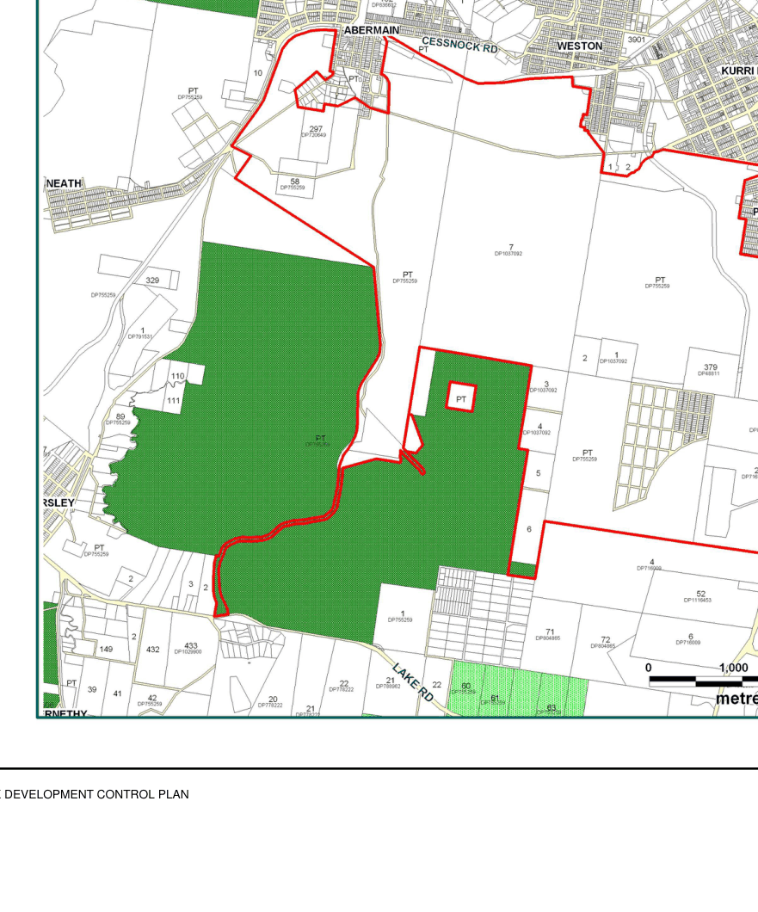

### 6.5 MEDICAL AND COMMUNITY USES PRECINCTS

These precincts have been strategically located to provide services both to the existing

communities to the north of the HEZ and to employees within the HEZ.

The Medical Uses precinct also serves to provide possible future expansion space for the Kurri

Kurri Hospital as well as opportunity for the co-location of specialist and paramedical services

near to the hospital and retirement village (eg. podiatry, chiropractic, physiotherapy, industrial

rehabilitation, dentistry, prosthetics, counseling etc).

The Community Uses precinct aims to flexibly meet the combined recreational and social needs

of communities to its north and the planned workplaces to its south (eg. quiet relaxation,

barbeque / picnic facilities, informal site recreation, outdoor assembly / entertainment space

etc). In addition, there is land where occasional or long-day childcare services may be located

near to bus and commuter routes.

#### 6.5.1 Medical Precinct

A separate Chapter shall be prepared for development within the Medical Precinct which would

address the following issues:

(a) provide opportunity for the establishment of specialist medical services adjacent to the

existing Hospital in Kurri Kurri (eg. medical imaging, physiotherapy, podiatry,

orthodontistry, occupational therapy, appliances and prostheses, psychiatry etc);

(b) provide opportunity for long-term expansion of the hospital;

(c) provide opportunity for the establishment of general practice / occupational health

medical facilities near to the HEZ;

(d) ensure adequate and formalised hospital visitor and staff carparking and provide

opportunity to time-share car parking within a broader medical precinct around the south

and western sides of the existing public hospital.

#### 6.5.2 Community Uses Precinct

(a) Provision for a 50 place Childcare Centre is likely to be required to be provided as a

result of the development of the HEZ that provides for the childcare needs of workers

and shall be located near a medical centre to enable children to be cared for while a

parent attends a clinic.

(b) Street furnishing shall be provided in various locations as nominated in a landscape plan

for the precinct.

(c) Public transport nodes shall be conveniently located and adequately furnished to provide

high levels of comfort and security for all users of the medical and community facilities.

Part E: Specific Areas

Chapter 6: HEZ

(d) Each development in the precinct is to be clearly defined by way of large print directories

in obvious locations such as at public transport nodes.

E.6-31

> [Picture on page 34: a picture, saved as a picture (images/part-e6-hunter-economic-zone-hez-page-34-2.gif, 150 dpi).]
