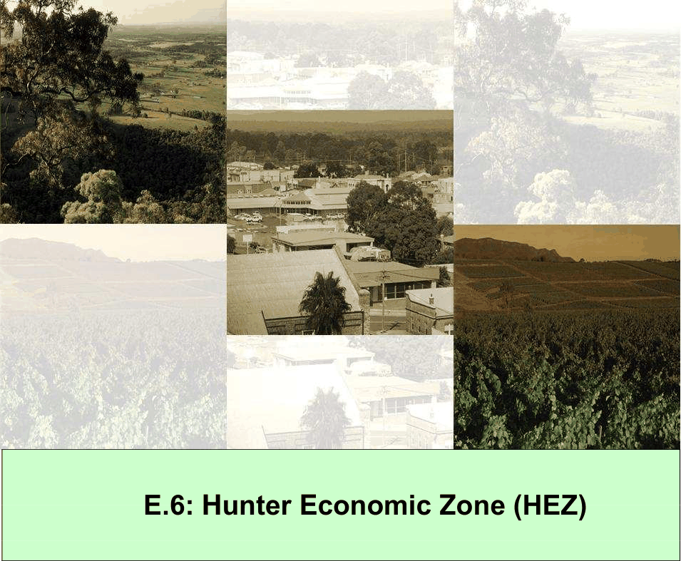

# Cessnock Development Control Plan 2010 - Part E6 Hunter Economic Zone (HEZ)

> This chapter is split into 2 section file(s), one per numbered heading, in the order they appear in the PDF.

Source PDF: [E6 - Hunter Economic Zone (HEZ).pdf](E6%20-%20Hunter%20Economic%20Zone%20%28HEZ%29.pdf)

### CESSNOCK

### DEVELOPMENT CONTROL PLAN

### PART E

### SPECIFIC AREAS

> [Picture on page 1: a picture, saved as a picture (images/part-e6-hunter-economic-zone-hez-page-1-5.gif, 150 dpi).]

### E.6: Hunter Economic Zone (HEZ)

#### Amendment History

| Version No. | Nature of Amendment | Date in Force |
|---|---|---|
| 1 | Initial adoption by Council on 6 November 2002 (DCP 47) | 19 June 2004 |
| 2 | Amended by Council on 19 April 2006 | 26 April 2006 |
| 3 | Consequential Amendments to site-specifics arising from the Cessnock DCP 2006 | 1 December 2006 |
| 4 | Incorporation into Part E: Specific Areas | 30 March 2007 |
| 5 | Consequential amendments as a result of Cessnock Local Environmental Plan. | 23 December 2011 |

#### TABLE OF CONTENTS PART E: SPECIFIC AREAS

#### E.6

| E.6: | HEZ.............................................................................................................................. 1 |
|---|---|
| 6.1 | INTRODUCTION............................................................................................................ 1 |
| 6.1.1 6.1.2 6.1.3 6.1.4 6.1.5 6.1.6 | Application ..................................................................................................................... 2 Aims and Objectives....................................................................................................... 3 Relationship with Other Plans ........................................................................................ 3 Definitions ...................................................................................................................... 3 Advice and Consultation................................................................................................. 4 Preparing a Development Application............................................................................. 4 |
| 6.2 | ENVIRONMENTAL MANAGEMENT STRATEGY ......................................................... 4 |
| 6.2.1 6.2.2 6.2.3 | What is the Environmental Management Strategy (EMS)............................................... 4 Structure of the EMS...................................................................................................... 4 Content of the EMS........................................................................................................ 6 |
| 6.3 | OBJECTIVES AND DEVELOPMENT CONTROLS ....................................................... 8 |
| 6.3.1 6.3.2 6.3.3 6.3.4 6.3.5 6.3.6 6.3.7 6.3.8 6.3.9 6.3.10 6.3.11 6.3.12 6.3.13 6.3.15 6.3.16 6.3.17 6.3.18 6.3.19 6.3.20 | Master Plan.................................................................................................................... 8 Site Analysis................................................................................................................... 8 Flora and Fauna ………………………………………………………………………………...9 Heritage ....................................................................................................................... ..9 Urban Design ............................................................................................................... 11 Landscaping................................................................................................................. 14 Site Facilities................................................................................................................ 16 Fencing and Walls........................................................................................................ 16 Security and Lighting.................................................................................................... 17 Outdoor Storage Areas ................................................................................................ 17 Signage........................................................................................................................ 18 Transport Considerations ............................................................................................. 20 Infrastructure................................................................................................................ 24 Cutting and Filling of Land............................................................................................ 25 Management of Hazards and Risk ............................................................................... 25 Mine Subsidence.......................................................................................................... 26 Waste Management and Resource Recovery .............................................................. 26 Air Quality .................................................................................................................... 27 Acoustics...................................................................................................................... 27 |
| 6.4 | SOCIAL/ECONOMIC IMPACT..................................................................................... 27 |
| 6.5 | MEDICAL AND COMMUNITY USES PRECINCTS ..................................................... 29 |
| 6.5.1 6.5.2 | Medical Precinct........................................................................................................... 29 Community Uses Precinct ............................................................................................ 29 |

Chapter 6: HEZ

#### E.6 HEZ 6.1

#### INTRODUCTION

Investigations in 1998 by Hassell Consultants, in association with the Employment Studies

Centre, University of Newcastle, identified the physical characteristics, planning framework and

economic context of what was to become known as the Hunter Employment Zone (HEZ).

The investigations concluded that HEZ has a number of distinguishing characteristics:

• Relative isolation from other land uses offering potential to accommodate land uses

requiring physical separation so as to avoid conflicts between land uses.

• Strategic positioning within the Lower Hunter Region and its various industrial centres.

• Potential to be well serviced by Hunter Valley transport corridors including road and rail.

• Close proximity to a skilled labour market and essential services.

The Hassell Report investigated the market for industrial land in the Hunter Valley and showed

land availability for industry to be limited as expansion of such lands was constrained by

fragmented ownership.

The report concluded that there were few large unencumbered sites available for industrial

development and that limitations were being created by encroachment of residential

development and resultant sensitivities to activities which might be perceived to cause a loss of

environmental amenity.

It was identified that a decline in the coal industry and the exodus of a significant industrial focus

from the Hunter including companies such as BHP, had contributed to a decrease in the

dominance of heavy industry within the Lower Hunter and therefore opportunities arose to take

advantage of the pool of skilled labour, transport linkages and sites that contained large tracts of

land that were significantly buffered from adjoining land uses, as was found to be the case of

the lands now known as the Hunter Employment Zone.

Following recommendations in the Hassell Report, the Hunter Valley Wine Country Committee

made an application to Cessnock City Council to commence a more detailed rezoning process

to investigate the suitability of the Tomalpin area for development as a major employment zone.

Cessnock Local Environmental Plan (CLEP) 1989 (Amendment No. 60) – Hunter Employment

Zone was gazetted on the 28th March 2002 wherein the subject land was zoned for

industrial/employment generating development, conservation purposes and National Park.

During this period, it was determined that the study area be identified as the ’Hunter

Employment Zone’ (HEZ).

Importantly, Clause 56 of the CLEP 1989 (Amendment No. 60) – Hunter Employment Zone

restricted the subdivision of land such that speculative subdivision cannot occur within Zones

4(h) or 5(a) of the Hunter Employment Zone.

CLEP, Clause 6.1 – Subdivision in the Hunter Economic Zone, retains the above requirement

and reads as follows:

<!-- sections -->
## Sections

1. [6.1 Subdivision in the Hunter Economic Zone](01-6-1-subdivision-in-the-hunter-economic-zone.md)
2. [6.5 MEDICAL AND COMMUNITY USES PRECINCTS](02-6-5-medical-and-community-uses-precincts.md)
