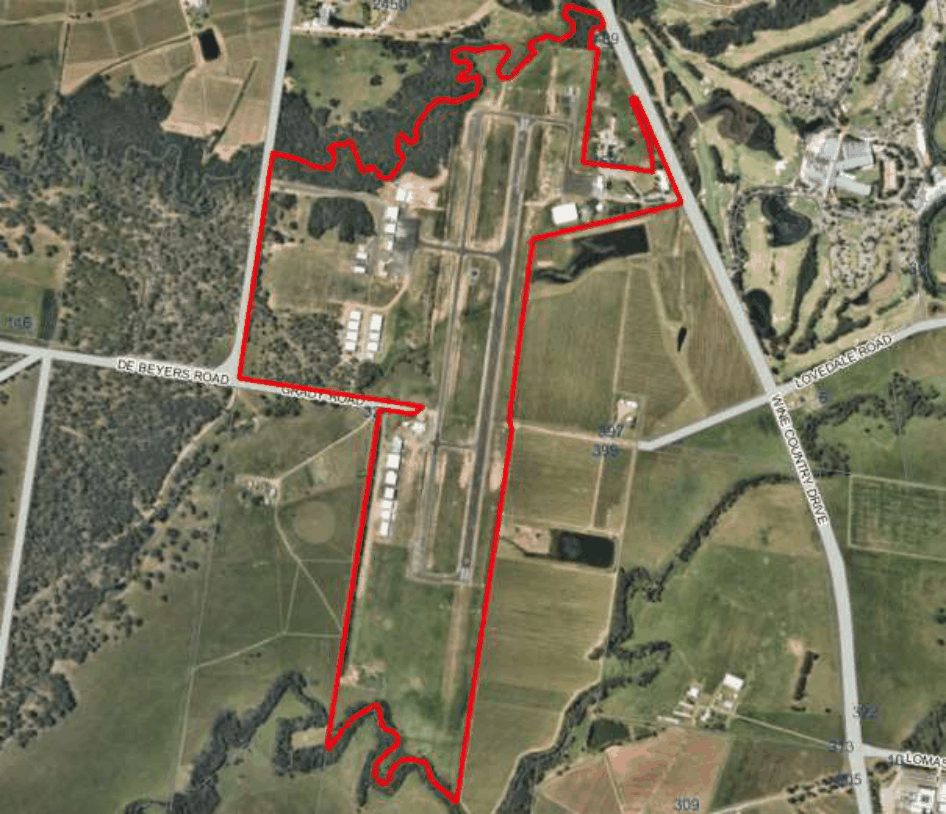
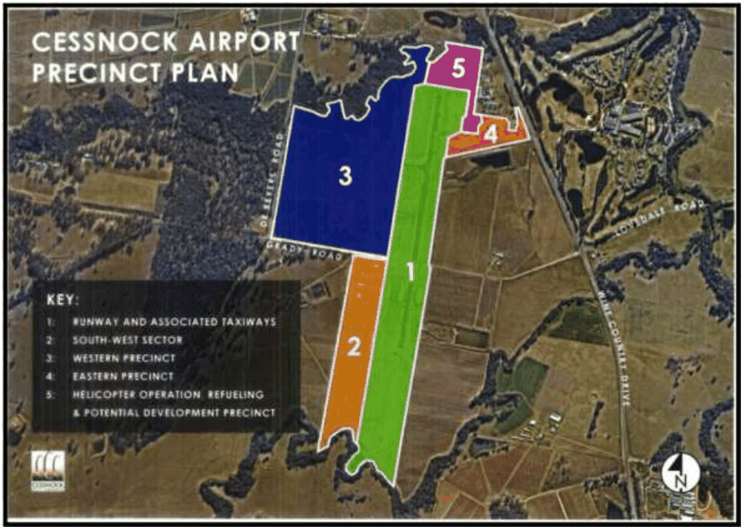

#### Preamble

Cessnock is the focal point for the Hunter Region’s wine industry and a significant tourism and entertainment destination. Cessnock Airport is one of the area’s most valuable assets with about 20,000 flight movements per annum1.

The purpose of these controls is to provide for the expansion of the Cessnock Airport (Figure 1), to encourage good built design outcomes and to ensure that existing, surrounding development is not subject to adverse environmental impacts.

> [Picture on page 2: a picture, saved as a picture (images/part-e7-cessnock-airport-page-2-9.gif, 150 dpi).]

Figure 1: Cessnock Airport.

On 5 February 2020, Cessnock City Council adopted The Cessnock Airport Strategic Plan (Airport Strategy). The Airport Strategy has identified a number of areas of opportunity for growth and

1 Cessnock Airport Strategic Plan

development to support the viability of the airport and assist economic growth within the Hunter Region. The Airport Strategy and Precinct Masterplan (Figure 2) have identified a number of opportunities for growth and development within five (5) precincts and the entranceways.

The Vision for Cessnock Airport, as outlined in the Airport Strategy is: “A viable, user friendly and vibrant aviation hub to the Hunter region.”

> [Picture on page 3: a picture, saved as a picture (images/part-e7-cessnock-airport-page-3-6.gif, 150 dpi).]

Figure 2: Cessnock Airport Precinct Masterplan
