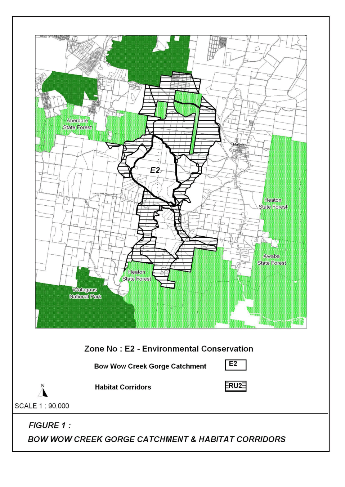

#### 8.1.1 Application

This Chapter applies to Bow Wow Creek Gorge Catchment & Habitat Corridors (see Figure 1).

#### Purpose

This Chapter provides detailed guidelines for those wishing to develop land within Bow Wow

Creek Gorge Catchment and Habitat Corridors.  The Chapter also provides a basis upon which to

implement stated objectives for Bow Wow Creek Gorge Catchment and Habitat Corridors.

#### Planning Provisions

This Chapter applies to land in Figure 1, zoned E2: Environmental Conservation and land

shown by horizontal hatching zoned RU2: Rural Landscape under Cessnock Local

Environmental Plan (CLEP).

Prior to granting consent to development on land to which this Chapter applies, Council shall

have regard to whether the development may carried out on areas of the site that do not have

established native vegetation on them.

Council shall not consent to development on land to which this Chapter applies unless it is

satisfied that the development:

is designed to minimise disturbance to the existing structure and species composition of

native vegetation communities; and

will allow native fauna and flora to breed, disperse, colonise or migrate (whether seasonally

or nomadically) by:

> [Picture on page 5: a picture, saved as a picture (images/part-e8-bow-wow-creek-gorge-page-5-1.gif, 150 dpi).]

being carried out on areas of the site that have already been cleared (unless Council is

satisfied that the development cannot be appropriately carried out on other areas

of the site that have already been cleared);

adequate provision being made, satisfactory to Council, for protection from the threat of

bushfire;

the clustering of development and the minimisation of any driveways;

landscaping with local native species;

designing and erecting any fences so that fauna movement is neither impaired nor

restricted; and

minimising the use of any herbicides and pesticides.
