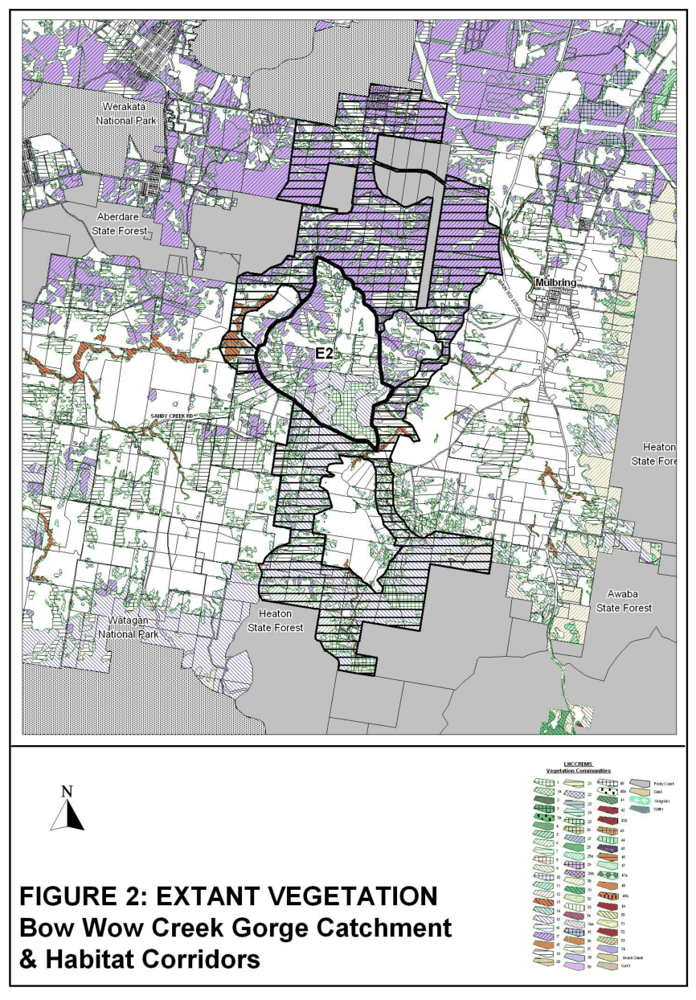
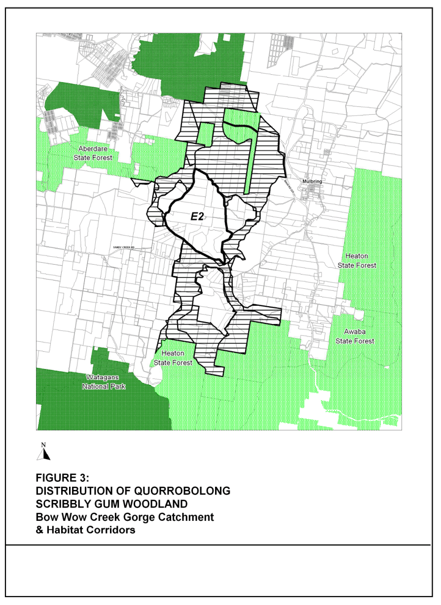
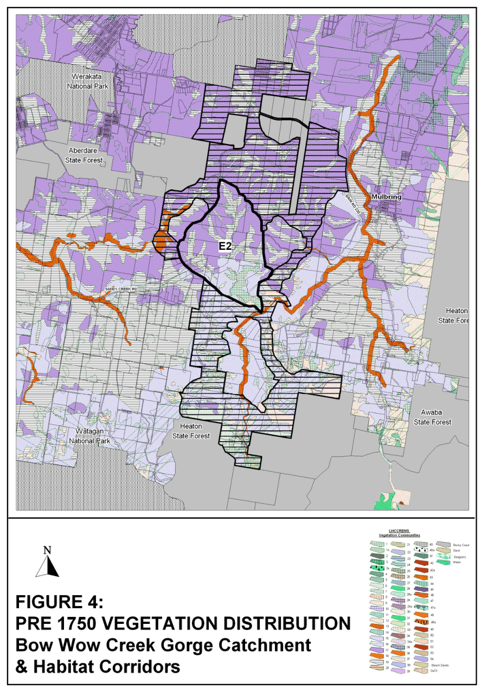

### 8.3 CATCHMENT AREA DEVELOPMENT CONSIDERATIONS

The following development considerations apply to development within the E2: Environmental

Conservation Zone (Bow Wow Creek Gorge Catchment).

#### Tourist Development Densities Objectives

• To protect and enhance the biodiversity and native ecosystems of the Catchment Area

by ensuring that it does not become over-developed.

• To promote the establishment and maintenance of native vegetation within the Bow

Wow Creek Gorge Catchment through the facilitation of increased tourist development

densities.

#### Requirements

CLEP, Clause 6.2(2) – Rural tourist and visitor accommodation in zones RU2, RU4 and E2 (Bow Wow

Creek Gorge and Habitat Corridors), states as follows:

Consent must not be granted to development for the purposes of tourist and visitor

accommodation on land within Zones RU2 and E2 (Bow Wow Creek Gorge

Catchment and Habitat Corridors) unless the lot on which the development is to be

carried out has an area of not less than 10 hectares and has a dwelling entitlement

pursuant to clause 4.2A of this plan.

• Council will consider applications for development in the E2: Environmental

Conservation Zone (Bow Wow Creek Gorge Catchment) in accordance with the

following criteria:

(1) Subject to subclause (2), Council shall not grant consent to tourist development on

land zoned E2: Environmental Conservation, which exceeds the maximum number

of permissible tourist & visitor accommodation buildings and units specified in the

following Table for the lot:

|  | Column 1 | Column 2 | Column 3 | Column 4 |
|---|---|---|---|---|
| Lot Size (hectares) | Maximum number of individual units. | Maximum number of individual buildings. | Maximum number of individual units with habitat enhancement. | Maximum number of individual buildings with habitat enhancement. |
| Minimum 10 but less than 40 | 2 | NA | 4 | NA |
| 40 and greater | 2 | NA | 8 | 6 |

(2) Council may consent to tourist & visitor accommodation development on land

zoned E2: Environmental Conservation at the densities permitted in Columns 3

and 4, where a proposal seeks to fully comply with the requirements for

maintenance of existing habitat corridors, or where a proposal seeks to establish

and maintain a minimum of 900 native trees or shrubs per individual unit.

Staged development of tourist & visitor accommodation units including those with habitat

enhancement shall not be consented to unless at least 2 tourist & visitor  accommodation units

are constructed in the first stage of the development.

• Where an application seeks to develop tourist & visitor accommodation buildings with

habitat enhancement, details of the proposed planting must be clearly specified in the

application (both plans and text accompanying the application), including proposed

ground preparation, species planting and maintenance and fencing details.  See

Appendix 1 for further detail concerning habitat enhancement and information to be

submitted with applications.

• Consents issued on the basis of habitat enhancement will include specific conditions

relating to the continued maintenance of such habitat, remaining the responsibility of the

land owner (eg. through instruments attached to the title of the property). A refundable

bond or bank guarantee will be required in the order of $3000 per tourist & visitor

accommodation unit, above the allowable density of tourist & visitor accommodation

units under Columns 1 & 2. The total amount of the bond will be released upon

attainment of a 90% establishment rate within 3 years of the completion of planting

activities.

#### Soil and Water Management

Note:   CLEP, Schedule 3: Complying Development states the requirements with regard to

dams (waterbody artificial) in the RU2: Rural Landscape zone.

Vegetation within Bow Wow Creek Gorge is likely to be sensitive to upstream disturbances such

as erosion and water pollution (Bell and Murray, 2001).  For this reason particular care is

needed to control sediment upstream of the gorge.

#### Objectives

• To provide mechanisms for the protection of the environment through minimisation of

erosion and sedimentation.

• To protect the quality of water of receiving streams, particularly Bow Wow Creek and

Wallis Creek, and to reduce land degradation.

#### Requirements

• Applications for development within the Bow Wow Creek Catchment shall be

accompanied by a preliminary Soil and Water Management Plan.  Preparation of a Soil

and Water Management Plan shall be a condition of any consent.

• Proposals for construction of dams are subject to Council’s requirements.

The following matters may need to be addressed in the preparation of a Soil and Water

Management Plan.  The headings are generic in nature and may not be appropriate for different

types and scales of development:

• construction of a perimeter or diversion bank to manage water movement;

• construction of sediment traps and sediment basins and filter fences to collect

sediment, nutrients and trash prior to site disturbance;

• minimisation and prompt stabilisation of disturbed areas;

• staggered site works (with progressive landscaping);

• drainage control measures to control water movement and quality;

• the sowing of a cover crop on disturbed areas to minimise the time and period

disturbances are exposed and to reduce erosion;

• the collection of silts and clays through flocculation where soils are known to be

dispersable.;

• soil and water management measures should be designed for the 1 in 5 year

storm event;

• Council should be notified 48 hours prior to the commencement of site works, so

as to enable a site inspection of the control measures;

• polluted and nutrient rich runoff from the site, should not contaminate receiving

waters or ground waters;

• development of slopes greater than 20% (180) shouldshall be avoided;

• any development on land with slopes greater than 20% (180) will require an

evaluation of the site's stability by means of a geotechnical report. In such areas,

cut and fill should not exceed depths of 1.0 metre;

• the discharge of water through adjoining lands should reflect the pre-existing or

natural situation. Concentration flows of unpolluted water, should be channelled to

natural drainage systems or absorbed into the ground water in an appropriate

manner.; and

• energy dissipaters should be used to reduce the velocity of stormwater into

watercourses.

#### Disposal of Waste Objectives

• To ensure that wastewater is disposed of in an environmentally acceptable manner

which does not impact upon the quality of water in Bow Wow Creek, and its vegetation.

#### Requirements

• Wastewater disposal facilities shall be located so as to maximise setbacks from

watercourses.

• Details of the methods proposed to dispose of wastewater must be clearly outlined in

applications for development.

Note:  Landowners should refer to ‘The easy septic guide’ available at Council’s offices for

advice on maintaining a safe and healthy septic system.

#### REFERENCES

Bell, S., and Murray, M., 2001, The Ecological Significance of Bow Wow Creek Gorge, Mulbring,

Hunter Valley, New South Wales: A Nationally significant site, unpublished.

Fallding, M., Kelly, A., Bateson, P., and Donovan, I., 2001, Biodiversity planning guide for NSW

Local Government, NSW National Parks and Wildlife Service, Hurstville.

James, R. and Brennan, W., 1997, Preliminary Archaeological Investigations of the Proposed

Rothbury Country Resort Development Area near Cessnock, N.S.W., unpublished.

NSW Department of Local Government, 2000, The Easy Septic Guide. Developed by Social

Change Media for the New South Wales Department of Local Government. Amendments by

Cessnock City Council.

NSW Rural Fire Service, 2006, Planning for Bushfire Protection 2006. Prepared by NSW Rural

Fire Service in cooperation with the Department of Planning.

#### APPENDIX 1

#### Bow Wow Creek Gorge Catchment Habitat Corridors & Revegetation Guidelines

Council is seeking to promote the establishment and enhancement of habitat corridors in Bow

Wow Creek Gorge Catchment generally in accordance with locations and details specified in

this Appendix. Other mass plantings are also being encouraged in strategic locations.

#### Objectives

• To enhance native fauna habitat and conserve the biodiversity of the Bow Wow Creek

Gorge.

• To ensure Bow Wow Creek Gorge does not become isolated from surrounding remnant

bushland to the north and south.

• To promote a more sustainable environment.

#### DEVELOPMENT INCENTIVES AND MAINTENANCE

• As detailed in the provisions of this Chapter, Council may consent to increased tourist &

visitor accommodation development densities within the E2: Environmental

Conservation zone, where a proposal seeks to fully comply with the requirements for

maintenance of existing habitat corridors (see Figure 1), or where a proposal seeks to

establish and maintain a minimum of 900 native trees or shrubs per tourist & visitor

accommodation unit.

Notes: 1. The requirements for the maintenance of existing habitat corridors applies only to

sites that are fully vegetated, in all other cases supplementary plantings, as

discussed in 2 below, will be required to qualify for increased tourist & visitor

accommodation development densities.

2\. Where corridors partially exist within a property, the density outlined above can be

achieved through appropriate supplementation of native vegetation (determined

on-merit due to species selection and associated sizes) and where such total

areas are maintained in perpetuity as outlined below.

• Where an application seeks to develop tourist & visitor accommodation buildings with

habitat enhancement, details of the proposed planting must be clearly specified in the

application (both plans and text), including proposed ground preparation, species

planting, maintenance and fencing details.  This Appendix provides further detail

concerning habitat enhancement and information to be submitted with applications.

• Consents issued on the basis of habitat enhancement will include specific conditions

relating to the continued maintenance of such habitat, remaining the responsibility of the

land owner (eg. through instruments attached to the title of the property).  A refundable

bond or bank guarantee will be required in the order of $3000 per tourist & visitor

accommodation unit above the allowable density of tourist & visitor accommodation

units under Columns 1 & 2.

• The total amount of the bond will be released upon attainment of a 90% establishment

rate within 3 years of the completion of planting activities. A 90% survival rate (of

establishment of planted trees / shrubs) must be achieved at the end of 18 months

following completion of planting activities, or at a later date to be agreed upon by

Council for environmental reasons such as seasonality and / or drought factors.  To be

considered successful at the time of inspection by Council staff, all tree plantings musts

have achieved a minimum height of 800mm and have visual evidence of healthy shoot

growth.  A Council appointed person may undertake a site assessment at a nominal cost

to the applicant to determine compliance with this requirement.

• The locations of habitat corridors are to be modified around existing service lines

including electricity, reticulated water, telephone and gas. Whilst the location of these

services is generally available from Council’s Geographic Information System at a

strategic scale, applicants should consult with the relevant servicing authorities to ensure

that appropriate locations have been selected.

• For applications which seek to establish native vegetation, the location of the proposed

native vegetation is to be considered on-merit with the aim to ensure the expansion of:

(a) wildlife corridors and connecting areas between vegetation remnants;

(b)  existing vegetation remnants, habitats for threatened species and plant

communities;

(c) riparian areas adjoining watercourses; and

(d)  buffers to National Parks and State Forests.

• All plantings are to be in keeping with the locally indigenous plant communities (see

Figures 2 and 3 and where necessary consult the LHCCREMS report entitled

‘Vegetation Survey, Classification and Mapping – Lower Hunter and Central Coast

Region Version 1.2’ and accompanying map detailing vegetation community composition

and distribution to identify local communities).  Where the land to be planted is cleared it

may be necessary to consult the LHCCREMS Pre 1750 Vegetation Community mapping

(see Figure 4) to identify a suitable community for the site.  In the Bow Wow Creek

Gorge Catchment, cleared areas largely comprised Hunter Lowland Redgum Forest.

• Submission to Council of a Native Vegetation Management Plan detailing the

revegetation program and timetable by which activities will be carried out on site.  The

content of the management plan shall include the following:

(a) the principal aims and objectives of the plan as they relate to the flora and fauna

communities and habitat on site;

(b) a planning strategy to achieve these aims and objectives;

(c) expected completion date for planting activities;

(d) details of site preparation in planting areas, including the clearing of competitive /

inhibiting grass and weeds;

(e) a species list appropriate to the local area (this should be based on the

vegetation communities and species composition as identified by LHCCREMS

mapping and detailed in their report entitled ‘Vegetation Survey, Classification

and Mapping – Lower Hunter and Central Coast Region Version 1.2’, an extract

of which is provided overleaf);

(f) names and mature heights of selected species;

(g) specific planting locations (accompanied by a site map detailing this information),

spacing / density, names and mature heights of tree and shrub species to be

planted;

(h) irrigation measures and source of water supply;

(i) details of how local species stock will be sourced;

(j) mechanisms to protect plantings from stock (fencing essential) or other browsing

animals, where necessary; and

(k) nature and duration of weed maintenance program to ensure the success of the

planting work undertaken.

> [Picture on page 20: a picture, saved as a picture (images/part-e8-bow-wow-creek-gorge-page-20-1.gif, 150 dpi).]

> [Picture on page 21: a picture, saved as a picture (images/part-e8-bow-wow-creek-gorge-page-21-1.gif, 150 dpi).]

> [Picture on page 22: a picture, saved as a picture (images/part-e8-bow-wow-creek-gorge-page-22-1.gif, 150 dpi).]

#### APPENDIX 2:

#### SUGGESTED PLANTING LISTS

Tree and shrub species have been selected following detailed ecological study (see Bell and

Murray, 2001 and the LHCCREMS mapping and report entitled ‘Vegetation Survey, Classification

and Mapping – Lower Hunter and Central Coast Region Version 1.2’) and through local knowledge

of the Bow Wow Creek Gorge Catchment.

Tree and shrub species have been selected to enhance biodiversity and provide wildlife habitat.

Please refer to Figures 2 & 3 for current vegetation community identification and locations or

alternatively contact Council.  For cleared sites, please refer to Figure 4 (LHCCREMS Pre 1750

Vegetation Community mapping) for guidance or alternatively contact Council.

This Chapter and more specifically these figures (detailed and in colour) can be viewed at

www.cessnock.nsw.gov.au > Building & Development > Development Control Plan > Part E:

Specific Areas, Chapter 8: Bow Wow Creek Gorge.

#### Coastal Wet Gully Forest (Map Unit 1)

| Stratum | Common Name | Species |
|---|---|---|
| Emergent | Turpentine Sydney Blue Gum Mountain Blue Gum White Mahogany Rough Barked Apple Large-fruited Red Mahogany Blackbutt | Syncarpia glomulifera Eucalyptus saligna Eucalyptus deanei Eucalyptus acmenoides Angophora floribunda Eucalyptus scias subsp scias Eucalyptus pilularis |
| Tallest | Lillypilly Guioa Sassafras Brown Beech Coachwood Murrogun Grey Myrtle Bangalow Palm Native Quince Sandpaper Fig Soft Corkwood - - Scentless Rosewood Scrub Beefwood Doughwood Black Plum Black Apple Cabbage-tree Palm | Acmena smithii Guioa semiglauca Doryphora sassafras Cryptocarya glaucescens Ceratopetalum apetalum Cryptocarya microneura Backhousia myrtifolia Archontophoenix cunninghamiana Alectryon subcinereus Ficus coronata Caldcluvia paniculosa Sarcomelicope simplicifolia subsp simplicifolia Mischocarpus australis Synoum glandulosum Stenocarpus salignus Melicope micrococca Diospyros australis Planchonella australis Livistona australis |
| Mid | White Bolly Gum Native Guava Tree Heath Buff Hazelwood Scrub Ironwood Birdlime Tree Orange Thorn Settlers Flax Wilkiea Brittlewood - Brush Pepper-bush | Neolitsea dealbata Eupomatia laurina Trochocarpa laurina Symplocos thwaitesii Austromyrtus acmenoides Pisonia umbellifera Citriobatus pauciflorus Gymnostachys anceps Wilkiea huegeliana Claoxylon australe Psychotria loniceroides Tasmannia insipida |

| Lowest (<1m) | Rasp Fern Pastel Flower Creeping Shield Fern Giant Maidenhair - - Gristle Fern Trim Shield Fern Basket Grass - - - | Doodia aspera Pseuderanthemum variabile Lastreopsis microsora Adiantum formosum Polystichum australiense Adiantum silvaticum Blechnum cartilagineum Lastreopsis decomposita Oplismenus imbecillis Pollia crispata Asplenium attenuatum Lomandra spicata |
|---|---|---|
| Vines and Epiphytes | Jasmine Morinda Kangaroo Grape Water Vine or Native Grape - Rock Felt-fern Spider Orchid Wheatgrain Bulbophyllum - Wong-Wonga Vine Bird’s Nest Fern Tangle Orchid | Morinda jasminoides Cissus antarctica Cissus hypoglauca Ripogonum fawcettianum Pyrrosia rupestris Dendrobium tetragonum Bulbophyllum shepherdii Smilax australis Pandorea pandorana Asplenium australasicum Plectorrhiza tridentata |

#### Alluvial Tall Moist Forest (Map Unit 5)

| Stratum | Common Name | Species |
|---|---|---|
| Emergents | Sydney Blue Gum Turpentine Flooded Gum Rough-barked Apple Swamp Mahogany Blackbutt Forest Red Gum Mountain Blue Gum Tallow Wood Sydney Peppermint White Mahogany Red Mahogany Swamp She-Oak Spotted Gum Red Bloodwood | Eucalyptus saligna Syncarpia glomulifera Eucalyptus grandis Angophora floribunda Eucalyptus robusta Eucalyptus pilularis Eucalyptus tereticornis Eucalyptus deanei Eucalyptus microcorys Eucalyptus piperita Eucalyptus acmenoides Eucalyptus resinifera subsp resinifera Casuarina glauca Corymbia maculata Corymbia gummifera |
| Tallest | Cheese Tree Lillypilly Prickly-leaved Paperbark Sandpaper Fig | Glochidion ferdinandi Acmena smithii Melaleuca styphelioides Ficus coronata |

|  | Snow-in-summer | Melaleuca linariifolia |
|---|---|---|
|  | Grey Myrtle | Backhousia myrtifolia |
|  | Willow Bottlebrush | Callistemon salignus |
|  | Red Ash | Alphitonia excelsa |
|  | Buff Hazelwood | Symplocos stawellii |
|  | Forest Oak | Allocasuarina torulosa |
|  | - | Melaleuca biconvexa |
|  | Cabbage-tree Palm | Livistona australis |
| Lower Mid | - Settlers Flax Breynia - | Gahnia clarkei Gymnostachys anceps Breynia oblongifolia Acacia irrorata subsp irrorata |
| Lowest (<1m) | Common Maidenhair Fern Pastel Flower - Mat Rush Basket Grass White Root Basket Grass Kidney Weed Bracken - Native Violet Rasp Fern - Floating Burr-reed Harsh Ground Fern False Bracken Fern | Adiantum aethiopicum Pseuderanthemum variabile Entolasia marginata Lomandra longifolia Oplismenus imbecillis Pratia purpurascens Oplismenus aemulus Dichondra repens Pteridium esculentum Hydrocotyle laxiflora Viola hederacea Doodia aspera Austrosteenisia blackii Sparganium subglobosum Youngia japonica Hypolepis muelleri Calochlaena dubia |
| Vines and Epiphytes | Scrambling Lily Yam Jasmine Morinda - Love Creeper Wonga-Wonga Vine Monkey Rope Stephania or Snake Vine Kangaroo Grape Wombat Berry Pearl Vine | Geitonoplesium cymosum Dioscorea transversa Morinda jasminoides Smilax australis Glycine clandestina Pandorea pandorana Parsonsia straminea Stephania japonica var discolor Cissus antarctica Eustrephus latifolius Sarcopetalum harveyanum |

#### Coastal Narabeen Moist Forest (Map Unit 6)

| Stratum | Common Name | Species |
|---|---|---|
| Tallest | Turpentine Sydney Blue Gum White Mahogany Mountain Blue Gum Blackbutt Rough-barked Apple Grey Ironbark Northern Grey Ironbark Spotted Gum Grey Gum Small-fruited Gum Large-fruited Red Mahogany | Syncarpia glomulifera Eucalyptus saligna Eucalyptus acmenoides Eucalyptus deanei Eucalyptus pilularis Angophora floribunda Eucalyptus paniculata subsp paniculata Eucalyptus siderophloia Corymbia maculata Eucalyptus punctata Eucalyptus propinqua Eucalyptus scias subsp scias |
| Upper Mid | Murrogun Scrub Turpentine Scentless Rosewood Forest Oak Cheese Tree Guioa Lillypilly Cabbage-tree Palm | Cryptocarya microneura Rhodamnia rubescens Synoum glandulosum Allocasuarina torulosa Glochidion ferdinandi Guioa semiglauca Acmena smithii Livistona australis |
| Lower Mid | Settlers Flax Native Guava - | Gymnostachys anceps Eupomatia laurina Astrotricha latifolia |
| Lowest (<1m) | Pastel Flower Rasp Fern Basket Grass Twining Guinea Flower Giant Maidenhair Gristle Fern False Bracken Fern - - Christmas Orchid Forest Germander | Pseuderanthemum variabile Doodia aspera Oplismenus imbecillis Hibbertia dentata Adiantum formosum Blechnum cartilagineum Calochlaena dubia Entolasia stricta Dennstaedtia davallioides Calanthe triplicata Teucrium corymbosum |
| Vines and Epiphytes | - Yam Jasmine Morinda Wonga-Wonga Vine Kangaroo Grape - | Smilax australis Dioscorea transversa Morinda jasminoides Pandorea pandorana Cissus antarctica Ripogonum fawcettianum |

#### Sheltered Rough Barked Apple Forest (Map Unit 7)

| Stratum | Common Name | Species |
|---|---|---|
| Tallest | Rough-barked Apple Turpentine Mountain Blue Gum Sydney Peppermint Blackbutt Sydney Blue Gum Grey Ironbark Grey Gum | Angophora floribunda Syncarpia glomulifera Eucalyptus deanei Eucalyptus piperita Eucalyptus pilularis Eucalyptus saligna Eucalyptus paniculata subsp paniculata Eucalyptus punctata |
| Upper Mid | Forest Oak Mountain Cedar Wattle | Allocasuarina torulosa Acacia elata |
| Lower Mid | Breynia Tree Heath Lillypilly Corkwood Cheese Tree | Breynia oblongifolia Trochocarpa laurina Acmena smithii Duboisia myoporoides Glochidion ferdinandi |
| Lowest (<1m) | Blue Flax Lily Gristle Fern False Bracken Fern - Mat Rush Basket Grass - White Root Rasp Fern Pastel Flower Bracken Blady Grass Common Maidenhair Fern - - | Dianella caerulea Blechnum cartilagineum Calochlaena dubia Hydrocotyle laxiflora Lomandra longifolia Oplismenus imbecillis Desmodium varians Pratia purpurascens Doodia aspera Pseuderanthemum variabile Pteridium esculentum Imperata cylindrica var major Adiantum aethiopicum Entolasia stricta Entolasia marginata |
| Vines and Epiphytes | Love Creeper Stephania or Snake Vine Native Grape Native Raspberry - Wombat Berry Wonga-Wonga Vine Old Man’s Beard | Glycine clandestina Stephania japonica var discolor Cissus hypoglauca Rubus parvifolius Smilax australis Eustrephus latifolius Pandorea pandorana Clematis aristata |

#### Coastal Ranges Open Forest (Map Unit 9)

| Stratum | Common Name | Species |
|---|---|---|
| Tallest | Turpentine Blackbutt Rough-barked Apple Mountain Blue Gum Sydney Blue Gum White Mahogany Broad-leaved White Mahogany Tallow Wood Grey Ironbark Spotted Gum Grey Gum Northern Grey Ironbark | Syncarpia glomulifera Eucalyptus pilularis Angophora floribunda Eucalyptus deanei Eucalyptus saligna Eucalyptus acmenoides Eucalyptus umbra Eucalyptus microcorys Eucalyptus paniculata subsp paniculata Corymbia maculata Eucalyptus punctata Eucalyptus siderophloia |
| Upper Mid | Forest Oak Hickory or Maiden’s Wattle | Allocasuarina torulosa Acacia maidenii |
| Lower Mid | Narrow-leaved Geebung Breynia - - | Persoonia linearis Podolobium ilicifolium Breynia oblongifolia Psychotria loniceroides Maytenus silvestris |
| Lowest (<1m) | Blue Flax Lily Blady Grass Pastel Flower Mat Rush White Root Bracken Basket Grass Weeping Grass - - False Bracken Fern Rasp Fern Tussock Grass | Dianella caerulea Imperata cylindrica var major Pseuderanthemum variabile Lomandra longifolia Pratia purpurascens Pteridium esculentum Oplismenus imbecillis Microlaena stipoides var stipoides Desmodium varians Entolasia stricta Calochlaena dubia Doodia aspera Poa labillardieri |
| Vines and Epiphytes | Forest Clematis Dusky Coral Pea Golden Guinea Flower Twining Guinea Flower | Clematis glycinoides var glycinoides Kennedia rubicunda Hibbertia scandens Hibbertia dentata |

#### Hunter Valley Moist Forest (Map Unit 12)

| Stratum | Common Name | Species |
|---|---|---|
| Tallest | Spotted Gum Grey Gum Northern Grey Ironbark Rough-barked Apple Narrow-leaved Ironbark Turpentine White Mahogany Forest Red Gum White Stringybark Narrow-leaved Stringy Bark Sydney Red Gum Mountain Blue Gum Broad-leaved Ironbark Red Bloodwood | Corymbia maculata Eucalyptus punctata Eucalyptus siderophloia Angophora floribunda Eucalyptus crebra Syncarpia glomulifera Eucalyptus acmenoides Eucalyptus tereticornis Eucalyptus globoidea Eucalyptus sparsifolia Angophora costata Eucalyptus deanei Eucalyptus fibrosa Corymbia gummifera |
| Upper Mid | Forest Oak Kurrajong Prickly-leaved Paper Bark | Allocasuarina torulosa Brachychiton populneus subsp populneus Melaleuca styphelioides |
| Lower Mid | Indian-weed Mutton Wood Breynia - Mock Olive | Sigesbeckia orientalis Rapanea variabilis Breynia oblongifolia Maytenus silvestris Notelaea longifolia |
| Lowest (<1m) | White Root Kidney Weed - - Common Maidenhair Weeping Grass Slender Plaintain Kangaroo Grass Basket Grass - | Pratia purpurascens Dichondra repens Plectranthus parviflorus Desmodium varians Adiantum aethiopicum Microlaena stipoides var stipoides Plantago debilis Themeda australis Oplismenus aemulus Entolasia marginata |
| Vines and Epiphytes | Wombat Berry Scrambling Lily Slender Grape Forest Clematis Native Raspberry | Eustrephus latifolius Geitonoplesium cymosum Cayratia clematidea Clematis glycinoides var glycinoides Rubus parvifolius |

#### Central Hunter Riparian Forest (Map Unit 13)

| Stratum | Common Name | Species |
|---|---|---|
| Tallest | Swamp She-Oak Forest Red Gum River Red Gum Rough-barked Apple Grey Box Broad-leaved Ironbark Yellow Box Narrow-leaved Ironbark Cabbage Gum Grey Gum | Casuarina glauca Eucalyptus tereticornis Eucalyptus camaldulensis Angophora floribunda Eucalyptus moluccana Eucalyptus fibrosa Eucalyptus melliodora Eucalyptus crebra Eucalyptus amplifolia subsp amplifolia Eucalyptus punctata |
| Mid |  | Allocasuarina luehmannii |
| Lowest (<1m) | Common Couch Weeping Grass Native Wandering Jew Three-awn Speargrass Lovegrass - - Starfruit - Common Onion Orchid | Cynodon dactylon Microlaena stipoides var stipoides Commelina cyanea Aristida vagans Eragrostis leptostachya Paspalidium aversum Amaranthus macrocarpus var macrocarpus Damasonium minus Goodenia gracilis Linaria pelisseriana Microtis unifolia |
| Vines and Epiphytes | - | Lysiana exocarpi subsp tenuis |

#### Coastal Foothills Spotted Gum - Ironbark Forest (Map Unit 15)

| Stratum | Common Name | Species |
|---|---|---|
| Tallest | Spotted Gum Broad-leaved White Mahogany Northern Grey Ironbark Turpentine Sydney Red Gum Small-fruited Gum White Mahogany Grey Gum Broad-leaved Ironbark Tallow Wood White Stringybark Grey Ironbark | Corymbia maculata Eucalyptus umbra Eucalyptus siderophloia Syncarpia glomulifera Angophora costata Eucalyptus propinqua Eucalyptus acmenoides Eucalyptus punctata Eucalyptus fibrosa Eucalyptus microcorys Eucalyptus globoidea Eucalyptus paniculata subsp paniculata |
| Upper Mid | Forest Oak | Allocasuarina torulosa |
| Mid | Narrow-leaved Geebung Elderberry Panax Breynia - Ball Honey Myrtle | Persoonia linearis Polyscias sambucifolia Breynia oblongifolia Daviesia ulicifolia Melaleuca nodosa |
| Lowest (<1m) | White Root Blady Grass - Kangaroo Grass Pastel Flower Weeping Grass King Greenhood - - Blue Flax Lily - Wombat Berry Mat Rush Apple Berry - - Love Creeper | Pratia purpurascens Imperata cylindrica var major Entolasia stricta Themeda australis Pseuderanthemum variabile Microlaena stipoides var stipoides Pterostylis baptistii Brachycome graminea Pterostylis furcillata Dianella caerulea Vernonia cinerea var cinerea Eustrephus latifolius Lomandra longifolia Billardiera scandens Desmodium rhytidophyllum Maytenus silvestris Glycine clandestina |
| Vines and Epiphytes | Hardenbergia | Hardenbergia violacea |

#### Lower Hunter Spotted Gum - Ironbark Forest (Map Unit 17)

| Stratum | Common Name | Species |
|---|---|---|
| Tallest | Spotted Gum Broad-leaved Ironbark Grey Gum Narrow-leaved Ironbark Grey Box Blue-leaved Stringy Bark Broad-leaved White Mahogany Red Bloodwood Turpentine White Stringybark Northern Grey Ironbark Grey Ironbark Narrow-leaved Stringy Bark Sydney Red Gum White Mahogany - Forest Red Gum Dusky-leaved Ironbark | Corymbia maculata Eucalyptus fibrosa Eucalyptus punctata Eucalyptus crebra Eucalyptus moluccana Eucalyptus agglomerata Eucalyptus umbra Corymbia gummifera Syncarpia glomulifera Eucalyptus globoidea Eucalyptus siderophloia Eucalyptus paniculata subsp paniculata Eucalyptus sparsifolia Angophora costata Eucalyptus acmenoides Eucalyptus fergusonii subsp fergusonii Eucalyptus tereticornis Eucalyptus nubila Corymbia eximia |
| Mid | - - Ball Honey Myrtle - - Narrow-leaved Geebung Native Cranberry Breynia - | Daviesia ulicifolia Acacia parvipinnula Melaleuca nodosa Oxylobium ellipticum Daviesia leptophylla Persoonia linearis Lissanthe strigosa Breynia oblongifolia Pultenaea cunninghamii |
| Lowest (<1m) | Mulga Fern - Pomax White Root Mauve Flax Lily Love Creeper - Weeping Grass Kangaroo Grass Thyme Spurge - Barbed-wire Grass Snake-tounged Greenhood | Cheilanthes sieberi subsp sieberi Entolasia stricta Pomax umbellata Pratia purpurascens Dianella revoluta var revoluta Glycine clandestina Lepidosperma laterale Microlaena stipoides var stipoides Themeda australis Phyllanthus hirtellus Vernonia cinerea var cinerea Cymbopogon refractus Aristida lignosa Austrodanthonia induta Calotis cuneata var cuneata Pterostylis ophioglossa Solanum papaverifolium Sporobolus caroli |

#### Hunter Lowlands Redgum Forest (Map Unit 19)

| Stratum | Common Name | Species |
|---|---|---|
| Tallest | Forest Red Gum Grey Gum Narrow-leaved Ironbark Rough-barked Apple Spotted Gum Grey Box Thin-leaved Stringybark White Stringybark Broad-leaved Ironbark Blackbut Grey Ironbark Sydney Red Gum White Mahogany Cabbage Gum Broad-leaved White Mahogany Turpentine | Eucalyptus tereticornis Eucalyptus punctata Eucalyptus crebra Angophora floribunda Corymbia maculata Eucalyptus moluccana Eucalyptus eugenioides Eucalyptus globoidea Eucalyptus fibrosa Eucalyptus pilularis Eucalyptus paniculata subsp paniculata Angophora costata Eucalyptus acmenoides Eucalyptus amplifolia subsp amplifolia Eucalyptus umbra Syncarpia glomulifera |
| Mid | Breynia Bearded Heath - Narrow-leaved Geebung Dogwood | Breynia oblongifolia Leucopogon juniperinus Daviesia ulicifolia Persoonia linearis Jacksonia scoparia |
| Lowest (<1m) | Mulga Fern Weeping Grass White Root Barbed-wire Grass - Pomax Kidney Weed - Blue Trumpet Tufted Hedgehog Grass - - Lovegrass Blady Grass Two Colour Panic Forest Nightshade Kangaroo Grass Smallflower Fingergrass - Apple Berry Mat Rush Brown’s Love Grass - Love Creeper | Cheilanthes sieberi subsp sieberi Microlaena stipoides var stipoides Pratia purpurascens Cymbopogon refractus Lomandra multiflora subsp multiflora Pomax umbellata Dichondra repens Vernonia cinerea var cinerea Brunoniella australis Echinopogon caespitosus var caespitosus Lagenifera stipitata Desmodium varians Eragrostis leptostachya Imperata cylindrica var major Panicum simile Solanum prinophyllum Themeda australis Digitaria parviflora Entolasia stricta Billardiera scandens Lomandra longifolia Eragrostis brownii Paspalidium distans Austrodanthonia monticola Glycine clandestina |

#### Hunter Range Grey Gum Forest (Map Unit 21)

| Stratum | Common Name | Species |
|---|---|---|
| Tallest | Grey Gum Sydney Red Gum Narrow-leaved Stringy Bark Turpentine Narrow-leaved Ironbark Blue-leaved Stringy Bark Rough-barked Apple - Spotted Gum Sydney Peppermint White Mahogany | Eucalyptus punctata Angophora costata Eucalyptus sparsifolia Syncarpia glomulifera Eucalyptus crebra Eucalyptus agglomerata Angophora floribunda Eucalyptus prominula Corymbia eximia Corymbia maculata Eucalyptus piperita Eucalyptus acmenoides |
| Upper Mid | Forest Oak | Allocasuarina torulosa |
| Lower Mid | Narrow-leaved Geebung Mutton Wood Dwarf Currant Dogwood - | Persoonia linearis Podolobium ilicifolium Rapanea variabilis Exocarpos strictus Jacksonia scoparia Acacia parvipinnula |
| Lowest (<1m) | - Pomax - Kangaroo Grass Weeping Grass Native Parsnip Grey Guinea Flower - - - | Entolasia stricta Pomax umbellata Goodenia heterophylla Themeda australis Microlaena stipoides var stipoides Platysace lanceolata Hibbertia obtusifolia Poa affinis Pterostylis revoluta Vittadinia dissecta var dissecta |
| Vines and Epiphytes | Hardenbergia Dusky Coral Pea | Hardenbergia violacea Kennedia rubicunda |

#### Kurri Sand Swamp Woodland (Map Unit 35)

| Stratum | Common Name | Species |
|---|---|---|
| Tallest | Drooping Red Gum Narrow-leaved Apple Blue-leaved Stringy Bark Broad-leaved Ironbark Scribbly Gum Narrow-leaved Stringy Bark | Eucalyptus parramattensis subsp decadens Angophora bakeri Eucalyptus agglomerata Eucalyptus fibrosa Eucalyptus signata Eucalyptus sparsifolia |
| Mid | Ball Honeymyrtle Hair-pin Banksia Dogwood Finger Hakea Prickly Moses Mountain Devils White Feather Honeymyrtle White Spider Flower Narrow-leaved Geebung | Melaleuca nodosa Banksia spinulosa Jacksonia scoparia Hakea dactyloides Acacia ulicifolia Lambertia formosa Melaleuca decora Grevillea linearifolia Persoonia linearis |
| Lowest (<1m) | - Heathy Parrot Pea Native Cranberry - Rice Flower Mauve Flax Lily - | Entolasia stricta Dillwynia retorta Lissanthe strigosa Melaleuca thymifolia Pimelea linifolia Dianella revoluta var revoluta Phebalium squamulosum Macrozamia flexuosa |

#### Quorrobolong Scribbly Gum Woodland

| Stratum | Common Name | Species |
|---|---|---|
| Trees |  | Eucalyptus racemosa Eucalyptus punctata Eucalyptus piperita Eucalyptus resinifera Angophora costata Syncarpia glomulifera |
| Small tree |  | Leptospermum trinervium Xylomelum pyriforme Acacia parvipinnula Melaleuca nodosa Persoonia linearis |
| Shrubs |  | Zieria smithii ssp. smithii Acacia ulicifolia Leptospermum polygalifolium ssp. cismontanum Daviesia ulicifolia Correa reflexa var. reflexa Jacksonia scoparia Banksia spinulosa var. collina Breynia oblongifolia Dillwynia retorta Leucopogon juniperinus Melaleuca sieberi Lomatia silaifolia Comesperma ericinum Polyscias sambucifolia Exocarpos cupressiformis Callistemon pinifolius Hakea sericea Allocasuarina littoralis |
| Vines |  | Billardieria scandens var. sericata Hardenbergia violacea Glycine clandestina Cassytha glabella forma glabella |
| Herbs |  | Hibbertia diffusa Phyllanthus hirtellus forma A Goodenia heterophylla ssp. heterophylla Platysace ericoides Pratia purpurascens Dampiera stricta Pseuderanthemum variabile Pomax umbellata Gompholobium minus Goodenia rotundifolia Laxmannia compacta |

| Grasses | Imperata cylindrica var. major Themeda australis Aristida vagans Eragrostis brownii Panicum simile Microlaena stipoides var. stipoides Entolasia stricta Echinopogon ovatus Digitaria ramularis Anisopogon avenaceus Paspalidium distans Lomandra cylindrica Lomandra glauca Lomandra multiflora ssp. multiflora Gahnia aspera Dianella caerulea var. assera Lepidosperma gunnii Xanthorrhoea ?macronema |
|---|---|
| Ferns | Pteridium esculentum |
| Orchids | Cryptostylis subulata |

#### APPENDIX 3:

#### PLANTING PREPARATION

The following is a general prescription for establishing habitat corridors as well as for plantings in general.

Details following in this Appendix have been provided by Greening Australia (1998).

#### Calendar for planting
