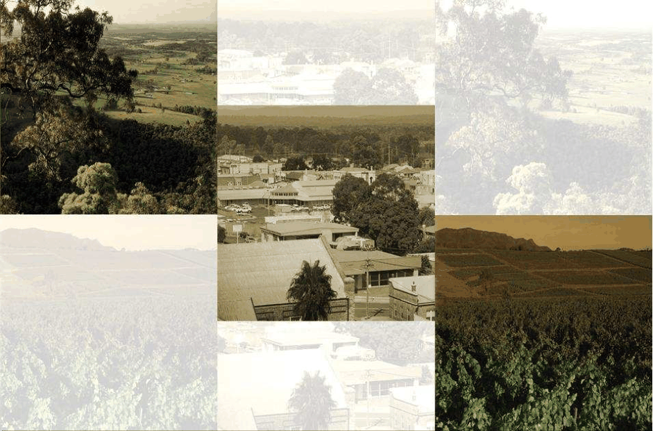

# Cessnock Development Control Plan 2010 - Part E8 Bow Wow Creek Gorge

> This chapter is split into 9 section file(s), one per numbered heading, in the order they appear in the PDF.

Source PDF: [E8 - Bow Wow Creek Gorge.pdf](E8%20-%20Bow%20Wow%20Creek%20Gorge.pdf)

### CESSNOCK

### DEVELOPMENT CONTROL PLAN

### PART E

### SPECIFIC AREAS

> [Picture on page 1: a picture, saved as a picture (images/part-e8-bow-wow-creek-gorge-page-1-5.gif, 150 dpi).]

### E.8: BOW WOW CREEK GORGE

#### Amendment History

| Version No. | Nature of Amendment | Date in force |
|---|---|---|
| 1 | Initial adoption by Council on 19 May 2004 (DCP 57) | 5 May 2006 |
| 2 | Consequential amendments to site-specific development control plans arising from the Cessnock DCP 2006 | 1 December 2006 |
| 3 | Incorporation into Part E: Specific Areas | 30 March 2007 |
| 4 | Consequential amendments as a result of Cessnock Local Environmental Plan. | 23 December 2011 |

#### TABLE OF CONTENTS

#### E.8

#### E.8 BOW WOW CREEK GORGE

8.1 INTRODUCTION.......................................................................................................... 1

8.1.1 Application.................................................................................................................... 1

8.1.2 Purpose........................................................................................................................ 1

8.1.3 Planning Provisions...................................................................................................... 1

8.1.4 Objectives .................................................................................................................... 3

8.2 GENERAL DEVELOPMENT CONSIDERATIONS....................................................... 3

8.2.1 Flora and Fauna Requirements .................................................................................... 3

8.2.2 Habitat Corridors .......................................................................................................... 5

8.2.3 Clearing of Vegetation.................................................................................................. 5

8.2.4 Building Siting and Design............................................................................................ 7

8.2.5 Bushfire Hazard............................................................................................................ 8

8.2.6 Aboriginal Heritage....................................................................................................... 8

8.2.7 Outdoor Lighting........................................................................................................... 9

8.2.8 Fencing ........................................................................................................................ 9

8.2.9 Servicing ...................................................................................................................... 10

8.3 CATCHMENT AREA DEVELOPMENT CONSIDERATIONS..................................... 10

8.3.1 Tourist Development Densities................................................................................... 11

8.3.2 Soil and Water Management ...................................................................................... 12

8.3.3 Disposal of Waste ...................................................................................................... 13

#### REFERENCES

#### 14

APPENDIX 1: Bow Wow Creek Gorge Catchment and Habitat Corridors Revegetation

Guidelines....................................................................................................... 15

APPENDIX 2: Suggested Planting List ..................................................................................20

APPENDIX 3: Planting Preparation .......................................................................................36

APPENDIX 4: Species Selection Guide.................................................................................39

> The PDF's contents list (page numbers of the printed document) is not repeated here - see Sections below.

#### E.8: BOW WOW CREEK GORGE

<!-- sections -->
## Sections

1. [8.1 INTRODUCTION](01-8-1-introduction.md)
2. [8.1.1 Application](02-8-1-1-application.md)
3. [8.1.4 Objectives](03-8-1-4-objectives.md)
4. [8.2 GENERAL DEVELOPMENT CONSIDERATIONS](04-8-2-general-development-considerations.md)
5. [8.3 CATCHMENT AREA DEVELOPMENT CONSIDERATIONS](05-8-3-catchment-area-development.md)
6. [12 months before planting](06-12-months-before-planting.md)
7. [9 months before planting](07-9-months-before-planting.md)
8. [6 months before planting](08-6-months-before-planting.md)
9. [2 to 3 weeks before planting](09-2-to-3-weeks-before-planting.md)
