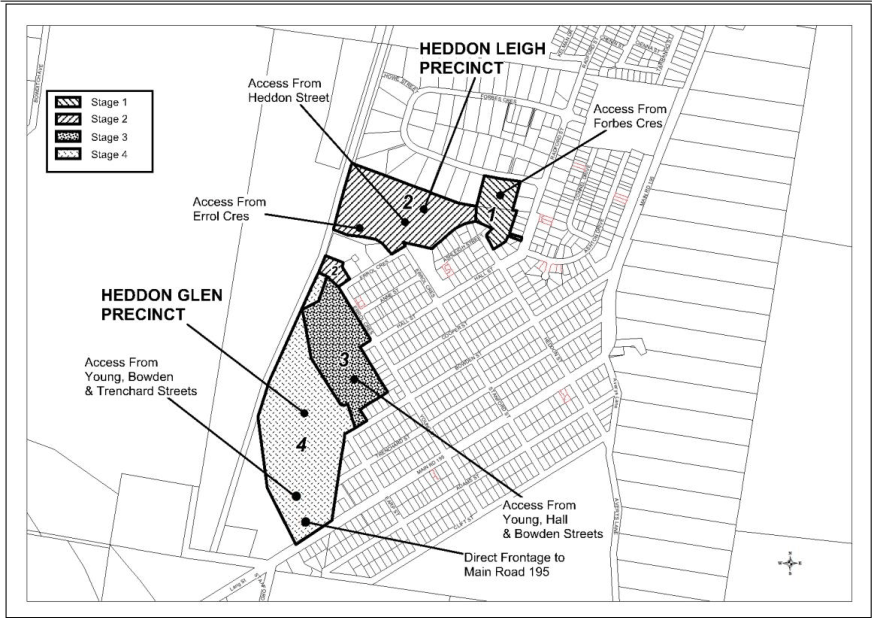

## 1 Staging Plan

Staging of the Urban Release Area should be consistent with the Heddon Greta Area Staging Plan.  The Heddon Greta Area Staging Plan is to be read in conjunction with the Heddon Greta Precinct and Road Hierarchy Plan and the Heddon Greta Voluntary Planning Agreement (VPA).

The Precinct Plan may provide for sub-stages consistent with infrastructure provision and sequencing.

> [Picture on page 2: a picture, saved as a picture (images/part-f1-heddon-greta-page-2-16.gif, 150 dpi).]

#### Figure 1: Staging, Precinct and Road Hierarchy Plan
