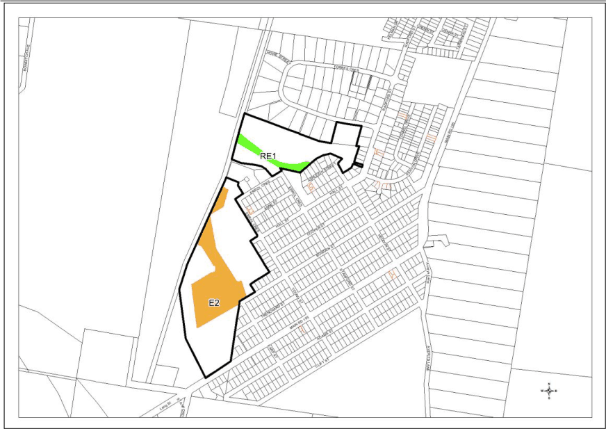

## 4 Passive and Active Recreational Areas

Development applications for subdivision that include areas of passive and active recreational space (as identified in Figure 2) are to include detailed designs in the overall landscaping strategy.

> [Picture on page 3: a picture, saved as a picture (images/part-f1-heddon-greta-page-3-12.gif, 150 dpi).]

#### Figure 2: Proposed Public Reserve Land Dedication
