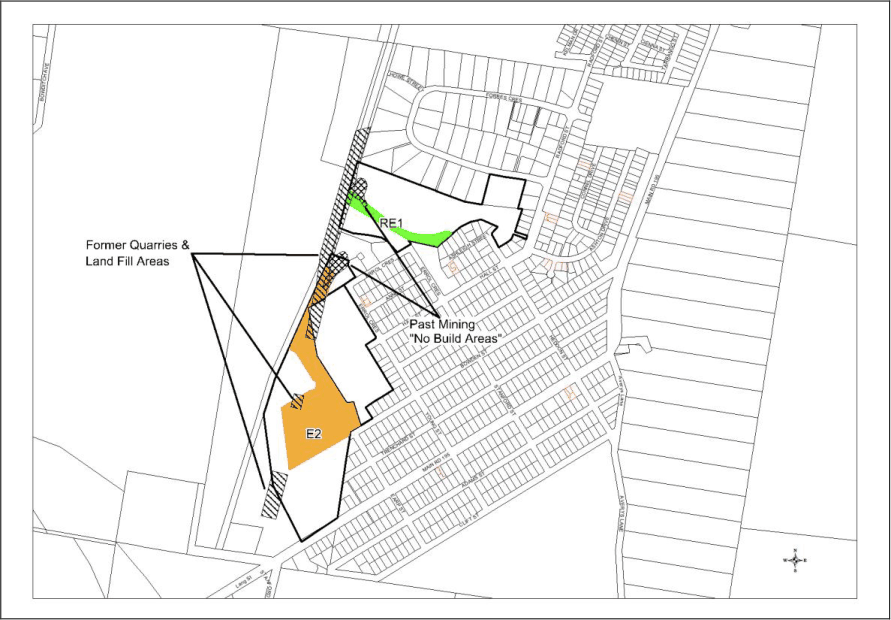
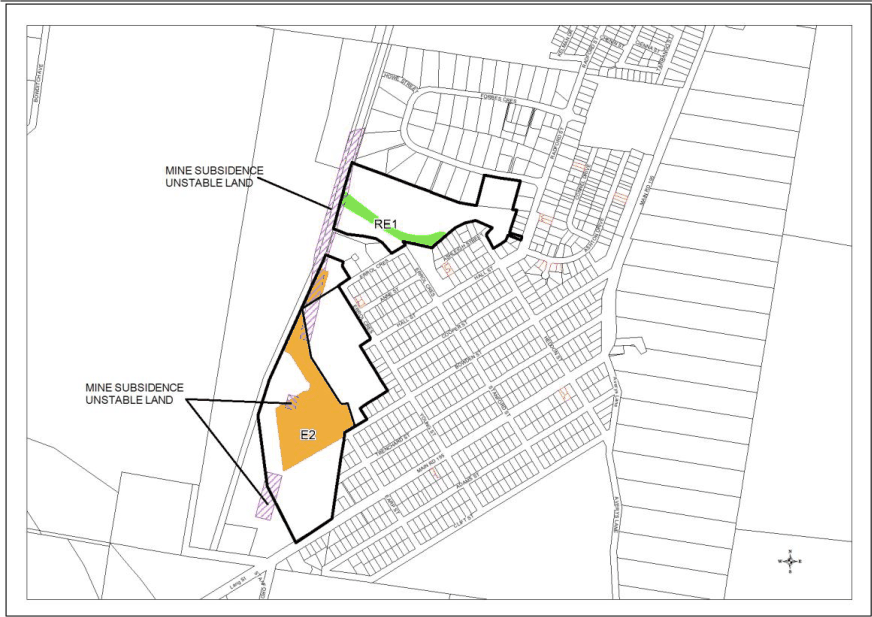

## 6 Amelioration of Natural and Environmental Hazards

Natural Hazards

There are no specific requirements in this regard.

Environmental Hazards

#### Geotechnical

Geotechnical investigations and appropriate amelioration responses must be submitted with development applications for subdivision to determine the following:

a) Suitability of footing design and road pavement design parameters with respect to rock outcrops, soft/saturated soils, erosion potential and salinity;

b) Slope stability assessment of on-site dam embankments;

c) Earthwork procedures and specifications.

> [Picture on page 4: a picture, saved as a picture (images/part-f1-heddon-greta-page-4-10.gif, 150 dpi).]

#### Figure 3: Geotechnical Constraints

#### Mine Subsidence - Unstable Lands

a) No development is to occur within the No Build Areas near the former South Maitland Railway Reserve within Lot 404 DP1127085 as shown on Figure 3, without specific geotechnical investigation first being carried out to give clearance for building or set building structural standards.

b) Development on that portion of Lot 404 DP1127085 zoned for residential purposes, as shown on Figure 4, shall be limited to a maximum of two storey brick veneer construction unless otherwise approved by the Mine Subsidence Board.

> [Picture on page 5: a picture, saved as a picture (images/part-f1-heddon-greta-page-5-1.gif, 150 dpi).]

#### Figure 4: Mine Subsidence - Unstable Lands
