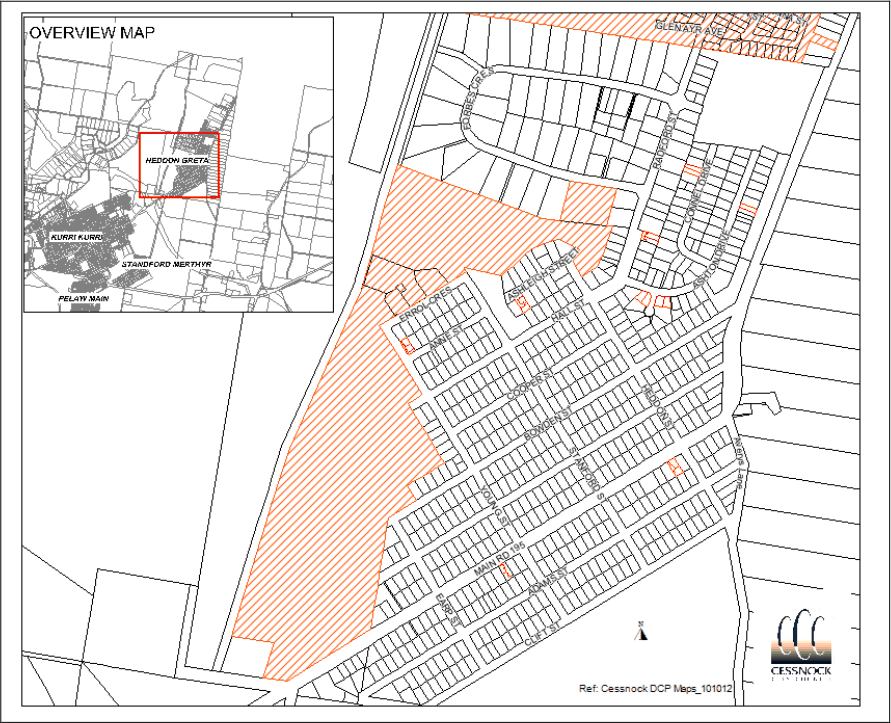

# Cessnock Development Control Plan 2010 - Part F1 Heddon Greta

> This chapter is split into 10 section file(s), one per numbered heading, in the order they appear in the PDF.

Source PDF: [Land-Use-Planning-_-Cessnock-DCP-2010-_-F1-Heddon-Greta-_-CCC-website-doc.pdf](Land-Use-Planning-_-Cessnock-DCP-2010-_-F1-Heddon-Greta-_-CCC-website-doc.pdf)

### F.1 - Heddon Greta Urban Release Area

> [Picture on page 1: a picture, saved as a picture (images/part-f1-heddon-greta-page-1-2.gif, 150 dpi).]

#### DESCRIPTION

The Heddon Greta Urban Release Area identifies approximately 24 hectares of land to the west of the existing Heddon Greta Village area.  Access to the area is via Heddon Street and Young Street from Main Road 195.

The majority of the land has traditionally been used for grazing.  No important sites or land uses are located within the Urban Release Area.  The disused former South Maitland Railway reserve forms the western boundary of the potential residential area.  The past underground mining activities near the railway reserve dictated specific design outcomes for the area.  Environmental issues associated endangered vegetation species have been determined in association with the Office of Environment and Heritage and the lands on the western side of the Railway reserve are predominantly included as conservation areas and are suitable for tree replacement.

The residential areas are to be developed in two (2) precincts, with a range of lot sizes that reflect the constraints of the site.  Individual lots will generally accommodate one and two storey dwellings.  Dual occupancy proposals should ensure that potential impacts to privacy, solar access, visual amenity,

traffic management and its suitability in relation to the form of adjoining development have been taken into account.

Development within this area is well progressed.  No overall Area Plan has been prepared for this Urban Release Area, as the area is relatively compact in relation to other sites.  An overall Precinct Plan has been prepared instead.

#### Development Requirements

All development applications shall demonstrate consistency with the following requirements.

<!-- sections -->
## Sections

1. [1 Staging Plan](01-staging-plan.md)
2. [2 Transport Movement Hierarchy](02-transport-movement-hierarchy.md)
3. [3 Overall Landscaping Strategy](03-overall-landscaping-strategy.md)
4. [4 Passive and Active Recreational Areas](04-passive-and-active-recreational-areas.md)
5. [5 Stormwater and Water Quality Management Controls](05-stormwater-and-water-quality-management.md)
6. [6 Amelioration of Natural and Environmental Hazards](06-amelioration-of-natural-and.md)
7. [7 Significant Development Sites](07-significant-development-sites.md)
8. [8 Residential Densities](08-residential-densities.md)
9. [9 Neighbourhood Commercial and Retail Uses](09-neighbourhood-commercial-and-retail-uses.md)
10. [10 Provision of Public Facilities and Services](10-provision-of-public-facilities-and.md)
