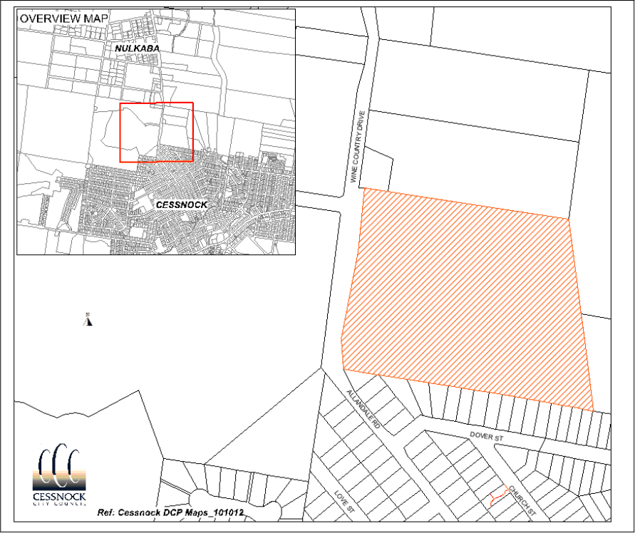

# Cessnock Development Control Plan 2010 - Part F2 Cessnock – BC5

> This chapter is split into 10 section file(s), one per numbered heading, in the order they appear in the PDF.

Source PDF: [Land-Use-Planning-_-Cessnock-DCP-2010-_-F2-Cessnock-BC5-_-CCC-website-doc.pdf](Land-Use-Planning-_-Cessnock-DCP-2010-_-F2-Cessnock-BC5-_-CCC-website-doc.pdf)

Part F - Urban Release Areas (Cessnock – BC5)

### F.2 - Cessnock (BC5) Urban Release Area

> [Picture on page 1: a picture, saved as a picture (images/part-f2-cessnock-bc5-page-1-3.gif, 150 dpi).]

#### DESCRIPTION

The Cessnock (BC5) Urban Release Area is located on the northern fringe of Cessnock with a frontage to Allandale Road and immediately adjacent to urban development along Dover Street.

At the commencement of the DCP the land is described as Lot 100, DP 7299762 and has traditionally been used for grazing.  No important sites or land uses are located within the Urban Release Area.

The residential areas are to be developed in a single precinct, with a range of lot sizes that reflect the constraints of the site.  Individual lots will generally accommodate one and two storey dwellings.  Multi dwelling housing or dual occupancy proposals should ensure that potential impacts to privacy, solar access, visual amenity, traffic management and its suitability in relation to the form of adjoining development have been taken into account.

No overall Area Plan has been prepared for this Urban Release Area, as the area is relatively compact in relation to other sites.  An overall Precinct Plan has been prepared instead.

CESSNOCK DEVELOPMENT CONTROL PLAN (2010)

F.2 - 1

Part F - Urban Release Areas (Cessnock – BC5)

#### Development Requirements

Development of the land to which this DCP applies must be undertaken in accordance with the following requirements.

<!-- sections -->
## Sections

1. [1 Staging Plan](01-staging-plan.md)
2. [2 Transport Movement Hierarchy](02-transport-movement-hierarchy.md)
3. [3 Overall Landscaping Strategy](03-overall-landscaping-strategy.md)
4. [4 Passive and Active Recreational Areas](04-passive-and-active-recreational-areas.md)
5. [5 Stormwater and Water Quality Management Controls](05-stormwater-and-water-quality-management.md)
6. [6 Amelioration of Natural and Environmental Hazards](06-amelioration-of-natural-and.md)
7. [7 Significant Development Sites](07-significant-development-sites.md)
8. [8 Residential Density](08-residential-density.md)
9. [9 Neighbourhood Commercial and Retail Uses](09-neighbourhood-commercial-and-retail-uses.md)
10. [10 Provision of Public facilities and Services](10-provision-of-public-facilities-and.md)
