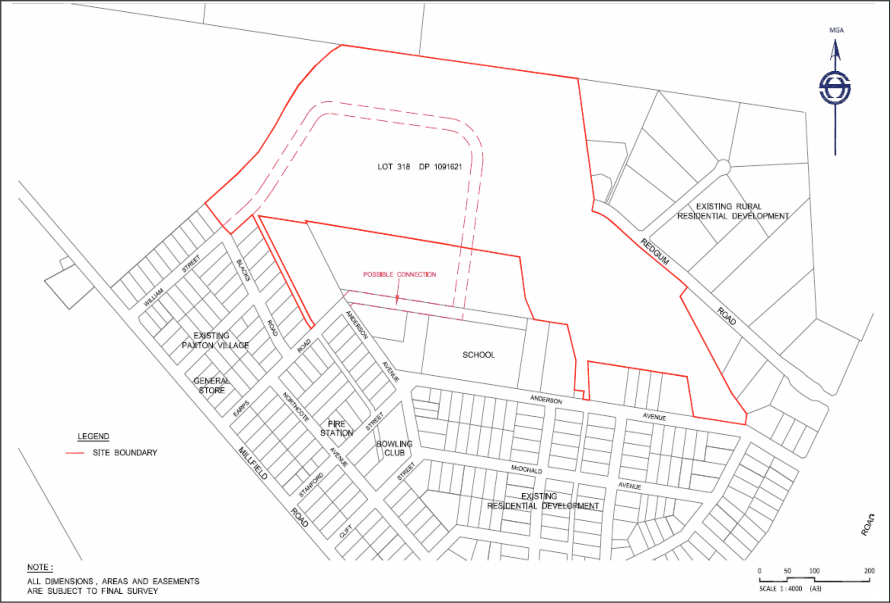

## 1 Staging Plan

All development applications for subdivisions shall include a staging plan, where the development is intended to be released sequentially.

> [Picture on page 2: a picture, saved as a picture (images/part-f3-paxton-north-page-2-8.gif, 150 dpi).]

#### Figure 1: Precinct Plan and Road Hierarchy
