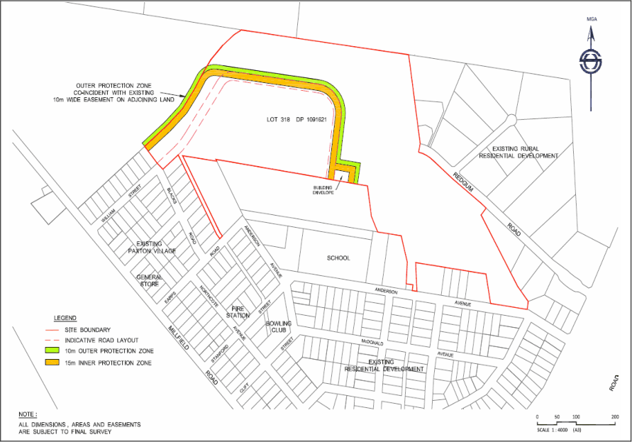

## 6 Amelioration of Natural and Environmental Hazards

Natural Hazards

#### Bushfire

Due to the geographical location of the site it is necessary in accordance with the NSW Rural Fire Service ‘Planning for Bushfire Protection 2001’ (PBP 2001) to implement APZ’s.  The configuration of the APZ’s (as can been seen on Figure 2) are derived from direct application of the PBP 2001 criteria.  Any deviation from this criteria would have to be clarified and accepted by the NSW Rural Fire Service.

#### Outer Protection Area (OPA)

The OPA (10m) is located adjacent to the hazard and would have originally been part of the hazard but has become an area where the fuel loadings are reduced.  This fuel reduction substantially decreases the intensity of an approaching fire and restricts the pathways to crown fuels, thereby reducing the level of direct flame, radiant heat and ember attack on the IPA.

#### Inner Protection Area (IPA)

The IPA (30m) extends from the edge of the OPA to the development, and ensures that the presence of fuels are minimised close to a development, thereby minimising the impact of direct flame contact and radiant heat upon the development. The performance of the IPA must be such that:

there is minimal fine fuel at ground level which could be set alight by a bushfire; and any vegetation in the IPA does not provide a path for the transfer of fire to the development – that is, the fuels are discontinuous.

The presence of a few shrubs or trees in the IPA is acceptable provided that they:

do not touch or overhang any buildings; are well spread out and do not form a continuous canopy; are not species that retain dead material or deposit excessive quantities of ground fuel in a short period or in a danger period; and are located far enough away from any dwelling so that they will not ignite the dwelling by direct flame contact or radiant heat emission.

Woodpiles, wooden sheds, combustible material storage areas, large areas / quantities of garden mulch, stacked flammable building materials etc. should not be permitted in the IPA, although the IPA can include lawns, discontinuous gardens, swimming pools, driveways and unattached garages.  The perimeter road surrounding the RU5 - Village zone will be included as part of the Inner Protection Area for the APZ.

#### Ongoing Fuel Management

Once an appropriate APZ has been created, ongoing maintenance is required to ensure that regrowth and fuel load replacement does not occur.  This will be the responsibility of the landowner and it is usual for such responsibility to be detailed in

CESSNOCK DEVELOPMENT CONTROL PLAN (2010)

F.3 - 3

Part F - Urban Release Areas

the appropriate Conditions of Consent, such as in the Section 88b Certificate. In this case, it is expected that the maintenance of the proposed APZ’s will become the responsibility of the individual lot owner.

> [Picture on page 4: a picture, saved as a picture (images/part-f3-paxton-north-page-4-5.gif, 150 dpi).]

#### Figure 2: Concept Plan

Environmental Hazards

There are no specific requirements in this regard.
