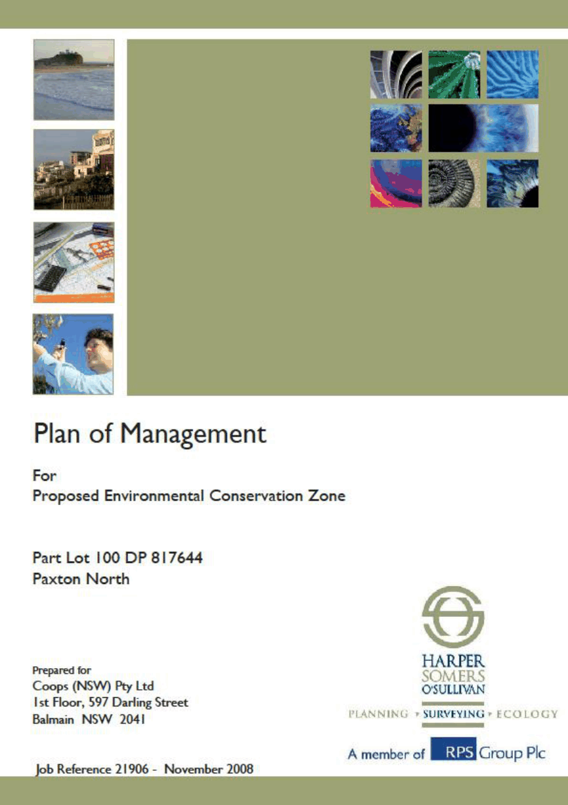
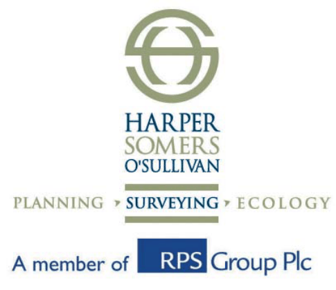
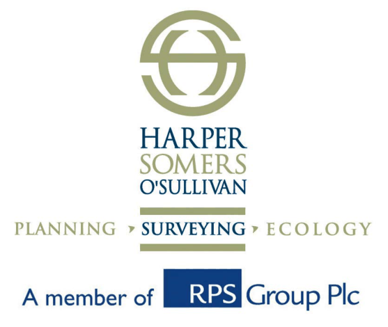
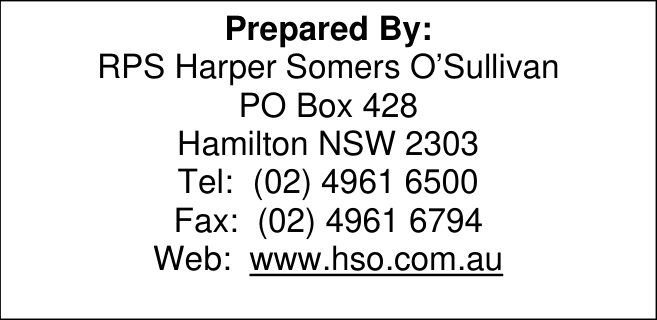

## 10 Provision of Public Facilities and Services

There are no specific requirements for this Precinct.

CESSNOCK DEVELOPMENT CONTROL PLAN (2010)

F.3 - 5

Part F - Urban Release Areas

### APPENDIX A

> [Picture on page 6: a picture, saved as a picture (images/part-f3-paxton-north-page-6-3.gif, 150 dpi).]

CESSNOCK DEVELOPMENT CONTROL PLAN (2010)

F.3 - 6

### Plan of Management

### For Proposed Environmental Conservation Zone

### Part Lot 100 DP 817644 Paxton North

Prepared for

#### Coops (NSW) Pty Ltd 1st Floor, 597 Darling Street Balmain  NSW  2041

#### Job Reference 21906 -  November 2008

> [Picture on page 7: a picture, saved as a picture (images/part-f3-paxton-north-page-7-11.gif, 150 dpi).]

> [Picture on page 8: a picture, saved as a picture (images/part-f3-paxton-north-page-8-1.gif, 150 dpi).]

> [Picture on page 8: a picture, saved as a picture (images/part-f3-paxton-north-page-8-2.gif, 150 dpi).]

### Prepared By:

### RPS Harper Somers O’Sullivan

### PO Box 428 Hamilton NSW 2303 Tel:   (02) 4961 6500 Fax:  (02) 4961 6794 Web:  www.hso.com.au

| PROJECT: PLAN OF MANAGEMENT – E2 ENVIRONMENTAL CONSERVATION ZONE – PAXTON NORTH |  |
|---|---|
| CLIENT: | COOPS (NSW) PTY LTD |
| OUR REF | 21502 |
| DATE: | NOVEMBER 2008 |
| APPROVED BY: | MATHEW WILKINSON |
| SIGNATURE: |  |
| CHECKED BY: | ROB DWYER |
| SIGNATURE: |  |

PREPARED BY RPS HARPER SOMERS O’SULLIVAN

| CONTENTS |  |
|---|---|
| 1 | INTRODUCTION ..................................................................................................1 1.1 Name and Status of Plan...............................................................................1 1.2 Land to which this Plan of Management Applies...........................................1 1.3 Aims and Objectives......................................................................................3 1.4 Relationship to Other Planning Instruments ..................................................3 1.5 Application of the Plan...................................................................................3 |
| 2 | ABORIGINAL HERITAGE VALUES .....................................................................4 |
| 3 | ECOLOGICAL VALUES .......................................................................................4 3.1 Threatened and Endangered Species...........................................................4 |
| 4 | BUSHFIRE HAZARD REDUCTION......................................................................5 |
| 5 | MANAGEMENT OBJECTIVES.............................................................................6 5.1 Ecological ......................................................................................................6 5.2 Aboriginal Heritage ........................................................................................9 |
| 6 | MANAGEMENT CONTROLS ...............................................................................9 6.1 Overview........................................................................................................9 6.2 Access ...........................................................................................................9 6.3 Weed Control and Bushland Rehabilitation.................................................10 6.4 Erosion Control and Water Quality Management ........................................11 6.5 Pest Control.................................................................................................11 6.6 Domestic Pest Control.................................................................................12 6.7 Fire...............................................................................................................12 6.8 Adjacent Development.................................................................................13 |
| 7 | MANAGEMENT FRAMEWORK .........................................................................14 7.1 Actions.........................................................................................................14 7.2 Responsibility...............................................................................................15 7.3 Monitoring....................................................................................................15 7.4 Adaptive Management Procedures .............................................................15 |
| 8 | MANAGEMENT MATRIX....................................................................................16 |
| FIGURES |  |
| Figure 1-1: E2 Environmental Conservation ................................................................2 |  |
| TABLES |  |
| Table 8-1: Management Matrix ..................................................................................17 |  |

PREPARED BY RPS HARPER SOMERS O’SULLIVAN
