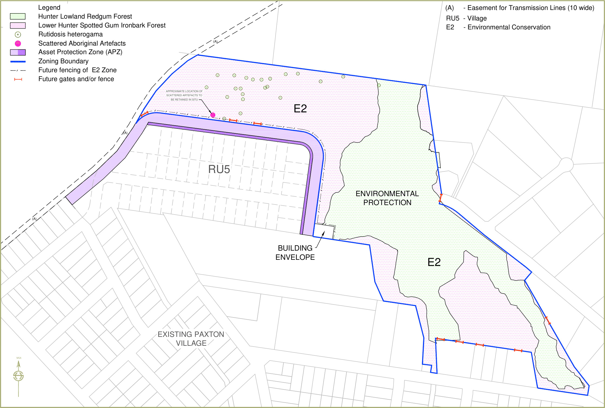

## 1 INTRODUCTION

### 1.1 Name and Status of Plan

This Plan is called the “Plan of Management” for lands within the Paxton North E2 Environmental Protection zone.

The Plan consists of a written statement, a map identifying the land to which the Plan of Management Applies and a range of management procedures to be implemented for this land.

This Plan of Management was prepared in accordance with the requirements of NSW Department of Environment Climate Change (DECC) and Cessnock City Council.

This Plan of Management has been prepared to assist the rezoning process of land at Part Lot 100 DP 817644 Paxton North and in particular to ensure the environmental qualities of the site are maintained.

### 1.2 Land to which this Plan of Management Applies

This Plan of Management applies to land proposed to be rezoned E2 Environmental Conservation as part of the proposed rezoning of Part Lot 100 DP 817644, Paxton. The land is located directly north of the village of Paxton.

The proposed E2 Environmental Conservation zone is situated around the north, north-east, and east of the proposed urban development’s perimeter road, which is illustrated in Figure 1-1.

> [Picture on page 11: a map, saved as a picture (images/part-f3-paxton-north-page-11-1.gif, 150 dpi); the street names and other small labels are on the picture.]
> Words printed on the picture (title and legend, copied from the PDF):
> (A)     - Easement for Transmission Lines (10 wide)
> RU5  - Village
> E2     - Environmental Conservation
> Hunter Lowland Redgum Forest
> Lower Hunter Spotted Gum Ironbark Forest
> Scattered Aboriginal Artefacts
> Asset Protection Zone (APZ)
> Future fencing of  E2 Zone
> Future gates and/or fence
> APPROXIMATE LOCATION OF
> SCATTERED ARTEFACTS TO
> BE RETAINED IN SITU

### E2

### RU5

#### ENVIRONMENTAL PROTECTION

#### BUILDING ENVELOPE

### E2

#### EXISTING PAXTON VILLAGE

SCALE:

1 : 3000 (A3)

REF:

21906-2C FIG 1-1  MW/LS

DATE:

1 DECEMBER 2008

CLIENT:

COOPS (NSW) PTY LTD

#### T:  02  4961  6500   F:  02  4961  6794   241  DENISON  STREET  BROADMEADOW

making a difference

#### PO  BOX  428  HAMILTON  NSW  2303    WWW.RPSHSO.COM.AU

creativepeople

TITLE:

FIGURE 1-1 : SITE ANALYSIS PLAN LOT 318, DP  1091621  PAXTON NORTH

### 1.3 Aims and Objectives

The principal objectives of this Plan of Management are to:

• Identify relevant threatened species, endangered ecological communities and habitats;

• Identify areas of Aboriginal heritage significance and implement controls to manage these sites;

• Identify actions in relation to management and protection of conservation lands;

• Implement regular reviews of the effectiveness of the management arrangements;

• Identify actions for the design and implementation of appropriate adaptive management responses;

### 1.4 Relationship to Other Planning Instruments

Cessnock City Council (CCC) is preparing a Draft Comprehensive Local Environmental Plan for the Cessnock Local Government Area (LGA). CCC has requested this Draft Plan of Management be prepared to be exhibited with Council’s Draft Comprehensive Local Environmental Plan.

This Draft Plan of Management will only come into effect with Council’s approval. CCC’s new Local Environmental Plan will outline permissible development within various zonings, including the E2 Environmental Conservation.

### 1.5 Application of the Plan

The proposed E2 Environmental Conservation land subject to this Plan of Management will remain in private ownership, and have one dwelling entitlement. This landowner will be required to ensure management and monitoring of the land is in accordance with measures in this Plan.

This Plan of Management is the overarching management strategy for the proposed

E2 Environmental Conservation zone.
