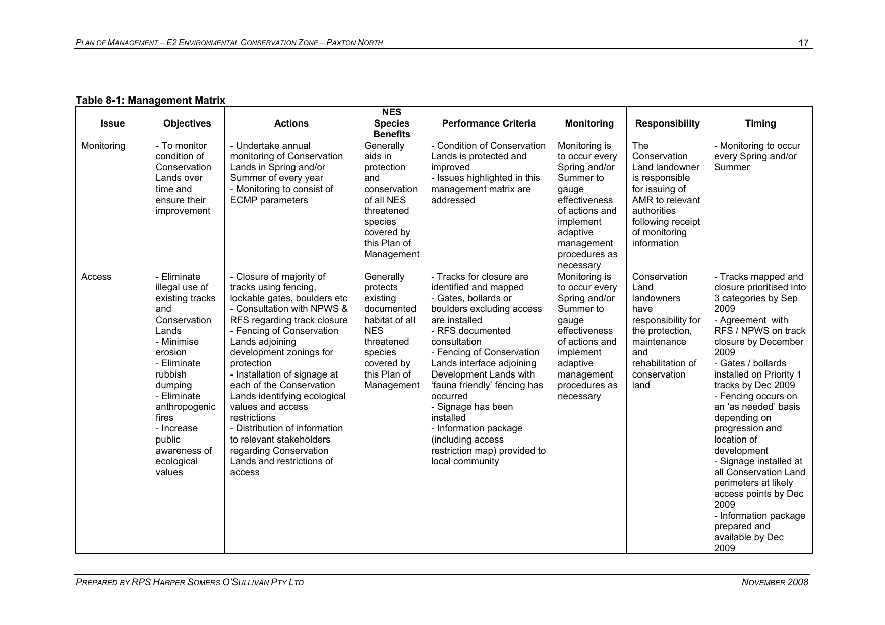
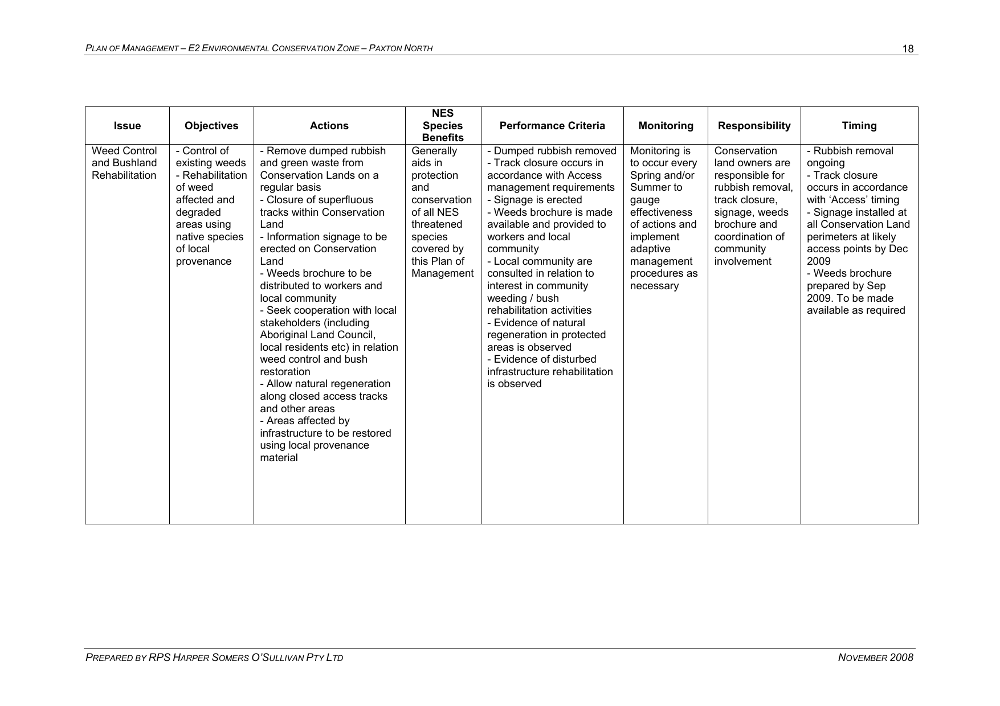
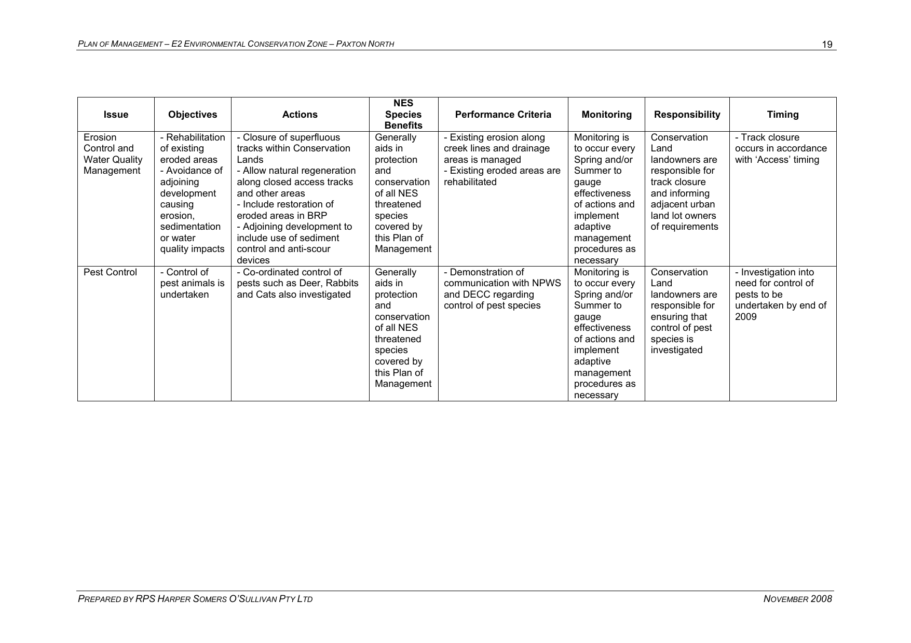
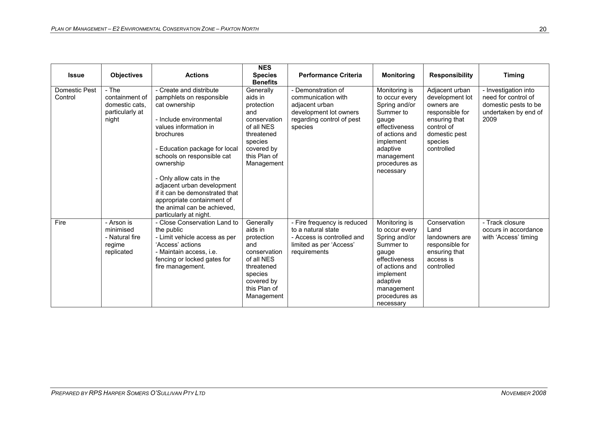
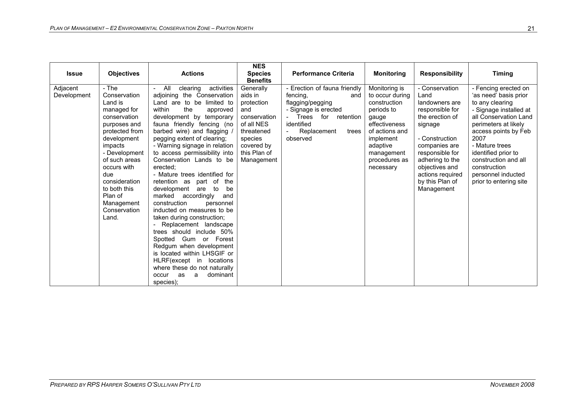
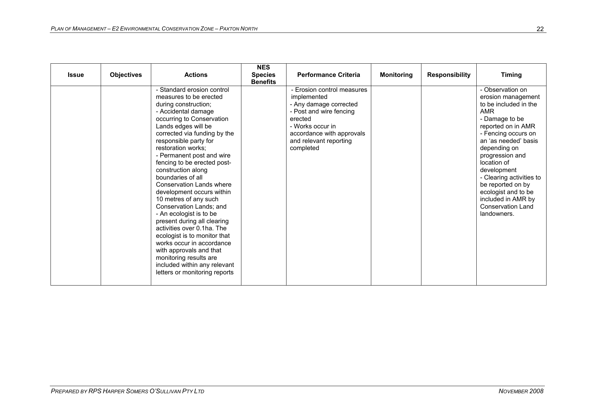

## 8 MANAGEMENT MATRIX

The management matrix provides a table that collates the information provided in this CLCMP into a concise package. This matrix identifies the proposed objectives, actions, review, adaptive management and reporting requirements and timing (if possible) of these.

> [Picture of page 26: a large table printed sideways, saved as a picture (images/part-f3-paxton-north-page-26.gif, 150 dpi) so its rows and columns stay readable.]

> Words printed in the table (copied from the PDF line by line, columns separated by |):
> PLAN OF MANAGEMENT – E2 ENVIRONMENTAL CONSERVATION ZONE – PAXTON NORTH | 17
> Table 8-1: Management Matrix
> NES
> Issue | Objectives | Actions | Species | Performance Criteria | Monitoring | Responsibility | Timing
> Benefits
> Monitoring | - To monitor | - Undertake annual | Generally | - Condition of Conservation | Monitoring is | The | - Monitoring to occur
> condition of | monitoring of Conservation | aids in | Lands is protected and | to occur every | Conservation | every Spring and/or
> Conservation | Lands in Spring and/or | protection | improved | Spring and/or | Land landowner | Summer
> Lands over | Summer of every year | and | - Issues highlighted in this | Summer to | is responsible
> time and | - Monitoring to consist of | conservation | management matrix are | gauge | for issuing of
> ensure their | ECMP parameters | of all NES | addressed | effectiveness | AMR to relevant
> improvement | threatened | of actions and | authorities
> species | implement | following receipt
> covered by | adaptive | of monitoring
> this Plan of | management | information
> Management | procedures as
> necessary
> Access | - Eliminate | - Closure of majority of | Generally | - Tracks for closure are | Monitoring is | Conservation | - Tracks mapped and
> illegal use of | tracks using fencing, | protects | identified and mapped | to occur every | Land | closure prioritised into
> existing tracks | lockable gates, boulders etc | existing | - Gates, bollards or | Spring and/or | landowners | 3 categories by Sep
> and | - Consultation with NPWS & | documented | boulders excluding access | Summer to | have | 2009
> Conservation | RFS regarding track closure | habitat of all | are installed | gauge | responsibility for | - Agreement with
> Lands | - Fencing of Conservation | NES | - RFS documented | effectiveness | the protection, | RFS / NPWS on track
> - Minimise | Lands adjoining | threatened | consultation | of actions and | maintenance | closure by December
> erosion | development zonings for | species | - Fencing of Conservation | implement | and | 2009
> - Eliminate | protection | covered by | Lands interface adjoining | adaptive | rehabilitation of | - Gates / bollards
> rubbish | - Installation of signage at | this Plan of | Development Lands with | management | conservation | installed on Priority 1
> dumping | each of the Conservation | Management | ‘fauna friendly’ fencing has | procedures as | land | tracks by Dec 2009
> - Eliminate | Lands identifying ecological | occurred | necessary | - Fencing occurs on
> anthropogenic | values and access | - Signage has been | an ‘as needed’ basis
> fires | restrictions | installed | depending on
> - Increase | - Distribution of information | - Information package | progression and
> public | to relevant stakeholders | (including access | location of
> awareness of | regarding Conservation | restriction map) provided to | development
> ecological | Lands and restrictions of | local community | - Signage installed at
> values | access | all Conservation Land
> perimeters at likely
> access points by Dec
> 2009
> - Information package
> prepared and
> available by Dec
> 2009
> PREPARED BY RPS HARPER SOMERS O’SULLIVAN PTY LTD | NOVEMBER 2008

> [Picture of page 27: a large table printed sideways, saved as a picture (images/part-f3-paxton-north-page-27.gif, 150 dpi) so its rows and columns stay readable.]

> Words printed in the table (copied from the PDF line by line, columns separated by |):
> PLAN OF MANAGEMENT – E2 ENVIRONMENTAL CONSERVATION ZONE – PAXTON NORTH | 18
> NES
> Issue | Objectives | Actions | Species | Performance Criteria | Monitoring | Responsibility | Timing
> Benefits
> Weed Control | - Control of | - Remove dumped rubbish | Generally | - Dumped rubbish removed | Monitoring is | Conservation | - Rubbish removal
> and Bushland | existing weeds | and green waste from | aids in | - Track closure occurs in | to occur every | land owners are | ongoing
> Rehabilitation | - Rehabilitation | Conservation Lands on a | protection | accordance with Access | Spring and/or | responsible for | - Track closure
> of weed | regular basis | and | management requirements | Summer to | rubbish removal, | occurs in accordance
> affected and | - Closure of superfluous | conservation | - Signage is erected | gauge | track closure, | with ‘Access’ timing
> degraded | tracks within Conservation | of all NES | - Weeds brochure is made | effectiveness | signage, weeds | - Signage installed at
> areas using | Land | threatened | available and provided to | of actions and | brochure and | all Conservation Land
> native species | - Information signage to be | species | workers and local | implement | coordination of | perimeters at likely
> of local | erected on Conservation | covered by | community | adaptive | community | access points by Dec
> provenance | Land | this Plan of | - Local community are | management | involvement | 2009
> - Weeds brochure to be | Management | consulted in relation to | procedures as | - Weeds brochure
> distributed to workers and | interest in community | necessary | prepared by Sep
> local community | weeding / bush | 2009. To be made
> - Seek cooperation with local | rehabilitation activities | available as required
> stakeholders (including | - Evidence of natural
> Aboriginal Land Council, | regeneration in protected
> local residents etc) in relation | areas is observed
> weed control and bush | - Evidence of disturbed
> restoration | infrastructure rehabilitation
> - Allow natural regeneration | is observed
> along closed access tracks
> and other areas
> - Areas affected by
> infrastructure to be restored
> using local provenance
> material
> PREPARED BY RPS HARPER SOMERS O’SULLIVAN PTY LTD | NOVEMBER 2008

> [Picture of page 28: a large table printed sideways, saved as a picture (images/part-f3-paxton-north-page-28.gif, 150 dpi) so its rows and columns stay readable.]

> Words printed in the table (copied from the PDF line by line, columns separated by |):
> PLAN OF MANAGEMENT – E2 ENVIRONMENTAL CONSERVATION ZONE – PAXTON NORTH | 19
> NES
> Issue | Objectives | Actions | Species | Performance Criteria | Monitoring | Responsibility | Timing
> Benefits
> Erosion | - Rehabilitation | - Closure of superfluous | Generally | - Existing erosion along | Monitoring is | Conservation | - Track closure
> Control and | of existing | tracks within Conservation | aids in | creek lines and drainage | to occur every | Land | occurs in accordance
> Water Quality | eroded areas | Lands | protection | areas is managed | Spring and/or | landowners are | with ‘Access’ timing
> Management | - Avoidance of | - Allow natural regeneration | and | - Existing eroded areas are | Summer to | responsible for
> adjoining | along closed access tracks | conservation | rehabilitated | gauge | track closure
> development | and other areas | of all NES | effectiveness | and informing
> causing | - Include restoration of | threatened | of actions and | adjacent urban
> erosion, | eroded areas in BRP | species | implement | land lot owners
> sedimentation | - Adjoining development to | covered by | adaptive | of requirements
> or water | include use of sediment | this Plan of | management
> quality impacts | control and anti-scour | Management | procedures as
> devices | necessary
> Pest Control | - Control of | - Co-ordinated control of | Generally | - Demonstration of | Monitoring is | Conservation | - Investigation into
> pest animals is | pests such as Deer, Rabbits | aids in | communication with NPWS | to occur every | Land | need for control of
> undertaken | and Cats also investigated | protection | and DECC regarding | Spring and/or | landowners are | pests to be
> and | control of pest species | Summer to | responsible for | undertaken by end of
> conservation | gauge | ensuring that | 2009
> of all NES | effectiveness | control of pest
> threatened | of actions and | species is
> species | implement | investigated
> covered by | adaptive
> this Plan of | management
> Management | procedures as
> necessary
> PREPARED BY RPS HARPER SOMERS O’SULLIVAN PTY LTD | NOVEMBER 2008

> [Picture of page 29: a large table printed sideways, saved as a picture (images/part-f3-paxton-north-page-29.gif, 150 dpi) so its rows and columns stay readable.]

> Words printed in the table (copied from the PDF line by line, columns separated by |):
> PLAN OF MANAGEMENT – E2 ENVIRONMENTAL CONSERVATION ZONE – PAXTON NORTH | 20
> NES
> Issue | Objectives | Actions | Species | Performance Criteria | Monitoring | Responsibility | Timing
> Benefits
> Domestic Pest | - The | - Create and distribute | Generally | - Demonstration of | Monitoring is | Adjacent urban | - Investigation into
> Control | containment of | pamphlets on responsible | aids in | communication with | to occur every | development lot | need for control of
> domestic cats, | cat ownership | protection | adjacent urban | Spring and/or | owners are | domestic pests to be
> particularly at | and | development lot owners | Summer to | responsible for | undertaken by end of
> night | - Include environmental | conservation | regarding control of pest | gauge | ensuring that | 2009
> values information in | of all NES | species | effectiveness | control of
> brochures | threatened | of actions and | domestic pest
> species | implement | species
> - Education package for local | covered by | adaptive | controlled
> schools on responsible cat | this Plan of | management
> ownership | Management | procedures as
> necessary
> - Only allow cats in the
> adjacent urban development
> if it can be demonstrated that
> appropriate containment of
> the animal can be achieved,
> particularly at night.
> Fire | - Arson is | - Close Conservation Land to | Generally | - Fire frequency is reduced | Monitoring is | Conservation | - Track closure
> minimised | the public | aids in | to a natural state | to occur every | Land | occurs in accordance
> - Natural fire | - Limit vehicle access as per | protection | - Access is controlled and | Spring and/or | landowners are | with ‘Access’ timing
> regime | ‘Access’ actions | and | limited as per ‘Access’ | Summer to | responsible for
> replicated | - Maintain access, i.e. | conservation | requirements | gauge | ensuring that
> fencing or locked gates for | of all NES | effectiveness | access is
> fire management. | threatened | of actions and | controlled
> species | implement
> covered by | adaptive
> this Plan of | management
> Management | procedures as
> necessary
> PREPARED BY RPS HARPER SOMERS O’SULLIVAN PTY LTD | NOVEMBER 2008

> [Picture of page 30: a large table printed sideways, saved as a picture (images/part-f3-paxton-north-page-30.gif, 150 dpi) so its rows and columns stay readable.]

> Words printed in the table (copied from the PDF line by line, columns separated by |):
> PLAN OF MANAGEMENT – E2 ENVIRONMENTAL CONSERVATION ZONE – PAXTON NORTH | 21
> NES
> Issue | Objectives | Actions | Species | Performance Criteria | Monitoring | Responsibility | Timing
> Benefits
> Adjacent | - The | - All clearing activities | Generally | - Erection of fauna friendly | Monitoring is | - Conservation | - Fencing erected on
> Development | Conservation | adjoining the Conservation | aids in | fencing, | and | to occur during | Land | ‘as need’ basis prior
> Land is | Land are to be limited to | protection | flagging/pegging | construction | landowners are | to any clearing
> managed for | within | the | approved | and | - Signage is erected | periods to | responsible for | - Signage installed at
> conservation | development by temporary | conservation | - Trees for retention | gauge | the erection of | all Conservation Land
> purposes and | fauna friendly fencing (no | of all NES | identified | effectiveness | signage | perimeters at likely
> protected from | barbed wire) and flagging / | threatened | - | Replacement | trees | of actions and | access points by Feb
> development | pegging extent of clearing; | species | observed | implement | - Construction | 2007
> impacts | - Warning signage in relation | covered by | adaptive | companies are | - Mature trees
> - Development | to access permissibility into | this Plan of | management | responsible for | identified prior to
> of such areas | Conservation Lands to be | Management | procedures as | adhering to the | construction and all
> occurs with | erected; | necessary | objectives and | construction
> due | - Mature trees identified for | actions required | personnel inducted
> consideration | retention as part of the | by this Plan of | prior to entering site
> to both this | development are to be | Management
> Plan of | marked accordingly and
> Management | construction | personnel
> Conservation | inducted on measures to be
> Land. | taken during construction;
> - Replacement landscape
> trees should include 50%
> Spotted Gum or Forest
> Redgum when development
> is located within LHSGIF or
> HLRF(except in locations
> where these do not naturally
> occur | as | a | dominant
> species);
> PREPARED BY RPS HARPER SOMERS O’SULLIVAN PTY LTD | NOVEMBER 2008

> [Picture of page 31: a large table printed sideways, saved as a picture (images/part-f3-paxton-north-page-31.gif, 150 dpi) so its rows and columns stay readable.]

> Words printed in the table (copied from the PDF line by line, columns separated by |):
> PLAN OF MANAGEMENT – E2 ENVIRONMENTAL CONSERVATION ZONE – PAXTON NORTH | 22
> NES
> Issue | Objectives | Actions | Species | Performance Criteria | Monitoring | Responsibility | Timing
> Benefits
> - Standard erosion control | - Erosion control measures | - Observation on
> measures to be erected | implemented | erosion management
> during construction; | - Any damage corrected | to be included in the
> - Accidental damage | - Post and wire fencing | AMR
> occurring to Conservation | erected | - Damage to be
> Lands edges will be | - Works occur in | reported on in AMR
> corrected via funding by the | accordance with approvals | - Fencing occurs on
> responsible party for | and relevant reporting | an ‘as needed’ basis
> restoration works; | completed | depending on
> - Permanent post and wire | progression and
> fencing to be erected post- | location of
> construction along | development
> boundaries of all | - Clearing activities to
> Conservation Lands where | be reported on by
> development occurs within | ecologist and to be
> 10 metres of any such | included in AMR by
> Conservation Lands; and | Conservation Land
> - An ecologist is to be | landowners.
> present during all clearing
> activities over 0.1ha. The
> ecologist is to monitor that
> works occur in accordance
> with approvals and that
> monitoring results are
> included within any relevant
> letters or monitoring reports
> PREPARED BY RPS HARPER SOMERS O’SULLIVAN PTY LTD | NOVEMBER 2008

PREPARED BY RPS HARPER SOMERS O’SULLIVAN
