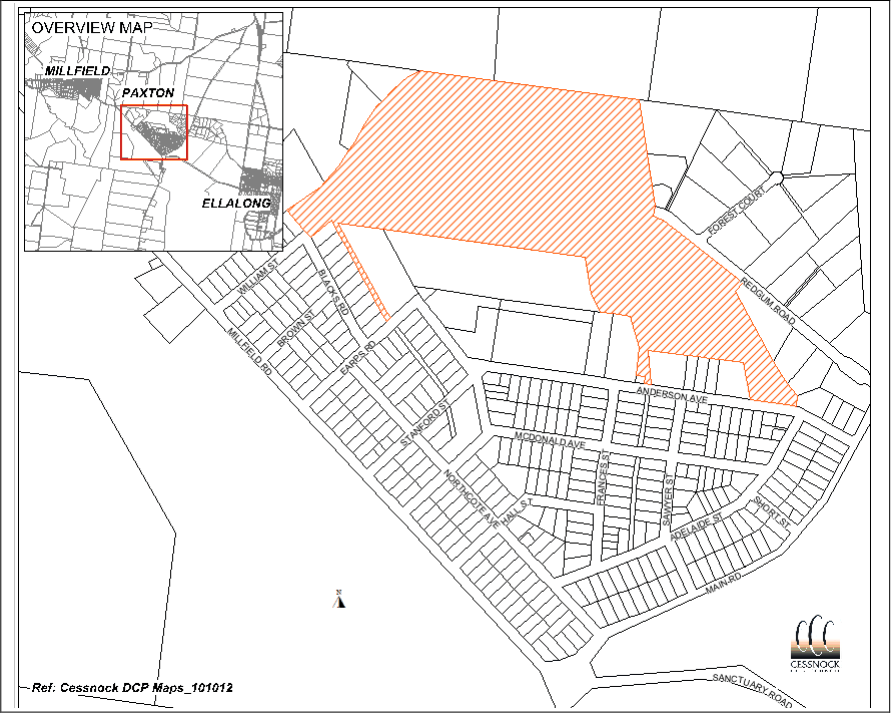

# Cessnock Development Control Plan 2010 - Part F3 Paxton North

> This chapter is split into 18 section file(s), one per numbered heading, in the order they appear in the PDF.

Source PDF: [Land-Use-Planning-_-Cessnock-DCP-2010-_-F3-Paxton-North-_-CCC-website-doc.pdf](https://planfortomorrow.sharepoint.com/sites/Planfortomorrow/Shared%20Documents/00%20NSW-Planning-Resources/dcp/cessnock-development-control-plan-2010/part-f3-paxton-north/Land-Use-Planning-_-Cessnock-DCP-2010-_-F3-Paxton-North-_-CCC-website-doc.pdf)

Part F - Urban Release Areas

### F.3 - Paxton North Urban Release Area

> [Picture on page 1: a picture, saved as a picture (images/part-f3-paxton-north-page-1-3.gif, 150 dpi).]

#### Description

The Paxton North Urban Release Area is located in the village of Paxton, directly north of Anderson Avenue and contains approximately 44.21 ha.  To the north and west, vacant land exists.  Stages 1 and 2 of the “Watagan Rise” subdivision are situated to the east.

Through the implementation of the Paxton North Urban Release Area, Cessnock City Council wishes to establish controls and guidelines to facilitate successful residential development that is of a high quality and considers the ecological importance of the

area.  It is envisaged that development on site will compliment the existing village structure and have minimal adverse impacts on the natural environment.

Specific landscape and visual amenity controls are included to ensure that the appearance of the development has regard for sustainable environmental management principles.

CESSNOCK DEVELOPMENT CONTROL PLAN (2010)

F.3 - 1

Part F - Urban Release Areas

#### Development Requirements

All development applications shall demonstrate consistency with the following requirements.

<!-- sections -->
## Sections

1. [1 Staging Plan](01-staging-plan.md)
2. [2 Transport Movement Hierarchy](02-transport-movement-hierarchy.md)
3. [3 Overall Landscaping Strategy](03-overall-landscaping-strategy.md)
4. [4 Passive and Active Recreational Areas](04-passive-and-active-recreational-areas.md)
5. [5 Stormwater and Water Quality Management Controls](05-stormwater-and-water-quality-management.md)
6. [6 Amelioration of Natural and Environmental Hazards](06-amelioration-of-natural-and.md)
7. [7 Significant Development Sites](07-significant-development-sites.md)
8. [8 Residential Densities](08-residential-densities.md)
9. [9 Neighbourhood Commercial and Retail Uses](09-neighbourhood-commercial-and-retail-uses.md)
10. [10 Provision of Public Facilities and Services](10-provision-of-public-facilities-and.md)
11. [1 INTRODUCTION](11-1-introduction.md)
12. [2 ABORIGINAL HERITAGE VALUES](12-2-aboriginal-heritage-values.md)
13. [3 ECOLOGICAL VALUES](13-3-ecological-values.md)
14. [4 BUSHFIRE HAZARD REDUCTION](14-4-bushfire-hazard-reduction.md)
15. [5 MANAGEMENT OBJECTIVES](15-5-management-objectives.md)
16. [6 MANAGEMENT CONTROLS](16-6-management-controls.md)
17. [7 MANAGEMENT FRAMEWORK](17-7-management-framework.md)
18. [8 MANAGEMENT MATRIX](18-8-management-matrix.md)
