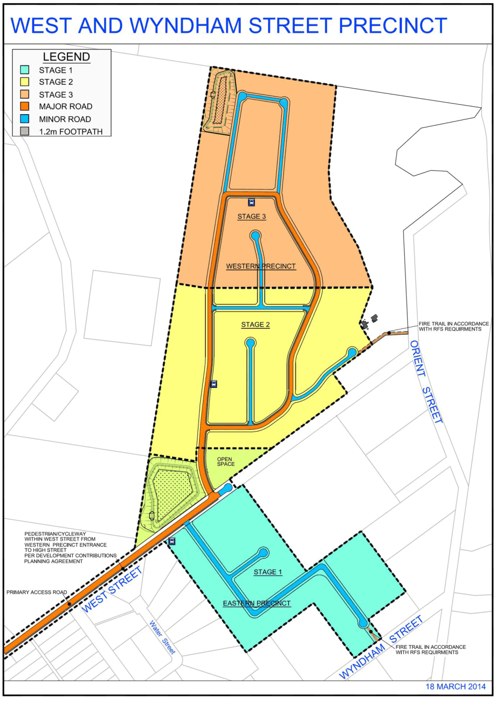

## 1 Staging Plan

All development applications for subdivisions shall include a staging plan, where the development is intended to be released sequentially. The development is to be staged from South to North in accordance with the Indicative Layout Plan at Figure 1. Prior to any subdivision of the site, West Street must be constructed to the satisfaction of Council.

> [Picture on page 3: a picture, saved as a picture (images/part-f4-west-wyndham-street-greta-page-3-1.gif, 150 dpi).]

#### Figure 1: Indicative Layout Plan
